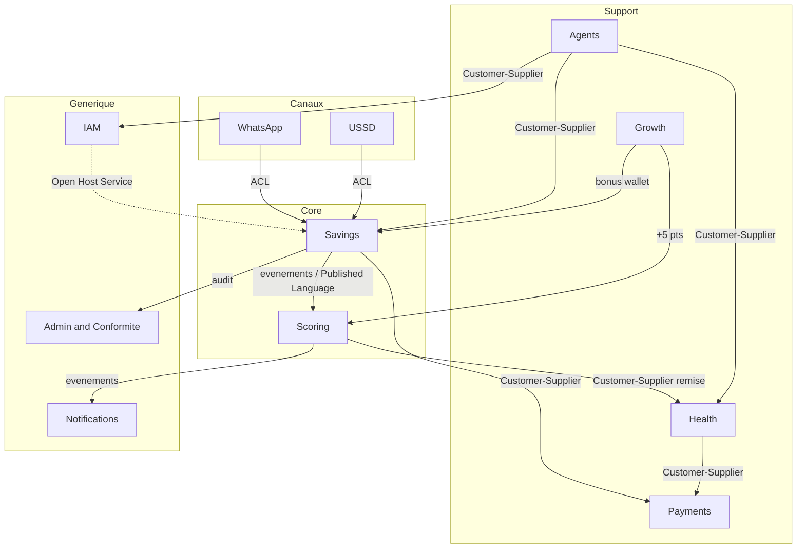

# KOTIZ — Context Map & Langage Ubiquitaire (DDD stratégique)

> Ce document est le socle **DDD stratégique** de KOTIZ. Il fixe :
>
> 1. les **bounded contexts** (frontières métier) et leur classification en sous-domaines,
> 2. la **context map** (qui parle à qui, avec quel pattern d'intégration),
> 3. le **langage ubiquitaire** par contexte (noms exacts des classes du code).
>
> Il **précède** et **alimente** l'ADR-011 (structure hexagonale + DDD tactique par module).
> Toute story métier (Epic 3+) doit s'y référer pour nommer ses classes et ses invariants.

---

## 1. Principes

- **Monolithe modulaire** conservé (cf. ADR-002) : 1 déploiement, N modules isolés — chaque
  module = 1 bounded context avec sa frontière de langage.
- **Convention de nommage** : terme métier en **français**, nom de code en **anglais**
  (aligné sur la règle projet « conversation FR / code EN »).
- **Classification des sous-domaines** — dicte l'effort DDD :
  - 🔴 **Core domain** : différenciateur concurrentiel → agrégats riches, invariants stricts, ATDD maximal.
  - 🟡 **Supporting** : spécifique KOTIZ mais pas différenciant → DDD tactique modéré.
  - ⚪ **Generic / Canal** : problème résolu / plomberie → enveloppe légère, pas de logique métier.

> ⚠️ Piège de nommage résolu : le module historiquement nommé `core` dans le HLD est renommé
> **`iam`** (Identity & Access Management). Ce n'est **pas** le _core domain_ : le vrai cœur métier
> est `savings` + `scoring`.

---

## 2. Les 11 bounded contexts

| #   | Contexte                           | Module            | Sous-domaine   | Effort DDD   |
| --- | ---------------------------------- | ----------------- | -------------- | ------------ |
| 1   | **Savings** (Épargne)              | `savings`         | 🔴 Core        | Maximal      |
| 2   | **Scoring** (Score 5⭐)            | `scoring`         | 🔴 Core        | Maximal      |
| 3   | **Agents**                         | `agents`          | 🟡 Supporting  | Moyen        |
| 4   | **Health** (Santé bundle J+1)      | `health`          | 🟡 Supporting  | Moyen        |
| 5   | **Payments** (Mobile Money)        | `payments`        | 🟡 Supporting  | Moyen        |
| 6   | **Growth** (viralité + anti-churn) | `growth` 🆕       | 🟡 Supporting  | Moyen        |
| 7   | **IAM** (Identité & Accès)         | `iam` (ex-`core`) | ⚪ Generic     | Faible-moyen |
| 8   | **Notifications**                  | `notifications`   | ⚪ Generic     | Minimal      |
| 9   | **Admin & Conformité**             | `admin`           | 🟡 Supporting* | Moyen        |
| 10  | **WhatsApp** (canal)               | `wa`              | ⚪ Canal (ACL) | Faible       |
| 11  | **USSD** (canal)                   | `ussd` 🆕         | ⚪ Canal (ACL) | Faible       |

\* _Admin & Conformité est classé supporting : obligatoire, spécifique à la réglementation ivoirienne
(BCEAO / CENTIF), mais non différenciant._

**Décisions d'atelier (26 juin 2026) :**

1. `core` → renommé `iam` (évite la confusion avec le core domain).
2. `wa` et `ussd` sont de **vrais bounded contexts « canal »** avec ACL (pas de simples adaptateurs).
3. `Referral` (parrainage) sort d'`iam` pour former le contexte **`growth`** (viralité + anti-churn).

---

## 3. Context Map (relations & patterns d'intégration)

### Catalogue des relations

| De → Vers                                     | Pattern DDD                         | Sens concret                                                                         |
| --------------------------------------------- | ----------------------------------- | ------------------------------------------------------------------------------------ |
| WhatsApp / USSD → Savings, Scoring, IAM       | **ACL**                             | Traduit `solde`, `cotiser`, `score` en appels métier, sans polluer le langage core   |
| Savings → Payments                            | **Customer/Supplier**               | Savings commande le mouvement d'argent ; Payments l'exécute (ACL par prestataire MM) |
| Savings → Scoring                             | **Published Language** (événements) | `DepositMade`, `StreakBadgeEarned` consommés comme signaux                           |
| Agents → Savings / Health / IAM               | **Customer/Supplier**               | L'agent initie enrôlement (IAM), 1er dépôt (Savings), bundle J+1 (Health)            |
| Scoring → Health                              | **Customer/Supplier**               | Le palier ⭐ ouvre un tarif santé préférentiel (remise ≥ 4⭐)                        |
| Scoring → WhatsApp                            | Conformist                          | Voix TTS activée pour les clientes ≥ 2⭐                                             |
| Growth → Savings + Scoring                    | **Customer/Supplier**               | Parrainage : bonus wallet (Savings) + 5 pts (Scoring)                                |
| IAM → tous                                    | **Open Host Service**               | Identité / JWT via contrat stable                                                    |
| Tous → Admin & Conformité                     | **Conformist** (aval)               | Audit trail + données pour reporting BCEAO / STR CENTIF                              |
| Savings/Scoring/Health/Growth → Notifications | Published Language                  | Abonné aux événements ; sort _via_ le canal WhatsApp                                 |

---

## 4. Règles de langage (invariants globaux — testés en ATDD)

1. **`numericScore` (0–1000) est secret cliente.** Jamais affiché en UI ; seul `StarRating` (1–5⭐)
   est exposé. Le score numérique n'est ouvert qu'à l'API partenaires (IMF / assureurs).
   Frontière stricte du contexte `Scoring`.
2. **`Money` toujours en centimes entiers (devise XOF).** Interdiction absolue du `float` pour
   représenter de l'argent, partout dans le code.
3. **Idempotence des paiements obligatoire.** Tout ordre `payments_orders` porte une
   `idempotency_key` unique ; un rejeu produit le même résultat.
4. **Ledger immuable et équilibré.** `Σ débits = Σ crédits` à tout instant ; aucune écriture
   n'est modifiée ou supprimée (append-only).
5. **Data residency UEMOA.** Aucune donnée personnelle stockée hors UEMOA (cf. ADR-005).

---

## 5. Langage ubiquitaire par contexte

### 5.1 `Savings` (Épargne) — 🔴 core

| Terme métier            | Nom code         | Type DDD                | Définition / invariant                                 |
| ----------------------- | ---------------- | ----------------------- | ------------------------------------------------------ |
| Compte / Wallet         | `SavingsAccount` | Agrégat racine          | Détient le solde. `solde = Σ écritures ledger`         |
| Écriture                | `LedgerEntry`    | Value Object (immuable) | Ligne double-entrée. Global : `Σ débits = Σ crédits`   |
| Montant                 | `Money`          | Value Object            | FCFA en `*_cents` (BIGINT), devise XOF, jamais `float` |
| Transaction / Mouvement | `Transaction`    | Entité                  | Dépôt / retrait / intérêt → ≥ 2 `LedgerEntry`          |
| Dépôt (cotisation)      | `Deposit`        | Concept + événement     | Min. 100 FCFA                                          |
| Retrait                 | `Withdrawal`     | Concept + événement     | —                                                      |
| Objectif nommé          | `SavingsGoal`    | Entité                  | Max **3 actifs**/user (trigger PG)                     |
| Verrouillage            | `GoalLock`       | Value Object            | Jusqu'à date cible ; déblocage anticipé → malus Score  |
| Série                   | `Streak`         | Value Object            | Jours consécutifs de dépôt ≥ 100 FCFA                  |
| Badge                   | `StreakBadge`    | Entité                  | Paliers 7/30/90 j → bonus `+5/+15/+30` pts             |

**Événements publiés** : `DepositMade`, `WithdrawalMade`, `GoalCreated`, `GoalReached`,
`GoalUnlockedEarly`, `StreakBadgeEarned`, `StreakBroken`.

### 5.2 `Scoring` (Score 5⭐) — 🔴 core

| Terme métier    | Nom code          | Type DDD                | Définition / invariant                                               |
| --------------- | ----------------- | ----------------------- | -------------------------------------------------------------------- |
| Score           | `Score`           | Agrégat racine (1/user) | Recalculé chaque nuit (00 h–04 h)                                    |
| Note numérique  | `numericScore`    | Value Object (0–1000)   | ⚠️ API partenaires uniquement (cf. règle 1)                          |
| Étoiles         | `StarRating`      | Value Object (1–5)      | Seule note montrée à la cliente                                      |
| Palier          | `Tier`            | Value Object            | Débutante / Régulière / Fiable / Confirmée / Premium                 |
| Composantes     | `ScoreComponents` | Value Object            | régularité 40 % · stabilité 25 % · ancienneté 20 % · engagement 15 % |
| Signal          | `ScoreSignal`     | Entité                  | Signal comportemental consommé des autres contextes                  |
| Avantage palier | `TierBenefit`     | Entité                  | `ACTIVE`/`EXPIRED`/`REVOKED` (si le score redescend)                 |
| Coup de pouce   | `ScoreBooster`    | Concept                 | +5 pts via parrainage (vient de `Growth`)                            |

**Codes avantages** : `RECAP_VOCAL` (2⭐), `PHONE_CONSULTATION` (3⭐), `HEALTH_DISCOUNT_10` (4⭐),
`CREDIT_PRIORITY` (5⭐), `TERRAIN_ELIGIBLE` (5⭐).
**Événements publiés** : `ScoreRecalculated`, `StarRatingChanged`, `TierBenefitActivated`,
`TierBenefitRevoked`.

### 5.3 `Agents` — 🟡 supporting

| Terme métier       | Nom code                               | Type DDD       | Note                                              |
| ------------------ | -------------------------------------- | -------------- | ------------------------------------------------- |
| Agent              | `Agent`                                | Agrégat racine | `agent_code` unique                               |
| Zone               | `AgentZone`                            | Entité         | Zone géographique                                 |
| Enrôlement / KYC   | `CustomerEnrollment`, `KYCDocument`    | Entités        | KYC Tier 1 auto < 5 min                           |
| Niveau KYC         | `KYCTier`                              | Value Object   | Tier 1 (photo CNI) / 2 (vérifiée) / 3 (biométrie) |
| Commission         | `Commission`                           | Entité         | Par période                                       |
| Cash-in / Cash-out | `CashInOperation` / `CashOutOperation` | Concept        | Cash ↔ wallet cliente                             |

**Événements** : `CustomerEnrolled`, `KYCTier1Validated`, `CashInCompleted`, `CashOutCompleted`,
`CommissionEarned`.

### 5.4 `Health` (bundle J+1) — 🟡 supporting

| Terme métier | Nom code             | Type DDD       | Note                                                         |
| ------------ | -------------------- | -------------- | ------------------------------------------------------------ |
| Police       | `HealthSubscription` | Agrégat racine | `id = numéro de police` ; `cancellation_deadline = now+24 h` |
| Formule      | `HealthPlan`         | Entité         | Famille / Confort / Premium (CIMA)                           |
| Prime        | `Premium`            | Value Object   | `weekly_premium_cents`, prélèvement J+1                      |
| Sinistre     | `Claim`              | Entité         | Déclaration manuelle (MVP)                                   |
| Partenaire   | `InsurancePartner`   | Entité         | Courtier CIMA (via ACL)                                      |
| Bundle J+1   | `BundleJ1`           | Concept        | Accepté en 2 clics, annulable 24 h sans frais/pénalité       |

**Événements** : `SubscriptionCreated`, `PremiumCharged`, `PremiumFailed`,
`SubscriptionCancelled24h`, `ClaimFiled`.

### 5.5 `Payments` (Mobile Money) — 🟡 supporting

| Terme métier      | Nom code          | Type DDD       | Note                                                    |
| ----------------- | ----------------- | -------------- | ------------------------------------------------------- |
| Ordre de paiement | `PaymentOrder`    | Agrégat racine | `idempotency_key` UNIQUE                                |
| Clé d'idempotence | `IdempotencyKey`  | Value Object   | Invariant : rejeu = même résultat                       |
| Callback          | `PaymentCallback` | Entité         | Webhook opérateur                                       |
| Prestataire       | `PaymentProvider` | Value Object   | OrangeMoney / Wave / MTN — 1 ACL (port) par prestataire |

**Événements** : `PaymentInitiated`, `PaymentConfirmed`, `PaymentFailed`.

### 5.6 `Growth` (viralité + anti-churn) — 🟡 supporting

| Terme métier     | Nom code          | Type DDD       | Note                                      |
| ---------------- | ----------------- | -------------- | ----------------------------------------- |
| Parrainage       | `Referral`        | Agrégat racine | `referral_code` unique (ex. `FATOU-X7K2`) |
| Bonus onboarding | `OnboardingBonus` | Value Object   | 200 FCFA à deux (FR-VI-02)                |
| Inactivité       | `InactivityEvent` | Entité         | Paliers 3/7/14/30 j ; `recovered_at`      |

**Événements** : `ReferralBonusApplied` (+5 pts → Scoring, bonus wallet → Savings),
`InactivityDetected`, `CustomerRecovered`.

### 5.7 `IAM` (Identité & Accès, ex-`core`) — ⚪ generic

`User` (agrégat racine) · `Role` (RBAC 8 rôles, SoD) · `Credential` (PIN 4 chiffres, OTP SMS,
biométrie optionnelle) · `Session` (JWT + refresh, Redis) · `Consent` (ARPD/RGPD) ·
`DataExportRequest`.
→ **Open Host Service** : fournit l'identité à tous.
**Événements** : `UserRegistered`, `PinSet`, `SessionRefreshed`, `ConsentGranted`.

### 5.8 `Notifications` — ⚪ generic

`Notification` / `NotificationQueue` (agrégat) · `Template` (approuvés Meta) ·
`WeeklyRecap` (`RecapWeeklyJob`, vendredi 19 h, image WhatsApp — FR-VI-03).
Consomme les événements de Savings / Scoring / Health / Growth.

### 5.9 `Admin & Conformité` — 🟡 supporting

`AuditTrail` (10 ans, recherche < 5 s) · `Report` (BCEAO / CENTIF) · `STRReport` (soupçon, ≤ 24 h) ·
`AMLAlert` · `KYCTier2QueueItem` · `SystemConfig`.
→ **Conformist** aval : consomme tout. Externes : CENTIF-CI, BCEAO.

### 5.10 `WhatsApp` (canal) — ⚪ ACL

`WaSession` (états, Redis TTL 10 min) · `Intent` VO (`solde`, `cotiser N`, `souscrire santé`,
`score`, `parrainer`, `aide`, `vocal on/off`) · `WaVoiceTranscript` (STT, MinIO TTL 24 h) ·
`VoiceMode` (TTS ≥ 2⭐).
Traduit les intents → `Savings` / `Scoring` / `IAM`.

### 5.11 `USSD` (canal) — ⚪ ACL

`UssdSession` · `UssdMenu` (menu 4 niveaux).
Contraintes : réponse ≤ 3 s P95, saisie ≤ 10 caractères.
**Exclusions** : pas de souscription santé ni d'objectif nommé (redirigés vers app / agent / WhatsApp).

---

## 6. Prochaines étapes

1. **ADR-011** — Structure hexagonale + DDD tactique par module, sur la base de cette context map
   (squelette type : `domain / application / infrastructure / adapters` par contexte).
2. **MAJ HLD v2** — remplacer « 9 modules fonctionnels isolés » par les 11 bounded contexts + la
   context map ci-dessus (avec renommage `core` → `iam`, ajout `growth` et `ussd`).
3. Référencer ce document dans chaque story métier (Epic 3+) pour le nommage et les invariants.

---

_Document produit en atelier guidé — 26 juin 2026. Source de vérité DDD stratégique de KOTIZ MVP._
