# Spec UX — Refonte des parcours, lot A : accès et accueil

Date : 19 octobre 2026. Statut : proposition à valider par le PO, mise à jour avec 7 décisions PO du 19 octobre 2026 (voir Décisions UX). Aucun écran haute fidélité, aucun code.

Sources : [brief refonte](brief.md) (fait foi), [PRODUCT.md](../../../PRODUCT.md), [PRD design v1.0](../prd-design-mvp.md) §3, §4, §4.1, §5, §8, §10, §11, §15, [registre métier](../../product/regles-metier-parcours-mvp.md), [matrice du socle](../matrice-couverture-socle.md), [inventaire lot A](../lot-a-inventaire-avant-production.md), [glossaire DDD](../../architecture/ddd-context-map-glossaire.md).

Script de test associé : [test-lot-a.md](test-lot-a.md).

Conventions : « à confirmer » = paramètre non tranché (gate G01 à G07 indiqué quand il existe). « Proposition non validée » = idée qui s'écarte d'une décision validée ; elle n'est pas appliquée dans les wireframes. Les noms, numéros et montants des wireframes sont fictifs.

## Hypothèses

- **H1 — Une seule porte d'entrée.** L'app ne demande pas « as-tu été invitée ? ». La cliente tape Créer mon compte ; après validation du code SMS, le système sait si son numéro a déjà une fiche créée par une agente (P4), un compte actif (P7) ou rien (P1). Elle n'a aucun choix technique à faire.
- **H2 — Existence du compte révélée après le code SMS.** On ne dit « ce numéro a déjà un compte » qu'une fois la possession du numéro prouvée. Le PRD laisse ce moment à confirmer (protection contre l'énumération, G02).
- **H3 — Téléphone habituel reconnu par l'app.** Si l'app reconnaît le téléphone pour ce compte, elle ouvre directement l'écran PIN (C01). Sinon elle ouvre l'écran Bienvenue (E01). Le mécanisme de reconnaissance est à confirmer (G02).
- **H4 — Invitation envoyée à la création de fiche.** Côté agente, la fiche créée déclenche le SMS d'invitation. Déclencheur, contenu, lien d'installation et validité de l'invitation : à confirmer (G02).
- **H5 — Reprise après interruption.** Si l'app est fermée en cours d'inscription, elle rouvre sur l'étape non terminée, sur le même téléphone. Les secrets (code SMS, PIN) ne sont jamais conservés : l'étape PIN recommence. Durée de conservation et validité du code : à confirmer.
- **H6 — Pas de file d'attente hors ligne dans le lot A.** Inscription, activation, connexion et création de fiche demandent le réseau. Hors ligne, la saisie est gardée et rien n'est envoyé en silence.
- **H7 — Direction 04 non réinspectée.** Le connecteur Figma n'a pas été utilisé dans cette session. Les wireframes de l'accueil reprennent la hiérarchie décrite dans l'inventaire (montant, QR, actions illustrées, épargnes, opérations). L'avis « garder / faire évoluer » reste à donner après inspection (question ouverte du brief).

## Vue d'ensemble

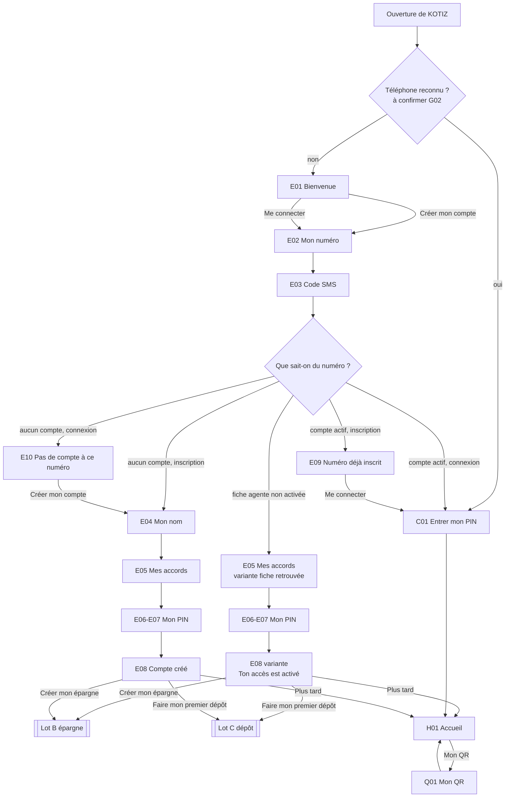

## Parcours

### P1 — Inscription autonome (critique)

Fatou ouvre KOTIZ pour la première fois et crée son compte seule.
Chemin principal : **8 écrans** (E01 → E02 → E03 → E04 → E05 → E06 → E07 → E08), soit 5 étapes numérotées entre l'entrée et le résultat.

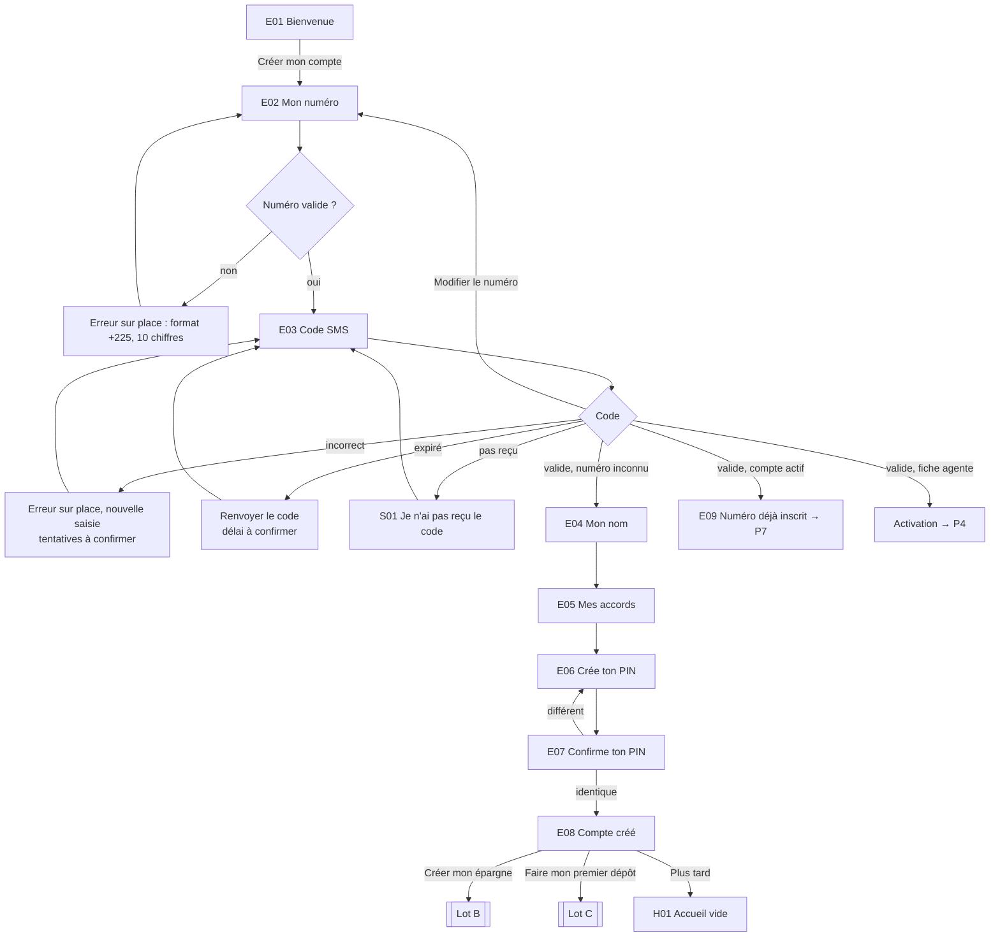

Sorties d'échec : pas de réseau (saisie gardée, Réessayer), code bloqué après trop d'essais (à confirmer : message et assistance, G02/G03), échec serveur à la création (Réessayer ; aucun compte annoncé tant que la création n'est pas confirmée).

### P2 — Cliente accompagnée sur son téléphone

Une agente est à côté de Fatou ; Fatou utilise son propre téléphone.
**Même parcours que P1, mêmes écrans, aucun doublon** : 8 écrans. L'agente explique ; Fatou saisit elle-même le code SMS, coche ses accords et crée son PIN.

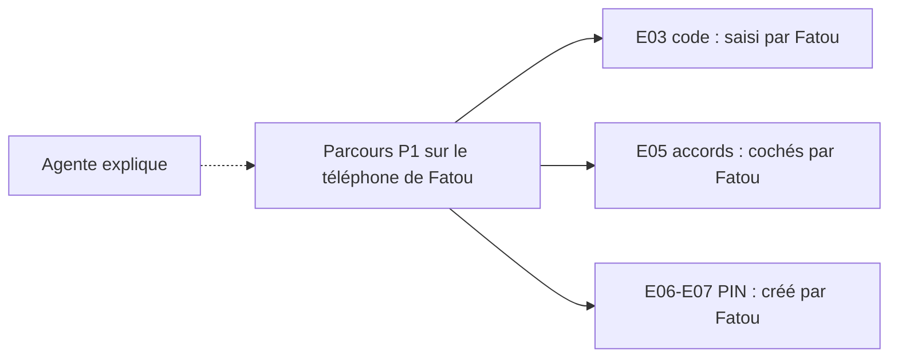

Différence observable unique : les écrans à secret (E03, E06, E07) portent la même mention pour toutes les clientes, « Ne le montre à personne, même à une agente ». Aucune bascule « mode accompagné » : l'app ne sait pas et n'a pas besoin de savoir qu'une agente est présente. Aucun rattachement n'est créé par cet accompagnement (accord distinct, lot E).

### P3 — Agente : Ajouter une cliente (départ côté agente)

L'agente crée une fiche pour une cliente qui activera son accès plus tard sur son propre téléphone. Le lot A ne spécifie que ce départ ; la liste Mes clientes et le reste de l'app agente sont hors périmètre.
Chemin principal : **3 écrans** spécifiés (A02 → A03 → A04), depuis le bouton Ajouter une cliente de Mes clientes.

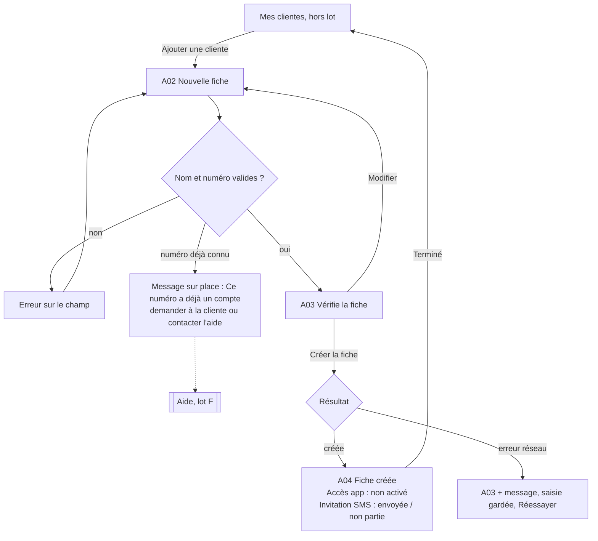

Ce que la fiche ne fait pas, et que l'écran dit : elle n'active pas l'accès de la cliente, ne donne pas accès à son solde, ne crée pas de rattachement. Aucune pièce d'identité dans cette séquence (KYC séparé).

### P4 — Activation personnelle sur le téléphone de la cliente

Fatou a une fiche créée par une agente. Elle reçoit un SMS d'invitation, ouvre KOTIZ et active son accès elle-même.
Chemin principal : **7 écrans** dans l'app (E01 → E02 → E03 → E05 variante → E06 → E07 → E08 variante), plus le SMS d'invitation hors app, puis H01 par Plus tard. Le nom n'est pas redemandé. Fin sur E08 « Ton accès est activé » : Décision PO du 19 octobre 2026.

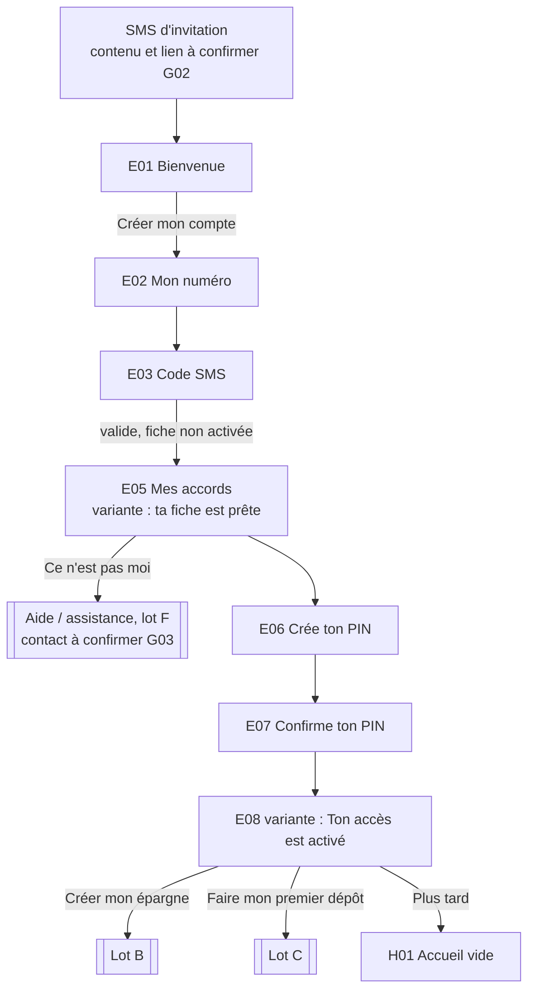

L'invitation seule n'active rien : sans code SMS, accords et PIN, la fiche reste « accès non activé ». La fin sur E08 en variante remplace le passage direct à l'accueil prévu par le PRD (Décision PO du 19 octobre 2026, ancienne proposition non validée n° 1).

### P5 — Connexion sur le téléphone habituel

Chemin principal : **2 écrans** (C01 → H01).

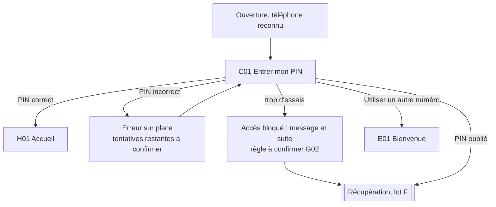

### P6 — Connexion sur un nouveau téléphone

Chemin principal : **5 écrans** (E01 → E02 → E03 → C01 → H01). Le code SMS prouve la possession du numéro ; il n'ouvre jamais le compte seul, le PIN reste demandé.

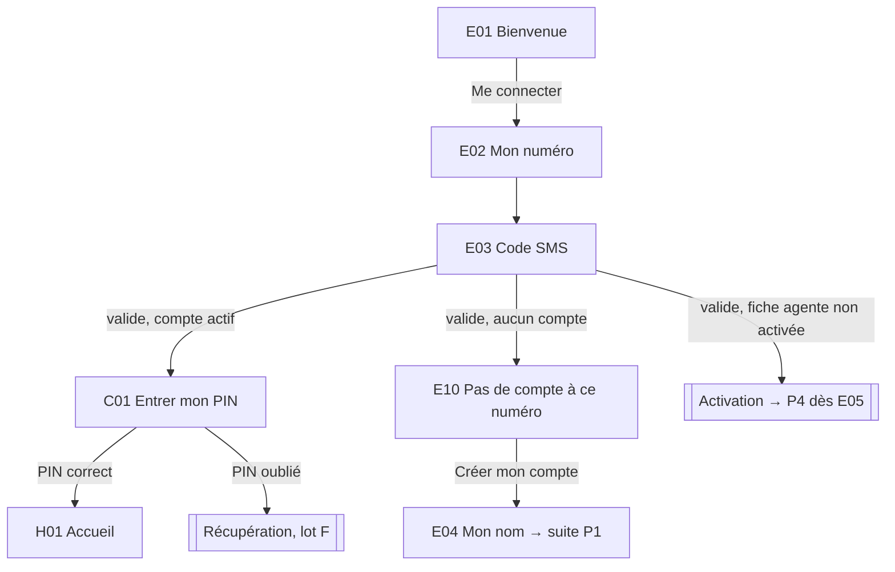

Anciennes sessions sur l'autre téléphone : traitement à confirmer (G02). Aucun message n'affirme qu'elles sont fermées.

### P7 — Numéro déjà inscrit

Fatou tente de créer un compte avec un numéro qui en a déjà un.
Chemin principal : **4 écrans** (E01 → E02 → E03 → E09), puis C01 (P5) ou récupération (lot F).

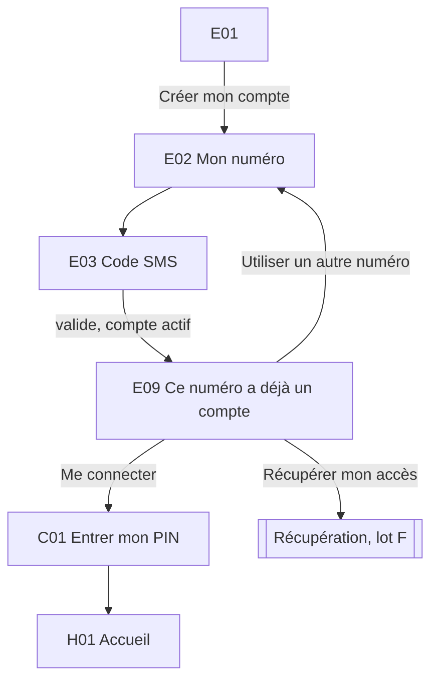

Aucun nom, solde, statut d'identité ou autre information n'est affiché sur E09. Aucun second compte n'est possible.

### P8 — Compte créé et ses trois sorties

Chemin principal : **2 écrans** (E08 → H01 par Plus tard) ; les deux autres sorties quittent le lot A. Même écran en fin d'activation (P4), variante « Ton accès est activé ».

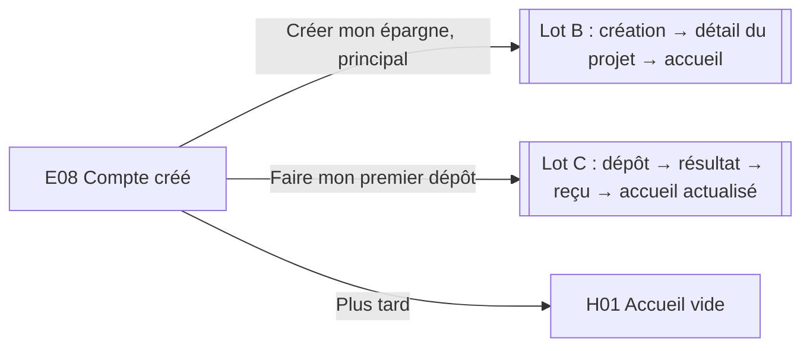

### P9 — Accueil : vide, rempli, montants masqués

Racine Accueil, avec la barre basse Accueil / Épargnes / Opérations / Profil. **1 écran** et ses états.

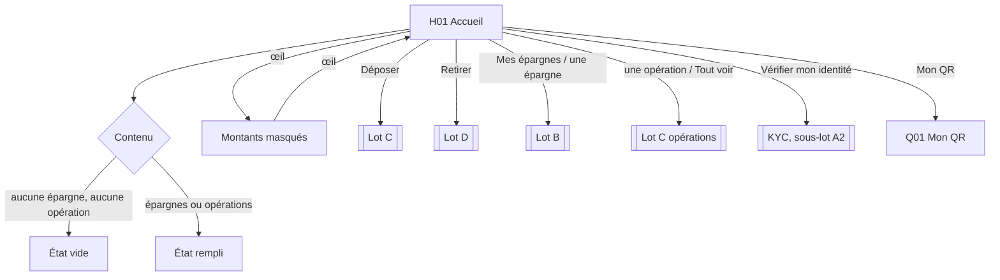

### P10 — Mon QR

Chemin principal : **2 écrans** (H01 → Q01 → retour H01).

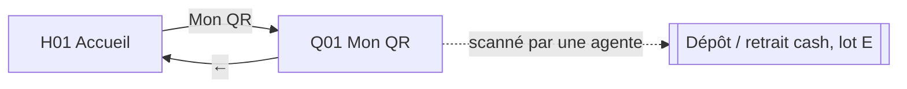

### Nombre d'écrans par parcours (chemin principal)

| Parcours                         | Écrans | Séquence                              |
| -------------------------------- | ------ | ------------------------------------- |
| P1 Inscription autonome          | 8      | E01 E02 E03 E04 E05 E06 E07 E08       |
| P2 Accompagnée sur son téléphone | 8      | identique à P1                        |
| P3 Agente : Ajouter une cliente  | 3      | A02 A03 A04 (depuis Mes clientes)     |
| P4 Activation personnelle        | 7      | E01 E02 E03 E05′ E06 E07 E08′ (+ SMS) |
| P5 Connexion téléphone habituel  | 2      | C01 H01                               |
| P6 Connexion nouveau téléphone   | 5      | E01 E02 E03 C01 H01                   |
| P7 Numéro déjà inscrit           | 4      | E01 E02 E03 E09 (puis C01 ou lot F)   |
| P8 Compte créé                   | 2      | E08 H01 (Plus tard)                   |
| P9 Accueil                       | 1      | H01 (vide / rempli / masqué)          |
| P10 Mon QR                       | 2      | H01 Q01                               |

## Carte des écrans

Barre basse : uniquement sur H01. Tous les autres écrans sont des pages poussées sans barre basse.

| ID  | Écran                              | Parcours           | Objectif                                                         |
| --- | ---------------------------------- | ------------------ | ---------------------------------------------------------------- |
| E01 | Bienvenue                          | P1 P2 P4 P6 P7     | Choisir entre créer un compte et se connecter                    |
| E02 | Mon numéro                         | P1 P2 P4 P6 P7     | Saisir le numéro qui recevra le code                             |
| E03 | Code SMS                           | P1 P2 P4 P6 P7     | Prouver qu'on possède ce numéro                                  |
| S01 | Je n'ai pas reçu le code (sheet)   | P1 P2 P4 P6 P7     | Savoir quoi faire quand le SMS n'arrive pas                      |
| E04 | Mon nom                            | P1 P2 (P6 via E10) | Dire comment on s'appelle                                        |
| E05 | Mes accords                        | P1 P2 P4           | Accepter les conditions avant de créer l'accès                   |
| E06 | Crée ton PIN                       | P1 P2 P4           | Choisir son code secret                                          |
| E07 | Confirme ton PIN                   | P1 P2 P4           | Vérifier qu'on se souvient du code                               |
| E08 | Compte créé / Ton accès est activé | P1 P2 P4 P8        | Savoir que c'est fait et choisir la suite                        |
| E09 | Ce numéro a déjà un compte         | P7                 | Rejoindre son compte existant sans en créer un second            |
| E10 | Pas de compte à ce numéro          | P6                 | Corriger le numéro ou créer un compte                            |
| C01 | Entrer mon PIN                     | P5 P6 P7           | Ouvrir son compte                                                |
| H01 | Accueil                            | P4 P5 P6 P8 P9 P10 | Voir ce qu'on a et lancer une action                             |
| Q01 | Mon QR                             | P10                | Montrer son code à une agente pour être identifiée               |
| A02 | Nouvelle fiche (agente)            | P3                 | Saisir nom et numéro de la cliente                               |
| A03 | Vérifie la fiche (agente)          | P3                 | Relire avant de créer                                            |
| A04 | Fiche créée (agente)               | P3                 | Savoir que la fiche existe et que l'accès n'est pas encore actif |

## Règles communes aux écrans d'accès (E02 à E07, C01)

- **Orientation** : titre = ce que Fatou fait (« Ton numéro », « Ton code SMS »). Sur P1/P2, indicateur texte « Étape n sur 5 » (Numéro, Code, Nom, Accords, PIN). Sur P4 : même total « sur 5 », l'étape Nom étant déjà faite par la fiche (Accords = « Étape 4 sur 5 », PIN = « Étape 5 sur 5 ») ; l'app ne sait qu'il s'agit d'une activation qu'après le code SMS (critique du 19 octobre 2026). Sur P6 : pas d'indicateur (3 étapes courtes).
- **Retour** `←` : revient à l'étape précédente en gardant ce qui a été saisi, sauf les secrets.
- **Bouton principal** en bas, au-dessus du clavier, toujours visible clavier ouvert. Désactivé tant que la saisie est incomplète, avec la raison en clair sous le champ.
- **Attente réseau** (> 1 s) : le bouton passe en « Vérification… », les champs sont figés, aucun écran suivant n'apparaît avant la réponse.
- **Hors ligne / échec réseau** : bandeau « Pas de connexion. Ta saisie est gardée. » + bouton Réessayer. Jamais de succès supposé.
- **Erreur** : sous le champ concerné, une phrase courte qui dit quoi faire (« Vérifie le numéro : 10 chiffres »). Statut porté par une icône et le texte, pas par la couleur seule.
- **Aide** : lien texte « Besoin d'aide ? » en bas des écrans E02 et C01 → raccord lot F (contact à confirmer, G03). Sur E03, l'aide passe par « Je n'ai pas reçu le code » (S01 › Contacter l'aide), pour ne pas doubler les liens (critique du 19 octobre 2026).
- **Mode vocal** : optionnel, jamais par défaut ; son emplacement est décidé par le design system, hors de cette spec.

## Écrans

### E01 — Bienvenue

- Objectif : comprendre ce qu'est KOTIZ en une phrase et choisir sa porte.
- Action primaire : Créer mon compte.
- Actions secondaires : Me connecter.
- Contenu (par priorité) : logo, illustration d'accueil Direction 04, promesse courte, deux boutons.
- États : nominal ; hors ligne (les deux boutons restent actifs, l'erreur apparaît à l'étape suivante).
- Cas limites : grands textes système (la promesse passe sur 2 lignes, les boutons restent visibles sans défilement) ; ouverture depuis le SMS d'invitation (même écran, H1).

```
┌──────────────────────────────┐
│            KOTIZ             │
│                              │
│      [ illustration ]        │
│                              │
│  Ton argent, mis de côté,    │
│  toujours à toi.             │
│                              │
├──────────────────────────────┤
│ [    Créer mon compte    ] ★ │
│      Me connecter            │
└──────────────────────────────┘
★ action primaire
```

Libellé de promesse : à valider avec le ton « Akwaba Fatou » ; ne dit ni banque, ni tontine, ni garantie.

### E02 — Mon numéro

- Objectif : saisir le numéro qui recevra le code SMS.
- Action primaire : Recevoir le code.
- Actions secondaires : ← retour, Besoin d'aide ?
- Contenu : titre, préfixe +225 fixe, champ 10 chiffres groupés par 2, phrase « On t'envoie un code par SMS ».
- États : vide (bouton désactivé) ; saisi ; invalide (« Il faut 10 chiffres ») ; envoi en cours ; échec d'envoi (« Le SMS n'est pas parti. Réessaie. ») ; hors ligne.
- Cas limites : numéro collé avec +225 ou espaces (normalisé) ; préfixes non ivoiriens refusés ; numéro modifié depuis E03 (le code précédent ne vaut plus, nouveau code envoyé) ; limite d'envois de SMS à confirmer (G02).

```
┌──────────────────────────────┐
│ ←              Étape 1 sur 5 │
├──────────────────────────────┤
│ Ton numéro                   │
│                              │
│ +225 [ 07 08 12 34 56     ]  │
│ On t'envoie un code par SMS. │
│                              │
├──────────────────────────────┤
│ [    Recevoir le code    ] ★ │
│      Besoin d'aide ?         │
├──────────────────────────────┤
│   clavier numérique système  │
└──────────────────────────────┘
```

### E03 — Code SMS

- Objectif : prouver qu'on possède ce numéro.
- Action primaire : Valider (ou validation automatique quand le code est complet : à décider avec le design system ; longueur à confirmer).
- Actions secondaires : Modifier (le numéro), Renvoyer le code, Je n'ai pas reçu le code (ouvre S01).
- Contenu : titre, numéro affiché en entier avec Modifier, champ code, mention de confidentialité, renvoi.
- États : attente du SMS ; saisi ; vérification ; code incorrect (« Ce code ne marche pas. Vérifie le SMS. ») ; code expiré (« Ce code n'est plus valable. Demande un nouveau code. ») ; Renvoyer indisponible avec décompte, puis disponible (délai à confirmer) ; trop d'essais (message et suite à confirmer, G02) ; hors ligne.
- Cas limites : lecture automatique du SMS par Android (si retenue, la cliente voit le code se remplir et garde la main sur Valider ; faisabilité à confirmer) ; SMS arrivé après un renvoi (seul le dernier code vaut : à confirmer) ; interruption (au retour, l'écran reste ouvert si le code est encore valable, durée à confirmer).
- Aucun compte n'est créé à cette étape.

```
┌──────────────────────────────┐
│ ←              Étape 2 sur 5 │
├──────────────────────────────┤
│ Ton code SMS                 │
│ Envoyé au 07 08 12 34 56     │
│                  Modifier    │
│                              │
│ [ code reçu par SMS       ]  │
│ (nombre de chiffres          │
│  à confirmer)                │
│                              │
│ 🔒 Ne le montre à personne,  │
│    même à une agente.        │
│                              │
│ Renvoyer le code dans …      │
│ Je n'ai pas reçu le code     │
├──────────────────────────────┤
│ [        Valider         ] ★ │
└──────────────────────────────┘
```

### S01 — Je n'ai pas reçu le code (bottom sheet)

- Objectif : savoir quoi faire sans quitter l'étape.
- Action primaire : Renvoyer le code (active seulement après le délai, à confirmer).
- Actions secondaires : Modifier mon numéro, Contacter l'aide (raccord lot F, contact à confirmer G03), fermer.
- Contenu : 3 vérifications courtes (le numéro est bon, le téléphone capte, attendre un peu).
- États : renvoi indisponible (décompte) / disponible / renvoi en cours / renvoyé (« Nouveau code envoyé ») / échec.

```
┌──────────────────────────────┐
│ ░░░░░░░ fond voilé ░░░░░░░░░ │
├──────────────────────────────┤
│ Pas de SMS ?            ✕    │
│ • Ton numéro est bon ?       │
│   07 08 12 34 56   Modifier  │
│ • Ton téléphone capte ?      │
│ • Le SMS peut prendre        │
│   un peu de temps.           │
├──────────────────────────────┤
│ [   Renvoyer le code     ] ★ │
│      Contacter l'aide        │
└──────────────────────────────┘
```

### E04 — Mon nom

- Objectif : dire comment on s'appelle.
- Action primaire : Continuer.
- Actions secondaires : ←.
- Contenu : titre, champ Prénom et nom (un seul champ ou deux : à décider avec le design system ; règles exactes de nom à confirmer avec le KYC partenaire, G01), phrase « Écris ton nom comme sur ta pièce d'identité » (à confirmer, G01).
- États : vide ; saisi ; invalide (vide ou caractères refusés) ; hors ligne.
- Cas limites : noms longs ou composés (retour à la ligne, pas de troncature dans le champ) ; accents et apostrophes acceptés ; non affiché en P4 (fiche existante).

```
┌──────────────────────────────┐
│ ←              Étape 3 sur 5 │
├──────────────────────────────┤
│ Ton nom                      │
│                              │
│ Prénom et nom                │
│ [ Fatou Koné              ]  │
│                              │
├──────────────────────────────┤
│ [       Continuer        ] ★ │
├──────────────────────────────┤
│        clavier système       │
└──────────────────────────────┘
```

### E05 — Mes accords

- Objectif : accepter les conditions avant de créer l'accès.
- Action primaire : J'accepte et je continue (actif quand toutes les cases obligatoires sont cochées).
- Actions secondaires : ←, Lire (chaque accord ouvre son texte complet).
- Contenu : une case par accord, une phrase simple par case, lien Lire. **Liste, nombre et textes des accords à confirmer** (juridique, ARPD, partenaire). Les libellés du wireframe sont des emplacements.
- États : aucune case ; partiel (bouton désactivé, « Coche chaque case pour continuer ») ; tout coché ; envoi ; hors ligne.
- Variante P4 « fiche retrouvée » : en tête, message d'information (pas de succès vert avant la fin) « Une agente a préparé ta fiche » et le nom de la fiche, affiché seulement après validation du code SMS (affichage du nom à confirmer, G02) ; lien « Ce n'est pas moi » → aide (lot F, G03). Indicateur « Étape 4 sur 5 ».
- Cas limites : texte complet long (page poussée, retour sans perdre les cases cochées) ; grands textes ; aucun accord de rattachement à une agente ici (accord distinct, lot E).

```
┌──────────────────────────────┐
│ ←              Étape 4 sur 5 │
├──────────────────────────────┤
│ Tes accords                  │
│                              │
│ [x] J'accepte les conditions │
│     d'utilisation.     Lire ›│
│ [ ] J'accepte l'usage de mes │
│     données.           Lire ›│
│ (liste à confirmer)          │
│                              │
├──────────────────────────────┤
│ [J'accepte et je continue]★  │
└──────────────────────────────┘
```

### E06 — Crée ton PIN

- Objectif : choisir son code secret.
- Action primaire : aucune touche « Valider » si la saisie complète passe automatiquement à E07 (à décider avec le design system) ; sinon Continuer.
- Actions secondaires : ←, Effacer.
- Contenu : titre, rappel « Ce code protège ton argent. Garde-le pour toi. », emplacements du PIN, clavier numérique KOTIZ.
- États : vide ; en cours ; refusé par une règle (règles de PIN interdites, ex. suites : à confirmer) ; hors ligne n'empêche pas la saisie (l'envoi se fait à E07).
- Longueur : **4 chiffres dans le prototype, composant capable de 6** ; valeur finale à confirmer avec le partenaire (G02). Décision PO du 19 octobre 2026 ; elle lève le conflit glossaire DDD / PRD côté design.
- Cas limites : retour arrière depuis E07 efface les deux saisies ; capture d'écran bloquée sur cet écran (à confirmer technique) ; reprise après interruption : on recommence E06.

```
┌──────────────────────────────┐
│ ←              Étape 5 sur 5 │
├──────────────────────────────┤
│ Crée ton PIN                 │
│ Ce code protège ton argent.  │
│ Ne le montre à personne,     │
│ même à une agente.           │
│                              │
│        ○  ○  ○  ○            │
│ (4 au prototype, jusqu'à 6)  │
├──────────────────────────────┤
│   1     2     3              │
│   4     5     6              │
│   7     8     9              │
│         0     ⌫              │
└──────────────────────────────┘
```

### E07 — Confirme ton PIN

- Objectif : vérifier qu'on se souvient du code.
- Action primaire : saisie complète = création de l'accès (vérification puis E08 / H01).
- Actions secondaires : ← (revient à E06, tout effacé).
- Contenu : même composition que E06, titre « Écris-le encore une fois ».
- États : en cours ; différent (« Les deux codes ne sont pas pareils. Recommence. » → E06 vide) ; création en cours (« Création de ton compte… », plein écran sans illustration de succès) ; échec serveur (pastille « Échoué », « Ton compte n'est pas créé. », « Rien n'a été créé. Tu peux réessayer maintenant. », saisie conservée côté serveur à confirmer) ; hors ligne (même message, Réessayer).
- Cas limites : perte de réseau pendant la création : résultat inconnu = écran « On vérifie ton compte » + Réessayer qui interroge l'état, jamais « Compte créé » supposé.

```
┌──────────────────────────────┐
│ ←              Étape 5 sur 5 │
├──────────────────────────────┤
│ Écris-le encore une fois     │
│                              │
│        ●  ●  ○  ○            │
│                              │
├──────────────────────────────┤
│   1     2     3              │
│   4     5     6              │
│   7     8     9              │
│         0     ⌫              │
└──────────────────────────────┘
```

### E08 — Compte créé (variante : Ton accès est activé)

- Objectif : savoir que c'est fait et choisir la suite, sans obligation.
- Action primaire : Créer mon épargne (Décision PO du 19 octobre 2026 : scénario phare A, épargne sans coût ni agente, différenciation face aux portefeuilles).
- Actions secondaires : Faire mon premier dépôt (bouton secondaire), Plus tard (lien texte → H01 vide).
- Contenu : illustration de résultat (scène d'accueil, pas celle de création d'épargne), « C'est fait, Fatou ! Ton compte est créé. », phrase « Tu peux déposer ou créer une épargne quand tu veux. », trois sorties.
- États : succès uniquement (affiché seulement quand la création est confirmée).
- Variante activation (P4, Décision PO du 19 octobre 2026) : titre « C'est fait, Fatou ! Ton accès est activé. », mêmes trois sorties, même hiérarchie. Affichée seulement quand l'activation est confirmée.
- Cas limites : retour système Android = Plus tard (jamais retour vers le PIN) ; niveau d'accès limité tant que l'identité n'est pas vérifiée : pas annoncé ici (pas de plafond inventé), l'invitation discrète est sur H01.

```
┌──────────────────────────────┐
│                              │
│   [ illustration résultat ]  │
│                              │
│  ✓ C'est fait, Fatou !       │
│    Ton compte est créé.      │
│                              │
│  Tu peux déposer ou créer    │
│  une épargne quand tu veux.  │
│                              │
├──────────────────────────────┤
│ [  Créer mon épargne     ] ★ │
│ [Faire mon premier dépôt]    │
│          Plus tard           │
└──────────────────────────────┘
```

### E09 — Ce numéro a déjà un compte

- Objectif : rejoindre son compte existant sans en créer un second.
- Action primaire : Me connecter (→ C01).
- Actions secondaires : Récupérer mon accès (→ lot F), Utiliser un autre numéro (→ E02).
- Contenu : « Ce numéro a déjà un compte KOTIZ. », numéro, « Connecte-toi avec ton PIN. » Aucune autre information sur le compte.
- États : nominal.
- Cas limites : compte fermé ou suspendu sur ce numéro (traitement à confirmer, G01/G02) ; cliente qui pense n'avoir jamais eu de compte (lien d'aide).

```
┌──────────────────────────────┐
│ ←                            │
├──────────────────────────────┤
│ Ce numéro a déjà un compte   │
│ 07 08 12 34 56               │
│                              │
│ Connecte-toi avec ton PIN.   │
│                              │
├──────────────────────────────┤
│ [     Me connecter       ] ★ │
│    Récupérer mon accès       │
│  Utiliser un autre numéro    │
└──────────────────────────────┘
```

### E10 — Pas de compte à ce numéro

- Objectif : corriger le numéro ou créer un compte.
- Action primaire : Créer mon compte (continue à E04 sans renvoyer de code, la possession du numéro étant prouvée ; à confirmer G02).
- Actions secondaires : Utiliser un autre numéro (→ E02).
- Contenu : « Aucun compte avec ce numéro. », numéro, question « C'est bien ton numéro ? ».
- États : nominal.
- Cas limites : la cliente a changé de numéro → lien « J'ai changé de numéro » → récupération, branche numéro inaccessible (lot F).

```
┌──────────────────────────────┐
│ ←                            │
├──────────────────────────────┤
│ Aucun compte avec ce numéro  │
│ 07 08 12 34 56               │
│ C'est bien ton numéro ?      │
│                              │
│  J'ai changé de numéro ›     │
├──────────────────────────────┤
│ [   Créer mon compte     ] ★ │
│  Utiliser un autre numéro    │
└──────────────────────────────┘
```

### C01 — Entrer mon PIN

- Objectif : ouvrir son compte.
- Action primaire : saisie complète du PIN = vérification.
- Actions secondaires : PIN oublié ? (→ lot F), Utiliser un autre numéro (→ E01 ; sur téléphone habituel seulement), Besoin d'aide ?
- Contenu : « Akwaba Fatou » sur téléphone habituel (prénom affiché car le téléphone est déjà reconnu ; à confirmer G02) ou « Ton PIN » sur nouveau téléphone, numéro partiellement masqué, emplacements, clavier.
- États : saisie ; vérification (« Vérification… ») ; incorrect (« PIN incorrect. Réessaie. » + essais restants si la règle est confirmée) ; bloqué (message, suite et durée à confirmer, G02) ; hors ligne (« Pas de connexion. Réessaie quand tu captes. »).
- Cas limites : téléphone partagé (lien Utiliser un autre numéro) ; reprise après mise en arrière-plan : délai de verrouillage à confirmer.

```
┌──────────────────────────────┐
│                              │
│ Akwaba Fatou                 │
│ 07 •• •• •• 56               │
│ Entre ton PIN                │
│                              │
│        ●  ●  ○  ○            │
│                              │
│ PIN oublié ?                 │
├──────────────────────────────┤
│   1     2     3              │
│   4     5     6              │
│   7     8     9              │
│         0     ⌫              │
├──────────────────────────────┤
│  Utiliser un autre numéro    │
└──────────────────────────────┘
```

### H01 — Accueil

- Objectif : voir ce qu'on a et lancer une action.
- Action primaire : Déposer.
- Actions secondaires : Retirer, Mes épargnes, Mon QR, œil (masquer / afficher les montants), une épargne, une opération, Tout voir, Vérifier mon identité, notifications (si retenues par le lot F), barre basse.
- Contenu (par priorité) :
  1. Salutation « Akwaba Fatou ».
  2. **Solde disponible** : montant dominant, œil, bouton Mon QR.
  3. Actions illustrées : Déposer, Retirer, Mes épargnes.
  4. Ligne d'identité discrète (ligne, pas une carte ; ne cite aucun plafond ni délai). Son texte suit le statut KYC (Décision PO du 19 octobre 2026 : statuts dans A1, écrans KYC dans le sous-lot A2) :
     - Non commencé : « Vérifie ton identité pour aller plus loin. › »
     - En vérification : « Ton identité est en vérification. » (aucun délai annoncé)
     - Complément requis : « Il manque une information pour ton identité. › »
     - Refusé : « Ta vérification n'a pas abouti. Voir pourquoi › »
     - Validé : la ligne disparaît de l'accueil.
       La flèche › ouvre le sous-lot A2 (capture des pièces en attente du partenaire, G01 ; non spécifiée ici).
  5. Mes épargnes : jusqu'à 3 lignes (nom, montant, progression) ; montants des épargnes distincts du solde disponible, jamais additionnés au solde.
  6. Dernières opérations : 3 lignes (libellé, date, montant, statut textuel : Fait / En attente / Échoué) + Tout voir.
  7. Barre basse Accueil / Épargnes / Opérations / Profil.
- États :
  - **Vide** (après Plus tard sur E08, inscription ou activation) : « Solde disponible 0 FCFA » ; Mes épargnes : « Pas encore d'épargne. » + lien Créer une épargne (facultatif) ; Opérations : « Tes opérations s'afficheront ici. » ; Retirer désactivé avec « Rien à retirer pour l'instant ».
  - **Rempli** : wireframe ci-dessous.
  - **Masqué** (Décision PO du 19 octobre 2026, aligné sur DESIGN.md §Carte solde) : tous les montants remplacés par « ••• ••• » suivi de « FCFA » : solde, « Épargné ce mois-ci », montant et objectif des épargnes, reste à atteindre, montants des opérations. Le **pourcentage est masqué** ; la **barre de progression reste visible, sans chiffre**. Noms, statuts, libellés, devise, QR et œil restent visibles. Le masquage **persiste entre deux ouvertures** et s'applique aussi aux racines Épargnes et Opérations (lots B et C). **Exception** : la saisie d'un montant et le récapitulatif d'une opération restent toujours visibles.
  - **Chargement** : structure affichée avec emplacements gris, sans montant à 0 trompeur.
  - **Hors ligne** : derniers montants connus + « Mis à jour à 14:32 · hors connexion » ; Déposer et Retirer ouvrent leur lot qui gère l'absence de réseau.
  - **Opération en attente** : la ligne dit « En attente », jamais « Fait » ; le solde n'inclut pas un montant non confirmé (règle de calcul à confirmer, G01).
- Cas limites : 3 épargnes actives (pas de lien Créer ici ; la limite est expliquée au lot B) ; noms d'épargne longs (une ligne, troncature avec …) ; montants longs (`1 250 000 FCFA` tient sur une ligne en grand texte) ; aucune barre basse ailleurs qu'ici.

```
┌──────────────────────────────┐
│ Akwaba Fatou            🔔   │
├──────────────────────────────┤
│ Solde disponible        👁   │
│ 12 400 FCFA                  │
│                [ ▣ Mon QR ]  │
├──────────────────────────────┤
│ [Déposer]★ [Retirer] [Mes    │
│                     épargnes]│
├──────────────────────────────┤
│ ⓘ Vérifie ton identité pour  │
│   aller plus loin.         › │
├──────────────────────────────┤
│ Mes épargnes                 │
│ École Awa     45 000 FCFA  › │
│ ▓▓▓▓▓▓░░░░ 45 %              │
│ Boutique      8 000 FCFA   › │
│ ▓░░░░░░░░░ 8 %               │
├──────────────────────────────┤
│ Dernières opérations         │
│ Dépôt Wave   +5 000  Fait  › │
│ 18 oct.                      │
│ Vers École   2 000 En attente│
│ 17 oct.                    › │
│                   Tout voir ›│
├──────────────────────────────┤
│ Accueil Épargnes Opérat. Prof│
└──────────────────────────────┘
```

État masqué (extrait) :

```
┌──────────────────────────────┐
│ Solde disponible        👁̸   │
│ ••• ••• FCFA                 │
│ École Awa    ••• ••• FCFA  › │
│ ▓▓▓▓▓▓░░░░                   │
│ Dépôt Wave ••• ••• FCFA Fait›│
└──────────────────────────────┘
```

### Q01 — Mon QR

- Objectif : montrer son code à une agente pour être identifiée.
- Action primaire : aucune action à faire (l'écran se montre) ; ← retour à l'accueil.
- Actions secondaires : ←.
- Contenu : QR grand format, nom, numéro partiellement masqué, phrase « L'agente scanne ce code pour te trouver. Il ne sert pas à payer. » Aucun solde, aucun montant.
- États : nominal ; chargement ; hors ligne (QR disponible si gardé sur le téléphone : à confirmer, sécurité G02) ; erreur (« Ton QR ne s'affiche pas. Réessaie. »).
- Luminosité : l'écran passe à la luminosité maximale pendant l'affichage du QR et revient au réglage de Fatou en quittant Q01 (Décision PO du 19 octobre 2026, sous réserve de faisabilité Expo à confirmer côté dev).
- Cas limites : plein soleil (QR noir sur blanc, marge blanche suffisante) ; capture d'écran du QR (autorisée ou non : à confirmer) ; montants masqués sans effet (aucun montant ici).

```
┌──────────────────────────────┐
│ ←  Mon QR                    │
├──────────────────────────────┤
│                              │
│   ┌──────────────────────┐   │
│   │                      │   │
│   │      [ QR code ]     │   │
│   │                      │   │
│   └──────────────────────┘   │
│                              │
│        Fatou Koné            │
│      07 •• •• •• 56          │
│                              │
│ L'agente scanne ce code pour │
│ te trouver. Il ne sert pas   │
│ à payer.                     │
└──────────────────────────────┘
```

### A02 — Nouvelle fiche (app agente)

- Objectif : saisir nom et numéro de la cliente.
- Action primaire : Continuer.
- Actions secondaires : ← (retour Mes clientes ; si saisie en cours, « Quitter sans créer la fiche ? »).
- Contenu : Nom complet (requis), Téléphone +225 (requis), Activité (facultatif), Localisation (facultatif, texte libre, aucune géolocalisation automatique), rappel « La cliente activera son accès sur son téléphone. »
- États : vide ; saisi ; champ invalide ; vérification du numéro ; **numéro déjà connu** : message sous le champ « Ce numéro a déjà un compte. Demande à la cliente ou contacte l'aide. » ; aucun accès à la fiche existante, aucune de ses données affichée (Décision PO du 19 octobre 2026) ; hors ligne (saisie gardée).
- Cas limites : numéro d'un compte autonome déjà actif (même message, aucun rattachement créé) ; facultatifs laissés vides (aucun blocage) ; aucun champ PIN, code SMS ou pièce d'identité.

```
┌──────────────────────────────┐
│ ←  Ajouter une cliente       │
├──────────────────────────────┤
│ Nom complet                  │
│ [ Fatou Koné              ]  │
│ Téléphone                    │
│ +225 [ 07 08 12 34 56     ]  │
│ Activité (facultatif)        │
│ [ Vente de pagnes         ]  │
│ Localisation (facultatif)    │
│ [ Marché d'Adjamé         ]  │
│                              │
│ ⓘ Elle activera son accès    │
│   sur son téléphone.         │
├──────────────────────────────┤
│ [       Continuer        ] ★ │
└──────────────────────────────┘
```

### A03 — Vérifie la fiche (app agente)

- Objectif : relire avant de créer.
- Action primaire : Créer la fiche.
- Actions secondaires : Modifier (→ A02, saisie gardée).
- Contenu : lignes récapitulatives (nom, téléphone, activité et localisation seulement si renseignées), encadré « Ce qui va se passer » : la fiche est créée ; un SMS d'invitation part vers ce numéro (H4, à confirmer) ; la cliente n'a pas encore accès à l'app ; tu n'as pas accès à son argent.
- États : nominal ; création en cours ; erreur (« La fiche n'est pas créée. Réessaie. ») ; résultat inconnu (« On vérifie… », pas de double création au Réessayer).
- Cas limites : numéro devenu doublon entre A02 et A03 (retour A02 avec message).

```
┌──────────────────────────────┐
│ ←  Vérifie la fiche          │
├──────────────────────────────┤
│ Nom          Fatou Koné      │
│ Téléphone    07 08 12 34 56  │
│ Activité     Vente de pagnes │
│ Lieu         Marché d'Adjamé │
│                    Modifier  │
├──────────────────────────────┤
│ Ce qui va se passer          │
│ • La fiche est créée.        │
│ • Elle reçoit un SMS         │
│   d'invitation.              │
│ • Elle active son accès      │
│   elle-même.                 │
│ • Tu ne vois pas son argent. │
├──────────────────────────────┤
│ [    Créer la fiche      ] ★ │
└──────────────────────────────┘
```

### A04 — Fiche créée (app agente)

- Objectif : savoir que la fiche existe et que l'accès de la cliente n'est pas encore actif.
- Action primaire : Terminé (→ Mes clientes).
- Actions secondaires : Renvoyer l'invitation (si l'envoi a échoué ; règles de renvoi à confirmer).
- Contenu : ✓ Fiche créée ; trois statuts distincts en lignes : Fiche : créée · Accès à l'app : pas encore activé · Invitation SMS : envoyée / pas partie ; consigne « Aide-la à ouvrir KOTIZ sur son téléphone. Elle saisit elle-même son code et son PIN. »
- États : invitation envoyée ; invitation pas partie (Renvoyer) ; invitation en cours.
- Cas limites : l'agente tente d'ouvrir la session cliente sur son appareil : impossible, aucun écran ne le propose.

```
┌──────────────────────────────┐
│ ✓ Fiche créée                │
│   Fatou Koné                 │
├──────────────────────────────┤
│ Fiche          Créée         │
│ Accès à l'app  Pas activé    │
│ Invitation SMS Envoyée       │
├──────────────────────────────┤
│ Aide-la à ouvrir KOTIZ sur   │
│ son téléphone. Elle saisit   │
│ elle-même son code et son    │
│ PIN.                         │
├──────────────────────────────┤
│ [        Terminé         ] ★ │
└──────────────────────────────┘
```

## Raccords vers les autres lots (non spécifiés ici)

| Départ (lot A)                                                                                                                                                                  | Destination                                                       | Lot                 |
| ------------------------------------------------------------------------------------------------------------------------------------------------------------------------------- | ----------------------------------------------------------------- | ------------------- |
| H01 ligne d'identité ›                                                                                                                                                          | KYC : niveau, pièces, suivi, complément, refus                    | A2 (juste après A1) |
| E08 Créer mon épargne ; H01 Mes épargnes, une épargne, lien Créer une épargne                                                                                                   | Création, liste, détail d'épargne                                 | B                   |
| E08 Faire mon premier dépôt ; H01 Déposer                                                                                                                                       | Dépôt Mobile Money, résultat, reçu                                | C                   |
| H01 une opération, Tout voir ; onglet Opérations                                                                                                                                | Historique, détail, reçu                                          | C                   |
| H01 Retirer                                                                                                                                                                     | Retrait Mobile Money                                              | D                   |
| Q01 scanné ; A04 → Mes clientes ; rattachement                                                                                                                                  | Cash in / cash out, accompagnement, permissions                   | E                   |
| C01 PIN oublié ; E09 Récupérer mon accès ; E10 J'ai changé de numéro ; Besoin d'aide ; S01 Contacter l'aide ; A02 contacter l'aide ; E05′ Ce n'est pas moi ; 🔔 ; onglet Profil | Récupération, aide, notifications, profil, masquage depuis Profil | F                   |

Tant qu'un lot n'est pas produit, le prototype montre un écran « Bientôt ici » neutre, jamais un lien vers une archive Figma.

## Décisions UX

### Décisions PO du 19 octobre 2026

| Décision                                                                                                                                                                                              | Raison                                                                                            | Alternative rejetée                                                                           |
| ----------------------------------------------------------------------------------------------------------------------------------------------------------------------------------------------------- | ------------------------------------------------------------------------------------------------- | --------------------------------------------------------------------------------------------- |
| E08 : « Créer mon épargne » bouton principal, « Faire mon premier dépôt » secondaire, « Plus tard » lien                                                                                              | Scénario phare A ; l'épargne se crée sans coût ni agente ; différenciation face aux portefeuilles | « Faire mon premier dépôt » en principal (proposé initialement) ; trois boutons de même poids |
| KYC en sous-lot A2, juste après A1. A1 garde seulement la ligne discrète de l'accueil et les statuts : non commencé, en vérification, validé, refusé, complément requis                               | Les écrans de capture des pièces dépendent du partenaire (G01) ; ils ne sont pas spécifiés        | KYC complet dans A1 ; KYC sans lot désigné                                                    |
| Masquage persistant entre deux ouvertures, sur Accueil, Épargnes et Opérations ; barre de progression visible sans chiffre, pourcentage masqué ; saisie de montant et récapitulatif toujours visibles | Cohérence avec DESIGN.md §Carte solde ; on ne confirme jamais un montant qu'on ne voit pas        | Masquer le seul solde ; laisser le pourcentage visible ; réafficher à chaque ouverture        |
| PIN de 4 chiffres dans le prototype, composant capable de 6 ; valeur finale à confirmer avec le partenaire (G02)                                                                                      | Résout côté design le conflit glossaire DDD (4) / PRD (non tranché) sans figer le protocole       | Longueur libre non dessinée                                                                   |
| Activation (P4) terminée sur E08 en variante « Ton accès est activé », avec les trois mêmes sorties                                                                                                   | Résultat net et même suite que l'inscription autonome (ancienne proposition non validée n° 1)     | Passage direct à l'accueil (PRD initial)                                                      |
| A02 doublon : aucun accès à la fiche existante ; message « Ce numéro a déjà un compte » + demander à la cliente / contacter l'aide                                                                    | Aucun doublon, aucune divulgation, aucun droit implicite de l'agente                              | « Voir la fiche » selon les droits de l'agente                                                |
| Q01 : luminosité maximale pendant l'affichage du QR, retour au réglage en sortie ; faisabilité Expo à confirmer côté dev                                                                              | Scan en plein soleil (ancienne proposition non validée n° 2)                                      | Luminosité inchangée                                                                          |

### Décisions de conception de cette spec

| Décision                                                                                                                  | Raison                                                                                      | Alternative rejetée                                                           |
| ------------------------------------------------------------------------------------------------------------------------- | ------------------------------------------------------------------------------------------- | ----------------------------------------------------------------------------- |
| Une seule porte « Créer mon compte » pour inscription et activation (H1)                                                  | Fatou n'a pas à savoir qu'une agente lui a créé une fiche ; moins de choix, moins d'erreurs | Bouton « J'ai reçu une invitation » sur E01 (choix technique pour la cliente) |
| Existence du compte révélée après le code SMS (H2)                                                                        | Aucune information avant preuve de possession du numéro (PRD §4)                            | Message dès E02 (plus rapide, mais révèle qui est client)                     |
| Indicateur texte « Étape n sur 5 »                                                                                        | Critère d'orientation : savoir où on en est                                                 | Barre de progression seule (moins lisible en lecture partielle)               |
| Numéro affiché en entier sur E03 avec Modifier                                                                            | Décision validée PRD ; erreur de numéro = première cause d'échec SMS                        | Numéro masqué                                                                 |
| Mention « même à une agente » sur tous les écrans à secret                                                                | Protège la cliente accompagnée sans créer de parcours dupliqué                              | Mode accompagné dédié (interdit : pas de doublon)                             |
| PIN créé puis confirmé sur deux écrans à composition identique                                                            | Une décision par écran ; erreur de confirmation claire                                      | Deux champs PIN sur un même écran                                             |
| Création du compte affichée en attente neutre, résultat seulement après confirmation                                      | Principe « statut réel avant tout »                                                         | Écran de succès optimiste                                                     |
| Retirer désactivé à 0 FCFA avec explication                                                                               | Évite un parcours qui échoue à la fin                                                       | Bouton actif menant à une erreur au lot D                                     |
| Ligne d'identité discrète dont le texte suit le statut KYC, sans chiffre ni délai ; disparaît une fois l'identité validée | Décision validée (invitation discrète) ; aucun plafond inventé                              | Carte d'alerte colorée en haut de l'accueil                                   |
| Côté agente : statuts Fiche / Accès / Invitation séparés sur A04                                                          | Fiche ≠ activation (RM-ACC-01, RM-PERM-01)                                                  | Simple « Cliente créée ✓ »                                                    |

## Propositions non validées

Aucune à ce jour : les deux propositions initiales (fin d'activation sur E08, luminosité de Mon QR) ont été validées par le PO le 19 octobre 2026 et figurent dans Décisions UX.

## Questions ouvertes

**Paramètres sécurité et SMS (G02)**

- Longueur du code SMS, durée de validité, délai avant Renvoyer, nombre de renvois et de tentatives, comportement en cas de blocage.
- Longueur finale du PIN (4 au prototype, jusqu'à 6 possible) et règles de PIN refusés.
- Reconnaissance du téléphone habituel, délai de verrouillage, sort des sessions sur l'ancien téléphone.
- Moment exact où l'existence d'un compte est révélée (H2) et affichage du nom de la fiche en activation.
- Invitation : déclencheur (H4), contenu du SMS, lien d'installation, validité, renvoi.
- Lecture automatique du SMS sur Android : retenue ou non.
- Mon QR : disponible hors ligne, capture autorisée, QR fixe ou renouvelé.

**Partenaire et juridique (G01)**

- Liste et textes des accords (E05) ; consigne « nom comme sur ta pièce » ; règles de nom.
- Calcul du solde disponible avec une opération en attente.
- Compte fermé ou suspendu sur un numéro (E09).
- Pièces et contrôles KYC du sous-lot A2.

**Assistance (G03)**

- Contact et canal derrière « Besoin d'aide », « Contacter l'aide », « Ce n'est pas moi » et le message de doublon de A02.

**Technique**

- Luminosité maximale de Q01 : faisabilité Expo.

**Produit, à trancher par le PO**

- Place des notifications (🔔) sur l'accueil, à confirmer avec le lot F.
- Avis expert « garder / faire évoluer » sur l'accueil Direction 04 après inspection Figma (H7).

## Points les plus incertains

1. **Le routage par numéro après le code SMS (H1, H2)** : toute la simplicité de l'entrée repose sur lui, et il dépend du protocole G02 (énumération, affichage du nom de fiche).
2. **La reconnaissance du téléphone habituel (H3)** : elle décide si Fatou voit C01 ou E01 au lancement, donc la longueur de P5.
3. **Le masquage étendu** : il doit être repris tel quel dans les specs des lots B et C (racines Épargnes et Opérations), avec son exception sur la saisie et le récapitulatif.
