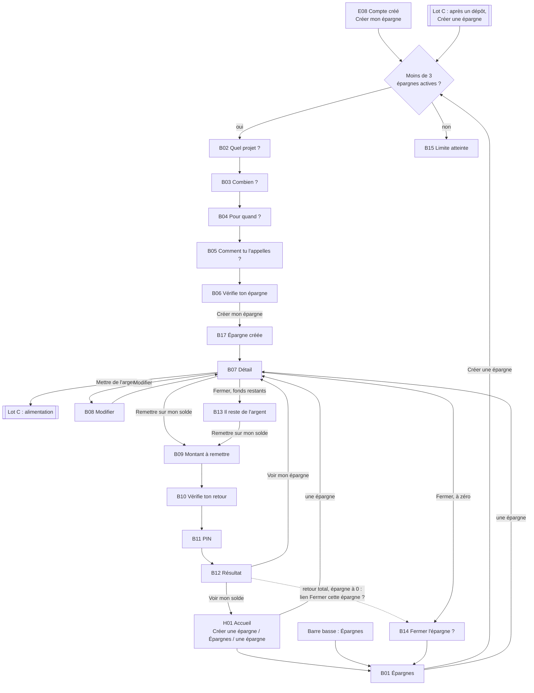
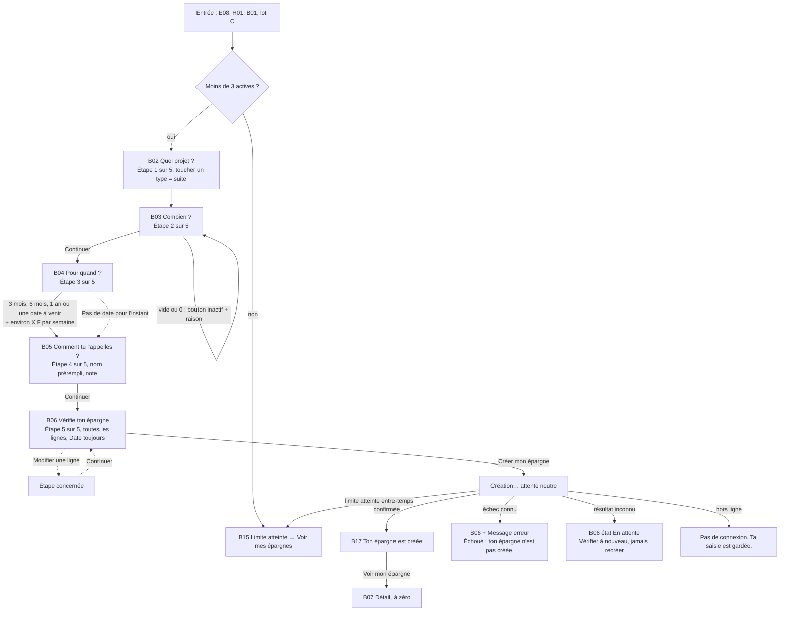
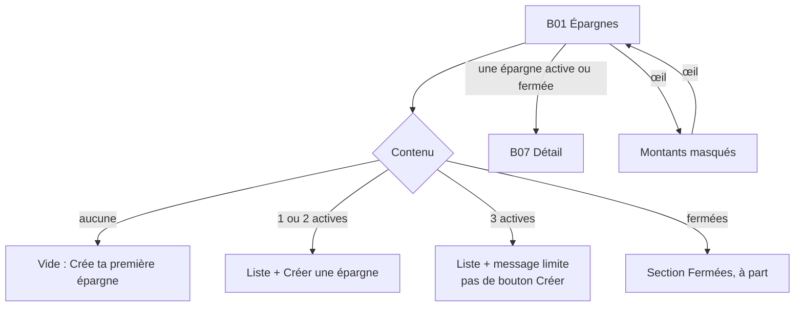
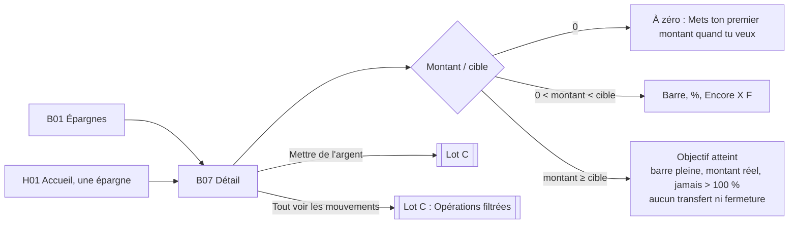
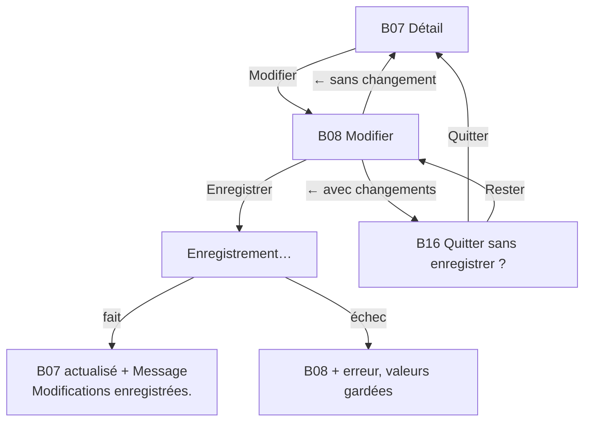
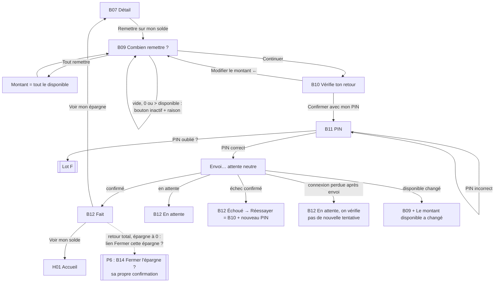
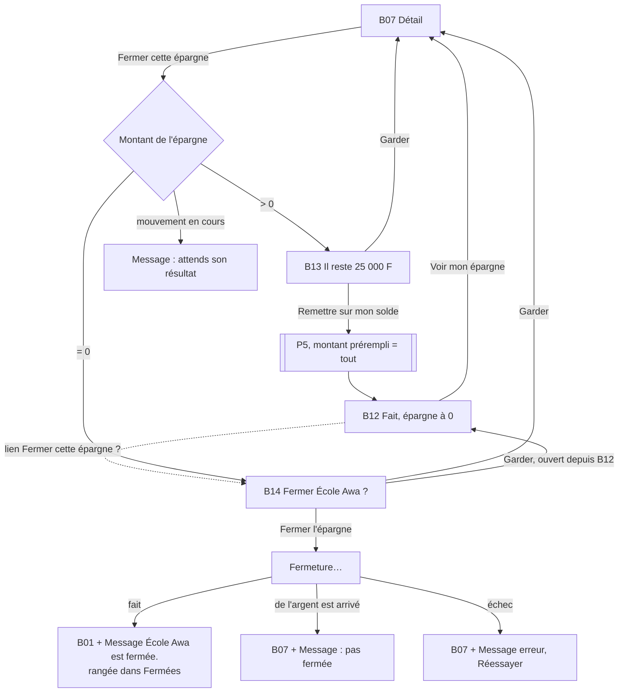
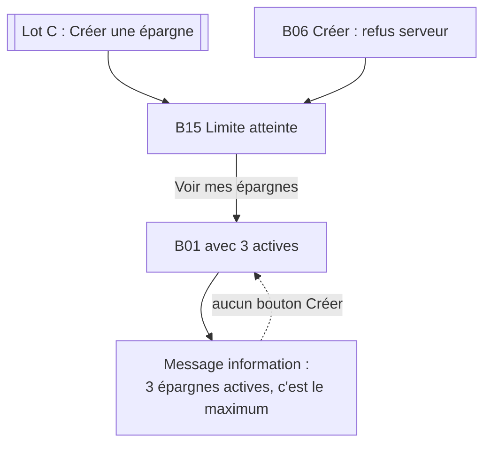
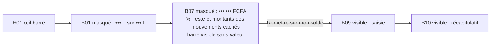

# Spec UX — Refonte des parcours, lot B : épargne et retour au solde

Date : 19 octobre 2026. Statut : parcours tranchés par le PO le 19 octobre 2026 (Q1 à Q12 validées, deux propositions refusées, une alternative validée : voir Décisions UX). **Lot B validé le 19 octobre 2026** par le PO et sa conjointe, y compris la création en 5 étapes (remplace Q2), les récapitulatifs B06 (aperçu) et B10 (flux) et le retour au solde sans frais. Maquettes dans le canvas « KOTIZ — App cliente » (version 12 (`1792433346-fbe2`)), composants promus dans le [KOTIZ Design System v10](https://claude.ai/artifact/F7WrzuAZTLaJ1MEGEEu134) (`1792428939-8e5b`) ; aucun code.

Sources : [brief refonte](brief.md) (fait foi), [PRODUCT.md](../../../PRODUCT.md), [DESIGN.md](../../../DESIGN.md) (composants `Kotiz.*`, contrat de progression F03, masquage F02), [PRD design v1.0](../prd-design-mvp.md) §3, §5 (familles 06 et 07), §6 (SAV, REL), §7 (règles 1 à 15), §8, §10 (Projet, Montant, Transaction), §11, §15.1 (FIN-02, FIN-05), [registre métier](../../product/regles-metier-parcours-mvp.md) (RM-SAV-01 à 04, RM-PERM-09, RM-FUND-09), [matrice du socle](../matrice-couverture-socle.md) (lignes 06 et 07, gates G01-G07), [spec lot A](ux-spec-lot-a.md), [écrans lot A](screens.md), [handoff lot A](handoff-lot-a.md) (masquage, `GoalRow`, raccords), [glossaire DDD](../../architecture/ddd-context-map-glossaire.md) §5.1 (contexte `savings`), issue GitHub [kotiz-ci/platform#73](https://github.com/kotiz-ci/platform/issues/73).

Script de test associé : [test-lot-b.md](test-lot-b.md).

Conventions (reprises du lot A) : « à confirmer » = paramètre non tranché, avec son gate (G01 à G07) quand il existe. « Proposition non validée » = idée qui contredit une décision validée ; elle n'est pas appliquée dans les wireframes. Noms et montants des wireframes fictifs. IDs d'écrans préfixés `B` (lot B) ; les IDs du lot A (E08, H01, C01…) gardent leur sens.

Vocabulaire : l'interface dit **épargne** (le PRD dit aussi « projet », le glossaire `SavingsGoal` / objectif nommé). Le mouvement interne vers le solde s'appelle **Remettre sur mon solde** (PRD §3) ; il n'est jamais appelé « retrait ». L'alimentation d'une épargne (lot C) est libellée ici **Mettre de l'argent**, libellé à aligner avec la spec du lot C.

## Hypothèses

- **H1 — Création sans autorisation financière.** Créer, modifier ou fermer une épargne ne déplace pas d'argent : aucune règle n'impose le PIN pour ces actions. Seul le retour au solde demande le PIN KOTIZ (FIN-02). Fermeture : dialogue de confirmation, sans PIN.
- **H2 — Types d'épargne = illustrations d'objectif existantes.** Les neuf illustrations du Design System (Scolarité, Commerce, Santé, Logement, Voyage, Véhicule, Événement, Précaution, Projet), libellées École, Commerce, Santé, Maison, Voyage, Véhicule, Fête, Imprévus, Autre projet ; nom par défaut « Mon projet » pour Autre projet (Décision PO du 19 octobre 2026, Q1). Le type Santé reste un projet d'épargne : aucun écran, libellé ni illustration n'évoque une assurance (PRD §15, Décision PO du 19 octobre 2026).
- **H3 — Montant épargné = mouvements confirmés.** Le montant d'une épargne n'inclut que les mouvements confirmés ; un mouvement en attente apparaît dans « Derniers mouvements » avec son statut, sans changer la barre. Règle de calcul à confirmer (G01), comme pour le solde au lot A.
- **H4 — Pas de nouveau retour pendant une attente.** Tant qu'un retour au solde depuis cette épargne est en attente ou incertain, on ne peut ni lancer un autre retour ni fermer l'épargne (RM-FUND-09 : pas de répétition d'une opération au résultat inconnu). Une alimentation entrante en attente (lot C) ne bloque pas le retour, qui porte sur le montant confirmé (H3), mais elle bloque la fermeture. Décision PO du 19 octobre 2026 (Q8).
- **H5 — Pas de file d'attente hors ligne** (comme le lot A, H6). Création, modification, retour et fermeture demandent le réseau. Hors ligne, la saisie est gardée et rien n'est envoyé en silence.
- **H6 — Le masquage suit le réglage du lot A.** Un seul réglage, persistant, basculé par l'œil (H01, B01 et B07 : Décision PO du 19 octobre 2026, Q5). Il couvre B01 et B07. Exceptions : saisie d'un montant (B03, B08, B09), récapitulatifs (B06, B10), rappel du montant sur le PIN (B11), résultat du retour (B12) et feuille B13 (Décision PO du 19 octobre 2026, Q3).

## Vue d'ensemble



## Parcours

### P1 — Créer une épargne (critique)

Entrées : E08 « Créer mon épargne » (bouton principal, scénario phare A), H01 « Créer une épargne › » (accueil vide), B01 « Créer une épargne », lot C après un dépôt sans épargne (PRD 16c). Type et cible requis ; nom, note et date facultatifs (RM-SAV-01), mais **toujours présentés** : la question de la date est toujours posée et le nom est prérempli (Décision PO du 19 octobre 2026, création en 5 étapes). Aucun argent ne bouge.

Chemin principal : **5 étapes** (B02 Quel projet, B03 Combien, B04 Pour quand, B05 Comment tu l'appelles, B06 Vérifie), puis le résultat B17 et le détail B07 : **7 écrans** au total. Q2 (« personnalisation depuis le récapitulatif ») est remplacée.



### P2 — Voir mes épargnes (racine Épargnes)

Racine, barre basse visible, onglet Épargnes actif. **1 écran** et ses états : vide, 1 à 3 actives, limite atteinte, épargnes fermées à part, masqué, hors ligne.



### P3 — Suivre une épargne (détail et progression)

**2 écrans** (B01 → B07). États de la matrice Projet (PRD §10) : créée à zéro, progression partielle, objectif atteint, mouvement en attente, fermée.



### P4 — Modifier une épargne

**2 écrans** (B07 → B08 → B07). Nom, note, cible et date modifiables, avec les mêmes champs que la création, tous visibles (Décision PO du 19 octobre 2026, création en 5 étapes) ; type fixe ; aucun mouvement de fonds (PRD §7 règle 14).



### P5 — Remettre de l'argent sur mon solde (critique)

Partiel ou total (« Tout remettre »), récapitulatif puis PIN KOTIZ (FIN-02). L'épargne reste ouverte, même à zéro. Aucun retrait externe enchaîné (PRD §7 règle 11).

Chemin principal : **5 écrans** (B07 B09 B10 B11 B12), puis retour à B07 ou H01. Après un retour total qui laisse l'épargne à 0, B12 propose aussi le lien secondaire « Fermer cette épargne ? », qui ouvre la fermeture existante (B14) avec sa propre confirmation ; jamais de fermeture automatique (Décision PO du 19 octobre 2026).



Variante assistée sans smartphone : autorisation SMS propre au mouvement, distincte du dépôt et du retrait, aucun PIN partagé (FIN-02). **Raccord lot E, non spécifiée ici.**

### P6 — Fermer une épargne

Uniquement à zéro, avec confirmation (RM-SAV-04, PRD §7 règle 15). Chemin à zéro : **3 écrans** (B07 B14 → B01). Avec des fonds : B13 puis P5 ; si le retour total est fait et l'épargne à 0, le lien « Fermer cette épargne ? » de B12 ouvre B14 (Décision PO du 19 octobre 2026). Sinon, retour à B07 et « Fermer cette épargne ». Aucune fermeture automatique après le retour.



### P7 — Limite de 3 épargnes actives (FIN-05)

Les épargnes fermées ne comptent pas. La limite est expliquée, jamais résolue à la place de la cliente (aucune fermeture automatique, aucun bouton qui ferme). Même limite en création assistée (lot E).



### P8 — Montants masqués dans les épargnes

Réglage du lot A, persistant (Décision PO du 19 octobre 2026). Pas d'écran propre : états masqués de B01 et B07.



### Nombre d'écrans par parcours (chemin principal)

| Parcours | Écrans | Séquence |
|---|---|---|
| P1 Créer une épargne | 7 (5 étapes + résultat + détail) | B02 B03 B04 B05 B06 B17 B07 (depuis E08, H01 ou B01) |
| P2 Voir mes épargnes | 1 | B01 (vide / 1 à 3 / limite / fermées / masqué) |
| P3 Suivre une épargne | 2 | B01 B07 |
| P4 Modifier | 2 | B07 B08 (retour B07) |
| P5 Remettre sur mon solde | 5 | B07 B09 B10 B11 B12 |
| P6 Fermer à zéro | 3 | B07 B14 B01 |
| P6 Fermer avec des fonds | 7 | B07 B13 B09 B10 B11 B12 B14 (puis B01), par le lien « Fermer cette épargne ? » de B12 |
| P7 Limite atteinte | 1 | B01 (état) ou B15 |
| P8 Masquage | 2 | B01 B07 (états) |

## Carte des écrans

Barre basse : uniquement sur B01 (racine Épargnes). Tous les autres écrans sont des pages poussées sans barre basse, avec `PageHeader`.

| ID | Écran | Parcours | Objectif |
|---|---|---|---|
| B01 | Épargnes (racine) | P1 P2 P3 P6 P7 P8 | Voir ses épargnes et en ouvrir ou créer une |
| B02 | Quel projet ? (étape 1 sur 5) | P1 | Dire pour quoi on épargne |
| B03 | Combien ? (étape 2 sur 5) | P1 | Dire combien on veut atteindre |
| B04 | Pour quand ? (étape 3 sur 5) | P1 | Se donner une date, ou dire qu'on n'en a pas |
| B05 | Comment tu l'appelles ? (étape 4 sur 5) | P1 | Donner un nom (prérempli) et une note si on veut |
| B06 | Vérifie ton épargne (étape 5 sur 5) | P1 | Relire toutes les lignes avant de créer, modifier une ligne |
| B07 | Détail d'une épargne | P3 P4 P5 P6 P8 | Voir où on en est et choisir le geste suivant |
| B08 | Modifier l'épargne | P4 | Changer nom, description, cible ou date |
| B09 | Combien remettre ? | P5 P6 | Saisir le montant qui revient sur le solde |
| B10 | Vérifie ton retour | P5 P6 | Voir d'où, vers où et combien avant le PIN |
| B11 | PIN de confirmation | P5 P6 | Autoriser le mouvement |
| B12 | Résultat du retour | P5 P6 | Savoir si c'est fait, en attente ou échoué |
| B13 | Il reste de l'argent (bottom sheet) | P6 | Comprendre pourquoi on ne peut pas fermer |
| B14 | Fermer l'épargne ? (dialogue) | P5 P6 | Confirmer une fermeture définitive (depuis B07 ou le lien de B12) |
| B15 | Limite atteinte (bottom sheet) | P1 P7 | Comprendre la limite de 3 |
| B16 | Quitter sans enregistrer ? (dialogue) | P4 | Ne pas perdre ses changements par erreur |
| B17 | Ton épargne est créée (ex-B06) | P1 | Savoir que c'est fait |

## Règles communes aux écrans du lot B

- **Orientation** : titre = ce que Fatou fait (« Quel projet ? », « Pour quand ? », « Combien remettre ? »). Création : indicateur « Étape n sur 5 » (Projet, Combien, Pour quand, Nom, Vérifier) dans `PageHeader`, de B02 à B06 (Décision PO du 19 octobre 2026, création en 5 étapes). Retour au solde : « Étape n sur 3 » (Montant, Vérifier, PIN). Le nom de l'épargne est rappelé sur B09 à B12.
- **Destination toujours lisible** (principe produit 2) : sur B09, B10, B11 et B12, « Depuis : École Awa » et « Vers : Solde disponible ».
- **Retour** `←` : revient à l'écran précédent en gardant la saisie, sauf le PIN. Depuis B12, le retour n'ouvre jamais B10 ni B11 (PRD §7 règle 10) : il mène à B07.
- **Bouton principal** en bas, visible clavier ouvert, désactivé tant que la saisie est incomplète, avec la raison sous le champ.
- **Attente réseau** (> 1 s) : bouton en « Création… », « Enregistrement… », « Envoi… » ou « Fermeture… », double appui bloqué, aucun écran suivant avant la réponse.
- **Hors ligne** : `Message` « Pas de connexion. Ta saisie est gardée. » + Réessayer. Jamais de succès supposé.
- **Montants** : FCFA sans décimales, espace des milliers ; `amount` (34 Bold) pour le montant saisi et le montant de l'épargne sur B07 ; `12 500 F` dans les lignes.
- **Progression** : contrat F03 de DESIGN.md, calculé par l'app. `% = ⌊épargné / cible × 100⌋`, barre `min(%, 100)`, reste affiché seulement s'il est positif. Cible atteinte ou dépassée : « Objectif atteint » (texte neutre `text-primary`, sans coche verte : ce n'est pas un « Fait »), barre pleine, montant réel, jamais de % > 100 (critique du lot B, validée par le PO le 19 octobre 2026).
- **Statuts** : `StatusPill` « Fait » / « En attente » / « Échoué », mot + pictogramme, couleur en renfort.
- **Aucun paramètre inventé** : pas de minimum ni de maximum de cible, pas de longueur de nom, pas de délai. Le retour au solde est sans frais (Décision PO du 19 octobre 2026). Les valeurs fictives du prototype sont annoncées comme telles.

## Écrans

### B01 — Épargnes (racine)

- Objectif : voir ses épargnes et en ouvrir ou créer une.
- Action primaire : Créer une épargne (absente à 3 actives).
- Actions secondaires : une épargne (→ B07), œil (masquer / afficher), une épargne fermée (→ B07 fermée), barre basse.
- Contenu (par priorité) :
  1. En-tête de racine : titre « Mes épargnes » + œil 48 (même réglage que H01, Décision PO du 19 octobre 2026, Q5).
  2. Épargnes actives dans un seul bloc `goal-list` de `GoalRow` (illustration 32, nom, « 45 000 F sur 100 000 F », barre, chevron). Pas de pourcentage, comme sur l'accueil. Variante atteinte : « Objectif atteint » sous le nom (texte neutre, sans coche), barre pleine ; même variante sur l'accueil H01 (critique du lot B, validée par le PO le 19 octobre 2026).
  3. Compteur discret « 2 sur 3 épargnes actives » (texte 14, `text-secondary`), pour rendre la limite visible avant qu'elle bloque.
  4. Bouton principal « Créer une épargne ».
  5. Section « Fermées » sous un titre de section, lignes sans barre ni montant : nom + « Fermée le 12 oct. », chevron.
- États :
  - **Vide** : `IconPastille` avec l'illustration Épargnes, « Pas encore d'épargne. », « Mets de côté pour un projet : école, boutique, fête… », bouton « Crée ta première épargne ». Rien n'est imposé : aucune relance.
  - **1 ou 2 actives** : wireframe ci-dessous.
  - **3 actives (limite)** : pas de bouton Créer ; `Message` information « Tu as 3 épargnes actives. C'est le maximum. » + « Pour en créer une autre, ferme une épargne vide. » Aucun bouton qui ferme ou vide une épargne.
  - **Fermées seulement** : état vide + section Fermées.
  - **Masqué** : « ••• F sur ••• F », barre visible sans valeur annoncée, œil barré, chaque montant lu « Montant masqué ».
  - **Chargement** : squelette de 2 lignes au premier chargement, jamais « 0 F ».
  - **Hors ligne** : derniers montants connus + `Message` « Mis à jour à 14:32 · hors connexion » ; Créer reste visible mais B06 refusera l'envoi sans réseau.
  - **Retour après fermeture** : `Message` succès « École Awa est fermée. » en haut de liste (une fois).
- Cas limites : nom long (une ligne, troncature « … » dans `GoalRow`, nom complet sur B07) ; deux épargnes au même nom (autorisé, Décision PO du 19 octobre 2026, Q11) ; montant à 7 chiffres (« 1 250 000 F sur 2 000 000 F » passe à la ligne sous le nom, jamais coupé) ; texte système agrandi ; plus de 5 fermées (les 5 dernières + « Tout voir › », à confirmer à l'implémentation) ; mouvement en attente sur une épargne : la ligne garde le montant confirmé (H3).

```
┌──────────────────────────────┐
│ Mes épargnes             👁  │
├──────────────────────────────┤
│ ┌──────────────────────────┐ │
│ │[🎒] École Awa          › │ │
│ │ 45 000 F sur 100 000 F   │ │
│ │ ▓▓▓▓▓▓░░░░░░░░           │ │
│ │──────────────────────────│ │
│ │[🏪] Boutique           › │ │
│ │ 8 000 F sur 50 000 F     │ │
│ │ ▓▓░░░░░░░░░░░░           │ │
│ └──────────────────────────┘ │
│ 2 sur 3 épargnes actives     │
│                              │
│ [  Créer une épargne     ] ★ │
│                              │
│ Fermées                      │
│ Moto · Fermée le 12 oct.   › │
├──────────────────────────────┤
│ Accueil Épargnes Opérat. Prof│
└──────────────────────────────┘
```

État limite (extrait) :

```
┌──────────────────────────────┐
│ … 3 lignes GoalRow …         │
│ ⓘ Tu as 3 épargnes actives.  │
│   C'est le maximum.          │
│   Pour en créer une autre,   │
│   ferme une épargne vide.    │
│ Fermées                      │
└──────────────────────────────┘
```

> **Décision PO du 19 octobre 2026, après le test du lot B par la conjointe : la création passe en 5 étapes**, avec le nom, la note et la date toujours visibles. Elle remplace Q2 (« personnalisation depuis le récapitulatif ») et l'ancien écran B05 « Nom, note et date ». Correspondance des identifiants : B02 et B03 inchangés ; B04 = « Pour quand ? » (nouveau) ; B05 = « Comment tu l'appelles ? » (remplace « Nom, note et date ») ; B06 = « Vérifie ton épargne » (ex-B04) ; B17 = « Ton épargne est créée » (ex-B06). B07 à B16 gardent leur identifiant. Ainsi « Étape n sur 5 » correspond à B02 … B06.

### B02 — Quel projet ? (étape 1 sur 5)

- Objectif : dire pour quoi on épargne.
- Action primaire : toucher un type (passe directement à B03, pas de bouton Continuer).
- Actions secondaires : ← (vers la provenance : E08, H01, B01 ou lot C).
- Contenu : `PageHeader` (←, « Étape 1 sur 5 ») ; titre « Quel projet ? » ; grille de 2 colonnes de choix illustrés (illustration 48 + libellé 14, cible ≥ 96 × 96) ; phrase « Tu lui donneras un nom plus loin. »
- Types (Décision PO du 19 octobre 2026, Q1) : École (Scolarité), Commerce, Santé, Maison (Logement), Voyage, Véhicule, Fête (Événement), Imprévus (Précaution), Autre projet (Projet).
- Santé (Décision PO du 19 octobre 2026) : un projet d'épargne comme les autres. Libellé « Santé » seul ; aucune mention d'assurance, de couverture, de cotisation ou de remboursement ; illustration : un cœur corail, sans croix, stéthoscope ni bouclier ; Imprévus : un coffret de réserve avec une pièce, sans bouclier, parapluie ni coche (critique du lot B, validée par le PO le 19 octobre 2026). Les illustrations `23:1518` (trousse à croix) et Précaution (bouclier) ne sont pas utilisées pour ces types.
- États : nominal ; retour depuis B03 : le type choisi est marqué sélectionné (fond vert doux, bordure, libellé), toucher un autre type le remplace et garde la cible saisie. Si le nom n'a pas été changé, il suit le nouveau type (« École » → « Commerce ») ; un nom saisi est gardé.
- Depuis le récapitulatif (« Modifier » sur Projet) : toucher un type ramène à B06.
- Cas limites : 320 px (2 colonnes gardées, libellé sur deux lignes si besoin) ; texte agrandi (1 colonne) ; le type ne pourra plus changer après la création (type fixe au MVP).

```
┌──────────────────────────────┐
│ ←              Étape 1 sur 5 │
├──────────────────────────────┤
│ Quel projet ?                │
│ ┌───────────┐ ┌───────────┐  │
│ │   [🎒]    │ │   [🏪]    │  │
│ │   École   │ │ Commerce  │  │
│ └───────────┘ └───────────┘  │
│ … Santé, Maison, Voyage,     │
│   Véhicule, Fête, Imprévus,  │
│   Autre projet               │
│ Tu lui donneras un nom plus  │
│ loin.                        │
└──────────────────────────────┘
```

### B03 — Combien ? (étape 2 sur 5)

- Objectif : dire combien on veut atteindre.
- Action primaire : Continuer (→ B04, ou → B06 si l'écran a été ouvert depuis le récapitulatif).
- Actions secondaires : ← (B02, type gardé ; B06 si ouvert depuis le récapitulatif).
- Contenu : `PageHeader` (←, « Étape 2 sur 5 ») ; rappel du type (illustration 32 + « École ») ; titre « Combien tu veux mettre de côté ? » ; champ montant (`amount` 34, devise « FCFA » à côté, focus visible, clavier numérique) ; aide sous le trait « C'est ton objectif. Aucun argent ne bouge. » quand le montant est valide.
- Pas de montants rapides : les suggestions 500 / 1 000 / 2 000 du PRD sont des valeurs de dépôt de démonstration, pas des cibles ; en proposer serait inventer (décision de conception).
- États : vide (Continuer désactivé, « Écris un montant. ») ; saisi ; 0 (désactivé, « Le montant doit être plus grand que 0. ») ; au-delà d'un maximum éventuel (règle à confirmer, aucune valeur inventée) ; clavier ouvert (bouton au-dessus du clavier).
- Cas limites : montant à 7 chiffres (le champ garde 34 px à 360, réduit seulement s'il déborde) ; collage d'un texte non numérique ignoré ; zéros en tête retirés ; séparateur des milliers ajouté pendant la saisie. Montant cible minimum et maximum : à confirmer (produit, G01 si le partenaire impose une limite).

```
┌──────────────────────────────┐
│ ←              Étape 2 sur 5 │
├──────────────────────────────┤
│ [🎒] École                   │
│ Combien tu veux mettre       │
│ de côté ?                    │
│   100 000|  FCFA             │
│   ─────────────────          │
│ C'est ton objectif. Aucun    │
│ argent ne bouge.             │
├──────────────────────────────┤
│ [      Continuer         ] ★ │
└──────────────────────────────┘
```

### B04 — Pour quand ? (étape 3 sur 5, nouveau)

- Objectif : se donner une date, ou dire qu'on n'en a pas. La question est toujours posée ; la date reste facultative.
- Action primaire : Continuer (→ B05), actif dès qu'une date valide est choisie ; désactivé sinon, avec la raison « Choisis une durée, ou continue sans date. ».
- Actions secondaires : lien discret « Pas de date pour l'instant » (→ B05 sans date) ; ← (B03).
- Contenu : `PageHeader` (←, « Étape 3 sur 5 ») ; rappel « École · 100 000 F » ; titre « Pour quand ? » ; choix en liste (`DateChoice`, une option par ligne, 48 de haut) : « Dans 3 mois », « Dans 6 mois », « Dans 1 an », « Choisir une date » (ouvre le champ date et le calendrier Android) ; quand une date est choisie : « Pour le 19 avril 2027 » puis **« Ça fait environ 3 847 F par semaine. »**.
- Calcul « par semaine » (aide d'affichage, pas une règle financière) : objectif ÷ nombre de semaines entières restantes (au moins 1), arrondi au franc supérieur, format FCFA de DESIGN.md (`3 847 F`). Les raccourcis partent de la date du jour (même jour du mois, + 3, 6 ou 12 mois).
- États : rien choisi (Continuer désactivé + raison) ; raccourci choisi (option sélectionnée : fond vert doux, bordure 2, `aria-pressed`) ; « Choisir une date » avec une date à venir ; date passée ou du jour refusée (« Choisis une date à venir. », Continuer désactivé : Décision PO du 19 octobre 2026, Q9).
- Cas limites : date très proche (moins d'une semaine : le calcul divise par 1) ; objectif à 7 chiffres ; texte agrandi (options sur deux lignes) ; retour depuis le récapitulatif (le choix est gardé, Continuer ramène à B06).

```
┌──────────────────────────────┐
│ ←              Étape 3 sur 5 │
├──────────────────────────────┤
│ [🎒] École · 100 000 F       │
│ Pour quand ?                 │
│ [ Dans 3 mois             ]  │
│ [▓Dans 6 mois▓▓▓▓▓▓▓▓▓▓▓▓▓]  │
│ [ Dans 1 an               ]  │
│ [ Choisir une date        ]  │
│ Pour le 19 avril 2027        │
│ Ça fait environ 3 847 F par  │
│ semaine.                     │
│ Pas de date pour l'instant   │
├──────────────────────────────┤
│ [      Continuer         ] ★ │
└──────────────────────────────┘
```

### B05 — Comment tu l'appelles ? (étape 4 sur 5)

- Objectif : donner un nom à son épargne, et une note si on veut.
- Action primaire : Continuer (→ B06), toujours actif.
- Actions secondaires : ← (B04 ; B06 si ouvert depuis le récapitulatif).
- Contenu : `PageHeader` (←, « Étape 4 sur 5 ») ; rappel du type ; titre « Comment tu l'appelles ? » ; champ « Nom » **prérempli avec le libellé du type** (« École » ; « Mon projet » pour Autre projet), modifiable, aide « Si tu ne mets rien : École » ; champ « Note (facultatif) » visible, multiligne, aide « Par exemple : frais de rentrée de Awa. ».
- États : prérempli ; nom changé ; nom effacé (le libellé du type sera utilisé) ; note remplie ; texte trop long (longueur maximale à confirmer, aucun compteur inventé).
- Cas limites : nom de 40 caractères et plus (retour à la ligne) ; emoji dans le nom (à confirmer dev) ; clavier ouvert, Continuer visible ; même nom qu'une épargne active : signalé au récapitulatif, sans bloquer (Q11).

```
┌──────────────────────────────┐
│ ←              Étape 4 sur 5 │
├──────────────────────────────┤
│ [🎒] École                   │
│ Comment tu l'appelles ?      │
│ Nom                          │
│ [ École                  ]   │
│ Si tu ne mets rien : École   │
│ Note (facultatif)            │
│ [                        ]   │
│ Par exemple : frais de       │
│ rentrée de Awa.              │
├──────────────────────────────┤
│ [      Continuer         ] ★ │
└──────────────────────────────┘
```

### B06 — Vérifie ton épargne (étape 5 sur 5, ex-B04)

- Objectif : relire avant de créer.
- Action primaire : Créer mon épargne.
- Actions secondaires : ← (B05) ; « Modifier » sur chaque ligne, qui ramène à l'étape concernée (Projet → B02, Nom et Note → B05, Objectif → B03, Date → B04) ; après la modification, Continuer revient au récapitulatif.
- Contenu (`Summary.Preview`, aperçu de l'épargne à venir ; Décision PO du 19 octobre 2026 après le commentaire « trop plat ») :
  1. Carte unique en `surface` bordée (pas de carte dans la carte) : illustration du type 64, type en `text-secondary` (seulement s'il diffère du nom), **nom** 24 Bold + « Modifier » ; **objectif** 34 Bold tabulaire + « FCFA » + « Modifier » ; barre vide et « 0 F pour l'instant » ; sous un filet, « d'ici le 30 juin 2027 » et la puce `surface-canvas` « ≈ 2 778 F / semaine » + « Modifier », ou « Pas de date » + « Ajouter » (→ B04).
  2. Sous la carte, sans vert : « Aucun argent ne bouge. »
  3. Bloc « Détails » : Projet (« École », Modifier → B02), Note si remplie (Modifier → B05) ; libellé `text-secondary`, valeur `text-primary`, « Modifier » aligné à droite (cible 48).
  4. TalkBack lit la carte en une phrase : « Épargne École Awa, projet École, objectif 100 000 francs, d'ici le 30 juin 2027, environ 2 778 francs par semaine, 0 franc pour l'instant. » ; les « Modifier » restent atteignables.
- **Exception validée à la règle « pas de ligne vide »** (Décision PO du 19 octobre 2026) : la date est toujours présente dans la carte (« Pas de date · Ajouter » sinon). La Note n'apparaît que si elle est remplie.
- États : nominal ; création en cours (bouton « Création… », écran figé : aucun « Modifier ») ; **échec connu** (`Message` erreur « Échoué : ton épargne n'est pas créée. Réessaie. », saisie gardée) ; **résultat inconnu** (`Message` en attente « On vérifie si ton épargne est créée. Ne la recrée pas. » + bouton « Vérifier à nouveau » ; aucun « Modifier » ; création idempotente, à confirmer côté dev) ; **limite atteinte entre-temps** (→ B15) ; hors ligne (`Message`, rien n'est envoyé).
- Cas limites : même nom qu'une épargne active (« École » deux fois) : `Message` information « Tu as déjà une épargne École. Donne un autre nom à celle-ci. », sans bloquer (Q11) ; retour Android = ←.

```
┌──────────────────────────────┐
│ ←              Étape 5 sur 5 │
├──────────────────────────────┤
│ Vérifie ton épargne          │
│ ┌──────────────────────────┐ │
│ │ [🎒] École               │ │
│ │      École Awa  Modifier │ │
│ │ 100 000 FCFA    Modifier │ │
│ │ ░░░░░░░░░░░░░░░░░░░░░░░░ │ │
│ │ 0 F pour l'instant       │ │
│ │ ──────────────────────── │ │
│ │ d'ici le 30 juin 2027    │ │
│ │ (≈ 2 778 F / semaine)    │ │
│ │                 Modifier │ │
│ └──────────────────────────┘ │
│ Aucun argent ne bouge.       │
│ Détails                      │
│ Projet   École      Modifier │
│ Note     Frais de   Modifier │
│          rentrée de Awa      │
├──────────────────────────────┤
│ [   Créer mon épargne    ] ★ │
└──────────────────────────────┘
```

### B17 — Ton épargne est créée (résultat, ex-B06)

- Objectif : savoir que c'est fait.
- Action primaire : Voir mon épargne (→ B07, PRD §4 : création puis détail du projet).
- Actions secondaires : aucune (retour Android = Voir mon épargne, jamais retour vers B06).
- Contenu : résultat illustré `120:866` (épargne créée) ; titre « C'est fait ! Ton épargne École Awa est créée. » ; « Aucun argent n'a bougé. » ; **« Dedans : 0 F »** (Semi Bold 16) puis « Objectif : 100 000 F » en secondaire ; « Pour le 30 juin 2027 » s'il y a une date.
- États : succès uniquement, affiché seulement après confirmation serveur. Pas d'animation de célébration au-delà du résultat illustré (DESIGN.md).
- Cas limites : nom long (retour à la ligne) ; arrivée depuis E08 : B07 aura un retour vers H01 (pas vers E08).

### B07 — Détail d'une épargne

- Objectif : voir où on en est et choisir le geste suivant.
- Action primaire : Mettre de l'argent (→ lot C, alimentation par Mobile Money ou depuis le solde disponible ; raccord seulement).
- Actions secondaires : Remettre sur mon solde (bouton secondaire), Modifier (lien à droite du `PageHeader`), œil, un mouvement (→ lot C détail), « Tout voir › » (→ lot C Opérations filtrées sur cette épargne), Fermer cette épargne (bouton texte en bas de page).
- Contenu (par priorité) :
  1. `PageHeader` : ← (vers la provenance : B01, H01, B06 → H01 ou B01), lien « Modifier », œil.
  2. Illustration 56 + nom complet (retour à la ligne).
  3. **Montant épargné** en `amount` : « 45 000 FCFA ».
  4. « sur 100 000 F » ; barre ; « 45 % » ; phrase de reste « Encore 55 000 F pour ton objectif. »
  5. « Pour le 30 juin 2027 · encore 36 semaines » si une date existe (semaines entières restantes ; « moins d'une semaine » sous 7 jours ; rien de plus si la date est passée) (Décision PO du 19 octobre 2026, création en 5 étapes) ; note si une description existe.
  6. Boutons : Mettre de l'argent (principal), Remettre sur mon solde (secondaire).
  7. « Derniers mouvements » : 3 `TransactionRow` (dépôts et affectations vers l'épargne, retours vers le solde), statut en mots, puis « Tout voir › ».
  8. Bouton texte « Fermer cette épargne ».
- États :
  - **À zéro** (créée ou vidée) : « 0 FCFA », « sur 100 000 F », barre vide, pas de %, « Mets ton premier montant quand tu veux. » ; Remettre sur mon solde désactivé avec « Rien à remettre pour l'instant. » ; mouvements : « Tes mouvements s'afficheront ici. »
  - **Partiel** : wireframe ci-dessous.
  - **Objectif atteint** : « 52 000 FCFA », « sur 50 000 F », barre pleine, « Objectif atteint » (texte neutre, sans coche) à la place du % et de la phrase de reste, avec une petite illustration « objectif atteint » (drapeau, dessiné dans le canvas, à reporter dans le Design System) (critique du lot B, validée par le PO le 19 octobre 2026). Pas de `StatusPill` « Fait » ni de titre de résultat : c'est un état de l'épargne, pas une transaction (PRD §7 règle 13). Mêmes boutons, même ordre (Décision PO du 19 octobre 2026, Q4). Phrase « Ton épargne reste ouverte. Tu peux continuer ou remettre l'argent sur ton solde. »
  - **Mouvement en attente** : la ligne du mouvement dit « En attente » ; le montant et la barre restent sur le confirmé (H3). Retour au solde en attente : Remettre sur mon solde et Fermer désactivés, avec une seule phrase qui couvre les deux, sous Remettre : « Un retour est en cours. Tu pourras remettre ou fermer après. » (critique du lot B, validée par le PO le 19 octobre 2026). Alimentation en attente : seul Fermer est bloqué (« De l'argent est en route. Tu pourras fermer après. ») (H4).
  - **Modifiée** (retour de B08) : `Message` succès « Modifications enregistrées. », sans illustration ni célébration.
  - **Fermée** (depuis la section Fermées) : bandeau neutre « Fermée le 12 oct. », montant « 0 FCFA », pas de barre ni de boutons, mouvements conservés (« Tout voir › »). Aucune réouverture.
  - **Masqué** : « ••• ••• FCFA », « sur ••• F », % et phrase de reste retirés, barre visible sans valeur, montants des mouvements masqués ; libellés, statuts, dates et date cible visibles.
  - **Chargement** : squelette au premier affichage ; **hors ligne** : derniers montants connus + « Mis à jour à 14:32 · hors connexion », boutons d'action gardés (leurs écrans gèrent le réseau).
- Cas limites : cible atteinte par une modification de la cible (B08) : état atteint sans célébration ; cible dépassée de beaucoup (« 152 000 F sur 50 000 F », jamais « 304 % ») ; nom long ; épargne fermée ailleurs pendant la consultation (rafraîchir → état fermée) ; montant 7 chiffres sur 320 px.

```
┌──────────────────────────────┐
│ ←                Modifier 👁 │
├──────────────────────────────┤
│ [🎒] École Awa               │
│                              │
│ 45 000 FCFA                  │
│ sur 100 000 F                │
│ ▓▓▓▓▓▓░░░░░░░░  45 %         │
│ Encore 55 000 F pour ton     │
│ objectif.                    │
│ Pour le 30 juin 2027 ·       │
│ encore 36 semaines           │
│                              │
│ [  Mettre de l'argent    ] ★ │
│ [ Remettre sur mon solde ]   │
├──────────────────────────────┤
│ Derniers mouvements          │
│ ↘ Dépôt Wave  +5 000 F  Fait │
│   18 oct.                  › │
│ ↗ Depuis solde +2 000 F      │
│   17 oct.       En attente › │
│                  Tout voir › │
├──────────────────────────────┤
│     Fermer cette épargne     │
└──────────────────────────────┘
```

Objectif atteint (extrait) :

```
│ [🎉] Tabaski                 │
│ 52 000 FCFA                  │
│ sur 50 000 F                 │
│ ▓▓▓▓▓▓▓▓▓▓▓▓▓▓               │
│ [⚑] Objectif atteint         │
│ Ton épargne reste ouverte.   │
```

### B08 — Modifier l'épargne

- Objectif : changer nom, note, cible ou date.
- Action primaire : Enregistrer (désactivé tant que rien n'a changé ou que la cible est invalide).
- Actions secondaires : ← (B16 si des changements non enregistrés, sinon B07), Retirer la date.
- **Mêmes champs que la création, tous visibles** (Décision PO du 19 octobre 2026, création en 5 étapes) : Projet (non modifiable), Nom, Objectif, « Pour quand ? » (mêmes options `DateChoice` que B04, date actuelle sélectionnée en « Choisir une date », « Environ X F par semaine », Retirer la date), Note.
- Contenu : `PageHeader` (←, titre « Modifier ») ; ligne non modifiable « Projet : École — ne change pas » ; champs Nom (aide « Si tu ne mets rien : École »), Objectif (champ montant), « Pour quand ? », Note (facultatif), dans l'ordre du récapitulatif ; aide sous l'objectif quand la nouvelle cible est inférieure ou égale au montant épargné : « Ton objectif sera atteint avec ce montant. »
- Règles : aucun mouvement de fonds ; nom, note et date peuvent être vidés ; cible requise et > 0 ; la nouvelle cible met à jour %, barre et reste ensemble (F03).
- États : nominal ; enregistrement (« Enregistrement… ») ; échec (`Message` erreur « Rien n'a changé. Réessaie. », saisie gardée) ; hors ligne ; épargne fermée entre-temps (`Message` « Cette épargne est fermée. » → B07 fermée).
- Cas limites : modification depuis deux téléphones (la dernière l'emporte, à confirmer dev) ; cible égale au montant épargné (atteint) ; mouvement en attente (la modification reste possible : elle ne touche pas l'argent).

```
┌──────────────────────────────┐
│ ←  Modifier                  │
├──────────────────────────────┤
│ Projet : École — ne change   │
│ pas                          │
│ Nom                          │
│ [ École Awa              ]   │
│ Objectif                     │
│ 100 000 FCFA                 │
│ Pour quand ?                 │
│ [ Dans 3 mois             ]  │
│ [ Dans 6 mois             ]  │
│ [ Dans 1 an               ]  │
│ [▓Choisir une date▓▓▓▓▓▓▓▓]  │
│ [ 30/06/2027           ▾ ]   │
│ Pour le 30 juin 2027         │
│ Ça fait environ 2 778 F par  │
│ semaine. Retirer la date     │
│ Note (facultatif)            │
│ [ Frais de rentrée       ]   │
├──────────────────────────────┤
│ [      Enregistrer       ] ★ │
└──────────────────────────────┘
```

### B09 — Combien remettre ?

- Objectif : saisir le montant qui revient sur le solde disponible.
- Action primaire : Continuer.
- Actions secondaires : « Tout remettre » (remplit le montant avec tout le disponible de l'épargne), ← (B07).
- Contenu : `PageHeader` (←, « Étape 1 sur 3 ») ; titre « Combien remettre sur ton solde ? » ; ligne « Depuis : École Awa · 45 000 F dedans » ; champ montant (`amount` 34, toujours visible même en mode masqué) ; puce « Tout remettre » (variante large de `amount-quick-pick`) ; « Vers : Solde disponible ».
- États : vide (Continuer désactivé, « Écris un montant. ») ; saisi ; « Tout remettre » sélectionné (puce active ; une saisie différente la désélectionne) ; 0 (« Le montant doit être plus grand que 0. ») ; supérieur au disponible (« Tu as 45 000 F dans cette épargne. ») ; prérempli depuis B13 (Tout remettre sélectionné, modifiable) ; disponible changé au retour de B10 (`Message` « Le montant disponible a changé. » + nouveau disponible).
- Cas limites : montant minimum de retour (à confirmer G01, aucune valeur inventée) ; épargne à zéro (B09 inaccessible, bouton désactivé sur B07) ; clavier ouvert.

```
┌──────────────────────────────┐
│ ←              Étape 1 sur 3 │
├──────────────────────────────┤
│ Combien remettre sur ton     │
│ solde ?                      │
│ Depuis : École Awa           │
│          45 000 F dedans     │
│                              │
│   20 000|  FCFA              │
│   ─────────────────          │
│ [ Tout remettre ]            │
│                              │
│ Vers : Solde disponible      │
├──────────────────────────────┤
│ [      Continuer         ] ★ │
├──────────────────────────────┤
│   clavier numérique système  │
└──────────────────────────────┘
```

### B10 — Vérifie ton retour

- Objectif : voir combien, d'où et vers où, avant d'autoriser.
- Action primaire : Continuer (→ B11, PIN).
- Actions secondaires : ← (B09, montant gardé), « Modifier » à côté du montant.
- **Sans frais** (Décision PO du 19 octobre 2026 : retour au solde sans frais) : le retour d'une épargne vers le solde est un mouvement interne. Aucune ligne « Frais », aucun état « frais inconnus » ; le PIN n'est pas bloqué par G01.
- Contenu (`Summary.Flow`, carte unique en `surface` bordée, toujours visible même en mode masqué sauf le solde après) :
  1. « Tu remets » + **20 000 FCFA** (34 Bold, chiffres tabulaires) + « Modifier ».
  2. Flux sur deux lignes : illustration de l'épargne + « Depuis · École Awa », flèche verticale, illustration portefeuille + « Vers · Mon solde » (nommé pour TalkBack « De École Awa vers Mon solde »).
  3. « Il restera : 25 000 F dans École Awa ».
  4. « Ton solde après : 32 400 F » (solde disponible + montant, exact ; ligne cachée en mode masqué).
  5. Retour total : `Message` « École Awa sera à 0 F. Elle reste ouverte. »
  6. Phrase « L'argent reste sur KOTIZ. Pour le sortir, utilise Retirer. »
- États : nominal ; retour total ; disponible changé (retour à B09 avec message) ; hors ligne ; **refusé par une règle** (Décision PO du 19 octobre 2026) : un refus connu d'avance (plafond, compte restreint, niveau d'accès…) s'affiche ici, **avant le PIN** : `Message` d'erreur « Ce retour n'est pas possible pour l'instant. Ton argent n'a pas bougé. Il reste dans École Awa. » en tête, lien « Contacter l'aide › » (G03), « Continuer » désactivé avec la raison « Continuer est bloqué : ce retour est refusé. », aucune limite chiffrée (G01).
- Ce qui n'est pas sur B10 : l'**échec technique** au moment du mouvement (réseau, serveur) se lit sur B12 « Échoué », **après le PIN**.
- Cas limites : retour Android = ← ; app mise en arrière-plan puis reprise : le récapitulatif est recalculé avant le PIN ; solde changé entre-temps : « Ton solde après » est recalculé.

```
┌──────────────────────────────┐
│ ←              Étape 2 sur 3 │
├──────────────────────────────┤
│ Vérifie ton retour           │
│ ┌──────────────────────────┐ │
│ │ Tu remets       Modifier │ │
│ │ 20 000 FCFA              │ │
│ │ [🎒] Depuis · École Awa  │ │
│ │  ↓                       │ │
│ │ [👛] Vers · Mon solde    │ │
│ │ Il restera  25 000 F     │ │
│ │             dans École A.│ │
│ │ Ton solde   32 400 F     │ │
│ │ après                    │ │
│ └──────────────────────────┘ │
│ L'argent reste sur KOTIZ.    │
│ Pour le sortir : Retirer.    │
├──────────────────────────────┤
│ [       Continuer        ] ★ │
└──────────────────────────────┘
```

### B11 — PIN de confirmation

- Objectif : autoriser le retour au solde.
- Action primaire : saisie complète du PIN = envoi (pas de bouton, comme C01).
- Actions secondaires : ← (B10), PIN oublié ? (→ lot F), Effacer.
- Contenu : `PageHeader` (←, « Étape 3 sur 3 ») ; titre « Entre ton PIN » ; rappel « 20 000 F de École Awa vers ton solde » ; `PinSlots` (4 au prototype, jusqu'à 6) ; mention « Ne le montre à personne, même à une agente. » ; `PinPad`.
- États : saisie ; envoi (« Envoi… », pavé figé) ; PIN incorrect (« PIN incorrect. Réessaie. », cases vidées ; essais restants seulement si la règle est confirmée, G02) ; bloqué (suite et durée à confirmer, G02 → lot F) ; hors ligne avant envoi (« Pas de connexion. Rien n'a été envoyé. ») ; connexion perdue après envoi → B12 en attente.
- Cas limites : PIN jamais affiché ni conservé ; retour arrière efface le PIN ; capture d'écran bloquée (à confirmer technique, comme E06) ; cliente accompagnée : l'agente ne voit ni ne saisit le PIN (mention).

```
┌──────────────────────────────┐
│ ←              Étape 3 sur 3 │
├──────────────────────────────┤
│ Entre ton PIN                │
│ 20 000 F de École Awa        │
│ vers ton solde               │
│                              │
│        ●  ●  ○  ○            │
│                              │
│ Ne le montre à personne,     │
│ même à une agente.           │
│ PIN oublié ?                 │
├──────────────────────────────┤
│   1     2     3              │
│   4     5     6              │
│   7     8     9              │
│         0     ⌫              │
└──────────────────────────────┘
```

### B12 — Résultat du retour

- Objectif : savoir si c'est fait, en attente ou échoué.
- Action primaire : Voir mon épargne (→ B07 de la même épargne) ; Réessayer en cas d'échec confirmé.
- Actions secondaires : Voir mon solde (bouton texte → H01), lien « Voir le reçu › » en bouton texte (→ lot C reçu ; pas un `InfoLine` d'information), aide (→ lot F) en attente ou incertain ; après un retour total qui laisse l'épargne à 0, lien secondaire « Fermer cette épargne ? » (→ B14, Décision PO du 19 octobre 2026).
- Contenu par état (`OperationStatus` avec préréglages F07) :
  - **Fait** : `StatusPill` « Fait » ; titre « 20 000 F sont sur ton solde. » ; « Depuis : École Awa » ; « Il reste 25 000 F dans École Awa. » (barre actualisée en petit) ; référence ; reçu. Pas d'illustration de célébration : résultat simple d'un mouvement local (DESIGN.md).
  - **Fait, retour total** : même écran, « École Awa est à 0 F. Elle reste ouverte. » + lien secondaire « Fermer cette épargne ? » sous « Voir mon solde » (Décision PO du 19 octobre 2026). Il ouvre B14 par-dessus B12, avec sa propre confirmation ; « Garder » ramène à B12. Lien absent si l'épargne n'est pas à 0, si une alimentation est en attente (H4) ou si le résultat n'est pas « Fait ». Jamais de fermeture automatique.
  - **En attente** : `StatusPill` « En attente » + `StepTracker` (Demande : Envoyée · Arrivée sur ton solde : En attente ; jamais le mot « Fait » sur un écran d'attente (critique du lot B, validée par le PO le 19 octobre 2026)) ; titre « Ton retour est en attente. » ; « Ne refais pas l'opération. » ; « Tu le retrouves dans Opérations. » ; référence ; pas de reçu de succès.
  - **Incertain** (connexion perdue après envoi, délai dépassé) : même signature « En attente » ; titre « On vérifie ton retour. » ; référence ; « Contacter l'aide › » (contact à confirmer, G03) ; aucun bouton Réessayer (RM-FUND-09).
  - **Échec technique** (après le PIN) : `StatusPill` « Échoué » ; titre « Ton retour de 20 000 F n'a pas marché. » ; « Un problème technique l'a arrêté. » ; (le refus par une règle est sur B10, avant le PIN) ; « Ton argent n'a pas bougé. Il est dans École Awa. » ; bouton principal Réessayer (→ B10 actualisé, nouveau PIN), Voir mon épargne en bouton texte.
- Cas limites : retour Android = Voir mon épargne (jamais B11) ; de l'argent arrive entre le résultat et l'appui sur le lien : B14 refuse (« De l'argent est arrivé. École Awa reste ouverte. ») ; résultat arrivé pendant que l'app était fermée : B07 et Opérations montrent le statut réel ; montants visibles même en mode masqué (Décision PO du 19 octobre 2026, Q3).

```
┌──────────────────────────────┐
│                              │
│ [✓ Fait]                     │
│ 20 000 F sont sur            │
│ ton solde.                   │
│                              │
│ Depuis : École Awa           │
│ Il reste 25 000 F dedans.    │
│ ▓▓▓░░░░░░░░░░░               │
│ Réf. KTZ-2610-0042 (fictive) │
│ ──────────────────────────── │
│ Voir le reçu               › │
│ ──────────────────────────── │
├──────────────────────────────┤
│ [   Voir mon épargne     ] ★ │
│        Voir mon solde        │
└──────────────────────────────┘
```

Retour total, épargne à 0 (extrait) :

```
│ [✓ Fait]                     │
│ 45 000 F sont sur ton solde. │
│ École Awa est à 0 F.         │
│ Elle reste ouverte.          │
├──────────────────────────────┤
│ [   Voir mon épargne     ] ★ │
│        Voir mon solde        │
│                              │
│   Fermer cette épargne ?     │
```

En attente (extrait) :

```
│ [◷ En attente]               │
│ Ton retour est en attente.   │
│ (✓) Demande · Envoyée        │
│ (◷) Arrivée sur ton solde    │
│ Ne refais pas l'opération.   │
│ Tu le retrouves dans         │
│ Opérations.                  │
```

### B13 — Il reste de l'argent (bottom sheet)

- Objectif : comprendre pourquoi on ne peut pas fermer, et quoi faire.
- Action primaire : Remettre sur mon solde (→ B09 prérempli avec tout le disponible).
- Actions secondaires : Garder mon épargne (bouton texte, ferme la feuille), glisser vers le bas.
- Contenu : titre « Il reste 25 000 F dans École Awa » ; « Pour la fermer, elle doit être vide. » ; « Remets d'abord l'argent sur ton solde. »
- États : nominal ; masqué : le montant reste visible ici (Décision PO du 19 octobre 2026, Q3, même logique que la saisie : la cliente vient de demander une action sur cet argent).
- Cas limites : après le retour (P5), aucune fermeture automatique ; si l'épargne est à 0, B12 propose le lien « Fermer cette épargne ? » vers B14 (Décision PO du 19 octobre 2026).

```
┌──────────────────────────────┐
│ (voile sur B07)              │
├──────────────────────────────┤
│            ───               │
│ Il reste 25 000 F            │
│ dans École Awa               │
│ Pour la fermer, elle doit    │
│ être vide.                   │
│ Remets d'abord l'argent      │
│ sur ton solde.               │
│                              │
│ [ Remettre sur mon solde ] ★ │
│      Garder mon épargne      │
└──────────────────────────────┘
```

### B14 — Fermer l'épargne ? (dialogue)

- Objectif : confirmer une fermeture définitive.
- Action primaire : Fermer l'épargne.
- Actions secondaires : Garder (bouton secondaire, par défaut au retour Android), retour à la provenance (B07, ou B12 via le lien « Fermer cette épargne ? »).
- Contenu : titre « Fermer École Awa ? » ; « Elle quittera tes épargnes actives. » ; « Ses mouvements restent dans Opérations. » ; « Tu ne pourras pas la rouvrir. »
- États : nominal ; fermeture en cours (« Fermeture… ») ; échec (`Message` erreur sur B07 « École Awa n'est pas fermée. Réessaie. ») ; de l'argent est arrivé entre-temps (`Message` sur B07 « De l'argent est arrivé. École Awa reste ouverte. ») ; hors ligne.
- Cas limites : ne jamais parler de « supprimer » (les opérations sont conservées, PRD §7 règle 15) ; fermeture n'efface ni le reçu ni l'historique.

```
┌──────────────────────────────┐
│ (voile sur B07)              │
│ ┌──────────────────────────┐ │
│ │ Fermer École Awa ?       │ │
│ │ Elle quittera tes        │ │
│ │ épargnes actives.        │ │
│ │ Ses mouvements restent   │ │
│ │ dans Opérations.         │ │
│ │ Tu ne pourras pas la     │ │
│ │ rouvrir.                 │ │
│ │ [ Fermer l'épargne ]  ★  │ │
│ │ [      Garder      ]     │ │
│ └──────────────────────────┘ │
└──────────────────────────────┘
```

### B15 — Limite atteinte (bottom sheet)

- Objectif : comprendre la limite de 3 quand on arrive par une autre porte que B01.
- Action primaire : Voir mes épargnes (→ B01).
- Actions secondaires : Fermer la feuille (retour à la provenance).
- Contenu : `IconPastille` Épargnes ; titre « Tu as déjà 3 épargnes actives » ; « C'est le maximum. » ; « Pour en créer une autre, ferme une épargne vide. » ; « Les épargnes fermées ne comptent pas. »
- États : nominal. Déclenchée depuis : lot C (« Créer une épargne » après un dépôt), B06 (refus serveur au moment de créer), toute entrée future.
- Cas limites : aucune action qui ferme ou vide une épargne depuis la feuille (pas de fermeture automatique, FIN-05).

```
┌──────────────────────────────┐
│            ───               │
│        [ pastille ]          │
│ Tu as déjà 3 épargnes        │
│ actives                      │
│ C'est le maximum.            │
│ Pour en créer une autre,     │
│ ferme une épargne vide.      │
│ Les épargnes fermées ne      │
│ comptent pas.                │
│ [  Voir mes épargnes     ] ★ │
└──────────────────────────────┘
```

### B16 — Quitter sans enregistrer ? (dialogue)

- Objectif : ne pas perdre ses changements par erreur.
- Action primaire : Rester (garde B08).
- Actions secondaires : Quitter (→ B07 avec les anciennes valeurs).
- Contenu : « Quitter sans enregistrer ? » ; « Tes changements seront perdus. »
- États : nominal. Affiché seulement si un champ a changé (PRD §8 : confirmation seulement si une perte réelle est possible).

```
┌──────────────────────────────┐
│ │ Quitter sans enregistrer ? │
│ │ Tes changements seront     │
│ │ perdus.                    │
│ │ [     Rester      ]  ★     │
│ │ [     Quitter     ]        │
└──────────────────────────────┘
```

## Composants

### Réutilisés tels quels (bundle `Kotiz.*`, DS v9, inchangés en v10)

`PageHeader`, `TextField` (dont `type="date"`), `Message` (information, succès, erreur, chargement, en attente), `PinSlots` + `PinPad`, `IconPastille`, `StatusPill`, `InfoLine`, `Button` (primaire, secondaire, texte), `BottomNav`, `BottomSheet`, `OperationStatus`, `IllustratedResult`, `HomeHeader`, `BalanceCard`, `Shortcuts`, `TransactionRow`.

### Promus dans le [KOTIZ Design System v10](https://claude.ai/artifact/F7WrzuAZTLaJ1MEGEEu134) (`1792428939-8e5b`)

Noms exacts ; propriétés dans le DS et dans [handoff-lot-b.md](handoff-lot-b.md). Le canvas les dessine dans `kotiz-app.css` sur sa copie v9.

| Composant | Besoin |
|---|---|
| **`GoalTypeOption`** dans **`GoalTypeGrid`** | Choix du type illustré, sélection vert doux + bordure 2 (B02) |
| **`GoalProgress`** | Détail : montant 34, « sur X F », barre, %, reste, « Objectif atteint » (drapeau, texte neutre), « Pour le … · encore X semaines », masqué (B07) |
| **`SummaryPreview`** (`Kotiz.Summary.Preview`) | Récapitulatif de création montré comme l'épargne à venir (B06) |
| **`SummaryFlow`** (`Kotiz.Summary.Flow`) | Récapitulatif d'un mouvement : montant, Depuis ↓ Vers, Il restera, Ton solde après, sans frais (B10) |
| **`AmountField`** | Montant 34 + devise, raison sous le champ, puce « Tout remettre » (B03, B08, B09) |
| **`DateChoice`** | « Pour quand ? » : 3 mois, 6 mois, 1 an, choisir une date ; « environ X F par semaine » (B04, B08) |
| **`TextField` multiligne** | Note facultative avec un exemple en aide (B05, B08) |
| **`ConfirmDialog`** | Dialogue titre + description + primaire + secondaire (B14, B16) |
| **`GoalRow`** (évolution) | `state` `reached` (« Objectif atteint », drapeau, sans coche) et `closed` (« Fermée le … ») (B01, H01) |
| **`RootHeader`** + **`MaskToggle`** | Titre de racine + œil 48 (B01) ; œil à côté de `PageHeader` (B07) |
| **`StepTracker`** (évolution) | Statut d'étape `sent` « Envoyée », jamais « Fait » pendant une attente (B12) |
| **Assets** | Cœur Santé, coffret Imprévus, drapeau « objectif atteint » (groupe Objectifs) |

Laissés de côté par le DS v10 : `DateField` (remplacé par `TextField type="date"`), variante mouvement interne de `TransactionRow` (à décider avec le lot C), squelette de chargement (B01, B07, à construire dans l'app).

## Raccords vers les autres lots (non spécifiés ici)

| Départ (lot B) | Destination | Lot |
|---|---|---|
| Entrées E08 « Créer mon épargne », H01 « Créer une épargne › », raccourci Épargnes, une épargne, « Tout voir › » | B02, B01, B07 | A (déjà spécifié) |
| B07 « Mettre de l'argent » ; B17 → B07 à zéro | Alimentation : Mobile Money ou Mon solde disponible, récapitulatif, autorisation, résultat, affectation liée (FIN-03) | C |
| B07 un mouvement, « Tout voir › » ; B12 « Voir le reçu › », « Tu le retrouves dans Opérations » | Opérations, détail, reçu | C |
| Lot C : « Créer une épargne » après un dépôt sans épargne (16c) | B02 ou B15 | C → B |
| B12 « Voir mon solde » puis Retirer | Retrait Mobile Money (jamais enchaîné automatiquement) | D |
| Retour au solde sans smartphone : autorisation SMS propre au mouvement (FIN-02) | Variante assistée de P5 | E |
| Création assistée : rattachement accepté + confirmation SMS propre à la création (RM-PERM-09, 16d-16g), même limite de 3 | Variante assistée de P1 | E |
| Permission carnet par épargne (nouvelle épargne non autorisée automatiquement, RM-PERM-04) | Carnet signé-signé, point d'épargne | E |
| B11 « PIN oublié ? », blocage PIN ; B12 « Contacter l'aide » ; masquage depuis Profil | Récupération, aide, Profil | F |

Tant qu'un lot n'est pas produit, le prototype montre l'écran neutre « Bientôt ici » du lot A.

## Décisions UX

### Décisions validées reprises (PO, PRD, DESIGN.md)

| Décision | Source |
|---|---|
| Type et cible requis ; nom, description, date facultatifs ; nom par défaut = libellé du type ; aucune ligne vide au récapitulatif | RM-SAV-01, PRD §3 et §11 |
| Épargne flexible : aucun blocage jusqu'à la date | PRD §3, RM-SAV-03 |
| 3 épargnes actives au maximum, fermées non comptées, limite expliquée sans fermeture automatique | RM-SAV-02, FIN-05 |
| Retour au solde partiel ou total, « Tout remettre sur mon solde », récapitulatif puis PIN KOTIZ ; épargne ouverte même à zéro | PRD §7 règles 11-12, FIN-02 |
| Cible atteinte : « Objectif atteint » (sans coche verte), barre pleine, montant réel, jamais > 100 %, aucun transfert ni fermeture | PRD §7 règle 13, DESIGN.md F03 |
| Modification sans mouvement de fonds, type fixe, facultatifs effaçables, sans célébration | PRD §7 règle 14 |
| Fermeture uniquement à zéro avec confirmation, sinon proposer Remettre sur mon solde ; historique conservé | PRD §7 règle 15, RM-SAV-04 |
| Masquage persistant sur Accueil, Épargnes, Opérations ; saisie et récapitulatif toujours visibles | Décision PO du 19 octobre 2026 (lot A) |
| Barre basse sur les racines seulement ; « Fait » comme seul mot du statut fait | DESIGN.md, critique lot A |

### Décisions PO du 19 octobre 2026 (lot B)

| Décision | Raison | Alternative rejetée |
|---|---|---|
| Q1 — Types : École, Commerce, Santé, Maison, Voyage, Véhicule, Fête, Imprévus, Autre projet (illustrations du DS) ; « Mon projet » par défaut pour Autre projet. Santé reste un projet d'épargne : aucun écran, libellé ni illustration n'évoque une assurance | Illustrations déjà dessinées ; libellés courts pour une lecture partielle ; assurance Santé hors MVP | Liste libre ; types sans illustration |
| ~~Q2 — Nom, note et date ouverts depuis le récapitulatif (B05), pas comme étape~~ **Remplacée le 19 octobre 2026** par la création en 5 étapes (ci-dessous) | Les champs facultatifs ne ressemblent pas à une obligation ; chemin plus court | Étape « Personnaliser » entre cible et récapitulatif |
| Q3 — Montants visibles sur le résultat B12 et la feuille B13 en mode masqué | Ils prolongent une saisie et un récapitulatif que la cliente vient de voir | Masquer aussi le résultat |
| Q4 — Épargne atteinte : « Mettre de l'argent » reste le bouton principal, même ordre partout | Même place pour les mêmes gestes ; aucune poussée vers la sortie ni vers le dépôt | Passer « Remettre sur mon solde » en principal |
| Q5 — Œil sur B01 et B07, même réglage que H01 | Réafficher sans revenir à l'accueil | Œil sur l'accueil seulement |
| Q6 — Libellé de l'alimentation : « Mettre de l'argent » (à reprendre tel quel au lot C) | Verbe simple, distinct de « Déposer » sur le solde | « Alimenter », « Affecter » |
| Q7 — Sortie de B17 (ex-B06) : « Voir mon épargne » seule | Le dépôt est le bouton principal de B07 ; rien n'est imposé | Ajouter « Mettre de l'argent » sur B17 |
| **Retour au solde sans frais** (Décision PO du 19 octobre 2026) : mouvement interne, aucune ligne Frais sur B10, « Ton solde après » exact, PIN non bloqué par G01 | L'argent change seulement de poche chez KOTIZ ; un frais affiché « à confirmer » inquiétait sans rien apprendre | Frais « à confirmer » (G01) et autorisation bloquée |
| **Récapitulatifs B06 en aperçu (`Summary.Preview`) et B10 en flux (`Summary.Flow`)** (Décision PO du 19 octobre 2026, après le commentaire « trop plat ») | On voit son projet ou son mouvement, pas un formulaire | Liste de lignes au même niveau |
| **Création en 5 étapes, nom, note et date toujours présentés** (Décision PO du 19 octobre 2026, après le test du lot B par la conjointe ; remplace Q2) : B02 Quel projet ?, B03 Combien ?, B04 Pour quand ? (3 mois, 6 mois, 1 an, une date, ou « Pas de date pour l'instant » ; « Ça fait environ X F par semaine. »), B05 Comment tu l'appelles ? (nom prérempli, note visible), B06 récapitulatif complet avec « Modifier » par ligne et Date toujours affichée ; B08 avec les mêmes champs ; B07 « encore X semaines » | Au test, la personnalisation cachée derrière le récapitulatif n'est pas trouvée ; une date et un rythme par semaine rendent l'objectif concret | Personnalisation facultative depuis le récapitulatif (Q2) |
| Q8 — Retour et fermeture bloqués pendant un retour en attente, raison affichée (H4) | RM-FUND-09 ; disponible jamais faux | Second retour sur le reste |
| Q9 — Date cible : date à venir seulement | Une date passée n'a pas de sens pour un objectif | Toute date acceptée |
| Q10 — Cible modifiable sous le montant épargné, avec « Ton objectif sera atteint avec ce montant. » | Épargne flexible ; conséquence visible avant d'enregistrer | Refuser la modification |
| Q11 — Deux épargnes au même nom autorisées, suggestion de renommer au récapitulatif | Ne pas bloquer ; aider à les distinguer | Nom unique obligatoire |
| Q12 — Épargnes fermées consultables en lecture seule, section « Fermées » de B01 | Historique conservé sans encombrer les actives | Fermées invisibles |
| Fermeture proposée après un retour total : lien secondaire « Fermer cette épargne ? » sur B12 quand l'épargne est à 0, qui ouvre B14 avec sa propre confirmation ; jamais de fermeture automatique | Évite de chercher la fermeture après avoir vidé l'épargne, sans fusionner deux décisions | « Tout remettre et fermer » en une seule action (refusé) |
| Type fixe au MVP, même pour une épargne vide | Règle PRD §3 et §7 règle 14 maintenue | Changer le type d'une épargne vide (refusé) |

### Décisions de conception de cette spec

| Décision | Raison | Alternative rejetée |
|---|---|---|
| Choix du type par simple toucher, sans bouton Continuer (B02) | Une décision, un geste ; lecture par l'illustration | Radios + Continuer (deux gestes) |
| Pas de montants rapides sur la cible | Aucune valeur de cible validée ; les suggestions du PRD sont des dépôts de démonstration | 50 000 / 100 000 / 200 000 proposés |
| Pas de PIN pour créer, modifier ou fermer (H1) | Aucun argent ne bouge ; FIN-02 ne vise que le retour au solde ; moins de PIN = PIN mieux protégé | PIN sur chaque action |
| B17 (ex-B06) résultat illustré puis détail (B07) | Moment majeur (DESIGN.md) ; PRD §4 : création puis détail du projet | Arrivée directe sur B07 avec un toast |
| Retour au solde en 3 étapes nommées (Montant, Vérifier, PIN) | Orientation ; même rythme que les autres opérations | PIN dans un dialogue sur le récapitulatif |
| « Il restera dans École Awa » au récapitulatif | Montant et destination lisibles, conséquence visible avant le PIN | Afficher seulement le montant remis |
| Résultat du retour sans illustration de célébration | Mouvement interne : l'argent ne fait que changer de poche | Résultat illustré comme la création |
| Compteur « 2 sur 3 épargnes actives » sur B01 | La limite se voit avant de bloquer | Limite découverte au moment de créer |
| Fermeture en bouton texte en bas du détail, jamais en rouge | Action rare et définitive ; le rouge signifie « échoué » | Bouton secondaire à côté des actions d'argent |
| Pas de total des épargnes sur B01 | Solde disponible et épargnes jamais additionnés (PRD §11) ; risque de confusion avec ce qu'on peut retirer | Bandeau « Dans tes épargnes : 53 000 F » |

### Corrections de la critique du lot B (validées par le PO le 19 octobre 2026)

Source : [critique-lot-b.md](critique-lot-b.md). Appliquées au canvas « KOTIZ — App cliente » le même jour.

| Décision | Raison | Alternative rejetée |
|---|---|---|
| Carte solde (H01) : la ligne du bas reste « Dernier dépôt », pour les dépôts seulement ; un retour au solde n'apparaît que dans les Dernières opérations | Un « + 8 000 F En attente » à côté d'un solde inchangé se lit comme un solde plus haut ; un libellé fixe se reconnaît sans relire | Libellé dynamique « Depuis École Awa » |
| Écran d'attente : l'étape terminée du `StepTracker` dit « Envoyée », jamais « Fait » | « Fait » est le mot unique du succès et la réponse attendue au test | « Demande envoyée : Fait » |
| « Objectif atteint » sans coche verte, texte neutre, drapeau sur B07, même rendu sur B01, B07 et H01 | Un état de l'épargne ne doit pas porter la signature d'une transaction faite | « Objectif atteint ✓ » en vert |
| Santé = cœur corail, Imprévus = coffret de réserve | Croix et bouclier évoquent les secours, la mutuelle, l'assurance | Trousse à croix, bouclier avec coche |
| B04 (devenu B06) : « Modifier » à côté du nom ; note et date par un lien (*remplacé par la création en 5 étapes*) ; tout est figé pendant la création et quand le résultat est inconnu (gardé) | Trouver où nommer (P1-2) ; pas de doublon possible (RM-FUND-09) | `InfoLine` d'information ; récapitulatif modifiable pendant l'attente |
| B05 « Valider » désactivé avec la raison si la date est passée (*règle reprise par B04 « Pour quand ? » : Continuer désactivé*) | Règle commune « bouton désactivé + raison » | Toujours actif |
| ~~B10 : état « frais inconnus » dessiné ; nominal « à confirmer » non livrable avant G01~~ **Sans objet** : le retour au solde est sans frais (décision PO ci-dessus) | — | — |

## Propositions non validées

Aucune en cours. Les deux propositions de la première version ont été tranchées par le PO le 19 octobre 2026 (voir Décisions UX) :
1. « Tout remettre et fermer » en une seule action : **refusée**. Alternative validée : lien « Fermer cette épargne ? » sur B12 après un retour total à 0.
2. Changer le type d'une épargne vide : **refusée** pour le MVP, le type reste fixe.

## Questions ouvertes

Groupées par décideur, avec ma recommandation. Les questions produit Q1 à Q12 sont tranchées (Décisions UX).

**Partenaire et règles financières (G01)**
- Montant épargné avec un mouvement en attente (H3). Recommandation : confirmé seulement, comme le solde.
- Montant minimum de retour, cible minimum et maximum. Recommandation : aucun minimum côté produit tant que le partenaire n'en impose pas.
- Le retour au solde consomme-t-il la capacité du niveau d'accès limité (PRD §12) ? Recommandation : non, mouvement interne distinct (à faire confirmer).

**Sécurité et SMS (G02)**
- Essais PIN restants et blocage sur B11 : mêmes règles que C01 (à confirmer avec le lot A).
- Protocole SMS du retour assisté sans smartphone (lot E).

**Exceptions (G05)**
- Création assistée déjà confirmée au résultat incertain lors du retrait du rattachement (PRD §15.2) : à trancher avant la variante assistée du lot E.

**Technique**
- Création idempotente (« Vérifier à nouveau » ne crée jamais deux épargnes), conflit de modification sur deux téléphones, longueur maximale du nom et de la note, emoji dans le nom.

**Domaine (à traiter avec `domain-modeling`)**
- Le glossaire DDD §5.1 décrit un `GoalLock` (verrouillage jusqu'à la date cible, malus de score au déblocage anticipé) : il contredit l'épargne flexible validée (PRD §3, RM-SAV-03) et le report du score. À retirer ou à marquer hors MVP.
- Le glossaire ne nomme pas les mouvements internes (affectation solde → épargne, retour épargne → solde) ni la fermeture d'épargne : concepts à ajouter au contexte `savings`.

**Tickets (G06)**
- L'issue [kotiz-ci/platform#73](https://github.com/kotiz-ci/platform/issues/73) ne contient que « Objectif nommé, cotisations flexibles, signatures numériques et retrait » et des critères génériques. « Retrait » doit devenir « retour au solde » (le retrait externe est au lot D, #68/#72) et « signatures numériques » relève du carnet (lot E). Recommandation : enrichir #73 après validation du lot B (création, liste, détail, modification, retour au solde, fermeture, limite), avec le feu vert du PO.

## Points les plus incertains

1. ~~Les frais du retour au solde (G01)~~ : tranché le 19 octobre 2026, le retour au solde est sans frais. Le lot B n'a plus de blocage dur lié aux frais.
2. ~~La personnalisation depuis le récapitulatif (Q2)~~ : tranché par le test du 19 octobre 2026, remplacée par la création en 5 étapes (date et nom toujours présentés). Nouveau point à observer : le chemin de création passe à 7 écrans ; le test P1 dira si les deux étapes ajoutées ralentissent Fatou ou si « environ X F par semaine » l'aide.
3. **Le calcul du montant épargné et le blocage pendant une attente (H3, H4)** : ils décident de ce que Fatou voit sur B07 juste après un dépôt ou un retour, et dépendent des règles de résultat du partenaire.
