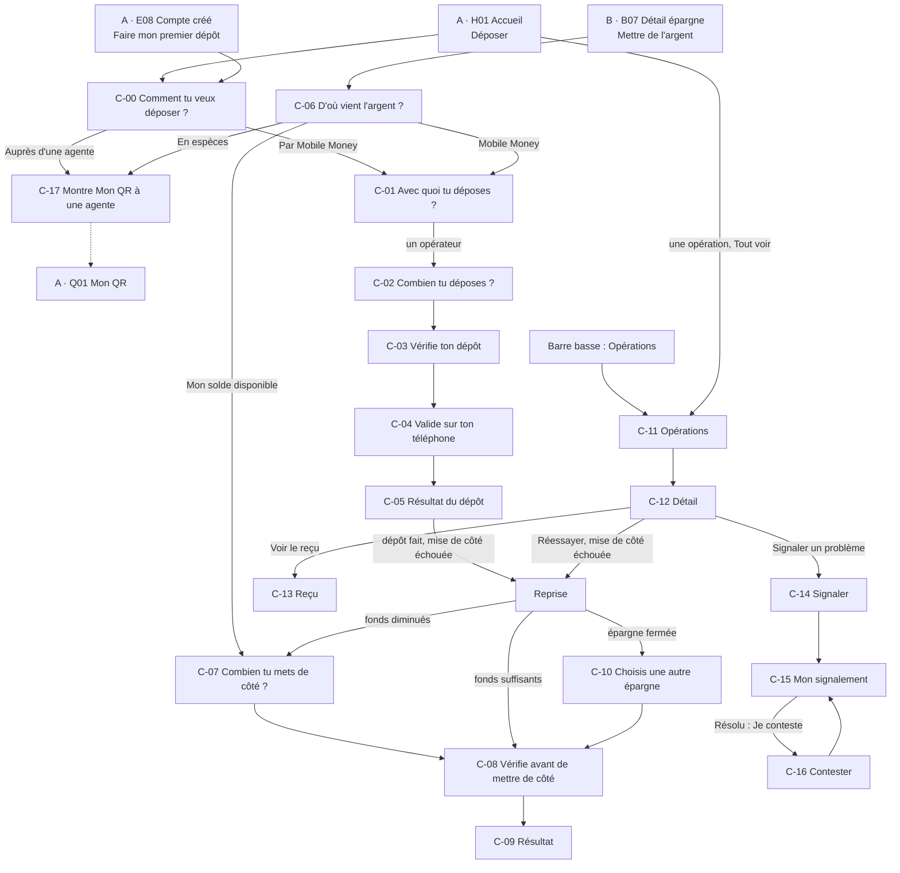
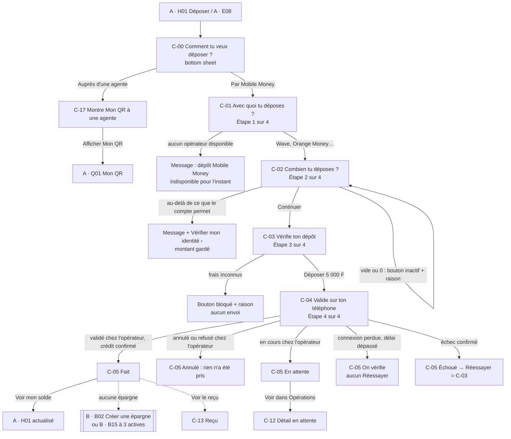
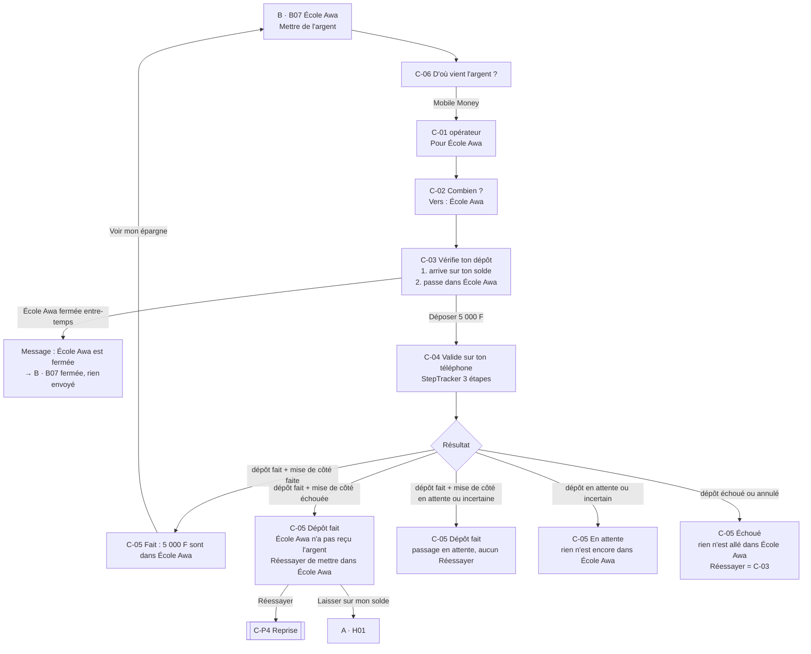
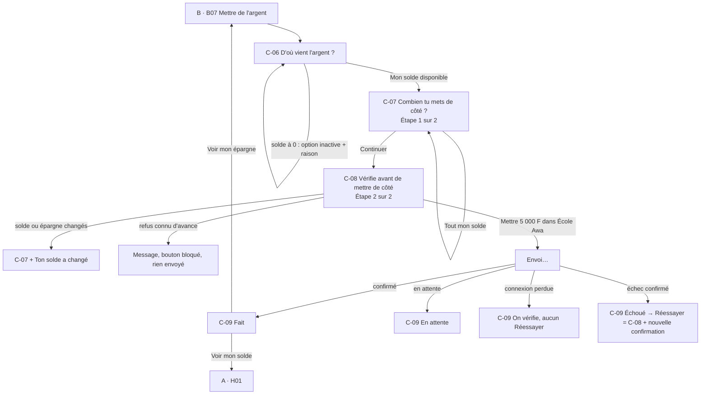
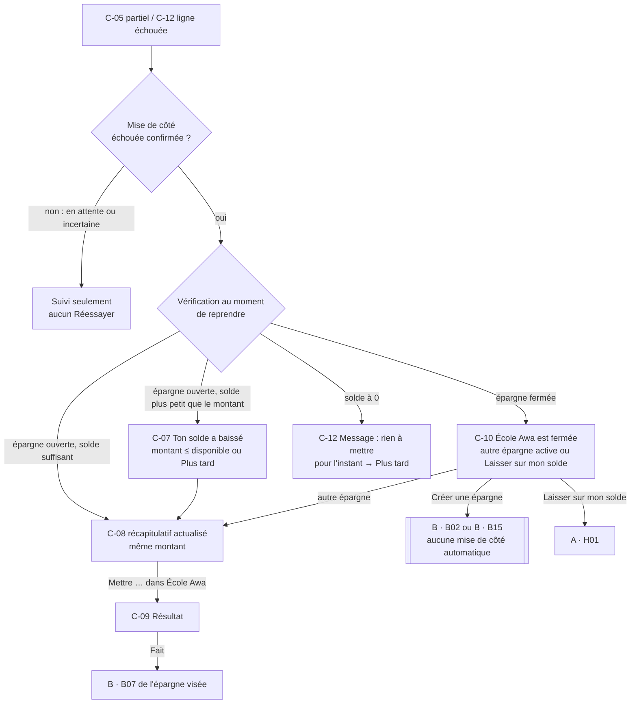
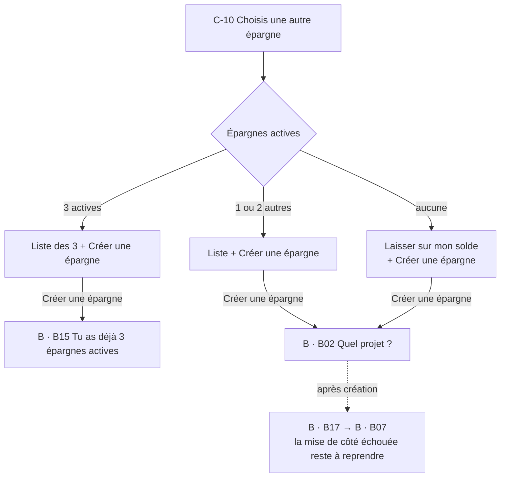
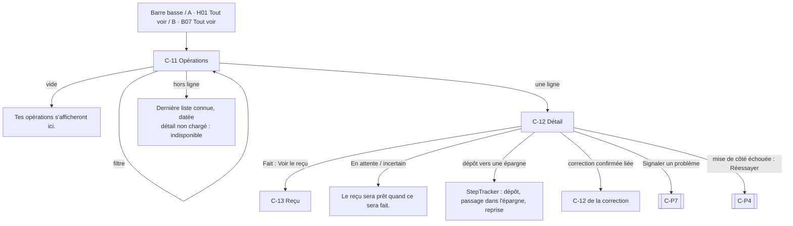
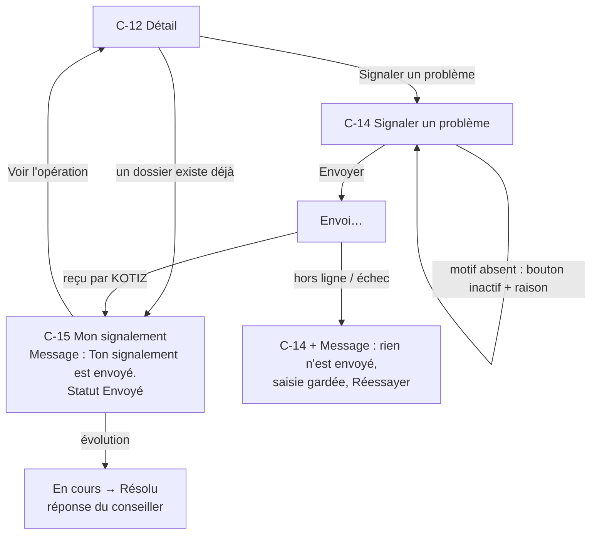
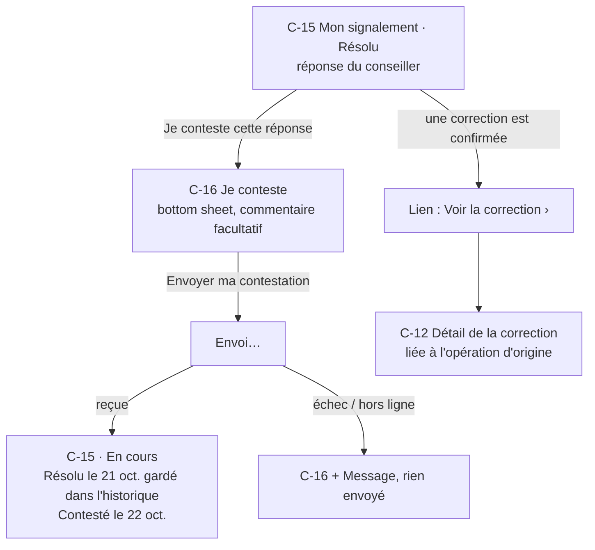

# Spec UX — Refonte des parcours, lot C : dépôt, affectation, opérations et reçus

Date : 19 octobre 2026. Statut : **parcours tranchés par le PO le 19 octobre 2026** (Q1 à Q9 et Q11 validées, PNV-1 refusée, PNV-2 conditionnelle au test : voir Décisions UX). Aucune maquette, aucun code. Les décisions déjà validées (PRD, registre métier, lots A et B, DESIGN.md) sont reprises telles quelles.

Sources : [brief refonte](brief.md) (fait foi), [PRODUCT.md](../../../PRODUCT.md), [DESIGN.md](../../../DESIGN.md) (Design System v11, composants `Kotiz.*`), [PRD design v1.0](../prd-design-mvp.md) §3, §5 (familles 08 et 12), §6 (DEP, AFT, OPS, HELP-OP), §7 (contrat interactionnel, règles 1 à 10, 16a, 16b, 16h, 16i, 16j), §8 (historique, signalement, suivi, contestation), §10 (Montant, Transaction, Dépôt et affectation liés, Opérations / aide, Correction financière), §15.1 (FIN-03, FIN-04), [registre métier](../../product/regles-metier-parcours-mvp.md) (RM-FUND-02, 03, 09, 11 ; RM-HELP-01 ; RM-SAV-02 ; RM-ACC-03), [matrice du socle](../matrice-couverture-socle.md) (lignes 08 et 12, gates G01 à G07), [spec lot A](ux-spec-lot-a.md) (H01, C01, E08, masquage, « Bientôt ici »), [spec lot B](ux-spec-lot-b.md) (B07, B09 à B12, B15, « Mettre de l'argent »), [écrans lot A](screens.md), [écrans lot B](screens-lot-b.md), [handoff lot B](handoff-lot-b.md) (convention provisoire des lignes internes), [glossaire DDD](../../architecture/ddd-context-map-glossaire.md) §4, §5.1, §5.5 (`GoalLock` ignoré, hors MVP), issues [kotiz-ci/platform#66](https://github.com/kotiz-ci/platform/issues/66), [kotiz-ci/platform#67](https://github.com/kotiz-ci/platform/issues/67), [kotiz-ci/platform#69](https://github.com/kotiz-ci/platform/issues/69), [kotiz-ci/platform#94](https://github.com/kotiz-ci/platform/issues/94).

Script de test associé : [test-lot-c.md](test-lot-c.md).

## Numérotation des écrans (à lire d'abord)

- Les écrans du lot C s'écrivent **`C-01` à `C-16`**, avec un **tiret**. Dans le canvas « KOTIZ — App cliente », les planches s'appellent « C · C-01 … » et les fichiers `C-C-01.dc.html`.
- **Deux écrans ajoutés le 19 octobre 2026 sans renuméroter** (Décision PO du 19 octobre 2026) : **`C-00`** « Comment tu veux déposer ? » (bottom sheet ouverte par « Déposer », avant C-01) et **`C-17`** « Montre Mon QR à une agente » (explication du dépôt en espèces, lot E). Les écrans C-01 à C-16 gardent leur numéro.
- **Renumérotation du 19 octobre 2026** : l'écran PIN de la première version (ancien C-09) est supprimé (Décision PO du 19 octobre 2026, Q3) ; les anciens C-10 à C-17 deviennent C-09 à C-16. Le numéro C-09 désigne désormais le résultat de la mise de côté.
- **`C01` sans tiret reste l'écran du lot A « Entrer mon PIN »**. Dans ce document, il est toujours écrit **« A · C01 »** pour lever toute ambiguïté.
- Les écrans des autres lots gardent leur identifiant avec le préfixe du lot quand il y a doute : « A · H01 » (Accueil), « A · E08 » (Compte créé), « B · B07 » (détail d'une épargne), « B · B15 » (limite atteinte).
- Les parcours s'écrivent `C-P1` à `C-P8`.

## Conventions

- « **à confirmer** » = paramètre non tranché, avec son gate (G01 partenaire, G02 sécurité et SMS, G03 assistance, G05 exceptions, G06 tickets). Aucune valeur n'est inventée : ni frais, ni plafond, ni minimum, ni opérateur garanti, ni délai, ni motif de signalement.
- « **Proposition non validée** » = idée qui contredit ou étend une décision validée. Elle n'est **pas** appliquée dans les wireframes ; elle est décrite à part.
- Noms, numéros, montants et références des wireframes sont **fictifs** (« Fatou Koné », `07 08 12 34 56`, `KTZ-2610-0042`).
- Formats : `12 400 FCFA` dans les montants dominants, `12 400 F` dans les lignes ; dates en français ; tutoiement, phrases de moins de 10 mots.

## Vocabulaire

| Interface (Fatou)                                            | Sens                                                                                                            | PRD / glossaire                                                                               |
| ------------------------------------------------------------ | --------------------------------------------------------------------------------------------------------------- | --------------------------------------------------------------------------------------------- |
| **Déposer**                                                  | Faire entrer de l'argent dans KOTIZ depuis le Mobile Money de la cliente (ou en espèces chez une agente, lot E) | dépôt externe, `Deposit`, `PaymentOrder`                                                      |
| **Mettre de l'argent** (bouton), **mettre de côté** (titres) | Faire passer de l'argent dans une épargne. Libellé validé au lot B (Q6)                                         | affectation interne, alimentation ; **absent du glossaire** (à nommer avec `domain-modeling`) |
| **Remettre sur mon solde**                                   | Mouvement d'une épargne vers le solde (lot B)                                                                   | retour au solde                                                                               |
| **Solde disponible**, **mon solde**                          | Argent libre, distinct des épargnes                                                                             | `SavingsAccount`                                                                              |
| **Opérations**                                               | Racine : liste unique de tous les mouvements                                                                    | historique                                                                                    |
| **Reçu**                                                     | Preuve d'une opération **faite**                                                                                | reçu                                                                                          |
| **Signaler un problème**, **mon signalement**                | Dossier ouvert depuis une opération                                                                             | signalement, dossier ; **absent du glossaire**                                                |
| **Je conteste cette réponse**                                | Reprise du même dossier après « Résolu »                                                                        | contestation                                                                                  |
| **Correction**                                               | Mouvement correctif confirmé, lié à une opération d'origine (libellé final à confirmer, G01)                    | correction financière, reversal, contre-écriture                                              |

Jamais : « affecter », « allocation », « transfert » (sonne externe), « retrait » pour un mouvement interne, « remboursé » pour un dossier résolu, toute référence à la tontine.

## Hypothèses

- **H1 — Numéro Mobile Money : toujours le numéro vérifié de la cliente (Décision PO du 19 octobre 2026).** Au MVP, le dépôt part uniquement de ce numéro, **non modifiable**, affiché sur le choix de l'opérateur (C-01) et sur le récapitulatif (C-03) sous la forme « Depuis ton numéro 07 08 12 34 56 · Wave ». Aucun champ ni bouton pour un autre numéro. Ajouter un autre numéro est une évolution post-MVP (voir « Raccords et évolutions »).
- **H2 — Validation chez l'opérateur, hors de KOTIZ.** Le dépôt est autorisé par la cliente chez son opérateur (application de l'opérateur, message à valider ou code : **protocole à confirmer, G01**). KOTIZ ne demande **jamais** le code ou le PIN Mobile Money (PRD §7 règle 6). L'écran C-04 décrit ce moment sans figer le protocole.
- **H3 — Pas de PIN KOTIZ dans le lot C (Décision PO du 19 octobre 2026, Q3).** Ni pour le dépôt Mobile Money (l'autorisation est celle de l'opérateur), ni pour mettre de l'argent depuis le solde, ni pour la reprise d'une mise de côté : **récapitulatif puis bouton de confirmation**. Règle générale : le PIN KOTIZ protège ce qui fait sortir l'argent d'une épargne (retour au solde, lot B) ou de KOTIZ (retraits, lot D).
- **H4 — L'entrée fixe la destination** (PRD §7 règle 1). « Déposer » (A · H01, A · E08) dépose **sur le solde**. « Mettre de l'argent » (B · B07) vise **l'épargne ouverte**, par Mobile Money ou depuis le solde. La destination ne se change pas en cours de route ; le choix d'une destination depuis l'accueil (PNV-1) est refusé pour le lot C (Décision PO du 19 octobre 2026).
- **H5 — Solde et épargne n'incluent que le confirmé.** Un dépôt en attente n'augmente ni le solde ni l'épargne ; il apparaît avec son statut (comme aux lots A et B). Règle de calcul **à confirmer (G01)**.
- **H6 — Pas de file d'attente hors ligne** (lots A et B). Déposer, mettre de côté, signaler et contester demandent le réseau. Hors ligne, la saisie est gardée, rien n'est envoyé en silence. Opérations affiche la dernière liste connue, datée.
- **H7 — Le masquage suit le réglage unique des lots A et B.** Il couvre Opérations (C-11), le détail (C-12) et le reçu (C-13), avec l'œil dans l'en-tête (Décision PO du 19 octobre 2026, Q6). Exceptions : saisie d'un montant (C-02, C-07), récapitulatifs (C-03, C-08), attente et résultats (C-04, C-05, C-09), comme le résultat B · B12 (décision Q3 du lot B).
- **H8 — Signes des montants vus depuis le solde.** Sur l'accueil et dans Opérations, `+` = l'argent arrive sur le solde (dépôt, retour d'une épargne), `−` = il quitte le solde (retrait, mise de côté vers une épargne). Dans le détail d'une épargne (B · B07), le point de vue est celui de l'épargne. Exception : un dépôt Mobile Money vers une épargne tient sur **une seule ligne** « Dépôt vers École Awa · +5 000 F » (Décision PO du 19 octobre 2026, Q4). C'est la convention provisoire du handoff du lot B et du critère de [kotiz-ci/platform#94](https://github.com/kotiz-ci/platform/issues/94), formalisée ici en variante `internal` de `TransactionRow`.
- **H9 — Un signalement ouvert par opération.** Si un dossier existe déjà, le détail de l'opération ouvre ce dossier au lieu d'en créer un second. Règle **à confirmer (G03)**.
- **H10 — Reprise possible tant que la mise de côté échouée n'a pas été reprise.** « Laisser sur mon solde » reporte sans rien perdre ; la reprise reste accessible depuis le détail de l'opération échouée. **Sans limite produit** : « Réessayer » reste tant que la mise de côté n'est pas reprise (Décision PO du 19 octobre 2026, Q5).

## Vue d'ensemble



## Parcours

### C-P1 — Déposer sur mon solde par Mobile Money (critique)

Entrées : A · H01 « Déposer » (bouton principal de l'accueil), A · E08 « Faire mon premier dépôt ». Destination fixée : **Mon solde** (H4). Montant, débit sur le Mobile Money et frais visibles avant validation (PRD §7 règle 5).

« Déposer » ouvre d'abord la bottom sheet **C-00 « Comment tu veux déposer ? »** : « Par Mobile Money » (ce parcours, en pages) ou « Auprès d'une agente » (C-17, explication et lien vers A · Q01 ; le dépôt cash lui-même est au lot E) (Décision PO du 19 octobre 2026).

Chemin principal : **6 écrans** C-00 C-01 C-02 C-03 C-04 C-05, puis A · H01 actualisé. Indicateur « Étape n sur 4 » (Moyen, Montant, Vérifier, Valider) sur C-01 à C-04 ; la feuille C-00 n'est pas comptée comme une étape.



### C-P2 — Mettre de l'argent dans une épargne par Mobile Money (critique, FIN-03)

Entrée : B · B07 « Mettre de l'argent » → C-06 « Mobile Money ». **Deux mouvements liés** : dépôt sur le solde, puis passage dans l'épargne (FIN-03, RM-FUND-11). Une seule destination, la totalité du montant (PRD 16b). Un dépôt fait ne devient **jamais** un échec parce que la mise de côté a échoué (RM-FUND-02).

Chemin principal : **6 écrans** C-06 C-01 C-02 C-03 C-04 C-05, depuis B · B07, retour à B · B07.



### C-P3 — Mettre de l'argent depuis mon solde

Entrée : B · B07 « Mettre de l'argent » → C-06 « Mon solde disponible ». Mouvement interne, **sans frais** (Décision PO du 19 octobre 2026, Q2, comme le retour au solde) et **sans PIN** : récapitulatif puis confirmation (Q3).

Chemin principal : **4 écrans** C-06 C-07 C-08 C-09, retour à B · B07. Indicateur « Étape n sur 2 » (Montant, Vérifier).



### C-P4 — Reprendre une mise de côté échouée (succès partiel)

Déclencheur : un dépôt **fait** dont la mise de côté a **échoué de façon confirmée** (PRD 16h). Entrées : C-05 état partiel « Réessayer de mettre dans École Awa », ou C-12 détail de la ligne « Dépôt vers École Awa · Dépôt fait · épargne pas faite », ou la ligne d'information de B · B07 (raccord, voir « Raccords »). Jamais de nouveau dépôt, jamais d'argent demandé au Mobile Money (RM-FUND-03). Toujours un **récapitulatif actualisé et une nouvelle confirmation** (bouton du récapitulatif, sans PIN, Décision PO du 19 octobre 2026, Q3) : l'autorisation du dépôt ne sert pas deux fois.

Chemins principaux :

- Fonds suffisants, épargne ouverte : **3 écrans** C-05 C-08 C-09.
- Fonds diminués (PRD 16i) : **4 écrans** C-05 C-07 C-08 C-09.
- Épargne fermée (PRD 16j) : **4 écrans** C-05 C-10 C-08 C-09.



### C-P5 — Limite de 3 épargnes au moment de choisir une destination

Dans l'app autonome, la destination n'est choisie qu'à un seul endroit : **C-10**, quand l'épargne d'origine est fermée avant la reprise (H4). C-10 liste les épargnes **actives** (3 au plus, les fermées ne comptent pas) et propose « Créer une épargne », qui ouvre B · B02, ou B · B15 « Tu as déjà 3 épargnes actives » quand la limite est atteinte (RM-SAV-02, FIN-05). Aucune fermeture automatique, aucune mise de côté automatique vers une épargne créée ensuite (PRD 16c, 16j). Le choix d'une destination au moment du dépôt cash est au lot E.

Chemin : **2 écrans** C-10 puis B · B15 (ou B · B02).



### C-P6 — Voir mes opérations, une opération et son reçu (critique)

Racine Opérations (barre basse), A · H01 « Tout voir » ou une ligne, B · B07 « Tout voir › » (filtrée sur l'épargne). Liste **unique** : dépôts, retraits (lot D, lignes seulement), mouvements internes, corrections confirmées. Chaque ligne : type, origine → destination, montant, date, statut en mots (PRD §8).

Chemin principal : **3 écrans** C-11 C-12 C-13.



### C-P7 — Signaler un problème et suivre mon signalement

Depuis le détail d'une opération (C-12), tout statut. Formulaire court : motif requis (liste **à confirmer, G03**), commentaire et pièce jointe facultatifs ; opération, montant et référence repris sans ressaisie (PRD §8, RM-HELP-01). L'envoi confirme la **réception** du signalement, jamais un remboursement. Suivi : **Envoyé > En cours > Résolu**, référence du dossier distincte de celle de l'opération.

Chemin principal : **3 écrans** C-12 C-14 C-15.



### C-P8 — Contester une réponse, et correction financière

Sur un dossier **Résolu**, « Je conteste cette réponse » reprend **le même dossier** et la même référence, garde les échanges et la résolution précédente, et repasse le dossier « En cours » (PRD §8). Ni nouveau signalement, ni remboursement, ni nouvelle transaction. Une **correction financière** n'apparaît que si elle est **confirmée** : ligne propre dans Opérations, liée à l'opération d'origine, avec son montant (PRD §10). Libellés finaux **à confirmer (G01)**.

Chemin principal : **2 écrans** C-15 C-16, retour à C-15.



### Nombre d'écrans par parcours (chemin principal)

| Parcours                                          | Écrans | Séquence                                                                |
| ------------------------------------------------- | ------ | ----------------------------------------------------------------------- |
| C-P1 Déposer sur mon solde                        | 6      | C-00 C-01 C-02 C-03 C-04 C-05 (depuis A · H01 ou A · E08), puis A · H01 |
| C-P1′ Déposer auprès d'une agente (raccord lot E) | 2      | C-00 C-17, puis A · Q01                                                 |
| C-P2 Mettre de l'argent par Mobile Money          | 6      | C-06 C-01 C-02 C-03 C-04 C-05 (depuis B · B07), puis B · B07            |
| C-P3 Mettre de l'argent depuis mon solde          | 4      | C-06 C-07 C-08 C-09 (depuis B · B07), puis B · B07                      |
| C-P4 Reprise, fonds suffisants                    | 3      | C-05 C-08 C-09                                                          |
| C-P4 Reprise, fonds diminués                      | 4      | C-05 C-07 C-08 C-09                                                     |
| C-P4 Reprise, épargne fermée                      | 4      | C-05 C-10 C-08 C-09                                                     |
| C-P5 Limite de 3 au choix de destination          | 2      | C-10 B · B15                                                            |
| C-P6 Opérations, détail, reçu                     | 3      | C-11 C-12 C-13                                                          |
| C-P7 Signaler et suivre                           | 3      | C-12 C-14 C-15                                                          |
| C-P8 Contester                                    | 2      | C-15 C-16 (retour C-15)                                                 |

Cible : aucun chemin principal au-delà de 6 écrans (le lot B monte à 7 pour la création). Le dépôt le plus fréquent (C-P1) tient en 6 écrans, dont une feuille de choix (C-00) et un écran d’attente que Fatou ne manipule pas.

## Carte des écrans

Barre basse : uniquement sur C-11 (racine Opérations). Tous les autres écrans sont des pages poussées sans barre basse, avec `PageHeader`, ou des `BottomSheet`.

| ID   | Écran                                    | Parcours            | Objectif                                                          |
| ---- | ---------------------------------------- | ------------------- | ----------------------------------------------------------------- |
| C-00 | Comment tu veux déposer ? (bottom sheet) | C-P1                | Choisir Mobile Money ou une agente                                |
| C-01 | Avec quoi tu déposes ?                   | C-P1 C-P2           | Choisir son opérateur                                             |
| C-02 | Combien tu déposes ?                     | C-P1 C-P2           | Saisir le montant du dépôt                                        |
| C-03 | Vérifie ton dépôt                        | C-P1 C-P2           | Voir montant, débit, frais, d'où et vers où, avant de valider     |
| C-04 | Valide sur ton téléphone                 | C-P1 C-P2           | Valider chez l'opérateur et suivre l'arrivée                      |
| C-05 | Résultat du dépôt                        | C-P1 C-P2 C-P4      | Savoir si c'est fait, en attente, échoué, ou fait en partie       |
| C-06 | D'où vient l'argent ? (bottom sheet)     | C-P2 C-P3           | Choisir Mobile Money, mon solde ou l'espèce                       |
| C-07 | Combien tu mets de côté ?                | C-P3 C-P4           | Saisir le montant qui passe du solde à l'épargne                  |
| C-08 | Vérifie avant de mettre de côté          | C-P3 C-P4           | Voir combien, d'où et vers où, puis confirmer                     |
| C-09 | Résultat de la mise de côté              | C-P3 C-P4           | Savoir si c'est fait, en attente ou échoué                        |
| C-10 | Choisis une autre épargne (bottom sheet) | C-P4 C-P5           | Épargne fermée : autre épargne active, ou laisser sur le solde    |
| C-11 | Opérations (racine)                      | C-P6                | Voir tous ses mouvements au même endroit                          |
| C-12 | Détail d'une opération                   | C-P4 C-P6 C-P7 C-P8 | Comprendre une opération et choisir la suite                      |
| C-13 | Reçu                                     | C-P6                | Garder la preuve d'une opération faite                            |
| C-14 | Signaler un problème                     | C-P7                | Dire ce qui ne va pas, sans rien retaper                          |
| C-15 | Mon signalement                          | C-P7 C-P8           | Suivre le dossier et lire la réponse                              |
| C-16 | Je conteste cette réponse (bottom sheet) | C-P8                | Rouvrir le même dossier                                           |
| C-17 | Montre Mon QR à une agente               | C-P1′               | Comprendre le dépôt en espèces et afficher son QR (raccord lot E) |

## Règles communes aux écrans du lot C

- **Orientation** : le titre dit ce que Fatou fait (« Combien tu déposes ? », « Combien tu mets de côté ? »). Dépôt : « Étape n sur 4 » (Moyen, Montant, Vérifier, Valider). Mise de côté : « Étape n sur 2 » (Montant, Vérifier). Reprise : mêmes écrans, sans compteur d'étapes (le parcours ne commence pas à l'étape 1) ; titre de C-08 « Réessayer de mettre de côté ».
- **Destination toujours lisible** : de C-02 à C-05 et de C-07 à C-09, une ligne « Vers : Mon solde » ou « Vers : École Awa ». Sur un dépôt vers une épargne, les deux temps sont nommés : « Arrive sur ton solde », puis « Passe dans École Awa ».
- **Montant dominant** : `AmountField` (34 Bold) à la saisie ; montant dominant de `SummaryFlow` au récapitulatif ; rappel du montant sur l'attente et le résultat.
- **Statut réel** : `StatusPill` « Fait » / « En attente » / « Échoué », mot + pictogramme. « Fait » n'apparaît qu'après confirmation. Sur un écran d'attente, `StepTracker` dit « Envoyée », « Validé », « Arrivé » pour les étapes passées, **jamais « Fait »** (DESIGN.md). Aucun reçu de succès, aucune illustration de célébration pendant une attente.
- **Une décision par écran** : un seul bouton principal. Réessayer n'est proposé que quand une nouvelle tentative est sûre (échec **confirmé**) ; jamais sur un résultat inconnu (RM-FUND-09).
- **Retour** `←` : écran précédent, saisie gardée. Depuis un résultat (C-05, C-09), le retour Android mène à la destination (A · H01 ou B · B07), jamais au récapitulatif ni à l'attente (PRD §7 règle 10).
- **Attente réseau** (> 1 s) : bouton en « Envoi… », double appui bloqué, aucun écran suivant avant la réponse. Clé d'idempotence par demande (glossaire §4, issue #67).
- **Hors ligne** : `Message` « Pas de connexion. Rien n'a été envoyé. » + Réessayer, saisie gardée. Après envoi : résultat « On vérifie », jamais un succès ni un échec supposé.
- **Reprise après interruption** (Fatou quitte KOTIZ pour valider dans son application Mobile Money, ou reçoit un client) : au retour, l'app rouvre sur C-04 de la même demande, ou sur son résultat s'il est connu. App fermée : la carte solde de A · H01 (« Dernier dépôt … En attente ») et Opérations mènent à la même opération.
- **Frais** : ligne « Frais » de `SummaryFlow` présente **seulement** avec un frais confirmé (G01). Frais inconnus = bouton de confirmation bloqué avec sa raison, aucun envoi (PRD §7 règle 5). Le retour au solde (lot B) reste sans frais ; aucune autre règle de frais n'est décidée.
- **Aucun paramètre inventé** : montants rapides 500 / 1 000 / 2 000 F = valeurs de démonstration du pilote (PRD §7 règle 4), ni minimum ni plafond. Opérateurs du prototype annoncés fictifs. Pas de délai annoncé (« dans quelques minutes » interdit tant que non confirmé).

## Écrans

### C-00 — Comment tu veux déposer ? (bottom sheet)

- Objectif : choisir comment déposer, avant d'entrer dans un parcours (Décision PO du 19 octobre 2026).
- Action primaire : toucher une option.
- Actions secondaires : fermer la feuille (retour à A · H01 ou A · E08, rien n'est perdu).
- Contenu : poignée ; titre « Comment tu veux déposer ? » ; deux lignes avec illustration et chevron, cible ≥ 48 :
  1. « Par Mobile Money » (→ C-01) ;
  2. « Auprès d'une agente » (→ C-17).
     Pas de montant, pas de sous-texte long ; la destination est le solde (H4).
- États : nominal ; **aucun opérateur disponible** : ligne 1 désactivée avec sa raison « Mobile Money indisponible pour l'instant. », ligne 2 active ; hors ligne : la feuille s'ouvre, C-01 gère le réseau.
- Cas limites : Fatou touche « Déposer » deux fois (une seule feuille) ; retour Android = fermer la feuille.

```
┌──────────────────────────────┐
│            ───               │
│ Comment tu veux déposer ?    │
│                              │
│ [📱] Par Mobile Money      › │
│ ──────────────────────────── │
│ [👤] Auprès d'une agente   › │
└──────────────────────────────┘
```

### C-01 — Avec quoi tu déposes ?

- Objectif : choisir l'opérateur Mobile Money d'où part l'argent.
- Action primaire : toucher un opérateur = étape suivante (liste avec chevron, sans radio ni bouton Continuer, PRD §7 règle 2).
- Actions secondaires : ← (provenance : C-00 refermée sur A · H01 / A · E08, ou C-06).
- Contenu (par priorité) :
  1. `PageHeader` : ←, « Étape 1 sur 4 ».
  2. Titre « Avec quoi tu déposes ? » ; sous-titre de contexte : « Vers : Mon solde » ou « Pour : École Awa » (depuis C-06).
  3. Liste des opérateurs **disponibles** (G01) : logo officiel 64 × 48 non recoloré (Wave : symbole seul, sans inscription), nom, chevron. Ligne de 64, cible ≥ 48.
  4. Sous la liste : « Depuis ton numéro 07 08 12 34 56 » (H1, Décision PO du 19 octobre 2026), en `body`, **non modifiable**, sans lien ni bouton.
- États :
  - **Nominal** : 1 à 4 opérateurs, dans l'ordre fourni par le partenaire (à confirmer G01).
  - **Un seul opérateur** : la liste reste une liste (pas de saut automatique), pour que Fatou voie d'où part l'argent.
  - **Aucun opérateur disponible** : `Message` information « Le dépôt Mobile Money n'est pas possible pour l'instant. » + lien « Déposer auprès d'une agente › » (→ C-17).
  - **Chargement** : squelette de 2 lignes (premier affichage seulement) ; **hors ligne** : `Message` « Pas de connexion. Réessaie quand tu captes. » + Réessayer.
- Cas limites : opérateur devenu indisponible entre C-01 et C-03 (message sur C-03, retour à C-01) ; logo manquant (nom seul, jamais un logo d'un autre opérateur) ; grand texte (le nom passe à la ligne, le logo garde sa taille).

```
┌──────────────────────────────┐
│ ←              Étape 1 sur 4 │
├──────────────────────────────┤
│ Avec quoi tu déposes ?       │
│ Vers : Mon solde             │
│                              │
│ [◉ ] Wave                  › │
│ ──────────────────────────── │
│ [OM] Orange Money          › │
│ ──────────────────────────── │
│ Depuis ton numéro            │
│ 07 08 12 34 56               │
└──────────────────────────────┘
```

### C-02 — Combien tu déposes ?

- Objectif : saisir le montant du dépôt.
- Action primaire : Continuer.
- Actions secondaires : ← (C-01, opérateur gardé), montants rapides.
- Contenu : `PageHeader` (←, « Étape 2 sur 4 ») ; titre « Combien tu déposes ? » ; ligne « Depuis : [logo] Wave » ; `AmountField` (montant 34 Bold, « FCFA » 16, focus visible, clavier numérique système) ; montants rapides 500 / 1 000 / 2 000 F (démonstration, PRD §7 règle 4 : un appui remplace le montant ; une saisie libre désélectionne la puce) ; « Vers : Mon solde » ou « Vers : École Awa ».
- États :
  - Vide (Continuer désactivé, « Écris un montant. ») ; puce sélectionnée ; saisie libre ; 0 (« Le montant doit être plus grand que 0. »).
  - **Au-delà de ce que le compte permet** (niveau d'accès limité, RM-ACC-03, A · H01 ligne d'identité) : `Message` information « Ce montant dépasse ce que ton compte permet pour l'instant. » + « Vérifier mon identité › » (→ sous-lot A2) ; montant gardé ; aucune limite chiffrée (G01).
  - Minimum ou maximum par dépôt fixé par l'opérateur ou le partenaire : raison sous le champ, **texte et valeurs à confirmer (G01)**.
  - Montants toujours visibles, même en mode masqué (H7).
- Cas limites : montant à 7 chiffres sur 320 px (le montant garde 34 px, la devise passe dessous) ; collage d'un texte ; clavier ouvert (Continuer reste visible au-dessus du clavier) ; retour depuis C-03 (montant gardé, puce resélectionnée si elle correspond).

```
┌──────────────────────────────┐
│ ←              Étape 2 sur 4 │
├──────────────────────────────┤
│ Combien tu déposes ?         │
│ Depuis : [◉] Wave            │
│                              │
│   5 000|  FCFA               │
│   ─────────────────          │
│ [ 500 ] [ 1 000 ] [ 2 000 ]  │
│                              │
│ Vers : Mon solde             │
├──────────────────────────────┤
│ [      Continuer         ] ★ │
├──────────────────────────────┤
│   clavier numérique système  │
└──────────────────────────────┘
```

### C-03 — Vérifie ton dépôt

- Objectif : voir combien sera pris sur le Mobile Money, ce qui arrive, d'où et vers où, avant de valider.
- Action primaire : « Déposer 5 000 F » (libellé avec le montant ; envoie la demande à l'opérateur, puis C-04).
- Actions secondaires : ← (C-02), « Modifier » à côté du montant (→ C-02). Pas de changement de destination (H4).
- Contenu (`SummaryFlow`, carte unique, toujours visible même en mode masqué sauf « Ton solde après ») :
  1. « Tu déposes » + **5 000 FCFA** + « Modifier ».
  2. Flux : [logo] « Depuis ton numéro 07 08 12 34 56 · Wave » (non modifiable, H1) ↓ [portefeuille] « Vers · Mon solde » (ou [illustration de l'épargne] « Vers · École Awa »). Nom TalkBack : « De Wave vers Mon solde ».
  3. Lignes de conséquence, **seulement quand elles sont connues** (G01) : « Pris sur ton Wave : X F », « Frais : X F », « Arrive sur ton solde : X F ». Sans frais confirmé, aucune ligne Frais n'est dessinée.
  4. Dépôt vers une épargne : deux lignes numérotées « 1. Arrive sur ton solde » « 2. Passe dans École Awa », et « Dans École Awa après : 50 000 F sur 100 000 F » (contrat F03).
  5. Phrase « Tu vas valider sur ton téléphone. » ; mention « KOTIZ ne te demande jamais ton code Wave. »
- États :
  - **Nominal** (frais confirmés) : wireframe.
  - **Frais inconnus** : `Message` information « Les frais ne sont pas encore connus. » + « Le dépôt n'est pas possible pour l'instant. » ; bouton désactivé, raison « Déposer est bloqué : frais inconnus. » ; rien n'est envoyé (PRD §7 règle 5). C'est l'état réel tant que G01 n'est pas levé ; le prototype utilise un scénario « frais fictifs » annoncé dans la bande hors produit, et cet état « frais inconnus » est dessiné en variante (Décision PO du 19 octobre 2026, Q1).
  - **Refus connu d'avance** (compte restreint, règle partenaire) : `Message` erreur « Ce dépôt n'est pas possible pour l'instant. » + « Contacter l'aide › » (G03) ; bouton désactivé ; aucune valeur chiffrée.
  - **Opérateur devenu indisponible** : `Message` « Wave n'est pas disponible pour l'instant. » + bouton « Choisir un autre moyen » (→ C-01, montant gardé).
  - **Épargne fermée entre-temps** (dépôt vers une épargne) : `Message` « École Awa est fermée. Rien n'a été envoyé. » ; bouton « Voir mon épargne » (→ B · B07 état fermée). Aucune redirection automatique vers le solde ni vers une autre épargne.
  - **Envoi** : bouton « Envoi… », double appui bloqué ; **hors ligne** : « Pas de connexion. Rien n'a été envoyé. ».
- Cas limites : app mise en arrière-plan puis reprise (récapitulatif recalculé avant envoi) ; numéro long ou format inattendu (affiché en entier, jamais coupé, `NumberChip`) ; nom d'épargne long (retour à la ligne).

```
┌──────────────────────────────┐
│ ←              Étape 3 sur 4 │
├──────────────────────────────┤
│ Vérifie ton dépôt            │
│ ┌──────────────────────────┐ │
│ │ Tu déposes      Modifier │ │
│ │ 5 000 FCFA               │ │
│ │ [◉] Depuis ton numéro    │ │
│ │     07 08 12 34 56 · Wave│ │
│ │  ↓                       │ │
│ │ [👛] Vers · Mon solde    │ │
│ │ Pris sur ton    X F      │ │
│ │ Wave            (à conf.)│ │
│ │ Frais           X F      │ │
│ │                 (à conf.)│ │
│ │ Arrive sur ton  X F      │ │
│ │ solde           (à conf.)│ │
│ └──────────────────────────┘ │
│ Tu vas valider sur ton       │
│ téléphone.                   │
│ KOTIZ ne te demande jamais   │
│ ton code Wave.               │
├──────────────────────────────┤
│ [   Déposer 5 000 F      ] ★ │
└──────────────────────────────┘
```

Dépôt vers une épargne (extrait de la carte) :

```
│ │ [◉] Depuis · Wave        │ │
│ │  ↓                       │ │
│ │ [🎒] Vers · École Awa    │ │
│ │ 1. Arrive sur ton solde  │ │
│ │ 2. Passe dans École Awa  │ │
│ │ Dans École Awa après :   │ │
│ │ 50 000 F sur 100 000 F   │ │
```

### C-04 — Valide sur ton téléphone

- Objectif : valider le dépôt chez l'opérateur, puis attendre son arrivée sans croire que c'est fait.
- Action primaire : **selon le protocole de l'opérateur (G01)** : « Ouvrir Wave » si l'opérateur passe par son application ; aucun bouton si la validation arrive d'elle-même sur le téléphone (message ou code de l'opérateur). La spec ne fige pas ce protocole.
- Actions secondaires : « Je n'ai rien reçu » (bottom sheet d'aide : vérifier le réseau, ouvrir l'application de l'opérateur, contacter l'aide ; contenu à confirmer G01/G03) ; « Annuler » **seulement** si l'opérateur permet d'annuler avant validation (à confirmer G01). Pas de bouton retour vers C-03 une fois la demande envoyée.
- Contenu :
  1. `PageHeader` sans ← (la demande est partie), « Étape 4 sur 4 ».
  2. Titre « Valide 5 000 F sur ton Wave » ; logo de l'opérateur.
  3. `StepTracker` (dépôt sur le solde) : « Demande envoyée à Wave » (`sent`, « Envoyée ») · « Ta validation sur Wave » (En attente) · « Arrivée sur ton solde » (Pas encore). Dépôt vers une épargne : quatrième étape « Passage dans École Awa » (Pas encore).
  4. « Ne ferme pas KOTIZ avant d'avoir validé. » puis, sous le tracker, « Tu peux revenir ici à tout moment. »
  5. Référence de la demande (fictive) en `caption`.
- États :
  - **Attente de validation** : wireframe.
  - **Validée, crédit en cours** : étape 2 « Validée » (coche, mot participe), étape 3 En attente ; titre « Ton dépôt arrive. ». Puis bascule automatique vers C-05 au résultat.
  - Délai d'attente au-delà duquel on passe à C-05 « On vérifie » : **à confirmer (technique, G01)**.
  - **Retour dans KOTIZ après validation** : l'écran se met à jour seul ; jamais de bouton « J'ai validé » (il ferait croire à un succès sans preuve).
- Cas limites : Fatou valide puis perd le réseau (C-05 « On vérifie », aucune nouvelle demande) ; elle quitte l'app et y revient le lendemain (A · H01 « Dernier dépôt … En attente » → C-12 de la même demande) ; elle tente de redéposer pendant l'attente (autorisé seulement pour une nouvelle demande distincte : décision PO du 19 octobre 2026, Q11 : nouvelle demande distincte, montant et référence propres, jamais la répétition de la même) ; TalkBack annonce chaque changement d'étape.

```
┌──────────────────────────────┐
│                Étape 4 sur 4 │
├──────────────────────────────┤
│ [◉]                          │
│ Valide 5 000 F sur ton Wave  │
│                              │
│ (✓) Demande envoyée à Wave   │
│     Envoyée                  │
│ (◷) Ta validation sur Wave   │
│     En attente               │
│ ( ) Arrivée sur ton solde    │
│     Pas encore               │
│                              │
│ Ne ferme pas KOTIZ avant     │
│ d'avoir validé.              │
│ Réf. KTZ-2610-0042 (fictive) │
├──────────────────────────────┤
│ [      Ouvrir Wave       ] ★ │
│       Je n'ai rien reçu      │
└──────────────────────────────┘
```

### C-05 — Résultat du dépôt

- Objectif : savoir si c'est fait, en attente, échoué, ou fait en partie.
- Action primaire : selon l'état (voir ci-dessous).
- Actions secondaires : « Voir le reçu › » (bouton texte, **seulement** si le dépôt est fait), « Signaler un problème » (en attente prolongée, incertain, partiel ; → C-14), « Voir dans Opérations » (→ C-12).
- Contenu par état (`OperationStatus`, préréglages F07) :
  - **Fait, vers le solde** : `StatusPill` « Fait » ; titre « 5 000 F sont sur ton solde. » ; « Depuis : Wave » ; référence ; « Voir le reçu › ». Primaire **Voir mon solde** (→ A · H01). Sans aucune épargne active : lien « Créer une épargne › » (→ B · B02 ; facultatif, aucune mise de côté automatique, PRD 16c). Pas d'illustration de célébration (mouvement d'argent courant), y compris pour le premier dépôt depuis A · E08 (Décision PO du 19 octobre 2026, Q8).
  - **Fait, vers une épargne** (dépôt fait + mise de côté faite) : `StatusPill` « Fait » ; titre « 5 000 F sont dans École Awa. » ; deux lignes « Dépôt · Fait » et « Dans École Awa · Fait » ; barre de l'épargne actualisée ; si la cible est atteinte : « École Awa a atteint son objectif. » en texte neutre, sans coche (DESIGN.md, PRD §7 règle 13). Primaire **Voir mon épargne** (→ B · B07), secondaire « Voir mon solde ».
  - **Fait en partie : dépôt fait, mise de côté échouée** (confirmée) : pas de `StatusPill` global ; titre « Ton dépôt est fait. » ; sous-titre « École Awa n'a pas reçu l'argent. » ; lignes « Dépôt · Fait » et « Dans École Awa · Échoué » ; « Les 5 000 F sont sur ton solde. » ; jamais « Épargne alimentée ». Primaire **Réessayer de mettre dans École Awa** (→ C-P4) ; bouton texte **Laisser sur mon solde** (→ A · H01 ; la reprise reste possible depuis Opérations, H10) ; « Voir le reçu du dépôt › ».
  - **Fait en partie : dépôt fait, mise de côté en attente ou incertaine** : titre « Ton dépôt est fait. » ; « Le passage dans École Awa est en attente. » ; lignes « Dépôt · Fait » et « Dans École Awa · En attente » ; « Ne refais pas l'opération. » ; **aucun Réessayer** (PRD 16a, 16h). Primaire **Voir dans Opérations** (→ C-12 de la même opération) ; « Voir le reçu du dépôt › ».
  - **En attente** (dépôt pas encore confirmé) : `StatusPill` « En attente » + `StepTracker` (étapes passées en participe) ; titre « Ton dépôt est en attente. » ; « Ne refais pas l'opération. » ; « Tu le retrouves dans Opérations. » ; vers une épargne : « Rien n'est encore dans École Awa. » ; pas de reçu. Primaire **Voir dans Opérations**.
  - **On vérifie** (connexion perdue après envoi, délai dépassé) : même signature « En attente » ; titre « On vérifie ton dépôt. » ; référence ; « Ne refais pas l'opération. » ; « Contacter l'aide › » (G03) ; **aucun Réessayer** (RM-FUND-09).
  - **Annulé ou refusé chez l'opérateur** : `StatusPill` « Échoué » ; titre « Ton dépôt n'est pas fait. » ; « Tu as annulé sur Wave. » ou « Wave a refusé le dépôt. » (raison de l'opérateur si elle est fournie, G01) ; « Rien n'a été pris sur ton Wave. » **seulement si l'opérateur le confirme** (G01). Primaire **Réessayer** (→ C-03 actualisé, nouvelle validation).
  - **Échoué** (échec technique confirmé) : `StatusPill` « Échoué » ; titre « Ton dépôt de 5 000 F n'a pas marché. » ; vers une épargne : « Rien n'est allé dans École Awa. » ; primaire **Réessayer** (→ C-03 actualisé) ; bouton texte « Retour à l'accueil ».
- Cas limites : retour Android = sortie vers la destination, jamais C-04 ni C-03 ; résultat arrivé pendant que l'app était fermée (A · H01 et C-11 montrent le statut réel) ; montants visibles même en mode masqué (H7) ; SMS ou notification de l'opérateur reçu avant le résultat KOTIZ : C-05 reste sur le statut KOTIZ, jamais déduit d'un message externe.

```
┌──────────────────────────────┐
│                              │
│ [✓ Fait]                     │
│ 5 000 F sont sur             │
│ ton solde.                   │
│                              │
│ Depuis : [◉] Wave            │
│ Réf. KTZ-2610-0042 (fictive) │
│ ──────────────────────────── │
│ Voir le reçu               › │
│ ──────────────────────────── │
├──────────────────────────────┤
│ [     Voir mon solde     ] ★ │
└──────────────────────────────┘
```

Fait en partie, mise de côté échouée :

```
┌──────────────────────────────┐
│ Ton dépôt est fait.          │
│ École Awa n'a pas reçu       │
│ l'argent.                    │
│                              │
│ Dépôt               [✓ Fait] │
│ Dans École Awa   [✕ Échoué]  │
│                              │
│ Les 5 000 F sont sur ton     │
│ solde.                       │
│ ──────────────────────────── │
│ Voir le reçu du dépôt      › │
│ ──────────────────────────── │
├──────────────────────────────┤
│ [Réessayer de mettre dans  ] │
│ [École Awa               ] ★ │
│     Laisser sur mon solde    │
└──────────────────────────────┘
```

Fait en partie, mise de côté en attente :

```
│ Ton dépôt est fait.          │
│ Le passage dans École Awa    │
│ est en attente.              │
│ Dépôt               [✓ Fait] │
│ Dans École Awa [◷ En attente]│
│ Ne refais pas l'opération.   │
├──────────────────────────────┤
│ [  Voir dans Opérations  ] ★ │
```

### C-06 — D'où vient l'argent ? (bottom sheet)

- Objectif : choisir l'origine des fonds pour mettre de l'argent dans une épargne (PRD §3 : Mobile Money OU Mon solde disponible, branches distinctes ; PRD §6 AFT : choix en bottom sheet).
- Action primaire : toucher une origine.
- Actions secondaires : fermer la feuille (retour à B · B07 sans perte).
- Contenu : poignée ; titre « D'où vient l'argent ? » ; rappel « Pour : École Awa » ; trois lignes avec illustration et chevron :
  1. « Mon solde disponible » (→ C-07) **si le solde est supérieur à 0** ;
  2. « Mobile Money » (→ C-01 avec contexte « Pour : École Awa ») ;
  3. « En espèces chez une agente » (→ C-17).
     Solde à 0 : **Mobile Money passe en premier**, « Mon solde disponible » descend en deuxième, désactivé avec sa raison (Décision PO du 19 octobre 2026, Q9).
     Aucun montant dans la feuille : le solde disponible s'affiche sur C-07, qui est une saisie (H7).
- États : **solde à 0 ou mise de côté en attente sur ce solde** : ligne 1 désactivée avec sa raison « Rien sur ton solde pour l'instant. » ; aucun opérateur disponible : ligne 2 désactivée, « Mobile Money indisponible pour l'instant. » ; hors ligne : la feuille s'ouvre, l'écran suivant gère le réseau.
- Cas limites : épargne fermée pendant que la feuille est ouverte (l'écran suivant le signale) ; ordre des lignes : solde en premier s'il est supérieur à 0, sinon Mobile Money (Décision PO du 19 octobre 2026, Q9).

```
┌──────────────────────────────┐
│            ───               │
│ D'où vient l'argent ?        │
│ Pour : École Awa             │
│                              │
│ [👛] Mon solde disponible  › │
│ ──────────────────────────── │
│ [📱] Mobile Money          › │
│ ──────────────────────────── │
│ [👤] En espèces chez une     │
│      agente                › │
└──────────────────────────────┘
```

### C-07 — Combien tu mets de côté ?

- Objectif : saisir le montant qui passe du solde à l'épargne.
- Action primaire : Continuer.
- Actions secondaires : ← (B · B07 via C-06 refermée), puce « Tout mon solde ».
- Contenu : `PageHeader` (←, « Étape 1 sur 2 ») ; titre « Combien tu mets de côté ? » ; « Depuis : Mon solde · 12 400 F disponibles » ; `AmountField` ; puce large « Tout mon solde » (même variante que « Tout remettre » du lot B) ; « Vers : [🎒] École Awa ».
- États : vide (Continuer désactivé, « Écris un montant. ») ; saisi ; « Tout mon solde » sélectionné ; 0 (« Le montant doit être plus grand que 0. ») ; supérieur au solde (« Tu as 12 400 F sur ton solde. ») ; solde changé au retour de C-08 (`Message` « Ton solde a changé. » + nouveau disponible).
- **Mode reprise, fonds diminués** (PRD 16i) : titre « Combien tu mets dans École Awa ? » ; `Message` information « Ton solde a baissé. Tu as 3 000 F disponibles. » ; montant prérempli avec **le plus petit des deux** : montant du dépôt d'origine ou solde disponible (3 000 F), modifiable vers le bas ; plafond = ce même montant (on ne prélève pas en silence des fonds autres que ceux du dépôt, PRD 16b) ; bouton texte **Plus tard** (laisse l'argent sur le solde, la reprise reste possible). Sans compteur d'étapes.
- Cas limites : montant minimum d'une mise de côté (à confirmer G01, aucune valeur) ; solde dont une partie est en attente de sortie (seul le disponible confirmé compte, H5) ; mise de côté qui fait dépasser la cible (autorisé, épargne flexible ; aide « Ton objectif sera atteint. » sous le champ).

```
┌──────────────────────────────┐
│ ←              Étape 1 sur 2 │
├──────────────────────────────┤
│ Combien tu mets de côté ?    │
│ Depuis : Mon solde           │
│          12 400 F disponibles│
│                              │
│   5 000|  FCFA               │
│   ─────────────────          │
│ [ Tout mon solde ]           │
│                              │
│ Vers : [🎒] École Awa        │
├──────────────────────────────┤
│ [      Continuer         ] ★ │
├──────────────────────────────┤
│   clavier numérique système  │
└──────────────────────────────┘
```

### C-08 — Vérifie avant de mettre de côté

- Objectif : voir combien, d'où et vers où, puis confirmer.
- Action primaire : **« Mettre 5 000 F dans École Awa »** (montant et destination dans le libellé ; envoie le mouvement, puis C-09). Pas de PIN (Décision PO du 19 octobre 2026, Q3).
- Actions secondaires : ← (C-07, montant gardé), « Modifier » à côté du montant ; en reprise, « Plus tard » (bouton texte).
- Contenu (`SummaryFlow`, carte unique, visible même en mode masqué sauf « Il restera sur ton solde ») :
  1. « Tu mets » + **5 000 FCFA** + « Modifier ».
  2. Flux : [portefeuille] « Depuis · Mon solde » ↓ [illustration] « Vers · École Awa ».
  3. « Il restera sur ton solde : 7 400 F ».
  4. « Dans École Awa après : 50 000 F sur 100 000 F » (contrat F03 ; « Objectif atteint » neutre si la cible est atteinte).
  5. **Aucune ligne Frais** : la mise de côté est sans frais (Décision PO du 19 octobre 2026, Q2), comme le retour au solde ; aucun état « frais inconnus ».
  6. Phrase « L'argent reste sur KOTIZ. Tu peux le remettre sur ton solde. »
- **Mode reprise** (C-P4) : titre « Réessayer de mettre de côté » ; ligne de contexte en tête « Suite à ton dépôt Wave du 18 oct. » (lien vers C-12 de cette même opération) ; montant actualisé ; destination actualisée (épargne d'origine ou celle choisie sur C-10) ; nouvelle confirmation obligatoire par le bouton du récapitulatif, sans PIN (PRD 16h ; Décision PO du 19 octobre 2026, Q3).
- États :
  - **Nominal** : wireframe.
  - **Envoi** : bouton « Envoi… », double appui bloqué.
  - **Refus connu d'avance** : `Message` erreur « Ce mouvement n'est pas possible pour l'instant. Ton argent n'a pas bougé. » + « Contacter l'aide › » ; bouton désactivé ; aucune valeur chiffrée (même règle que B · B10).
  - **Solde ou épargne changés** : retour à C-07 avec message, ou C-10 si l'épargne vient d'être fermée.
  - **Hors ligne** : « Pas de connexion. Rien n'a été envoyé. ».
- Cas limites : reprise ouverte depuis deux endroits (C-05 et C-12) : une seule nouvelle tentative possible à la fois, la seconde ouvre l'état en cours ; app en arrière-plan puis reprise : récapitulatif recalculé.

```
┌──────────────────────────────┐
│ ←              Étape 2 sur 2 │
├──────────────────────────────┤
│ Vérifie avant de mettre      │
│ de côté                      │
│ ┌──────────────────────────┐ │
│ │ Tu mets         Modifier │ │
│ │ 5 000 FCFA               │ │
│ │ [👛] Depuis · Mon solde  │ │
│ │  ↓                       │ │
│ │ [🎒] Vers · École Awa    │ │
│ │ Il restera sur  7 400 F  │ │
│ │ ton solde                │ │
│ │ Dans École Awa  50 000 F │ │
│ │ après       sur 100 000 F│ │
│ └──────────────────────────┘ │
│ L'argent reste sur KOTIZ.    │
├──────────────────────────────┤
│ [ Mettre 5 000 F dans    ] ★ │
│ [ École Awa              ]   │
└──────────────────────────────┘
```

Mode reprise (extrait) :

```
│ ←                            │
│ Réessayer de mettre de côté  │
│ Suite à ton dépôt Wave       │
│ du 18 oct.                 › │
│ │ Tu mets         Modifier │ │
│ │ 3 000 FCFA               │ │
│ ...                          │
│ [ Mettre 3 000 F dans    ] ★ │
│ [ École Awa              ]   │
│           Plus tard          │
```

### C-09 — Résultat de la mise de côté

Même structure que B · B12, dans l'autre sens.

- Objectif : savoir si l'argent est dans l'épargne.
- Action primaire : Voir mon épargne (→ B · B07) ; Réessayer en cas d'échec confirmé.
- Actions secondaires : Voir mon solde (→ A · H01), « Voir le reçu › » (si fait), aide (en attente ou incertain).
- Contenu par état :
  - **Fait** : `StatusPill` « Fait » ; titre « 5 000 F sont dans École Awa. » ; « Depuis : Mon solde » ; « Il reste 7 400 F sur ton solde. » ; barre de l'épargne actualisée ; si la cible est atteinte : « École Awa a atteint son objectif. » (neutre, sans coche, sans célébration) ; référence ; « Voir le reçu › ». En reprise : « Ton dépôt du 18 oct. est maintenant dans École Awa. » (ou dans l'épargne choisie).
  - **En attente** : `StatusPill` « En attente » + `StepTracker` (« Demande · Envoyée », « Dans École Awa · En attente ») ; « Ne refais pas l'opération. » ; « Tu le retrouves dans Opérations. » ; pas de reçu.
  - **On vérifie** : même signature ; « Contacter l'aide › » (G03) ; aucun Réessayer.
  - **Échoué** (confirmé, après envoi) : `StatusPill` « Échoué » ; titre « Les 5 000 F ne sont pas allés dans École Awa. » ; « Ton argent n'a pas bougé. Il est sur ton solde. » ; primaire Réessayer (→ C-08 actualisé, nouvelle confirmation) ; bouton texte « Voir mon épargne ».
- Cas limites : retour Android = Voir mon épargne ; épargne fermée pendant l'attente (le résultat reste celui du mouvement ; l'épargne fermée se lit sur B · B07) ; montants visibles en mode masqué (H7).

```
┌──────────────────────────────┐
│                              │
│ [✓ Fait]                     │
│ 5 000 F sont dans            │
│ École Awa.                   │
│                              │
│ Depuis : Mon solde           │
│ Il reste 7 400 F sur ton     │
│ solde.                       │
│ École Awa : 50 000 F sur     │
│ 100 000 F ▓▓▓▓▓▓▓░░░░░░░     │
│ Réf. KTZ-2610-0057 (fictive) │
│ ──────────────────────────── │
│ Voir le reçu               › │
├──────────────────────────────┤
│ [   Voir mon épargne     ] ★ │
│        Voir mon solde        │
└──────────────────────────────┘
```

### C-10 — Choisis une autre épargne (bottom sheet)

- Objectif : l'épargne visée est fermée ; choisir une autre épargne active ou laisser l'argent sur le solde (PRD 16j).
- Action primaire : toucher une épargne active (→ C-08 avec cette destination, nouvelle confirmation).
- Actions secondaires : **Laisser sur mon solde** (bouton secondaire, report ; → A · H01), « Créer une épargne › » (→ B · B02, ou B · B15 à 3 actives).
- Contenu : `IconPastille` Épargnes ; titre « École Awa est fermée » ; « Tes 5 000 F sont sur ton solde. » ; « Tu peux les mettre dans une autre épargne. » ; liste des épargnes **actives** (`GoalRow` compact : nom et progression ; montants masqués si le réglage l'est) ; « Créer une épargne › » ; bouton secondaire « Laisser sur mon solde ».
- États :
  - **1 à 3 autres actives** : liste ; avec 3 actives, « Créer une épargne › » ouvre B · B15 « Tu as déjà 3 épargnes actives » (C-P5).
  - **Aucune autre active** : pas de liste ; « Tu n'as pas d'autre épargne. » ; primaire **Laisser sur mon solde** ; « Créer une épargne › ».
  - Après création (B · B02 → B · B17 → B · B07) : **aucune mise de côté automatique** ; la reprise reste disponible depuis C-12 et l'état de B · B07 (raccord).
- Cas limites : jamais de réouverture de l'épargne fermée (PRD 16j) ; noms longs ; une épargne à objectif atteint reste choisissable.

```
┌──────────────────────────────┐
│            ───               │
│        [ pastille ]          │
│ École Awa est fermée         │
│ Tes 5 000 F sont sur ton     │
│ solde.                       │
│ Tu peux les mettre dans une  │
│ autre épargne.               │
│ [💼] Boutique              › │
│      8 000 F sur 50 000 F    │
│ [🎉] Tabaski               › │
│      Objectif atteint        │
│ Créer une épargne          › │
│ [ Laisser sur mon solde  ]   │
└──────────────────────────────┘
```

### C-11 — Opérations (racine)

- Objectif : voir tous ses mouvements au même endroit et en ouvrir un.
- Action primaire : toucher une opération (→ C-12). Pas de bouton principal (racine de consultation, comme B · B01 à 3 actives).
- Actions secondaires : filtres, œil (`MaskToggle`), « Voir plus », barre basse.
- Contenu (par priorité) :
  1. `RootHeader` « Opérations » + `MaskToggle`.
  2. Filtres en puces sur une ligne défilante : « Tout » (par défaut) · « Dépôts » · « Retraits » · « Épargnes » (mouvements entre solde et épargnes). Depuis B · B07 « Tout voir › » : puce supplémentaire « École Awa ✕ » active.
  3. Lignes groupées par jour (« Aujourd'hui », « Hier », « 17 octobre ») : `TransactionRow` (pastille, titre, sous-titre origine → destination, montant signé selon H8, statut en mots + pictogramme).
  4. « Voir plus » en bas (chargement par page, pas de défilement infini : data limitée).
  5. Barre basse, onglet Opérations actif.
- Lignes par type (titre · sous-titre · montant) :
  - Dépôt Mobile Money vers le solde : « Dépôt Wave » · « Vers ton solde » · `+5 000 F`.
  - Dépôt Mobile Money vers une épargne : **une seule ligne** « Dépôt vers École Awa » · « Depuis Wave » · `+5 000 F`, avec un **statut combiné** (Décision PO du 19 octobre 2026, Q4) : « Fait » (dépôt et passage faits) ; « En attente » (dépôt pas encore confirmé) ; « Échoué » (dépôt échoué) ; « Dépôt fait · épargne en attente » ; « Dépôt fait · épargne pas faite ». Le statut combiné s'écrit en deux segments : `StatusPill` « Fait » du dépôt, puis « épargne en attente » (horloge) ou « épargne pas faite » (croix), en 14. Une reprise faite remet la ligne à « Fait » ; « Laisser sur mon solde » la laisse à « Dépôt fait · épargne pas faite ».
  - Mise de côté depuis le solde : « Vers École Awa » · « Depuis ton solde » · `−5 000 F` (variante `internal`).
  - Retour au solde (lot B) : « Depuis École Awa » · « Vers ton solde » · `+20 000 F` (variante `internal`).
  - Dépôt en espèces (lot E) : « Dépôt en espèces » · « Avec [agente] » · `+` (ligne seulement).
  - Retrait (lot D) : « Retrait Wave » · « Vers 07 08 … 56 » · `−` (ligne seulement, parcours au lot D).
  - Correction confirmée : « Correction » · « Pour ton dépôt du 18 oct. » · montant signé (libellé final à confirmer, G01).
  - Pastilles : apport (vert doux) ; sortie (`surface-canvas`) ; mouvement interne (`surface-canvas` + pictogramme flèches internes, jamais de logo d'opérateur) ; échec (`surface-error`, seulement pour un échec).
- États :
  - **Vide** : illustration neutre + « Tes opérations s'afficheront ici. » + bouton texte « Faire un dépôt » (→ C-01). Pas de bouton principal vert sur une racine vide (cohérent avec A · H01 vide).
  - **Rempli** : wireframe.
  - **Filtre sans résultat** : « Aucun retrait pour l'instant. » + « Tout voir ».
  - **Masqué** (H7) : montants `••• F` annoncés « Montant masqué » ; titres, sous-titres, statuts, dates visibles.
  - **Chargement** : squelette au premier affichage ; « Voir plus » en « Chargement… ».
  - **Hors ligne / accès indisponible** (PRD §10) : dernière liste connue + « Mis à jour à 14:32 · hors connexion » ; statuts affichés tels que connus, jamais promus ; « Voir plus » désactivé avec sa raison.
- Cas limites : opération en attente depuis longtemps (reste « En attente », jamais requalifiée par l'app) ; plusieurs opérations en attente ; nom d'épargne long (sous-titre tronqué avec …, nom complet au détail) ; épargne fermée (ses lignes restent, sous-titre « Vers Moto (fermée) ») ; montant à 7 chiffres ; grand texte (le statut passe sous le montant).

```
┌──────────────────────────────┐
│ Opérations               👁  │
├──────────────────────────────┤
│ (Tout) Dépôts Retraits Épar.›│
├──────────────────────────────┤
│ Aujourd'hui                  │
│ [↘] Dépôt vers   +5 000 F    │
│     École Awa · Depuis Wave  │
│     [✓ Dépôt fait] · ✕       │
│     épargne pas faite        │
│ Hier                         │
│ [⇄] Depuis École  +20 000 F  │
│     Awa · Vers ton    [Fait] │
│     solde                    │
│ 17 octobre                   │
│ [↘] Dépôt Wave   +2 000 F    │
│     Vers ton solde           │
│               [◷ En attente] │
│         [ Voir plus ]        │
├──────────────────────────────┤
│ Accueil Épargnes Opérat. Prof│
└──────────────────────────────┘
```

### C-12 — Détail d'une opération

- Objectif : comprendre une opération et choisir la suite.
- Action primaire : selon l'état — **Voir le reçu** (fait) ; **Réessayer de mettre dans École Awa** (mise de côté échouée, reprise sûre) ; **Signaler un problème** (en attente prolongée, incertain) ; aucune (échoué simple, où « Signaler un problème » reste en bouton texte).
- Actions secondaires : ← (provenance), `MaskToggle`, « Signaler un problème » (bouton texte, ou « Voir mon signalement › » si un dossier existe, H9), correction liée (« Voir la correction › »).
- Contenu (par priorité) :
  1. `PageHeader` (←, titre du type : « Dépôt Wave », « Mise de côté », « Retour au solde », « Correction ») + `MaskToggle`.
  2. `StatusPill` du statut réel, en tête.
  3. Montant en `amount` (signé selon H8 pour la cohérence avec la liste ; masqué si le réglage l'est).
  4. Flux origine ↓ destination (même rendu que `SummaryFlow`, lecture seule) : « Depuis · Wave 07 08 12 34 56 » ↓ « Vers · Mon solde ».
  5. Lignes : date et heure ; frais et montant arrivé (si confirmés, G01) ; référence KOTIZ ; référence de l'opérateur (si fournie, G01) ; en attente : `StepTracker`.
  6. Dépôt vers une épargne (Décision PO du 19 octobre 2026, Q4) : `StepTracker` des étapes de la même ligne, chacune avec son statut réel : « Dépôt depuis Wave » (Fait / En attente / Échoué), « Passage dans École Awa » (Fait / En attente / Pas fait), et, s'il y a eu reprise, « Reprise vers École Awa (ou Boutique) · 19 oct. ». Le mot « Fait » n'apparaît que sur une étape confirmée. Bloc « Lié à cette opération » : correction confirmée liée.
  7. Actions (voir ci-dessus), puis « Signaler un problème » en bouton texte.
- États :
  - **Fait** : reçu disponible.
  - **En attente / on vérifie** : `StepTracker` ; « Le reçu sera prêt quand ce sera fait. » ; « Ne refais pas l'opération. » ; aucun reçu, aucun Réessayer.
  - **Échoué** : raison si connue ; « Ton argent n'a pas bougé. » seulement si confirmé ; Réessayer **uniquement** pour un dépôt fait dont le passage dans l'épargne a échoué (reprise, C-P4) ; un dépôt échoué se refait par « Déposer » (nouvelle demande).
  - **Passage échoué, solde à 0** : `Message` « Ton solde est à 0 F. Rien à mettre dans École Awa pour l'instant. » ; Réessayer désactivé avec cette raison.
  - **Reprise déjà faite** : étape « Reprise · Fait · 19 oct. » dans le `StepTracker` ; plus de Réessayer.
  - **Signalement en cours** : `InfoLine` « Signalement en cours · Dossier n° 2610-0007 › ».
  - **Correction confirmée** : bloc lié « Correction · +5 000 F · Fait › ». Aucune correction affichée tant qu'elle n'est pas confirmée ; un dossier résolu ne crée jamais, à lui seul, une ligne de correction.
  - **Masqué** : montants masqués, œil pour réafficher.
  - **Hors ligne, détail non chargé** : « Détail indisponible hors connexion. » + Réessayer (accès indisponible, PRD §10).
- Cas limites : opération d'une épargne fermée (lisible, aucune action d'argent) ; retrait (lot D) : détail en lecture seule, structure identique ; référence longue (retour à la ligne, copiable par appui long, à confirmer technique).

```
┌──────────────────────────────┐
│ ←  Dépôt Wave            👁  │
├──────────────────────────────┤
│ [✓ Fait]                     │
│ +5 000 FCFA                  │
│ [◉] Depuis · Wave            │
│     07 08 12 34 56           │
│  ↓                           │
│ [👛] Vers · Mon solde        │
│ ──────────────────────────── │
│ Date      18 oct. 2026, 9:42 │
│ Référence KTZ-2610-0042      │
│           (fictive)          │
│ ──────────────────────────── │
├──────────────────────────────┤
│ [     Voir le reçu       ] ★ │
│    Signaler un problème      │
└──────────────────────────────┘
```

Dépôt vers une épargne, passage échoué (extrait, une seule opération) :

```
│ ←  Dépôt vers École Awa  👁  │
│ [✓ Dépôt fait] · ✕ épargne   │
│ pas faite                    │
│ +5 000 FCFA                  │
│ [◉] Depuis · Wave            │
│  ↓                           │
│ [🎒] Vers · École Awa        │
│ (✓) Dépôt depuis Wave · Fait │
│ (✕) Passage dans École Awa · │
│     Pas fait                 │
│ Les 5 000 F sont sur ton     │
│ solde.                       │
│ [Réessayer de mettre dans  ] │
│ [École Awa               ] ★ │
│    Signaler un problème      │
```

### C-13 — Reçu

- Objectif : garder la preuve d'une opération **faite**.
- Action primaire : aucune (document de lecture). Fermer (←).
- Actions secondaires : œil ; **pas de partage** au lot C (Décision PO du 19 octobre 2026, Q7 : avec le carnet, lot E).
- Contenu : en-tête KOTIZ (logo) ; « Reçu » ; `StatusPill` « Fait » ; montant ; type ; « Depuis » / « Vers » (opérateur et numéro complet de la cliente, ou épargne) ; date et heure ; frais et montant arrivé (si confirmés, G01) ; référence KOTIZ ; référence opérateur (si fournie) ; nom de la cliente ; pour un dépôt vers une épargne : « Pour : École Awa » et deux lignes de résultat distinctes, « Dépôt : Fait » et « Passage dans École Awa : Fait / En attente / Pas fait » (PRD 16a) ; mention « Reçu fictif » dans le prototype.
- Règles : **jamais de reçu pour une opération en attente, incertaine ou échouée** (PRD §8) ; un dépôt vers une épargne a **un seul reçu**, disponible dès que le dépôt est fait, qui distingue les deux résultats (PRD 16a) ; tant que le passage n'est pas fait, le reçu n'annonce jamais « épargne alimentée ».
- États : nominal ; masqué (montants masqués, œil) ; hors ligne (reçu déjà ouvert : affiché depuis le cache ; jamais ouvert : « Reçu indisponible hors connexion. »).
- Cas limites : contenu légal du reçu et mentions du partenaire (G01) ; capture d'écran autorisée (c'est un reçu, à confirmer technique) ; grand texte.

```
┌──────────────────────────────┐
│ ←  Reçu                  👁  │
├──────────────────────────────┤
│ KOTIZ              [✓ Fait]  │
│ Dépôt Mobile Money           │
│ 5 000 FCFA                   │
│ ──────────────────────────── │
│ Depuis  Wave 07 08 12 34 56  │
│ Vers    Mon solde            │
│ Date    18 oct. 2026, 9:42   │
│ Réf.    KTZ-2610-0042        │
│ Réf. Wave  (si fournie)      │
│ Cliente Fatou Koné           │
│ ──────────────────────────── │
│ Reçu fictif (prototype)      │
└──────────────────────────────┘
```

### C-14 — Signaler un problème

- Objectif : dire ce qui ne va pas sur une opération, sans rien retaper.
- Action primaire : Envoyer (désactivé tant qu'aucun motif n'est choisi).
- Actions secondaires : ← (C-12 ; dialogue « Quitter sans envoyer ? » seulement si un commentaire ou une pièce a été ajouté, même règle que B · B16).
- Contenu :
  1. `PageHeader` (←, « Signaler un problème »).
  2. Rappel de l'opération (lecture seule, non modifiable) : type, montant, date, référence, statut.
  3. « Qu'est-ce qui ne va pas ? » : options d'une ligne (`Option`, sélection exclusive) ; **liste des motifs à confirmer (G03)**, aucune inventée. Le prototype montre « Motif A (à confirmer) », « Motif B (à confirmer) », « Autre chose ».
  4. « Ajoute un mot (facultatif) » : `TextField` multiligne.
  5. « Ajouter une photo (facultatif) » : bouton secondaire ; formats, taille et nombre **à confirmer (G03, technique)** ; aperçu avec « Retirer ».
  6. « L'envoi ne lance aucun remboursement. » (phrase courte, sous le bouton).
- États : sans motif (Envoyer désactivé, « Choisis ce qui ne va pas. ») ; prêt ; envoi (« Envoi… ») ; échec ou hors ligne (`Message` « Rien n'est envoyé. Ta saisie est gardée. » + Réessayer) ; dossier déjà ouvert (C-14 n'est pas proposé : C-12 ouvre C-15, H9).
- Cas limites : pièce jointe lourde sur 3G (compression et limite à confirmer ; jamais bloquer l'envoi sans pièce) ; cliente accompagnée (l'agente ne remplit pas à sa place : à confirmer au lot E) ; opération d'une épargne fermée (signalement possible).

```
┌──────────────────────────────┐
│ ←  Signaler un problème      │
├──────────────────────────────┤
│ Dépôt Wave · 5 000 F         │
│ 18 oct. · KTZ-2610-0042      │
│ [◷ En attente]               │
│                              │
│ Qu'est-ce qui ne va pas ?    │
│ [ Motif A (à confirmer)   ]  │
│ [ Motif B (à confirmer)   ]  │
│ [ Autre chose             ]  │
│                              │
│ Ajoute un mot (facultatif)   │
│ [                         ]  │
│ [ Ajouter une photo      ]   │
├──────────────────────────────┤
│ [        Envoyer         ] ★ │
│ L'envoi ne lance aucun       │
│ remboursement.               │
└──────────────────────────────┘
```

### C-15 — Mon signalement

- Objectif : suivre le dossier et lire la réponse.
- Action primaire : aucune en cours de traitement ; **Je conteste cette réponse** n'est pas un bouton principal vert (voir Décisions UX) : bouton secondaire, seulement sur un dossier Résolu.
- Actions secondaires : « Voir l'opération › » (→ C-12), « Voir la correction › » (si une correction confirmée existe), « Contacter l'aide › » (G03).
- Contenu :
  1. `PageHeader` (←, « Mon signalement »).
  2. Juste après l'envoi : `Message` succès « Ton signalement est envoyé. » + « Ce n'est pas un remboursement. ».
  3. « Dossier n° 2610-0007 » (référence de dossier, distincte de celle de l'opération) ; statut du dossier en `StatusPill` **neutre** : « Envoyé », « En cours » ou « Résolu » (jamais la coche verte de « Fait » : Résolu ≠ remboursé).
  4. Fil du dossier (`CaseTimeline`, nouveau) : « Envoyé · 18 oct. » ; « En cours · 19 oct. » ; « Résolu · 21 oct. » ; en cas de contestation, « Contesté · 22 oct. » puis « En cours », **sans effacer** la résolution précédente.
  5. Réponse du conseiller (texte), datée.
  6. Rappel de l'opération (type, montant, référence, statut financier réel, qui peut rester différent).
  7. Ce que tu as envoyé (motif, mot, photo).
- États : Envoyé ; En cours ; Résolu (réponse + « Je conteste cette réponse ») ; Résolu avec correction confirmée (lien « Voir la correction › », la correction se lit dans Opérations) ; Résolu sans correction (aucun mot « remboursé ») ; contesté (repasse En cours) ; contestation impossible (limite ou délai **à confirmer**, G03 : bouton absent et raison) ; hors ligne (dernière version datée).
- Cas limites : aucun délai annoncé (« sous 48 h » interdit tant que non confirmé, G03) ; notifications aux évolutions (lot F, canal à confirmer) ; dossier lié à une opération supprimée : impossible, l'historique est conservé.

```
┌──────────────────────────────┐
│ ←  Mon signalement           │
├──────────────────────────────┤
│ Dossier n° 2610-0007         │
│ (fictif)          [Résolu]   │
│                              │
│ ● Envoyé        18 oct.      │
│ ● En cours      19 oct.      │
│ ● Résolu        21 oct.      │
│                              │
│ Réponse du conseiller        │
│ « Ton dépôt est bien arrivé  │
│ sur ton solde le 19 oct. »   │
│ ──────────────────────────── │
│ Dépôt Wave · 5 000 F  [Fait] │
│ Voir l'opération           › │
├──────────────────────────────┤
│ [Je conteste cette réponse]  │
└──────────────────────────────┘
```

### C-16 — Je conteste cette réponse (bottom sheet)

- Objectif : rouvrir le même dossier.
- Action primaire : Envoyer ma contestation.
- Actions secondaires : fermer la feuille (aucun effet).
- Contenu : titre « Tu n'es pas d'accord ? » ; « Ton dossier n° 2610-0007 sera rouvert. » ; « Dis pourquoi (facultatif) » (`TextField` multiligne) ; « Ce n'est pas un remboursement. ».
- États : prêt ; envoi ; échec ou hors ligne (rien envoyé, saisie gardée) ; succès (feuille fermée, C-15 « En cours », fil avec « Contesté »).
- Cas limites : pas de nouveau dossier, pas de nouvelle référence (PRD §8) ; commentaire obligatoire ou non : à confirmer (G03), facultatif par défaut.

```
┌──────────────────────────────┐
│            ───               │
│ Tu n'es pas d'accord ?       │
│ Ton dossier n° 2610-0007     │
│ sera rouvert.                │
│ Dis pourquoi (facultatif)    │
│ [                         ]  │
│ [                         ]  │
│ Ce n'est pas un              │
│ remboursement.               │
│ [Envoyer ma contestation ] ★ │
└──────────────────────────────┘
```

### C-17 — Montre Mon QR à une agente

Raccord du lot E, ajouté le 19 octobre 2026 (Décision PO du 19 octobre 2026) : un écran d'explication, **sans parcours agente** (scan, montant, confirmation et remise des espèces sont spécifiés au lot E).

- Objectif : comprendre comment déposer des espèces avec une agente.
- Action primaire : **Afficher Mon QR** (→ A · Q01).
- Actions secondaires : ← (C-00 ou C-06 refermée).
- Contenu : `PageHeader` (←, « Déposer auprès d'une agente ») ; `IconPastille` agente ; titre « Montre Mon QR à une agente » ; trois phrases courtes numérotées : « 1. L'agente scanne ton QR. » « 2. Tu vérifies le montant dans ton app. » « 3. Tu donnes les espèces. » ; phrase « Rien ne bouge avant ta confirmation. » ; depuis C-06 (épargne) : « Dis à l'agente que c'est pour École Awa. »
- États : nominal ; aucun autre (pas de réseau requis pour lire l'explication ; A · Q01 gère son propre hors ligne).
- Cas limites : aucune liste d'agentes ni carte au MVP (non spécifiée) ; ne jamais dire que le dépôt est fait ; texte à relire avec le lot E quand son protocole sera fixé (G02).

```
┌──────────────────────────────┐
│ ←  Déposer auprès d'une      │
│    agente                    │
├──────────────────────────────┤
│        [ pastille ]          │
│ Montre Mon QR à une agente   │
│                              │
│ 1. L'agente scanne ton QR.   │
│ 2. Tu vérifies le montant    │
│    dans ton app.             │
│ 3. Tu donnes les espèces.    │
│                              │
│ Rien ne bouge avant ta       │
│ confirmation.                │
├──────────────────────────────┤
│ [    Afficher Mon QR     ] ★ │
└──────────────────────────────┘
```

## Composants

### Réutilisés tels quels (bundle `Kotiz.*`, Design System v11)

`PageHeader` (avec `step`), `RootHeader` + `MaskToggle`, `AmountField` (montants rapides, puce large), `SummaryFlow` (ligne Frais facultative), `StepTracker` (étape `sent` « Envoyée », mots participes, jamais « Fait » en attente), `StatusPill`, `OperationStatus`, `TransactionRow`, `Message` (dont « en attente »), `BottomSheet`, `ConfirmDialog`, `Button` (primaire, secondaire, texte), `InfoLine`, `IconPastille`, `NumberChip`, `GoalRow`, `TextField` (dont `multiline`), `Option`, `BottomNav`, logos opérateurs (`225:959` Wave symbole seul, `225:961` Orange Money, `225:963` MTN MoMo, `225:965` Moov Money), reçu compact `198:988`, bottom sheet « Origine des fonds » `198:949` (base de C-06).

Écrans réutilisés : B · B12 (structure de C-09), B · B15 (limite, depuis C-10), B · B02 (création, depuis C-05 et C-10), « Bientôt ici » (lots D, E, F dans le prototype).

### Nouveaux ou évolutions (à faire valider, puis à promouvoir dans le Design System)

| Composant                                                           | Besoin                                                                                                                                                                                                                                                                                           | Écrans                       |
| ------------------------------------------------------------------- | ------------------------------------------------------------------------------------------------------------------------------------------------------------------------------------------------------------------------------------------------------------------------------------------------ | ---------------------------- |
| **`TransactionRow` variante `internal`** (laissée de côté au lot B) | Mouvement entre solde et épargne : pastille neutre + pictogramme flèches internes, titre « Vers École Awa » / « Depuis École Awa », sous-titre « Depuis ton solde » / « Vers ton solde », signe selon le point de vue (H8). Jamais de logo d'opérateur, jamais la pastille vert doux d'un apport | C-11, C-12, A · H01, B · B07 |
| **`TransactionRow` sous-titre** origine → destination               | Toutes les lignes portent leur sous-titre (« Vers ton solde », « Pour École Awa »)                                                                                                                                                                                                               | C-11                         |
| **`LinkedStatusRows`**                                              | Deux lignes de statut sur un résultat ou un reçu (« Dépôt · Fait », « Dans École Awa · Échoué »), chacune avec son `StatusPill` ; pas de pill globale                                                                                                                                            | C-05, C-13                   |
| **`TransactionRow` statut combiné**                                 | Une seule ligne pour un dépôt vers une épargne : `StatusPill` du dépôt + segment « épargne en attente » / « épargne pas faite » avec pictogramme (Décision PO du 19 octobre 2026, Q4)                                                                                                            | C-11, A · H01, B · B07       |
| **`OperatorRow`**                                                   | Ligne d'opérateur : logo 64 × 48, nom, chevron, cible ≥ 48 (PRD §9 « ligne opérateur ») ; état désactivé avec raison                                                                                                                                                                             | C-01                         |
| **`FilterChips`**                                                   | Puces de filtre sur une ligne défilante, une active, puce « École Awa ✕ » amovible                                                                                                                                                                                                               | C-11                         |
| **`CaseTimeline`**                                                  | Fil d'un dossier : jalons datés neutres (Envoyé, En cours, Résolu, Contesté), aucun vert de succès                                                                                                                                                                                               | C-15                         |
| **`StatusPill` neutre** pour les dossiers                           | Le neutre existe ; à documenter pour Envoyé / En cours / Résolu                                                                                                                                                                                                                                  | C-15                         |
| **`Receipt`** (promotion du reçu compact `198:988`)                 | Reçu d'opération faite : en-tête, statut, montant, lignes, références, mention fictive                                                                                                                                                                                                           | C-13                         |
| **`StepTracker`** (évolution de contenu)                            | Jusqu'à 4 étapes (dépôt vers une épargne) ; étape « Validée » chez l'opérateur                                                                                                                                                                                                                   | C-04, C-05                   |
| **Pictogramme** flèches internes                                    | Mouvement interne, dans le style des icônes fonctionnelles                                                                                                                                                                                                                                       | C-11, C-12                   |
| **Illustration** agente (si absente du DS)                          | « Auprès d'une agente », « En espèces chez une agente »                                                                                                                                                                                                                                          | C-00, C-06, C-17             |

Laissé de côté : squelette de liste (déjà « à construire dans l'app » au lot B) ; partage du reçu (lot E, Q7). Plus utilisés au lot C : `PinSlots` + `PinPad` (aucun PIN, Q3).

## Raccords vers les autres lots et évolutions (non spécifiés ici)

| Départ                                                                                                                                                                                                                  | Destination                                                                                                  | Lot      |
| ----------------------------------------------------------------------------------------------------------------------------------------------------------------------------------------------------------------------- | ------------------------------------------------------------------------------------------------------------ | -------- |
| A · H01 « Déposer », A · E08 « Faire mon premier dépôt »                                                                                                                                                                | C-01                                                                                                         | A → C    |
| A · H01 une opération, « Tout voir », carte solde « Dernier dépôt »                                                                                                                                                     | C-12, C-11                                                                                                   | A → C    |
| B · B07 « Mettre de l'argent », un mouvement, « Tout voir › » ; B · B12 « Voir le reçu › », « Tu le retrouves dans Opérations »                                                                                         | C-06, C-12, C-11 filtrée, C-13                                                                               | B → C    |
| **B · B07, nouvel état à ajouter au lot B** : mise de côté échouée liée à un dépôt fait → `InfoLine` « 5 000 F ne sont pas entrés. Réessayer › » (→ C-P4)                                                               | Écran du lot B, **non modifié ici** : à reporter dans la spec et le canvas du lot B après validation         | C → B    |
| C-05 et C-10 « Créer une épargne »                                                                                                                                                                                      | B · B02, ou B · B15 à 3 actives                                                                              | C → B    |
| C-17 « Afficher Mon QR » (→ A · Q01) ; parcours agente du dépôt cash (scan, montant, confirmation, remise) ; choix de destination solde ou épargne au dépôt cash (16a) ; reprise d'affectation avec l'aide d'une agente | Dépôt cash, reprise assistée, présentation privée du disponible sans smartphone (G05)                        | E        |
| Lignes « Retrait … » de C-11                                                                                                                                                                                            | Parcours de retrait Mobile Money                                                                             | D        |
| « Contacter l'aide › » ; notifications d'évolution d'un dépôt ou d'un dossier ; SMS de confirmation                                                                                                                     | Récupération, aide générale, notifications essentielles (FIN-04)                                             | F        |
| C-02 « Vérifier mon identité › »                                                                                                                                                                                        | KYC                                                                                                          | A2       |
| **Évolution post-MVP** : déposer depuis un autre numéro Mobile Money que le numéro vérifié                                                                                                                              | Ajout d'un numéro (vérification à cadrer) ; **aucun bouton ni lien au MVP** (Décision PO du 19 octobre 2026) | Post-MVP |

Tant qu'un lot n'est pas produit, le prototype montre l'écran neutre « Bientôt ici » du lot A.

## Décisions UX

### Décisions validées reprises (PO, PRD, DESIGN.md)

| Décision                                                                                                                                                                                  | Source                                                      |
| ----------------------------------------------------------------------------------------------------------------------------------------------------------------------------------------- | ----------------------------------------------------------- |
| L'entrée fixe le contexte : déposer sur le solde OU mettre de l'argent dans une épargne identifiée                                                                                        | PRD §7 règle 1                                              |
| Mobile Money ou Mon solde disponible pour alimenter une épargne, branches distinctes jusqu'au récapitulatif ; choix de l'origine en bottom sheet                                          | PRD §3, §6 AFT                                              |
| Dépôt Mobile Money autonome depuis le numéro vérifié de la cliente uniquement, numéro visible au récapitulatif                                                                            | PRD §3 ; précisé par la Décision PO du 19 octobre 2026 (H1) |
| Liste d'opérateurs avec logo, nom et chevron, sans radios ; opérateurs disponibles seulement ; Wave en symbole sans inscription                                                           | PRD §7 règle 2, §3, DESIGN.md                               |
| Montant avec libellé, devise, focus, clavier numérique ; suggestions 500 / 1 000 / 2 000 de démonstration                                                                                 | PRD §7 règles 3-4                                           |
| Récapitulatif avant toute autorisation ; frais et net quand connus ; autorisation bloquée si inconnus                                                                                     | PRD §7 règle 5                                              |
| Jamais de PIN opérateur collecté ; mise de côté depuis le solde confirmée par KOTIZ (au lot C : bouton du récapitulatif, voir Q3)                                                         | PRD §7 règle 6, §6 AFT                                      |
| Dépôt Mobile Money vers une épargne = dépôt puis affectation liés, succès partiel explicite, reprise seulement de l'affectation échouée, nouvelle confirmation, jamais un nouveau dépôt   | FIN-03, RM-FUND-02, 03, 11, PRD 16a, 16h                    |
| Fonds diminués : montant inférieur compatible ou report, jamais le montant initial relancé ; épargne fermée : autre épargne active ou report, aucune réouverture ni création automatique  | PRD 16i, 16j                                                |
| Attente ≠ succès ; résultat inconnu = suivi sans répétition                                                                                                                               | PRD §7 règles 7, 9, RM-FUND-09                              |
| Historique unique, type et origine/destination distingués, une affectation ne ressemble pas à un apport ; pas de reçu de succès en attente                                                | PRD §8                                                      |
| Signalement : motif requis, commentaire et pièce facultatifs, opération reprise sans ressaisie ; suivi Envoyé > En cours > Résolu ; Résolu ≠ Rembourse ; contestation sur le même dossier | PRD §8, RM-HELP-01                                          |
| Correction affichée seulement si confirmée, liée à l'opération d'origine                                                                                                                  | PRD §10                                                     |
| 3 épargnes actives au maximum, fermées non comptées, aucune fermeture automatique                                                                                                         | RM-SAV-02, FIN-05                                           |
| « Fait » seul mot du succès ; `StepTracker` « Envoyée » en attente ; « Objectif atteint » neutre sans coche ; « Dernier dépôt » pour les dépôts seulement ; masquage persistant           | DESIGN.md, décisions PO du 19 octobre 2026 (lots A et B)    |
| « Mettre de l'argent » comme libellé de l'alimentation                                                                                                                                    | Lot B, Q6                                                   |
| Retour au solde sans frais (seule décision de frais existante)                                                                                                                            | Décision PO du 19 octobre 2026                              |

### Décisions PO du 19 octobre 2026 (lot C)

| Décision                                                                                                                                                                                                                                                                                                                                                                | Raison                                                                                                          | Alternative rejetée                                      |
| ----------------------------------------------------------------------------------------------------------------------------------------------------------------------------------------------------------------------------------------------------------------------------------------------------------------------------------------------------------------------- | --------------------------------------------------------------------------------------------------------------- | -------------------------------------------------------- |
| Q1 — Frais du dépôt Mobile Money non confirmés : le prototype utilise un scénario « frais fictifs » annoncé dans la bande hors produit ; l'état « frais inconnus » (autorisation bloquée) est dessiné en variante ; aucune valeur dans la spec ni le handoff                                                                                                            | Rendre le parcours testable sans inventer de tarif (G01)                                                        | Dessiner seulement l'état bloqué (parcours non testable) |
| Q2 — Mettre de l'argent du solde vers une épargne est **sans frais**, comme le retour au solde : aucune ligne Frais sur C-08, aucun état « frais inconnus »                                                                                                                                                                                                             | L'argent change seulement de poche chez KOTIZ                                                                   | Frais « à confirmer » et confirmation bloquée            |
| Q3 — **Pas de PIN KOTIZ** pour le dépôt Mobile Money (validation chez l'opérateur), ni pour la mise de côté depuis le solde, ni pour la reprise : récapitulatif puis confirmation. Règle générale : le PIN protège ce qui fait sortir l'argent d'une épargne (retour au solde) ou de KOTIZ (retraits). L'écran PIN (ancien C-09) est supprimé, les suivants renumérotés | Moins de PIN = PIN mieux protégé ; un mouvement vers l'épargne ne met pas l'argent en danger                    | PIN sur la mise de côté et la reprise                    |
| Q4 — Dans Opérations, un dépôt vers une épargne = **une seule ligne** « Dépôt vers {épargne} · +{montant} » avec statut combiné ; partiel « Dépôt fait · épargne en attente » ou « Dépôt fait · épargne pas faite » ; le détail montre les étapes avec `StepTracker`                                                                                                    | Fatou a fait un seul geste ; deux lignes avec `+` et `−` font croire à un double paiement                       | Deux lignes liées (dépôt et mise de côté)                |
| Q5 — Reprise sans limite produit : « Réessayer » reste tant que la mise de côté n'est pas reprise                                                                                                                                                                                                                                                                       | Rien n'est perdu en reportant                                                                                   | Reprise limitée dans le temps                            |
| Q6 — Détail et reçu suivent le masquage, œil dans l'en-tête                                                                                                                                                                                                                                                                                                             | Même réglage partout ; un reçu peut être montré à quelqu'un                                                     | Reçu toujours en clair                                   |
| Q7 — Pas de partage de reçu au lot C ; à traiter au lot E avec le carnet                                                                                                                                                                                                                                                                                                | Ne pas promettre une preuve d'envoi (G04)                                                                       | Bouton Partager sur C-12                                 |
| Q8 — Premier dépôt depuis A · E08 : résultat simple, sans illustration                                                                                                                                                                                                                                                                                                  | La célébration reste pour « Compte créé » et « Épargne créée »                                                  | Résultat illustré                                        |
| Q9 — Dans « D'où vient l'argent ? », le solde en premier s'il est supérieur à 0, sinon Mobile Money en premier                                                                                                                                                                                                                                                          | Proposer d'abord ce qui est possible                                                                            | Ordre fixe                                               |
| Q11 — Un second dépôt pendant qu'un premier est en attente est autorisé comme nouvelle demande distincte (montant et référence propres), jamais la répétition de la même                                                                                                                                                                                                | Ne pas bloquer Fatou ; RM-FUND-09 vise la même opération                                                        | Bloquer tout dépôt pendant une attente                   |
| « Déposer » ouvre la bottom sheet C-00 « Comment tu veux déposer ? » : « Par Mobile Money » (parcours en pages C-01 à C-05) ou « Auprès d'une agente » (C-17 : « Montre Mon QR à une agente », lien vers A · Q01, sans parcours agente)                                                                                                                                 | Un choix court et contextuel avant d'entrer dans le parcours ; l'espèce n'encombre plus la liste des opérateurs | Ligne « En espèces chez une agente » en bas de C-01      |
| Numéro Mobile Money : toujours le numéro vérifié de la cliente, non modifiable, affiché sur C-01 et C-03 (« Depuis ton numéro … · {opérateur} ») ; un autre numéro = évolution post-MVP, aucun bouton au MVP                                                                                                                                                            | Aucun numéro de tiers au MVP (PRD §3) ; Fatou voit d'où part l'argent                                           | Champ numéro, ou bouton « Autre numéro » désactivé       |
| PNV-1 (destination depuis « Déposer » de l'accueil) **refusée** pour le lot C ; à observer au test C-P2-1                                                                                                                                                                                                                                                               | PRD §7 règle 1 maintenue                                                                                        | —                                                        |
| PNV-2 (« Dernier dépôt » avec sa destination) **conditionnelle** : appliquée seulement si le test C-P2-3 montre la confusion                                                                                                                                                                                                                                            | Ne toucher un composant validé que sur preuve                                                                   | Appliquer d'office                                       |

### Décisions de conception de cette spec

| Décision                                                                                            | Raison                                                                                                                                              | Alternative rejetée                                                                    |
| --------------------------------------------------------------------------------------------------- | --------------------------------------------------------------------------------------------------------------------------------------------------- | -------------------------------------------------------------------------------------- |
| Écrans `C-01`… avec tiret, « A · C01 » pour le PIN du lot A                                         | `C01` existe déjà ; `D` est le lot D                                                                                                                | `D01`, renuméroter le lot A                                                            |
| Choisir l'opérateur d'abord, puis le montant (C-01 → C-02)                                          | Fatou sait d'abord « avec quoi » (son Wave) ; le montant s'affiche ensuite avec le bon logo, et les limites de l'opérateur s'appliquent à la saisie | Montant d'abord (comme Wave seul) : une étape de plus pour revenir changer d'opérateur |
| Bouton du récapitulatif avec le montant (« Déposer 5 000 F »)                                       | Dernière lecture du montant avant que l'argent parte                                                                                                | « Confirmer » seul                                                                     |
| C-04 sans bouton « J'ai validé »                                                                    | Ce bouton ferait croire à un succès sans preuve ; l'écran se met à jour seul                                                                        | Bouton de confirmation manuelle                                                        |
| Résultat partiel (C-05) sans `StatusPill` globale, deux lignes de statut                            | « Fait » global mentirait sur l'épargne, « Échoué » global mentirait sur le dépôt                                                                   | Un mot nouveau « Fait en partie » (hors du vocabulaire des trois statuts)              |
| « Laisser sur mon solde » comme sortie du partiel et de C-10                                        | Dit où est l'argent ; « Plus tard » seul ne le dit pas                                                                                              | « Annuler » (laisse croire que le dépôt est annulé)                                    |
| Reprise sans compteur d'étapes, titre « Réessayer de mettre de côté », lien vers le dépôt d'origine | Le parcours ne commence pas à l'étape 1 ; le lien d'origine est demandé par le PRD 16h                                                              | Rejouer « Étape 1 sur 2 »                                                              |
| Plafond de la reprise = plus petit du montant d'origine et du solde                                 | Ne pas prélever en silence d'autres fonds (16b) ni relancer un montant indisponible (16i)                                                           | Montant libre jusqu'au solde entier                                                    |
| Filtres « Tout / Dépôts / Retraits / Épargnes » + filtre d'épargne depuis B · B07                   | Questions réelles de Fatou ; « Tout voir › » de B · B07 doit montrer son épargne                                                                    | Recherche texte, filtre par date                                                       |
| « Voir plus » au lieu du défilement infini                                                          | Data chère, contrôle de la consommation                                                                                                             | Défilement infini                                                                      |
| Dossier en `StatusPill` neutre et `CaseTimeline` sans vert                                          | « Résolu » en vert se lirait comme « remboursé »                                                                                                    | Réutiliser `StepTracker` (sa coche verte signifie « fait »)                            |
| « Je conteste cette réponse » en bouton secondaire                                                  | Action légitime mais pas l'issue attendue ; évite d'inviter à contester par réflexe                                                                 | Bouton principal vert                                                                  |

## Propositions non validées

1. **PNV-1 — Choisir la destination depuis « Déposer » de l'accueil.** Sur C-02, une ligne « Vers : Mon solde · Changer » ouvrirait une bottom sheet « Où va l'argent ? ». Contredit PRD §7 règle 1. **Refusée pour le lot C** (Décision PO du 19 octobre 2026) ; à observer au test C-P2-1.
2. **PNV-2 — « Dernier dépôt » avec sa destination.** Quand le dernier dépôt est allé dans une épargne, la ligne de la carte solde (A · H01) ajouterait « · École Awa » sous le montant. Étend un composant validé. **Conditionnelle** (Décision PO du 19 octobre 2026) : appliquée seulement si le test C-P2-3 montre la confusion ; non dessinée d'ici là.

## Questions ouvertes

Groupées par décideur, avec ma recommandation.

**Produit (PO)** : Q1 à Q9 et Q11 tranchées le 19 octobre 2026 (voir Décisions UX). Reste à observer au test : PNV-1 (C-P2-1), PNV-2 (C-P2-3), lecture de la ligne combinée (C-P6-2) et du résultat partiel (C-P4-1).

**Partenaire et règles financières (G01)**

- Liste et ordre des opérateurs disponibles.
- Protocole de validation par opérateur (application, message, code, lien) et ce que C-04 doit afficher ; annulation possible avant validation.
- Frais, montant débité et montant arrivé ; minimum et maximum par dépôt ; règles du niveau d'accès limité (C-02).
- Sens d'un « échec confirmé » : garantit-il « rien n'a été pris » ? Sinon la phrase est retirée.
- Références de l'opérateur sur le reçu ; mentions légales du reçu.
- Calcul du solde et de l'épargne avec une opération en attente (H5).
- Une mise de côté ou une reprise consomme-t-elle la capacité du niveau limité ? Recommandation : non, mouvement interne.
- Correction financière : quand elle est confirmée, son libellé, son sens.
- Le glossaire (§5.1) écrit « Dépôt min. 100 FCFA » : ce n'est pas une décision produit ; aucune valeur affichée tant que G01 ne la confirme pas.

**Sécurité et SMS (G02)**

- SMS de confirmation d'un dépôt Mobile Money (trace sans smartphone) : lot F.

**Assistance (G03)**

- Liste des motifs de signalement ; pièces jointes (formats, taille, nombre) ; contact derrière « Contacter l'aide » ; délais de traitement ; limites de contestation ; commentaire obligatoire ou non à la contestation ; un seul dossier ouvert par opération (H9).

**Exceptions (G05)**

- Présentation privée du disponible pour une reprise assistée sans smartphone : lot E.

**Technique**

- Retour dans KOTIZ après la validation chez l'opérateur (lien de retour, reprise de C-04) ; délai au-delà duquel le résultat devient « On vérifie » ; idempotence de la reprise (C-05 et C-12 ouverts en même temps) ; cache d'Opérations hors ligne ; taille des pages de « Voir plus ».

**Domaine (à traiter avec `domain-modeling`)**

- Nommer l'**affectation** (mise de côté solde → épargne), le **lien** dépôt ↔ affectation, la **reprise**, le **signalement / dossier**, la **contestation** et la **correction** : absents du glossaire.

**Tickets (G06), sans modification distante avant feu vert du PO**

- [kotiz-ci/platform#66](https://github.com/kotiz-ci/platform/issues/66) ne parle que du dépôt vers le wallet : y ajouter le dépôt vers une épargne (lié), le récapitulatif, l'attente opérateur, les états de résultat.
- [kotiz-ci/platform#67](https://github.com/kotiz-ci/platform/issues/67) : y ajouter le lien dépôt ↔ affectation, le résultat partiel, la reprise idempotente avec nouvelle confirmation (sans PIN), l'interdiction de répéter un résultat inconnu.
- [kotiz-ci/platform#69](https://github.com/kotiz-ci/platform/issues/69) : signalement, dossier, contestation, correction confirmée ; ce ticket est bloqué par #68 (retrait, lot D) : le signalement d'un dépôt peut-il avancer sans lui ? Recommandation : retirer ce blocage pour le volet signalement.
- Aucune issue pour la **mise de côté depuis le solde** ni pour **Opérations / détail / reçu** : recommandation, créer deux issues (comme D24 au lot B).
- [kotiz-ci/platform#94](https://github.com/kotiz-ci/platform/issues/94) : critère des lignes internes à aligner sur la variante `internal` la ligne combinée d'un dépôt vers une épargne et, si PNV-2 est appliquée après le test, la ligne « Dernier dépôt ».

## Points les plus incertains

1. **Le protocole de validation chez l'opérateur (C-04, G01).** Tout le ressenti du dépôt en dépend : application qui s'ouvre, message à valider ou code. Tant qu'il n'est pas connu, C-04 est un écran générique et le test ne mesure pas la vraie difficulté (sortir de KOTIZ et y revenir).
2. **Les frais du dépôt Mobile Money (G01).** La mise de côté est sans frais (Q2) ; le dépôt reste bloqué en production tant que ses frais ne sont pas confirmés. Le prototype ne tient que par un scénario « frais fictifs » (Q1).
3. **La lecture du statut combiné (Q4) et du résultat partiel.** C'est le cas le plus nouveau du lot : Fatou doit comprendre « Dépôt fait · épargne pas faite » sans croire avoir perdu son argent. Les tests C-P4-1 et C-P6-2 le diront.
