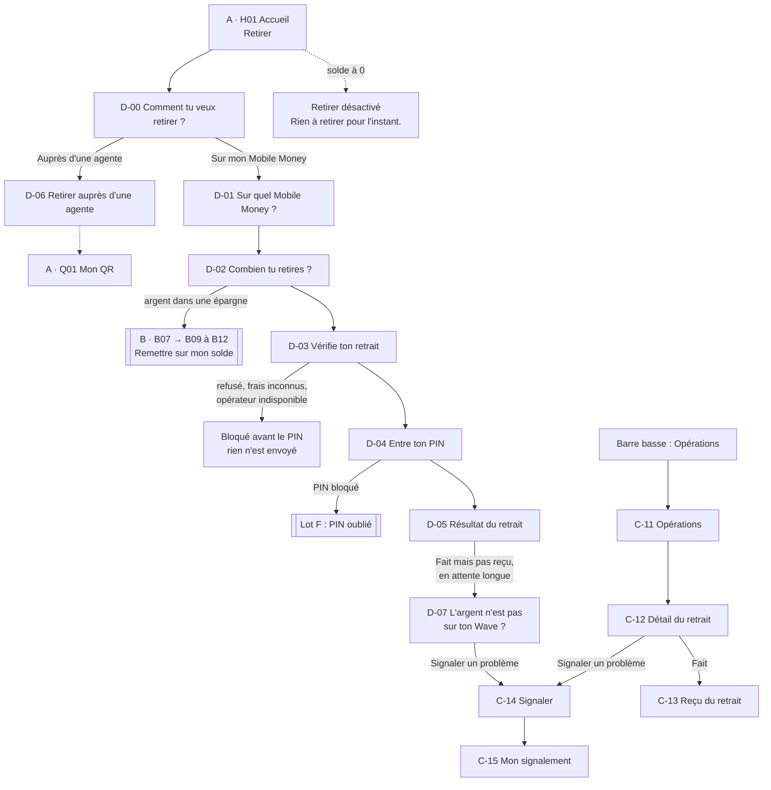
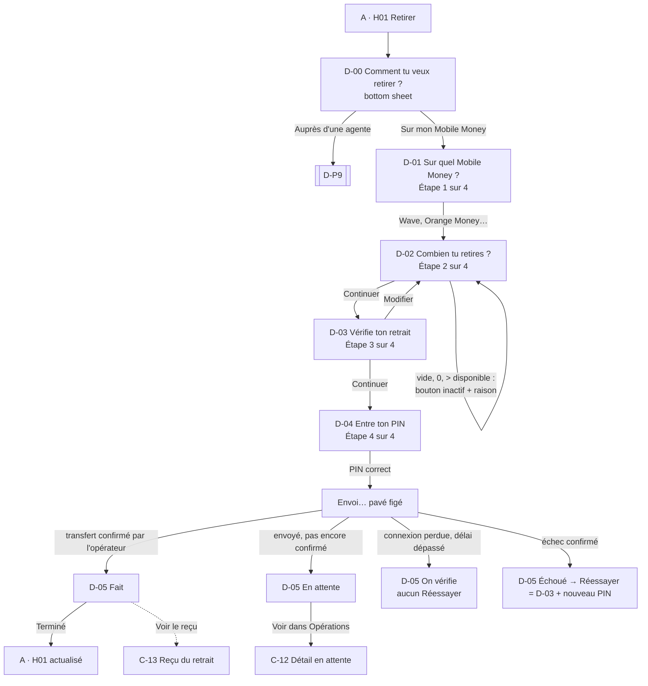
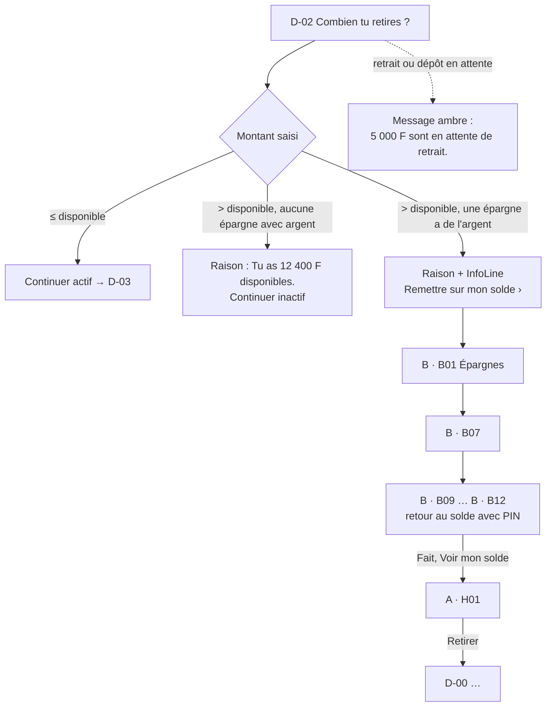
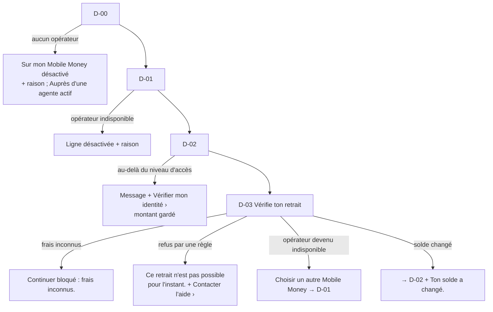
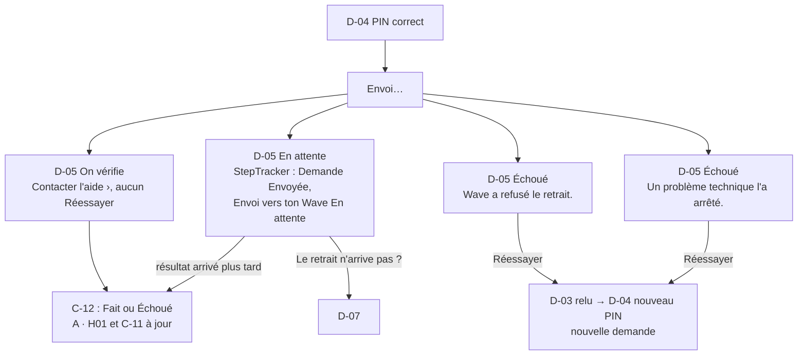
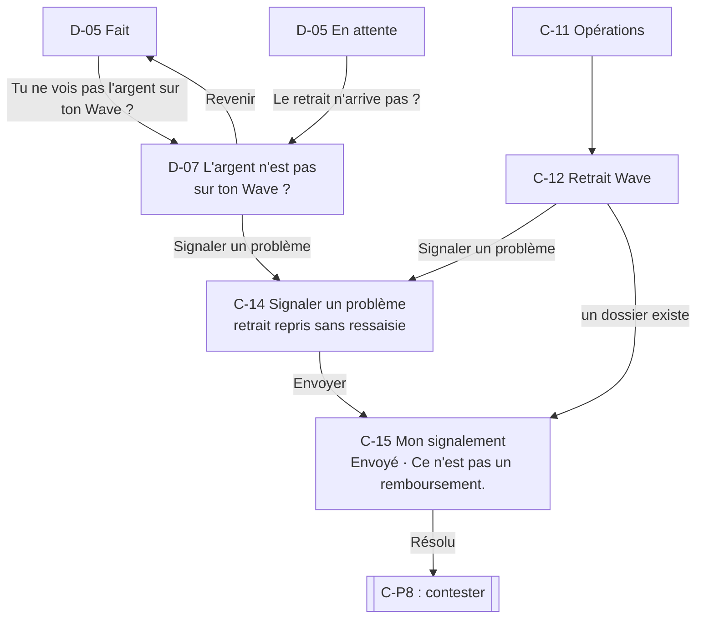
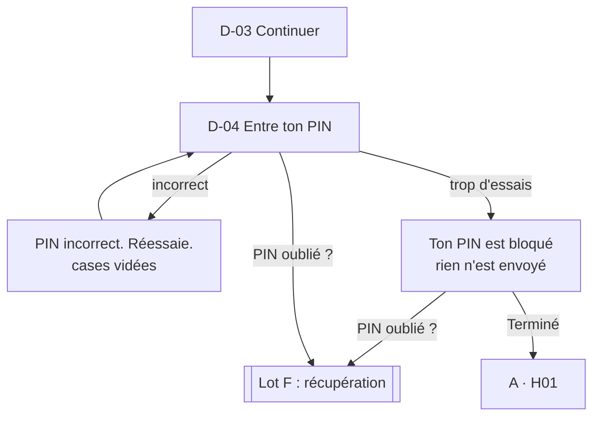
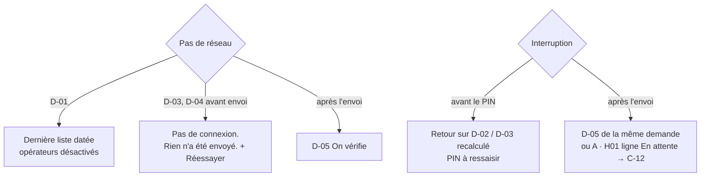
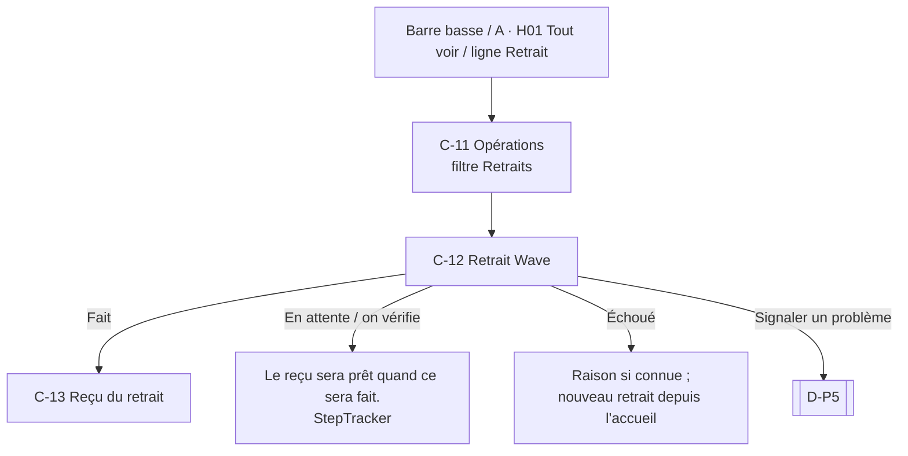
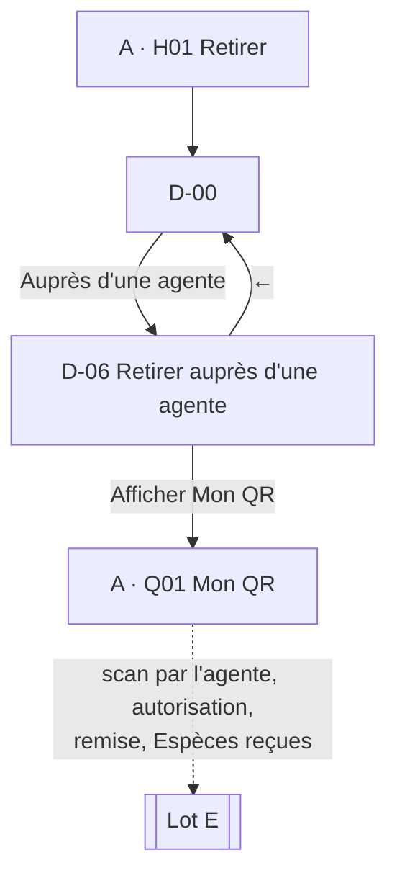

# Spec UX — Refonte des parcours, lot D : retraits

Date : 20 octobre 2026. Statut : **parcours tranchés par le PO le 20 octobre 2026** (Q1 à Q6 et Q8 validées, PNV-2 validée, PNV-1 conditionnelle au test, PNV-3 refusée, modèle de frais du prototype fixé : voir Décisions UX). Aucune maquette, aucun code. Les décisions déjà validées (PRD, registre métier, lots A, B et C, DESIGN.md, décisions PO transmises pour le lot D) sont reprises telles quelles.

Sources : [brief refonte](brief.md) (fait foi), [PRODUCT.md](../../../PRODUCT.md), [DESIGN.md](../../../DESIGN.md) (Design System v12, composants `Kotiz.*`), [CONTEXT-MAP.md](../../../CONTEXT-MAP.md), [glossaire DDD](../../architecture/ddd-context-map-glossaire.md) v1.1 (§4 règles 6 à 8, §5.1 `Withdrawal`, solde disponible, retour au solde, correction ; §5.5 Payments ; §5.12 signalement), [PRD design v1.0](../prd-design-mvp.md) §3 (retrait Mobile Money, autorisation par PIN), §5 (lot D = famille 09), §6 (WDR, WDR-ASS, OPS, HELP-OP), §7 (contrat transactionnel, règles 5 à 11, 25, 26, 30b), §8, §10 (Montant, Transaction, Opérations / aide, Correction), §15, [registre métier](../../product/regles-metier-parcours-mvp.md) (RM-FUND-06, RM-FUND-09, RM-ACC-03, RM-SEC-01, RM-HELP-01), [matrice du socle](../matrice-couverture-socle.md) (ligne 09, gates G01 à G07), [spec lot A](ux-spec-lot-a.md) (A · H01 « Retirer » désactivé à 0 FCFA, A · C01, A · Q01), [spec lot B](ux-spec-lot-b.md) (B · B09 à B · B12 retour au solde avec PIN, B · B11 PIN bloqué), [spec lot C](ux-spec-lot-c.md), [écrans lot C](screens-lot-c.md) et [handoff lot C](handoff-lot-c.md) (C-00, C-01 à C-05, C-11 à C-17, écarts spec / canvas validé), issues [kotiz-ci/platform#68](https://github.com/kotiz-ci/platform/issues/68), [#72](https://github.com/kotiz-ci/platform/issues/72), [#67](https://github.com/kotiz-ci/platform/issues/67), [#69](https://github.com/kotiz-ci/platform/issues/69), [#99](https://github.com/kotiz-ci/platform/issues/99).

Script de test associé : [test-lot-d.md](test-lot-d.md).

## Numérotation des écrans (à lire d'abord)

- Les écrans du lot D s'écrivent **`D-00` à `D-07`**, avec un **tiret**. Dans le canvas « KOTIZ — App cliente », les planches s'appelleront « D · D-01 … » et les fichiers `D-D-01.dc.html`, comme au lot C.
- **Attention : « D · D-01 » n'est pas une issue.** Les issues GitHub portent aussi un code en « D » dans leur titre : **D06** (#67), **D07** (#68, retrait direct), **D08** (#69), **D11** (#72, cash-out), **D20 à D26** (#93 à #99). Ces codes désignent des tickets ; les écrans du lot D ont toujours un tiret (`D-01`) et, en cas de doute, le préfixe du lot (« D · D-01 »). Une issue est toujours citée avec son numéro (« #68 »).
- Les écrans des autres lots gardent leur identifiant avec le préfixe de leur lot : « A · H01 » (Accueil), « A · C01 » (PIN de connexion), « A · Q01 » (Mon QR), « B · B07 » (détail d'une épargne), « B · B12 » (résultat du retour au solde), « C-12 » (détail d'une opération ; les écrans du lot C ont déjà un tiret, sans ambiguïté).
- Les parcours s'écrivent `D-P1` à `D-P9`.

## Conventions

- « **à confirmer** » = paramètre non tranché, avec son gate (G01 partenaire, G02 sécurité et SMS, G03 assistance, G05 exceptions, G06 tickets). **Aucune valeur n'est inventée** : ni frais, ni plafond, ni minimum, ni opérateur garanti, ni délai, ni nombre d'essais du PIN, ni motif de signalement.
- **Frais du retrait non confirmés (G01, décision PO transmise pour le lot D)** : le prototype jouera un scénario « frais fictifs » annoncé dans sa bande hors produit (comme au lot C) ; l'état « frais inconnus » (autorisation bloquée) est dessiné en variante. **Aucune valeur de frais dans cette spec.** Les wireframes écrivent « X F (à conf.) ».
- **Montant saisi = montant reçu (Décision PO du 20 octobre 2026)** : Fatou tape ce qu'elle **reçoit** sur son Mobile Money ; dans le prototype, les frais fictifs **s'ajoutent** à ce qui est pris sur son solde. Le récapitulatif montre toujours « Tu reçois », « Frais » et « Pris sur ton solde ». « Tout mon solde » = maximum retirable **calculé par le serveur**. Le modèle de frais réel reste à confirmer (G01).
- « **Proposition non validée** » (PNV) = idée qui étend ou contredit une décision validée. Elle n'est **pas** appliquée dans les wireframes ; elle est décrite à part.
- Noms, numéros, montants et références des wireframes sont **fictifs** (« Fatou Koné », `07 08 12 34 56`, `KTZ-2610-0081`).
- Formats : `12 400 FCFA` dans les montants dominants, `12 400 F` dans les lignes ; dates en français ; tutoiement, phrases de moins de 10 mots.
- **Le canvas validé du lot C fait foi** sur les compositions communes (écarts listés dans le [handoff lot C](handoff-lot-c.md)) : résultats en plein écran avec croix « Fermer » et bouton « Terminé », titres de résultat sans montant et montant sur sa ligne, « Signaler un problème » toujours en bouton texte sur un détail, messages d'information (jamais de succès vert) pour un envoi de signalement. Cette spec les reprend.

## Vocabulaire

| Interface (Fatou)                                             | Sens                                                                                   | Glossaire / PRD                       |
| ------------------------------------------------------------- | -------------------------------------------------------------------------------------- | ------------------------------------- |
| **Retirer** (raccourci, bouton), **retrait** (titres, lignes) | Faire sortir de l'argent de KOTIZ, vers son Mobile Money ou en espèces chez une agente | `Withdrawal` (§5.1), retrait externe  |
| **Sur mon Mobile Money**                                      | Retrait vers le numéro vérifié de la cliente                                           | WDR, RM-FUND-06                       |
| **Auprès d'une agente**                                       | Retrait en espèces (lot E)                                                             | cash-out, `CashOutOperation` (§5.3)   |
| **Solde disponible**, **mon solde**                           | Argent libre, seule source d'un retrait                                                | `availableBalance`                    |
| **Remettre sur mon solde**                                    | Mouvement d'une épargne vers le solde (lot B), préalable à un retrait de cet argent    | `ReturnToBalance`                     |
| **Frais**                                                     | Coût du retrait, affiché seulement s'il est confirmé (G01)                             | —                                     |
| **Tu reçois**                                                 | Ce qui arrive sur le Mobile Money                                                      | montant net, « somme reçue » (PRD §3) |
| **PIN KOTIZ**, « Entre ton PIN »                              | Autorisation de la cliente parce que l'argent sort de KOTIZ                            | règle 6 du glossaire                  |
| **Reçu**                                                      | Preuve d'un retrait **fait**                                                           | reçu                                  |
| **Signaler un problème**, **mon signalement**                 | Dossier ouvert depuis une opération (contexte Assistance, ADR-0020)                    | `IssueReport`                         |

Jamais : « transfert », « envoyer de l'argent » (sonne comme un envoi à quelqu'un d'autre), « retrait » pour un mouvement interne, « cash-out » dans l'interface, « code Wave » demandé par KOTIZ, « remboursé » pour un dossier résolu, toute référence à la tontine.

## Hypothèses

- **H1 — Destination : toujours le numéro vérifié de la cliente (décision PO).** Le retrait Mobile Money va uniquement vers ce numéro, **visible et non modifiable**, sur D-01, D-03, D-04, D-05, C-12 et C-13 (« Vers ton numéro 07 08 12 34 56 · Wave »). Aucun champ, bouton ni lien « autre numéro » au MVP ; un autre numéro est une évolution post-MVP.
- **H2 — Opérateurs proposés = opérateurs disponibles pour ce numéro.** Un numéro peut ouvrir un ou plusieurs portefeuilles (Wave, Orange Money…) ; la liste réelle, son ordre et le lien numéro ↔ opérateur sont **à confirmer (G01)**. Le prototype montre Wave et Orange Money, annoncés fictifs.
- **H3 — Autorisation par le PIN KOTIZ, rien chez l'opérateur (décision PO, PRD §7 règle 6 et 26).** Après le récapitulatif, Fatou entre son PIN KOTIZ ; KOTIZ ne demande **jamais** le PIN ou le code Mobile Money. Contrairement au dépôt (C-04), Fatou n'a rien à valider chez l'opérateur pour recevoir. Si un opérateur exigeait une action de la cliente pour recevoir, ce serait un écart à remonter (G01).
- **H4 — Le retrait part du solde disponible seulement (décision PO).** Pour retirer l'argent d'une épargne, Fatou le remet d'abord sur son solde (lot B, B · B09 à B · B12), puis fait un retrait distinct. Aucun retrait direct depuis une épargne, aucun enchaînement automatique (PRD §7 règle 11).
- **H5 — Un retrait en attente n'est plus disponible (Décision PO du 20 octobre 2026, Q4).** Le solde disponible **baisse dès l'envoi** du retrait ; une ligne « Retrait · En attente » dit où est l'argent. Ce montant ne peut pas être retiré ni mis de côté une seconde fois. Le glossaire dit « seul le confirmé compte » dans le solde disponible : le calcul exact (« montant engagé ») reste **à confirmer (G01, domaine)**. Un **dépôt** en attente, lui, n'augmente toujours pas le solde (lot C, H5).
- **H6 — Pas de file d'attente hors ligne** (lots A à C). Retirer demande le réseau à partir du récapitulatif. Hors ligne, la saisie est gardée, rien n'est envoyé en silence.
- **H7 — Masquage** : réglage unique des lots A à C. Toujours visibles : saisie (D-02), récapitulatif (D-03), PIN (D-04, rappel du montant), résultat (D-05), comme au lot C. Masqués selon le réglage : lignes d'Opérations (C-11), détail (C-12) et reçu (C-13) d'un retrait.
- **H8 — Signes vus depuis le solde** (lot C, H8) : « − 5 000 F » pour un retrait **fait** ; en attente ou échoué, montant sans signe en `text-secondary` (handoff C).
- **H9 — « Fait » = transfert confirmé par l'opérateur** (RM-FUND-06, PRD §7 règle 26). Un PIN accepté ne prouve pas que l'argent est arrivé : après le PIN, l'écran dit « Envoyée », jamais « Fait ».
- **H10 — Second retrait pendant une attente (Décision PO du 20 octobre 2026, Q2)** : autorisé comme **nouvelle demande distincte** (montant et référence propres), dans la limite du disponible (H5), jamais la répétition de la même (même règle que la décision Q11 du lot C).
- **H11 — Un signalement ouvert par opération** (lot C, H9) : si un dossier existe, le détail du retrait ouvre ce dossier.

## Vue d'ensemble



## Parcours

### D-P1 — Retirer sur mon Mobile Money (critique)

Entrée : A · H01 « Retirer » (raccourci illustré, actif si le solde disponible est supérieur à 0). « Retirer » ouvre la bottom sheet **D-00 « Comment tu veux retirer ? »**, symétrique de C-00, puis des pages pleines (décision PO). Source fixée : **Mon solde** (H4). Destination fixée : **le numéro vérifié** (H1). Montant, frais, somme reçue et solde après visibles avant le PIN (PRD §3, §7 règles 5 et 25).

Chemin principal : **6 écrans** D-00 D-01 D-02 D-03 D-04 D-05, puis A · H01 actualisé. Indicateur « Étape n sur 4 » (Moyen, Montant, Vérifier, PIN) sur D-01 à D-04 ; la feuille D-00 n'est pas comptée.



### D-P2 — Solde insuffisant, solde réduit par une attente, argent dans une épargne

Quatre situations, vues sur **D-02** ou dès l'accueil, jamais au bout du parcours :

- **Montant supérieur à ce que le solde permet** (montant reçu + frais au-delà du disponible ; maximum calculé par le serveur) : raison sous le champ « Tu peux recevoir au plus X F. » (valeur du serveur ; sans frais connus, « Tu as 12 400 F disponibles. »), Continuer désactivé.
- **Solde disponible réduit par une opération en attente** (H5) : sous « Depuis : Mon solde · X F disponibles » (déjà réduit du retrait en attente et de ses frais), `Message` en attente (ambre + horloge) « 5 000 F sont en attente de retrait. » ; un **dépôt** en attente donne « Ton dépôt de 2 000 F n'est pas encore arrivé. » (il n'est pas encore disponible). La raison du champ suit le disponible réel.
- **L'argent est dans une épargne** (H4) : quand le montant dépasse le disponible et qu'au moins une épargne contient de l'argent, `InfoLine` « Ton argent d'épargne doit revenir sur ton solde. Remettre sur mon solde › » → **B · B01, liste des épargnes** (Décision PO du 20 octobre 2026), où Fatou choisit l'épargne puis « Remettre sur mon solde ». Le retrait en cours est abandonné (rien n'a été envoyé) ; après B · B12, Fatou relance « Retirer » (PNV-1, conditionnelle au test).
- **Solde à 0, argent dans une épargne** (Décision PO du 20 octobre 2026, PNV-2 validée) : « Retirer » reste désactivé sur A · H01, avec la raison « Ton argent est dans tes épargnes. » au lieu de « Rien à retirer pour l'instant. ». Fatou passe par l'épargne (B · B07 → B09 à B12), puis « Retirer ».

Chemin principal (argent dans une épargne) : **3 écrans** D-00 D-01 D-02, puis le parcours B-P5 du lot B (5 écrans), puis D-P1.



### D-P3 — Retrait bloqué avant le PIN

Tout ce qui est **connu d'avance** est dit **avant le PIN**, rien n'est envoyé (décision du lot B pour B10, reprise ici) :

- **Opérateur indisponible** : sur D-00 (ligne « Sur mon Mobile Money » désactivée si aucun opérateur), sur D-01 (opérateur désactivé avec sa raison), sur D-03 (opérateur devenu indisponible entre-temps).
- **Frais inconnus** (état réel tant que G01 n'est pas levé) : D-03 bloqué, aucune ligne Frais, raison « Continuer est bloqué : frais inconnus. ».
- **Refusé par une règle** (niveau d'accès limité, compte restreint, plafond, numéro dont la vérification n'est plus valable : G01) : D-03 bloqué, `Message` erreur, aucune valeur chiffrée. Le cas « montant au-delà de ce que ton compte permet » se dit déjà sur D-02, avec « Vérifier mon identité › » (sous-lot A2), comme C-02.

Chemin : **4 écrans** D-00 D-01 D-02 D-03 (bloqué). Sortie : Fermer → A · H01, ou « Choisir un autre Mobile Money » → D-01.



### D-P4 — Après le PIN : en attente, on vérifie, échoué

Après l'envoi, quatre issues distinctes sur **D-05** (PRD §7 règles 7 et 9, RM-FUND-09) :

- **En attente** : envoyé à l'opérateur, pas encore confirmé. Aucun reçu, « Ne refais pas le retrait. ».
- **On vérifie** (connexion perdue après envoi, délai dépassé, délai **à confirmer**) : même signature ambre ; **aucun Réessayer** tant que le résultat est inconnu.
- **Échoué, problème technique** (après le PIN) : échec confirmé ; « Réessayer » ouvre D-03 relu, puis un **nouveau PIN** et une **nouvelle demande** (nouvelle clé, #67).
- **Échoué, refusé par l'opérateur** (après l'envoi) : même structure, raison de l'opérateur si elle est fournie (G01). Une règle devenue bloquante entre D-03 et le mouvement donne aussi « Échoué » (contrôle refait au moment du mouvement, comme au lot B).

« Ton argent n'a pas quitté KOTIZ. Il est sur ton solde. » ne s'écrit **que si le partenaire le garantit** pour cet échec (G01). Si l'argent a été pris puis rendu par une écriture distincte, voir la question G01 sur la correction.

Chemin principal : **6 écrans** (D-P1), puis C-12 du même retrait.



### D-P5 — L'argent est parti mais n'est pas sur mon Mobile Money (signalement)

Cas : KOTIZ affiche **Fait** (l'opérateur a confirmé le transfert) ou **En attente** depuis longtemps, mais Fatou ne voit rien sur son Wave. Elle ne refait pas le retrait : elle **signale**. Le signalement reprend l'opération sans ressaisie, ne crée aucune transaction et ne promet aucun remboursement (RM-HELP-01, lot C).

Entrées : D-05 (bouton texte « Tu ne vois pas l'argent sur ton Wave ? » sur Fait, « Le retrait n'arrive pas ? » sur En attente) → feuille **D-07** ; ou C-11 → C-12 du retrait → « Signaler un problème » (bouton texte, toujours présent).

Chemins principaux : **4 écrans** D-05 D-07 C-14 C-15, ou **4 écrans** C-11 C-12 C-14 C-15.



### D-P6 — PIN incorrect ou bloqué

Sur D-04, même comportement que B · B11 (lot B) : PIN incorrect = cases vidées, « PIN incorrect. Réessaie. », essais restants **seulement si la règle est confirmée (G02)**. **PIN bloqué** (trop d'essais) : titre « Ton PIN est bloqué », « Trop d'essais. », « Ton retrait n'est pas envoyé : ton argent n'a pas bougé. » ; pavé retiré ; « Terminé » (→ A · H01) et « PIN oublié ? » (→ lot F). Aucun nombre d'essais ni durée affiché (G02). Si le PIN est déjà bloqué quand Fatou arrive sur D-04, l'écran s'ouvre directement dans cet état.

Chemin : **5 écrans** D-00 à D-04 (bloqué), puis lot F.



### D-P7 — Hors connexion et interruption

- **Avant l'envoi** (D-01 à D-04) : rien ne part sans réseau. D-01 montre la dernière liste connue, datée, opérateurs désactivés avec leur raison (comme C-01 du canvas validé) ; D-02 accepte la saisie, avec le disponible « mis à jour à 14:32 » ; D-03 ne calcule pas le récapitulatif : `Message` « Pas de connexion. Rien n'a été envoyé. » + Réessayer ; D-04 avant envoi : même message, PIN effacé.
- **Après l'envoi** (connexion perdue) : D-05 « On vérifie », jamais un succès ni un échec supposé.
- **Interruption** (un client au marché, appel, app tuée par Android sur un téléphone de 2 Go) : avant le PIN, Fatou retrouve D-02 ou D-03 recalculé (le PIN n'est jamais gardé) ; après l'envoi, l'app rouvre sur D-05 de la même demande, ou A · H01 montre la ligne « Retrait Wave · En attente » qui mène à C-12. **Aucune nouvelle demande n'est créée** à la reprise.



### D-P8 — Retrouver un retrait depuis Opérations

Opérations (barre basse, A · H01 « Tout voir » ou la ligne du retrait) reste la racine de consultation du lot C : pas de bouton « Retirer » sur cette racine. Une **ligne par retrait** (décision PO) : « Retrait Wave » · « Vers 07 08 … 56 » · « − 5 000 F » si fait. Le détail C-12 et le reçu C-13 prennent leur **contenu retrait** (voir « Écrans du lot C réutilisés »). Filtre « Retraits » existant.

Chemin principal : **3 écrans** C-11 C-12 C-13.



### D-P9 — Retirer auprès d'une agente (raccord lot E)

Décision PO : raccord seulement. « Auprès d'une agente » sur D-00 ouvre **D-06**, écran d'explication du même type que C-17, sans parcours agente (scan, montant, autorisation, remise des espèces, « Espèces reçues » et codes sans smartphone sont au lot E).

Chemin : **2 écrans** D-00 D-06, puis A · Q01.



### Nombre d'écrans par parcours (chemin principal)

| Parcours                                        | Écrans | Séquence                                                        |
| ----------------------------------------------- | ------ | --------------------------------------------------------------- |
| D-P1 Retirer sur mon Mobile Money               | 6      | D-00 D-01 D-02 D-03 D-04 D-05 (depuis A · H01), puis A · H01    |
| D-P2 Argent dans une épargne                    | 3 + 5  | D-00 D-01 D-02, puis B · B07 B09 B10 B11 B12 (lot B), puis D-P1 |
| D-P3 Bloqué avant le PIN                        | 4      | D-00 D-01 D-02 D-03 (bloqué)                                    |
| D-P4 Après le PIN : attente, on vérifie, échoué | 6      | comme D-P1, puis C-12 du même retrait                           |
| D-P5 Pas reçu sur le Mobile Money               | 4      | D-05 D-07 C-14 C-15, ou C-11 C-12 C-14 C-15                     |
| D-P6 PIN bloqué                                 | 5      | D-00 à D-04 (bloqué), puis lot F                                |
| D-P7 Hors connexion et interruption             | —      | états des écrans D-01 à D-05                                    |
| D-P8 Retrouver un retrait                       | 3      | C-11 C-12 C-13                                                  |
| D-P9 Auprès d'une agente (raccord E)            | 2      | D-00 D-06, puis A · Q01                                         |

Cible : aucun chemin principal au-delà de 6 écrans, comme le dépôt (C-P1). Le retrait le plus fréquent tient en 6 écrans, dont une feuille de choix (D-00) et un PIN. Il n'a pas d'écran d'attente manipulé par Fatou : contrairement au dépôt, rien n'est à valider chez l'opérateur (H3).

## Carte des écrans

Aucune barre basse dans le lot D : pages poussées avec `PageHeader`, ou `BottomSheet`.

| ID               | Écran                                               | Parcours       | Objectif                                                               |
| ---------------- | --------------------------------------------------- | -------------- | ---------------------------------------------------------------------- |
| D-00             | Comment tu veux retirer ? (bottom sheet)            | D-P1 D-P3 D-P9 | Choisir Mobile Money ou une agente                                     |
| D-01             | Sur quel Mobile Money ?                             | D-P1 D-P3 D-P7 | Choisir l'opérateur qui reçoit, vers le numéro vérifié                 |
| D-02             | Combien tu retires ?                                | D-P1 D-P2 D-P3 | Saisir le montant à sortir du solde                                    |
| D-03             | Vérifie ton retrait                                 | D-P1 D-P3 D-P4 | Voir montant, frais, somme reçue, vers où et solde après, avant le PIN |
| D-04             | Entre ton PIN                                       | D-P1 D-P6      | Autoriser le retrait                                                   |
| D-05             | Résultat du retrait                                 | D-P1 D-P4 D-P5 | Savoir si c'est fait, en attente ou échoué                             |
| D-06             | Retirer auprès d'une agente                         | D-P9           | Comprendre le retrait en espèces et afficher son QR (raccord lot E)    |
| D-07             | L'argent n'est pas sur ton Wave ? (bottom sheet)    | D-P5           | Vérifier, ne pas refaire, puis signaler                                |
| C-11, C-12, C-13 | Opérations, détail et reçu (lot C), contenu retrait | D-P4 D-P5 D-P8 | Retrouver un retrait, son statut, son reçu                             |
| C-14, C-15       | Signaler, mon signalement (lot C)                   | D-P5           | Signaler un retrait, suivre le dossier                                 |

## Règles communes aux écrans du lot D

- **Orientation** : titre = ce que fait Fatou (« Sur quel Mobile Money ? », « Combien tu retires ? »). « Étape n sur 4 » (Moyen, Montant, Vérifier, PIN) sur D-01 à D-04. Réessayer après un échec repart de D-03 sans compteur (le parcours ne recommence pas à l'étape 1).
- **D'où et vers où toujours lisibles** : de D-02 à D-05, « Depuis : Mon solde » et « Vers : [logo] Wave · 07 08 12 34 56 ». Le numéro est entier, jamais coupé (`NumberChip` ou ligne), non modifiable.
- **Montant dominant** : `AmountField` (34 Bold) à la saisie ; montant dominant de `SummaryFlow` au récapitulatif ; rappel du montant sur le PIN et le résultat.
- **Statut réel** : `StatusPill` « Fait » / « En attente » / « Échoué », mot + pictogramme. « Fait » seulement après confirmation du transfert par l'opérateur (H9). En attente : ambre + horloge + `StepTracker` (« Envoyée »), jamais de reçu, jamais de célébration.
- **Une décision par écran** : un seul bouton principal ; Réessayer seulement après un échec **confirmé** (RM-FUND-09).
- **PIN seulement parce que l'argent sort de KOTIZ** (glossaire, règle 6) ; jamais de PIN opérateur ; mention « Ne le montre à personne, même à une agente. » (cliente accompagnée).
- **Frais** : ligne « Frais » de `SummaryFlow` **seulement** avec un frais confirmé (G01) ; frais inconnus = Continuer bloqué avant le PIN, avec sa raison. Le prototype joue des frais fictifs annoncés.
- **Retour** `←` : écran précédent, saisie gardée (sauf le PIN). Après l'envoi, la pile est vidée : depuis D-05, Fermer, Terminé et retour Android mènent à A · H01, jamais à D-04 ni à D-03 (PRD §7 règle 10).
- **Attente réseau** (> 1 s) : bouton ou pavé en « Envoi… », double appui bloqué, une clé d'idempotence par demande (#67).
- **Hors ligne** : voir D-P7. **Reprise après interruption** : la même demande, jamais une nouvelle.
- **Aucun paramètre inventé** : frais, minimum, maximum, plafond du niveau limité, opérateurs, délai d'arrivée (« en quelques minutes » interdit tant que non confirmé), nombre d'essais du PIN, motifs de signalement.

## Écrans

### D-00 — Comment tu veux retirer ? (bottom sheet)

- Objectif : choisir comment retirer, avant d'entrer dans un parcours (décision PO, symétrique de C-00).
- Action primaire : toucher une option.
- Actions secondaires : « Fermer » (croix 48) ou retour Android : retour à A · H01, rien n'est perdu.
- Contenu : poignée ; titre « Comment tu veux retirer ? » ; deux lignes de choix (illustration 48, libellé 16 Semi Bold, chevron, ≥ 64 de haut) :
  1. « Sur mon Mobile Money » (→ D-01) ;
  2. « Auprès d'une agente » (→ D-06).
     Pas de montant, pas de solde, pas de sous-texte long.
- États : nominal ; **aucun opérateur disponible** : ligne 1 désactivée, raison « Mobile Money indisponible pour l'instant. », ligne 2 active ; hors ligne : la feuille s'ouvre, D-01 gère le réseau.
- Cas limites : double appui sur « Retirer » (une seule feuille) ; Retirer désactivé à 0 FCFA (A · H01, lot A) : la feuille ne s'ouvre pas.

```
┌──────────────────────────────┐
│            ───            ✕  │
│ Comment tu veux retirer ?    │
│                              │
│ [📱] Sur mon Mobile Money  › │
│ ──────────────────────────── │
│ [👤] Auprès d'une agente   › │
└──────────────────────────────┘
```

### D-01 — Sur quel Mobile Money ?

- Objectif : choisir l'opérateur qui reçoit l'argent, sur le numéro vérifié.
- Action primaire : toucher un opérateur = étape suivante (liste avec chevron, sans radio ni bouton Continuer, PRD §7 règle 2).
- Actions secondaires : ← (D-00 refermée sur A · H01).
- Contenu (par priorité) :
  1. `PageHeader` : ←, « Étape 1 sur 4 ».
  2. Titre « Sur quel Mobile Money ? » ; sous-titre « Depuis : Mon solde ».
  3. Lignes d'opérateur (`OperatorRow` du lot C : logo officiel 64 × 48 non recoloré, Wave en symbole seul, nom, chevron), opérateurs **disponibles pour ce numéro** seulement (H2, G01).
  4. Sous la liste : « Vers ton numéro » + « 07 08 12 34 56 », **non modifiable**, sans lien ni bouton (H1).
- États :
  - **Nominal** : 1 à 4 opérateurs, ordre fourni par le partenaire (G01).
  - **Un seul opérateur** : la liste reste une liste (pas de saut automatique), pour que Fatou voie où va l'argent.
  - **Un opérateur indisponible** : ligne désactivée, raison « Wave est indisponible pour l'instant. ».
  - **Aucun opérateur disponible** : `Message` information « Le retrait Mobile Money n'est pas possible pour l'instant. » + lien « Retirer auprès d'une agente › » (→ D-06).
  - **Chargement** : squelette de 2 lignes (premier affichage) ; **hors ligne** : dernière liste connue, datée, opérateurs désactivés avec la raison « Pas de connexion. » + Réessayer (canvas validé du lot C).
- Cas limites : logo manquant (nom seul, jamais le logo d'un autre opérateur) ; grand texte (le nom passe à la ligne) ; numéro dont la vérification n'est plus valable (récupération en cours, lot F) : refus sur D-03 (G01, G02).

```
┌──────────────────────────────┐
│ ←              Étape 1 sur 4 │
├──────────────────────────────┤
│ Sur quel Mobile Money ?      │
│ Depuis : Mon solde           │
│                              │
│ [◉ ] Wave                  › │
│ ──────────────────────────── │
│ [OM] Orange Money          › │
│ ──────────────────────────── │
│ Vers ton numéro              │
│ 07 08 12 34 56               │
└──────────────────────────────┘
```

### D-02 — Combien tu retires ?

- Objectif : saisir le montant que Fatou **reçoit** sur son Mobile Money (Décision PO du 20 octobre 2026).
- Action primaire : Continuer.
- Actions secondaires : ← (D-01, opérateur gardé), puce « Tout mon solde », « Vérifier mon identité › » (si le niveau d'accès bloque), « Remettre sur mon solde › » (si l'argent est dans une épargne).
- Contenu : `PageHeader` (←, « Étape 2 sur 4 ») ; titre « Combien tu retires ? » ; « Depuis : Mon solde · 12 400 F disponibles » ; `AmountField` (montant 34 Bold, « FCFA » 16, focus visible, clavier numérique système, libellé lu « Montant que tu reçois ») ; aide sous le champ « Tu reçois ce montant sur ton Wave. Les frais s'ajoutent. » ; puce large « Tout mon solde » (même variante que C-07 et « Tout remettre » du lot B ; seule puce, sans montants rapides : Décision PO du 20 octobre 2026, Q3) ; « Vers : [logo] Wave · 07 08 12 34 56 ».
- États :
  - Vide (Continuer désactivé, « Écris un montant. ») ; saisi ; 0 (« Le montant doit être plus grand que 0. »).
  - **« Tout mon solde »** : remplit le champ avec le **maximum retirable calculé par le serveur** (disponible moins les frais) ; la puce reste sélectionnée tant que la saisie ne change pas. Frais inconnus : la puce remplit le disponible et D-03 bloque (« frais inconnus »).
  - **Plus que ce que le solde permet** (montant + frais > disponible, contrôle serveur) : « Tu peux recevoir au plus X F. » (valeur du serveur) ; sans frais connus : « Tu as 12 400 F disponibles. » ; Continuer désactivé.
  - **Disponible réduit par une attente** (H5) : `Message` en attente (ambre + horloge) sous la ligne Depuis : « 5 000 F sont en attente de retrait. » (ou « Ton dépôt de 2 000 F n'est pas encore arrivé. ») ; le disponible affiché et la raison du champ suivent le disponible réel.
  - **L'argent est dans une épargne** (D-P2) : en plus de la raison, `InfoLine` « Ton argent d'épargne doit revenir sur ton solde. Remettre sur mon solde › ». Aucun montant d'épargne affiché ici.
  - **Au-delà de ce que le compte permet** (niveau d'accès limité, RM-ACC-03) : `Message` information « Ce montant dépasse ce que ton compte permet pour l'instant. » + « Vérifier mon identité › » (sous-lot A2) ; montant gardé ; aucune limite chiffrée (G01).
  - **Minimum ou maximum par retrait** (opérateur ou partenaire) : raison sous le champ, texte et valeurs **à confirmer (G01)**.
  - **Hors ligne** : saisie possible ; « Mis à jour à 14:32 · hors connexion » sur le disponible ; Continuer mène à D-03 qui dit « Pas de connexion ».
  - Montants toujours visibles, même en mode masqué (H7).
- Cas limites : chargement du maximum de « Tout mon solde » (> 1 s : puce en « Un instant… ») ; hors ligne, « Tout mon solde » désactivé avec sa raison (le maximum vient du serveur) ; montant à 7 chiffres sur 320 px ; clavier ouvert (Continuer visible au-dessus) ; retour depuis D-03 (montant gardé).

```
┌──────────────────────────────┐
│ ←              Étape 2 sur 4 │
├──────────────────────────────┤
│ Combien tu retires ?         │
│ Depuis : Mon solde           │
│          12 400 F disponibles│
│                              │
│   5 000|  FCFA               │
│   ─────────────────          │
│ Tu reçois ce montant sur ton │
│ Wave. Les frais s'ajoutent.  │
│ [ Tout mon solde ]           │
│                              │
│ Vers : [◉] Wave              │
│        07 08 12 34 56        │
├──────────────────────────────┤
│ [      Continuer         ] ★ │
├──────────────────────────────┤
│   clavier numérique système  │
└──────────────────────────────┘
```

Disponible réduit par un retrait en attente, montant trop grand, argent dans une épargne (extrait) :

```
│ Depuis : Mon solde           │
│          X F disponibles     │
│ ◷ 5 000 F sont en attente    │
│   de retrait.                │
│   20 000|  FCFA              │
│ Tu peux recevoir au plus     │
│ X F. (serveur)               │
│ ──────────────────────────── │
│ ⓘ Ton argent d'épargne doit  │
│   revenir sur ton solde.     │
│   Remettre sur mon solde   › │
│ ──────────────────────────── │
│ [      Continuer         ]   │  (désactivé)
```

### D-03 — Vérifie ton retrait

- Objectif : voir combien sort du solde, combien arrive, où, et ce qui reste, avant d'autoriser.
- Action primaire : Continuer (→ D-04), comme B · B10. Pas de PIN sur cet écran.
- Actions secondaires : ← (D-02), « Modifier » à côté du montant (→ D-02). Pas de changement de numéro (H1).
- Contenu (`SummaryFlow`, carte unique, toujours visible même en mode masqué sauf « Ton solde après ») :
  1. « Tu reçois sur ton Wave » + **5 000 FCFA** (le montant saisi, Décision PO du 20 octobre 2026) + « Modifier ».
  2. Flux : [portefeuille] « Depuis · Mon solde » ↓ [logo] « Vers ton numéro » + « 07 08 12 34 56 · Wave » (non modifiable ; miroir du nœud de départ de C-03). Nom TalkBack : « De Mon solde vers ton Wave 07 08 12 34 56 ».
  3. Lignes de conséquence, toujours les trois et dans cet ordre (Décision PO du 20 octobre 2026) : « Tu reçois : 5 000 F », « Frais : X F », « Pris sur ton solde : X F » (montant + frais). Au prototype, frais fictifs annoncés ; en production, seulement avec un frais confirmé (G01). Sans frais confirmé, ni « Frais » ni « Pris sur ton solde » : l'état « frais inconnus » s'applique.
  4. « Ton solde après : X F » (masqué si le réglage l'est).
  5. Phrases : « L'argent sort de KOTIZ. » ; « Tu vas confirmer avec ton PIN KOTIZ. » ; « KOTIZ ne te demande jamais ton code Wave. »
- États :
  - **Nominal** (frais confirmés ; au prototype, frais fictifs annoncés) : wireframe.
  - **Frais inconnus** (état réel tant que G01 n'est pas levé) : `Message` information « Les frais ne sont pas encore connus. » + « Le retrait n'est pas possible pour l'instant. » ; ni Frais ni « Pris sur ton solde » (le montant reçu reste affiché) ; Continuer désactivé, raison « Continuer est bloqué : frais inconnus. » ; rien n'est envoyé (PRD §7 règle 5).
  - **Refusé par une règle** (connu d'avance : niveau d'accès, compte restreint, plafond, vérification du numéro, G01) : `Message` erreur en tête « Ce retrait n'est pas possible pour l'instant. » + « Ton argent n'a pas bougé. » + « Contacter l'aide › » (G03) ; Continuer désactivé, raison « Continuer est bloqué : ce retrait est refusé. » ; aucune valeur chiffrée.
  - **Opérateur devenu indisponible** : `Message` « Wave est indisponible pour l'instant. » + bouton « Choisir un autre Mobile Money » (→ D-01, montant gardé).
  - **Solde changé** (un dépôt est arrivé, un autre retrait est parti) : retour à D-02 avec `Message` « Ton solde a changé. » et le nouveau disponible.
  - **Chargement du récapitulatif** (> 1 s : frais et règles demandés au serveur) : carte en squelette, Continuer « Un instant… ».
  - **Hors ligne** : « Pas de connexion. Rien n'a été envoyé. » + Réessayer.
- Cas limites : app en arrière-plan puis reprise (récapitulatif recalculé avant le PIN) ; numéro long ou format inattendu (affiché en entier) ; grand texte (les lignes clé / valeur passent sur deux lignes).

```
┌──────────────────────────────┐
│ ←              Étape 3 sur 4 │
├──────────────────────────────┤
│ Vérifie ton retrait          │
│ ┌──────────────────────────┐ │
│ │ Tu reçois sur   Modifier │ │
│ │ ton Wave                 │ │
│ │ 5 000 FCFA               │ │
│ │ [👛] Depuis · Mon solde  │ │
│ │  ↓                       │ │
│ │ [◉] Vers ton numéro      │ │
│ │     07 08 12 34 56 · Wave│ │
│ │ Tu reçois       5 000 F  │ │
│ │ Frais           X F      │ │
│ │                 (à conf.)│ │
│ │ Pris sur ton    X F      │ │
│ │ solde           (à conf.)│ │
│ │ Ton solde après X F      │ │
│ └──────────────────────────┘ │
│ L'argent sort de KOTIZ.      │
│ KOTIZ ne te demande jamais   │
│ ton code Wave.               │
├──────────────────────────────┤
│ [       Continuer        ] ★ │
└──────────────────────────────┘
```

Frais inconnus (extrait) :

```
│ ⓘ Les frais ne sont pas      │
│   encore connus.             │
│   Le retrait n'est pas       │
│   possible pour l'instant.   │
│ ┌──────────────────────────┐ │
│ │ Tu reçois sur   Modifier │ │
│ │ ton Wave                 │ │
│ │ 5 000 FCFA               │ │
│ │ [👛] Depuis · Mon solde  │ │
│ │  ↓                       │ │
│ │ [◉] Vers ton numéro      │ │
│ │     07 08 12 34 56 · Wave│ │
│ └──────────────────────────┘ │
├──────────────────────────────┤
│ [       Continuer        ]   │  (désactivé)
│ Continuer est bloqué :       │
│ frais inconnus.              │
```

### D-04 — Entre ton PIN

Même composition que B · B11 (lot B).

- Objectif : autoriser le retrait.
- Action primaire : saisie complète du PIN = envoi (pas de bouton, comme A · C01 et B · B11).
- Actions secondaires : ← (D-03, PIN effacé), « PIN oublié ? » (→ lot F), Effacer.
- Contenu : `PageHeader` (←, « Étape 4 sur 4 ») ; titre « Entre ton PIN » ; rappel « Tu reçois 5 000 F sur ton Wave » + « 07 08 12 34 56 » + « Pris sur ton solde : X F » (montant + frais, même valeur que D-03) ; `PinSlots` (4 au prototype, jusqu'à 6, G02) ; mention « Ne le montre à personne, même à une agente. » ; `PinPad`.
- États :
  - Saisie.
  - **Envoi** : `Message` chargement « Envoi… », pavé figé ; puis D-05.
  - **PIN incorrect** : « PIN incorrect. Réessaie. », cases en erreur puis vidées ; essais restants **seulement si la règle est confirmée (G02)**.
  - **PIN bloqué** (D-P6) : titre « Ton PIN est bloqué » ; `Message` erreur « Trop d'essais. » + « Ton retrait n'est pas envoyé : ton argent n'a pas bougé. » ; pavé et cases retirés ; bouton principal « Terminé » (→ A · H01), bouton texte « PIN oublié ? » (→ lot F) ; aucun nombre ni durée (G02).
  - **Hors ligne avant envoi** : « Pas de connexion. Rien n'a été envoyé. », PIN effacé.
  - **Connexion perdue après envoi** : D-05 « On vérifie ».
- Cas limites : PIN jamais affiché, conservé ni journalisé ; capture d'écran bloquée (à confirmer technique, comme B · B11) ; cliente accompagnée : l'agente ne voit ni ne saisit le PIN ; règle devenue bloquante entre D-03 et l'envoi : D-05 Échoué.

```
┌──────────────────────────────┐
│ ←              Étape 4 sur 4 │
├──────────────────────────────┤
│ Entre ton PIN                │
│ Tu reçois 5 000 F sur ton    │
│ Wave 07 08 12 34 56          │
│ Pris sur ton solde : X F     │
│                              │
│        ●  ●  ○  ○            │
│                              │
│ Ne le montre à personne,     │
│ même à une agente.           │
│ PIN oublié ?                 │
├──────────────────────────────┤
│   1     2     3              │
│   4     5     6              │
│   7     8     9              │
│         0     ⌫              │
└──────────────────────────────┘
```

PIN bloqué (extrait) :

```
│ Ton PIN est bloqué           │
│ ✕ Trop d'essais.             │
│   Ton retrait n'est pas      │
│   envoyé : ton argent n'a    │
│   pas bougé.                 │
├──────────────────────────────┤
│ [        Terminé         ] ★ │
│         PIN oublié ?         │
```

### D-05 — Résultat du retrait

Écran de résultat **plein écran** du lot C (handoff C) : `PageHeader` avec seulement la croix « Fermer » ; bloc de statut dans le tiers haut (icône 64 ronde : vert doux + coche / ambre + horloge / rouge + croix ; `StatusPill` ; titre ; sous-titre ; montant `amount` + « FCFA »), annoncé `polite` (fait, attente) ou `assertive` (échec) ; lignes clé / valeur ; zone d'action fixe en bas. Jamais de pop-up.

- Objectif : savoir si l'argent est arrivé sur le Mobile Money, en attente, ou s'il n'est pas parti.
- Action primaire : selon l'état.
- Actions secondaires : selon l'état (voir ci-dessous).
- Montant du bloc de statut = montant **reçu** (saisi sur D-02). Lignes clé / valeur : « Vers » [logo] Wave + 07 08 12 34 56 ; « Frais » et « Pris sur ton solde » (si confirmés ; frais fictifs au prototype) ; « Ton solde » (fait ; en attente, le disponible déjà réduit) ; « Référence ».
- Contenu par état (statut · titre · sous-titre · primaire · boutons texte) :
  - **Fait** (transfert confirmé par l'opérateur) : `done` « Fait » · « Ton argent est sur ton Wave. » · « Depuis ton solde KOTIZ. » · **Terminé** (→ A · H01) · « Voir le reçu » (→ C-13), « Tu ne vois pas l'argent sur ton Wave ? » (→ D-07, puis signalement ; Décision PO du 20 octobre 2026, Q5). Pas d'illustration (Décision PO du 20 octobre 2026, Q8, comme Q8 du lot C).
  - **En attente** : `pending` « En attente » · « Ton retrait est en attente. » · « Wave n'a pas encore confirmé. » · `StepTracker` : « Demande envoyée » (`sent` « Envoyée ») · « Envoi vers ton Wave » (En attente) · « Arrivée sur ton Wave » (Pas encore) ; « Ne refais pas le retrait. » ; « Tu le retrouves dans Opérations. » · **Terminé** · « Voir dans Opérations » (→ C-12), « Le retrait n'arrive pas ? » (→ D-07). Pas de reçu.
  - **On vérifie** (connexion perdue après envoi, délai dépassé, à confirmer) : même signature ambre · « On vérifie ton retrait. » · « Ne refais pas le retrait. » · **Terminé** · « Voir dans Opérations », « Contacter l'aide › » (G03). **Aucun Réessayer** (RM-FUND-09).
  - **Échoué, problème technique** (confirmé, après le PIN) : `failed` « Échoué » · « Ton retrait n'a pas marché. » · « Un problème technique l'a arrêté. » ; « Ton argent n'a pas quitté KOTIZ. Il est sur ton solde. » **seulement si G01 le garantit** · **Réessayer** (→ D-03 relu, nouveau PIN, nouvelle demande) · « Terminé ».
  - **Échoué, refusé par l'opérateur** : même structure · sous-titre « Wave a refusé le retrait. » (raison de l'opérateur seulement si elle est fournie, G01) · **Réessayer** (→ D-03 : Fatou peut choisir un autre Mobile Money par ← jusqu'à D-01) · « Terminé ».
- Cas limites : retour Android = Terminé (→ A · H01), jamais D-04 ni D-03 ; résultat arrivé pendant que l'app était fermée (A · H01 et C-11 montrent le statut réel) ; SMS de l'opérateur reçu avant le résultat KOTIZ : D-05 reste sur le statut KOTIZ, jamais déduit d'un message externe ; montants visibles même en mode masqué (H7).

```
┌──────────────────────────────┐
│ ✕                            │
│                              │
│ (✓)                          │
│ [✓ Fait]                     │
│ Ton argent est sur ton Wave. │
│ 5 000 FCFA                   │
│ ──────────────────────────── │
│ Vers     [◉] Wave            │
│          07 08 12 34 56      │
│ Frais    X F (à conf.)       │
│ Pris sur X F (à conf.)       │
│ ton solde                    │
│ Ton solde X F                │
│ Réf.  KTZ-2610-0081 (fictive)│
├──────────────────────────────┤
│ [        Terminé         ] ★ │
│        Voir le reçu          │
│ Tu ne vois pas l'argent sur  │
│ ton Wave ?                   │
└──────────────────────────────┘
```

En attente (extrait) :

```
│ (◷)                          │
│ [◷ En attente]               │
│ Ton retrait est en attente.  │
│ Wave n'a pas encore confirmé.│
│ 5 000 FCFA                   │
│ (✓) Demande envoyée          │
│     Envoyée                  │
│ (◷) Envoi vers ton Wave      │
│     En attente               │
│ ( ) Arrivée sur ton Wave     │
│     Pas encore               │
│ Ne refais pas le retrait.    │
├──────────────────────────────┤
│ [        Terminé         ] ★ │
│     Voir dans Opérations     │
│   Le retrait n'arrive pas ?  │
```

Échoué (extrait) :

```
│ (✕)                          │
│ [✕ Échoué]                   │
│ Ton retrait n'a pas marché.  │
│ Un problème technique l'a    │
│ arrêté.                      │
│ 5 000 FCFA                   │
├──────────────────────────────┤
│ [       Réessayer        ] ★ │
│           Terminé            │
```

### D-06 — Retirer auprès d'une agente

Raccord du lot E (décision PO) : un écran d'explication du même type que C-17, **sans parcours agente**.

- Objectif : comprendre comment retirer des espèces avec une agente.
- Action primaire : **Afficher Mon QR** (→ A · Q01).
- Actions secondaires : ← (rouvre D-00).
- Contenu : `PageHeader` (←, « Retirer auprès d'une agente ») ; `IconPastille` avec l'illustration `Actions/agente.svg` ; titre « Montre Mon QR à une agente » ; étapes numérotées (même composant que C-17) : « 1. L'agente scanne ton QR. » « 2. Tu vérifies et tu confirmes dans KOTIZ. » « 3. L'agente te donne tes espèces. » ; phrases « Ne donne jamais ton PIN à l'agente. » et « Rien ne sort avant ta confirmation. ».
- États : nominal seulement (pas de réseau requis ; A · Q01 gère son hors ligne).
- Cas limites : aucune liste d'agentes ni carte (non spécifiée au MVP) ; aucun frais ni délai cité ; texte à relire avec le lot E quand son protocole (autorisation, remise, « Espèces reçues », codes sans smartphone, G02) sera fixé.

```
┌──────────────────────────────┐
│ ←  Retirer auprès d'une      │
│    agente                    │
├──────────────────────────────┤
│        [ pastille ]          │
│ Montre Mon QR à une agente   │
│                              │
│ (1) L'agente scanne ton QR.  │
│ (2) Tu vérifies et tu        │
│     confirmes dans KOTIZ.    │
│ (3) L'agente te donne tes    │
│     espèces.                 │
│                              │
│ Ne donne jamais ton PIN à    │
│ l'agente.                    │
│ Rien ne sort avant ta        │
│ confirmation.                │
├──────────────────────────────┤
│ [    Afficher Mon QR     ] ★ │
└──────────────────────────────┘
```

### D-07 — L'argent n'est pas sur ton Wave ? (bottom sheet)

Même famille que la feuille « Le dépôt n'arrive pas ? » de C-04 (canvas validé du lot C).

- Objectif : vérifier au bon endroit, ne pas refaire le retrait, puis signaler.
- Action primaire : **Signaler un problème** (→ C-14 sur ce retrait ; si un dossier existe, → C-15, H11).
- Actions secondaires : « Revenir » (bouton secondaire, ferme la feuille) ; Fermer (croix) ; retour Android = fermer.
- Contenu : titre « L'argent n'est pas sur ton Wave ? » (sur En attente : « Le retrait n'arrive pas ? ») ; trois phrases courtes : « Ouvre ton application Wave et regarde ton solde. » ; « Le message de Wave peut arriver plus tard. » ; **« Ne refais pas le retrait. »** (Semi Bold) ; rappel « Retrait de 5 000 F · KTZ-2610-0081 » ; « Contacter l'aide › » (G03).
- États : depuis Fait ; depuis En attente ; hors ligne (« Signaler un problème » ouvre C-14, qui gère l'échec d'envoi en gardant la saisie).
- Cas limites : aucun délai d'arrivée affiché (G01) ; texte de l'opérateur réel à reprendre (G01) ; le signalement ne crée aucun mouvement.

```
┌──────────────────────────────┐
│            ───            ✕  │
│ L'argent n'est pas sur ton   │
│ Wave ?                       │
│ Ouvre ton application Wave   │
│ et regarde ton solde.        │
│ Le message de Wave peut      │
│ arriver plus tard.           │
│ Ne refais pas le retrait.    │
│ Retrait de 5 000 F           │
│ KTZ-2610-0081 (fictive)      │
│ Contacter l'aide           › │
│ [ Signaler un problème   ] ★ │
│ [        Revenir         ]   │
└──────────────────────────────┘
```

## Écrans du lot C réutilisés, contenu retrait

Aucun nouvel écran : le lot C a prévu les retraits (« lignes seulement ») et le titre « Retrait {opérateur} » au détail (handoff C, C-11 et C-12). Le lot D fixe leur **contenu**.

### A · H01 (raccord lot A, inchangé)

- « Retirer » actif si le solde disponible est supérieur à 0 ; désactivé à 0 FCFA avec « Rien à retirer pour l'instant. » (décision du lot A, reprise). **Évolution validée (Décision PO du 20 octobre 2026, PNV-2)** : si le solde est à 0 mais qu'une épargne contient de l'argent, la raison devient « Ton argent est dans tes épargnes. » (texte seulement, à reporter dans l'état de A · H01).
- « Dernières opérations » : la ligne de retrait suit C-11 (ci-dessous). Le solde disponible exclut un retrait en attente dès l'envoi (H5).
- **Carte solde (Décision PO du 20 octobre 2026, évolution de la règle « Dernier dépôt » du lot B)** : tant qu'un retrait est en attente, la ligne de la carte devient **« Retrait en attente · − {montant pris sur le solde} »** avec horloge et ambre, à la place de « Dernier dépôt » ; elle mène à C-12 de ce retrait. Quand le retrait est fait ou échoué, la carte revient à « Dernier dépôt ». À reporter dans l'état de A · H01 et dans DESIGN.md (§ Carte solde) par les sessions qui les tiennent.

### C-11 — Opérations : ligne de retrait

- `TransactionRow` variante `withdrawal` (prop prévue au handoff C) : titre « Retrait Wave » · sous-titre « Vers 07 08 … 56 » · montant **pris sur le solde** (montant reçu + frais, point de vue du solde, H8 : « − 5 050 F » dans l'exemple fictif ; Décision PO du 20 octobre 2026).
- **Fait** : « − 5 000 F », pastille `surface-canvas` (sortie) avec l'illustration Retirer, « Fait » + coche. Jamais la pastille d'échec (DESIGN.md : un retrait réussi ne ressemble jamais à un échec).
- **En attente** : montant sans signe en `text-secondary`, pastille avec horloge, « En attente » ambre.
- **Échoué** : montant sans signe, pastille `surface-error`, « Échoué » + croix.
- Filtre « Retraits » : retraits Mobile Money et, au lot E, retraits en espèces. Filtre sans résultat : « Aucun retrait pour l'instant. » + « Tout voir » (handoff C).

```
│ Aujourd'hui                  │
│ [↗] Retrait Wave  X F        │
│     Vers 07 08 … 56          │
│               [◷ En attente] │
│ Hier                         │
│ [↗] Retrait Wave −X F        │
│     Vers 07 08 … 56  [✓ Fait]│
```

### C-12 — Détail d'un retrait

- `PageHeader` (←, « Retrait Wave ») + `MaskToggle` ; `StatusPill` du statut réel ; montant pris sur le solde en `amount` + « FCFA » (signe seulement si fait) ; flux lecture seule « Depuis · Mon solde » ↓ « Vers · Wave 07 08 12 34 56 » ; lignes : date et heure, « Tu as reçu » (montant saisi) et « Frais » (si confirmés, G01), référence KOTIZ, référence de l'opérateur (si fournie, G01).
- **Fait** : principal « Voir le reçu » (→ C-13) ; bouton texte « Signaler un problème ».
- **En attente / on vérifie** : `StepTracker` (Envoyée · Envoi vers ton Wave · Arrivée sur ton Wave) ; « Le reçu sera prêt quand ce sera fait. » ; « Ne refais pas le retrait. » ; **aucun bouton principal**, aucun Réessayer ; « Signaler un problème » en bouton texte.
- **Échoué** : raison si connue ; « Ton argent n'a pas quitté KOTIZ. » seulement si confirmé (G01) ; aucun Réessayer ni « Refaire ce retrait » sur le détail (un nouveau retrait part de l'accueil, même règle qu'un dépôt échoué au lot C ; Décision PO du 20 octobre 2026, PNV-3 refusée) ; « Signaler un problème ».
- Signalement existant : ligne « Mon signalement · {statut} · Dossier n° … › » (canvas validé du lot C).
- Correction confirmée liée (voir question G01) : bloc « Lié à cette opération », seulement si confirmée.

```
┌──────────────────────────────┐
│ ←  Retrait Wave          👁  │
├──────────────────────────────┤
│ [✓ Fait]                     │
│ −X FCFA (pris sur le solde)  │
│ [👛] Depuis · Mon solde      │
│  ↓                           │
│ [◉] Vers · Wave              │
│     07 08 12 34 56           │
│ ──────────────────────────── │
│ Date      20 oct. 2026, 10:05│
│ Frais     X F (à conf.)      │
│ Tu as reçu 5 000 F           │
│ Référence KTZ-2610-0081      │
│           (fictive)          │
├──────────────────────────────┤
│ [     Voir le reçu       ] ★ │
│    Signaler un problème      │
└──────────────────────────────┘
```

### C-13 — Reçu d'un retrait

- **Seulement pour un retrait fait** (PRD §8). Contenu : en-tête KOTIZ + `StatusPill` « Fait » ; « Retrait Mobile Money » ; montant reçu ; « Depuis : Mon solde » ; « Vers : Wave 07 08 12 34 56 » (numéro entier) ; « Frais » et « Pris sur ton solde » (si confirmés) ; date et heure ; référence KOTIZ ; référence de l'opérateur (si fournie) ; nom de la cliente ; mentions du partenaire (G01) ; « Reçu fictif (prototype) ». Pas de partage (décision Q7 du lot C). Masquage et hors ligne : comme au lot C.

### C-14 et C-15 — Signaler un retrait

- C-14 reprend « Retrait Wave · 5 000 F · 20 oct. · KTZ-2610-0081 · statut » sans ressaisie. Motifs **à confirmer (G03)** ; le prototype montre « Motif A (à confirmer) », « Motif B (à confirmer) », « Autre chose ». Un motif du type « L'argent n'est pas arrivé sur mon Mobile Money » est à **proposer** à l'assistance (G03), jamais inscrit d'office.
- C-15 : inchangé (Envoyé > En cours > Résolu, neutre ; « Ce n'est pas un remboursement. » ; contestation sur le même dossier).

## Composants

### Réutilisés tels quels (bundle `Kotiz.*`, Design System v12, et compositions validées du lot C)

`PageHeader` (avec `step`), `BottomSheet` (croix « Fermer » 48), ligne de choix / `OperatorRow` (lot C), `AmountField` (puce large « Tout mon solde »), `SummaryFlow` (ligne Frais facultative), `PinSlots` + `PinPad`, `Message` (information, erreur, chargement, **en attente** ambre + horloge), `StatusPill`, `StepTracker` (étape `sent` « Envoyée »), écran de résultat plein écran (composition du lot C), zone d'action fixe, `InfoLine`, `IconPastille`, étapes numérotées (C-03, C-17), `NumberChip`, `TransactionRow`, `Receipt`, `CaseTimeline`, `Button` (primaire, secondaire, texte), illustration `Actions/mobile-money.svg` (même image que le dépôt, D-00), logos opérateurs (`225:959` Wave symbole seul, `225:961` Orange Money, `225:963` MTN MoMo, `225:965` Moov Money), illustrations `Actions/agente.svg`, Retirer `13:619`, portefeuille (« Mon solde »).

Écrans réutilisés : B · B11 (composition de D-04, état PIN bloqué compris), C-00 (composition de D-00), C-17 (composition de D-06), feuille « Le dépôt n'arrive pas ? » de C-04 (composition de D-07), C-11 à C-15 (contenu retrait), « Bientôt ici » (lot E, F).

### Nouveaux ou évolutions (à faire valider, puis à promouvoir dans le Design System)

| Composant                                            | Besoin                                                                                                                                                                      | Écrans              |
| ---------------------------------------------------- | --------------------------------------------------------------------------------------------------------------------------------------------------------------------------- | ------------------- |
| **`SummaryFlow`** nœud d'arrivée « Vers ton numéro » | Logo de l'opérateur + « Vers ton numéro » + « {numéro} · {opérateur} », miroir du nœud de départ de C-03 ; lignes « Pris sur ton solde », « Tu reçois sur ton {opérateur} » | D-03                |
| **`TransactionRow`** variante `withdrawal` dessinée  | Prop prévue au handoff C, jamais dessinée avec ses trois statuts ; pastille sortie (`surface-canvas` + Retirer), signe « − » seulement si fait                              | C-11, C-12, A · H01 |
| **`StepTracker`** contenu retrait                    | Étapes « Demande envoyée » · « Envoi vers ton {opérateur} » · « Arrivée sur ton {opérateur} »                                                                               | D-05, C-12          |
| **`Message` en attente** pour le disponible réduit   | Le `Message` ambre existe ; usage nouveau sous la ligne « Depuis : Mon solde »                                                                                              | D-02                |

Aucune couleur ni token nouveau. Laissés de côté : partage du reçu (lot E) ; écrans de saisie d'un autre numéro (post-MVP).

## Raccords vers les autres lots et évolutions (non spécifiés ici)

| Départ                                                                                                                                                                                                                          | Destination                                                      | Lot      |
| ------------------------------------------------------------------------------------------------------------------------------------------------------------------------------------------------------------------------------- | ---------------------------------------------------------------- | -------- |
| A · H01 « Retirer »                                                                                                                                                                                                             | D-00                                                             | A → D    |
| A · H01 ligne de retrait, « Tout voir » ; barre basse Opérations                                                                                                                                                                | C-11, C-12 (contenu retrait)                                     | A → C    |
| B · B10 « Pour le sortir : Retirer. » ; B · B12 « Voir mon solde » puis Retirer                                                                                                                                                 | D-00, jamais enchaîné automatiquement                            | B → D    |
| D-02 « Remettre sur mon solde › »                                                                                                                                                                                               | B · B01, liste des épargnes (Décision PO du 20 octobre 2026)     | D → B    |
| D-06 « Afficher Mon QR » (→ A · Q01) ; retrait en espèces avec ou sans smartphone (scan, montant, autorisation, remise, « Espèces reçues », deux codes SMS) ; **retrait Mobile Money assisté** préparé par une agente (PRD 30b) | Cash-out et assistance (#72, #68 branche agente)                 | E        |
| D-04 « PIN oublié ? », PIN bloqué ; « Contacter l'aide › » ; notifications et SMS de confirmation d'un retrait                                                                                                                  | Récupération, aide générale, notifications essentielles (FIN-04) | F        |
| D-02 « Vérifier mon identité › »                                                                                                                                                                                                | KYC                                                              | A2       |
| **Évolution post-MVP** : retirer vers un autre numéro que le numéro vérifié                                                                                                                                                     | Aucun champ, bouton ni lien au MVP (décision PO)                 | Post-MVP |

Tant qu'un lot n'est pas produit, le prototype montre l'écran neutre « Bientôt ici » du lot A.

## Décisions UX

### Décisions validées reprises (PO, PRD, DESIGN.md, glossaire)

| Décision                                                                                                                                                    | Source                                                     |
| ----------------------------------------------------------------------------------------------------------------------------------------------------------- | ---------------------------------------------------------- |
| PIN KOTIZ demandé parce que l'argent sort de KOTIZ ; aucun PIN opérateur jamais collecté                                                                    | Décision PO ; glossaire §4 règle 6 ; PRD §7 règles 6 et 26 |
| Retrait Mobile Money uniquement vers le numéro vérifié, visible, non modifiable ; autre numéro = post-MVP, aucun bouton                                     | Décision PO ; PRD §3, §7 règle 25 ; RM-FUND-06             |
| « Retirer » ouvre la feuille « Comment tu veux retirer ? » (Sur mon Mobile Money / Auprès d'une agente), puis des pages pleines                             | Décision PO (symétrie de C-00)                             |
| Retrait en espèces auprès d'une agente au lot E : raccord seulement, écran d'explication comme C-17                                                         | Décision PO                                                |
| Résultats en plein écran, jamais de pop-up ; statut réel, ambre + horloge pour l'attente, jamais de succès ni de reçu de succès en attente                  | Décision PO ; handoff C ; DESIGN.md                        |
| Une ligne par retrait dans Opérations                                                                                                                       | Décision PO                                                |
| Frais du retrait non confirmés : scénario « frais fictifs » signalé au prototype, état « frais inconnus » dessiné, aucune valeur dans la spec               | Décision PO ; G01 ; PRD §7 règle 5                         |
| Retrait depuis le solde disponible uniquement ; une épargne passe d'abord par le retour au solde (lot B), sans enchaînement automatique                     | Décision PO ; PRD §3, §7 règle 11                          |
| Récapitulatif avec numéro destinataire, montant, frais et somme reçue avant autorisation ; frais inconnus ou destination non vérifiée = pas de confirmation | PRD §7 règle 25                                            |
| Annuler le PIN revient au récapitulatif sans envoyer ; le PIN accepté ne prouve pas la réception                                                            | PRD §7 règle 26                                            |
| Succès seulement après confirmation du transfert par l'opérateur                                                                                            | RM-FUND-06 ; PRD 30b                                       |
| Résultat inconnu = suivi, jamais de répétition                                                                                                              | RM-FUND-09                                                 |
| Refus connu d'avance avant le PIN ; échec technique après le PIN                                                                                            | Décision PO du lot B (B10 / B12), reprise                  |
| PIN incorrect et bloqué : sans nombre d'essais ni durée tant que G02 n'est pas tranché                                                                      | Lot B (B11) ; G02                                          |
| Signalement depuis l'opération, sans ressaisie ; Résolu ≠ remboursé ; contestation sur le même dossier                                                      | PRD §8 ; RM-HELP-01 ; lot C                                |
| « Fait » seul mot du succès ; `StepTracker` « Envoyée » en attente ; un retrait réussi n'a jamais la pastille d'échec                                       | DESIGN.md                                                  |
| Masquage persistant ; saisie, récapitulatif et résultat toujours visibles                                                                                   | Lots A à C                                                 |

### Décisions PO du 20 octobre 2026 (lot D)

| Décision                                                                                                                                                                                                                                                                                                    | Raison                                                                                                                          | Alternative rejetée                                                         |
| ----------------------------------------------------------------------------------------------------------------------------------------------------------------------------------------------------------------------------------------------------------------------------------------------------------- | ------------------------------------------------------------------------------------------------------------------------------- | --------------------------------------------------------------------------- |
| Q1 — Choisir l'opérateur d'abord, puis le montant (D-01 → D-02)                                                                                                                                                                                                                                             | Même ordre que le dépôt (C-01 → C-02) : un parcours appris sert deux fois ; les limites de l'opérateur s'appliquent à la saisie | Montant d'abord                                                             |
| Q2 — Un second retrait pendant qu'un premier est en attente est autorisé comme **nouvelle demande distincte**, dans la limite du disponible ; jamais la répétition de la même                                                                                                                               | Ne pas bloquer Fatou ; RM-FUND-09 vise la même opération (comme Q11 du lot C)                                                   | Bloquer tout retrait pendant une attente                                    |
| Q3 — Sur D-02, la puce **« Tout mon solde »** seule, sans montants rapides                                                                                                                                                                                                                                  | Un retrait part du solde : la question réelle est « combien j'ai » et « tout »                                                  | Montants rapides 500 / 1 000 / 2 000 du dépôt                               |
| Q4 — Le **solde disponible baisse dès l'envoi** du retrait, avec une ligne « Retrait · En attente »                                                                                                                                                                                                         | Seule lecture qui empêche de dépenser deux fois le même argent ; la ligne dit où il est                                         | Solde inchangé avec une mention                                             |
| Q5 — Sur D-05 Fait, bouton texte **« Tu ne vois pas l'argent sur ton Wave ? »** (→ D-07 → signalement)                                                                                                                                                                                                      | « Parti mais pas reçu » est la crainte n° 1 ; le dire évite de refaire le retrait                                               | Aide seulement dans Opérations                                              |
| Q6 — Le **retrait Mobile Money assisté** (agente qui prépare, cliente qui autorise, PRD 30b) va au **lot E**                                                                                                                                                                                                | Il part de l'app agente et d'un protocole SMS sans smartphone (G02) ; le lot D couvre la cliente autonome                       | Le spécifier au lot D                                                       |
| Q8 — D-05 Fait **sans illustration**                                                                                                                                                                                                                                                                        | Mouvement d'argent courant (comme Q8 du lot C)                                                                                  | Résultat illustré                                                           |
| PNV-2 validée — Sur A · H01, solde à 0 mais une épargne contient de l'argent : la raison de « Retirer » désactivé devient **« Ton argent est dans tes épargnes. »** (texte seulement)                                                                                                                       | « Rien à retirer » est faux pour Fatou qui voit de l'argent dans une épargne                                                    | Garder « Rien à retirer pour l'instant. »                                   |
| PNV-3 refusée — Pas de « Refaire ce retrait » sur le détail d'un retrait échoué                                                                                                                                                                                                                             | Même règle qu'un dépôt échoué (lot C) : un nouveau retrait part de l'accueil                                                    | Bouton sur C-12                                                             |
| **Montants d'un retrait** : Opérations et le détail montrent ce qui a **quitté le solde** (« − 5 050 F » dans l'exemple fictif) ; le détail ajoute « Tu as reçu 5 000 F » ; D-05 et le reçu mettent en avant le **montant reçu**                                                                            | Opérations parle du point de vue du solde (H8) ; le résultat et le reçu parlent de ce que Fatou a reçu                          | —                                                                           |
| **Carte solde de l'accueil** : « Retrait en attente · − {montant} » avec horloge et ambre tant qu'un retrait est en attente, à la place de « Dernier dépôt », puis retour à « Dernier dépôt » (évolution de la règle du lot B)                                                                              | Fatou voit sur la carte pourquoi son solde a baissé                                                                             | « Dernier dépôt » seul, retrait visible seulement dans Dernières opérations |
| « Remettre sur mon solde › » de D-02 ouvre **B · B01**, la liste des épargnes                                                                                                                                                                                                                               | Fatou choisit elle-même l'épargne ; un seul chemin                                                                              | B · B07 direct quand une seule épargne contient de l'argent                 |
| D-00 « Sur mon Mobile Money » garde la **même illustration** que le dépôt (`Actions/mobile-money.svg`)                                                                                                                                                                                                      | Une seule image pour Mobile Money ; pas de dessin nouveau                                                                       | Variante à flèche sortante                                                  |
| **Frais au prototype** : Fatou tape le montant qu'elle **reçoit** ; les frais fictifs **s'ajoutent** à ce qui est pris sur son solde ; le récapitulatif montre toujours « Tu reçois », « Frais », « Pris sur ton solde » ; « Tout mon solde » = maximum calculé par le serveur ; aucune valeur dans la spec | Fatou pense en « ce que je reçois » ; un modèle unique rend le prototype testable sans inventer de tarif (G01)                  | Frais retenus sur le montant saisi                                          |

### Décisions de conception de cette spec

| Décision                                                                                                                                  | Raison                                                                                                                                                                                                  | Alternative rejetée                                                |
| ----------------------------------------------------------------------------------------------------------------------------------------- | ------------------------------------------------------------------------------------------------------------------------------------------------------------------------------------------------------- | ------------------------------------------------------------------ |
| Écrans `D-00`… avec tiret, et rappel en tête que les issues D06 à D26 sont des tickets                                                    | Éviter de confondre « D-07 » (écran) et « D07 » (#68)                                                                                                                                                   | Renuméroter les écrans en `R-01` (lettre qui ne suit pas les lots) |
| Liste d'opérateurs même avec un seul opérateur                                                                                            | Fatou voit où va l'argent ; même règle que C-01                                                                                                                                                         | Saut automatique de D-01                                           |
| Les obstacles se disent tôt : disponible, attente, épargne et niveau d'accès sur D-02 ; frais, règles et opérateur sur D-03, avant le PIN | Fatou ne tape pas son PIN pour apprendre un refus                                                                                                                                                       | Erreur après le PIN                                                |
| Le bouton de D-03 dit « Continuer », pas « Retirer 5 000 F »                                                                              | Le geste qui engage est le PIN (comme B10 → B11) ; le montant est rappelé sur D-04                                                                                                                      | « Retirer 5 000 F » qui mène encore à un PIN                       |
| Pas d'écran d'attente manipulé entre le PIN et le résultat                                                                                | Rien à valider chez l'opérateur (H3) : l'attente est un état de D-05 avec `StepTracker`                                                                                                                 | Un écran C-04 bis sans action                                      |
| Lien « Remettre sur mon solde › » sur D-02 seulement quand le montant dépasse ce que le solde permet                                      | Montrer la route au moment où Fatou en a besoin, sans afficher les montants d'épargne                                                                                                                   | Lien permanent ; retrait direct depuis une épargne                 |
| **Pas de retrait direct depuis une épargne**, même en proposition                                                                         | Contredit PRD §3 et §7 règle 11, le glossaire (le retour au solde n'est jamais un retrait) et la décision PO ; mélangerait mouvement interne sans frais et sortie avec frais dans un même récapitulatif | Choix de la source « Mon solde / une épargne » sur D-02            |

## Propositions non validées

1. **PNV-1 — Lien « Retirer › » sur B · B12 après un retour ouvert depuis D-02.** Quand le retour au solde a été lancé par « Remettre sur mon solde › » de D-02, B · B12 « Fait » ajouterait un bouton texte « Retirer maintenant › » (→ D-00). Ce n'est **pas** un enchaînement automatique (PRD §7 règle 11 respectée). **Conditionnelle (Décision PO du 20 octobre 2026)** : appliquée seulement si le test D-P2 montre que Fatou ne retrouve pas « Retirer » ; non dessinée d'ici là (touche un écran validé du lot B).

PNV-2 (validée) et PNV-3 (refusée) sont dans les décisions PO ci-dessus.

## Questions ouvertes

Groupées par décideur, avec ma recommandation pour chacune.

**Produit (PO)** : Q1 à Q6 et Q8 tranchées le 20 octobre 2026 (voir Décisions UX). Reste à observer au test : PNV-1 (D-P2-1), lecture du disponible réduit et de « Retrait en attente » sur la carte solde (D-P2-3, D-P4-2).

**Partenaire et règles financières (G01)**

- Opérateurs disponibles **pour le numéro vérifié** (un numéro Orange ouvre-t-il seulement Orange Money ? Wave sur tout numéro ?) et leur ordre. Recommandation : la liste vient du partenaire, l'app n'en déduit rien.
- **Modèle de frais réel** : le prototype ajoute les frais à ce qui est pris sur le solde (Décision PO du 20 octobre 2026). À confirmer avec le partenaire ; si les frais étaient retenus sur le montant reçu, D-02 (aide, « Tout mon solde ») et D-03 seraient à revoir. Aucune valeur avant G01.
- Minimum et maximum par retrait ; plafonds du niveau d'accès limité ; compteur éventuel.
- Moment du débit du solde (à l'envoi ou à la confirmation de l'opérateur) et calcul exact du disponible avec un retrait en attente (le principe est décidé : il baisse dès l'envoi, Q4).
- Sens d'un « échec confirmé » : garantit-il que l'argent n'a pas quitté KOTIZ ? Sinon la phrase « Ton argent n'a pas quitté KOTIZ » est retirée.
- Refus par l'opérateur **après** un débit : l'argent revient-il par la même opération (statut « Échoué ») ou par une **correction** liée (ligne distincte) ? Recommandation : une seule opération « Échoué » pour Fatou ; une correction visible seulement si le partenaire impose une écriture distincte, alors liée au retrait d'origine (PRD §10).
- L'opérateur exige-t-il une action de la cliente pour recevoir (H3) ? Recommandation : non attendu ; sinon, écart à remonter avant les maquettes.
- Référence de l'opérateur et mentions légales du reçu ; délai au-delà duquel le résultat devient « On vérifie ».
- Une vérification du numéro peut-elle expirer ou être suspendue (changement de numéro, récupération) ? Le refus de D-03 doit-il le dire ?

**Sécurité et SMS (G02)**

- Longueur finale du PIN, nombre d'essais, blocage (durée, déblocage), affichage des essais restants.
- SMS de confirmation d'un retrait fait (trace) : contenu et moment ; lot F.
- Capture d'écran bloquée sur D-04.

**Assistance (G03)**

- Motif de signalement pour « argent pas arrivé sur mon Mobile Money » ; contact derrière « Contacter l'aide » ; délais (aucun affiché).

**Domaine (à traiter avec `domain-modeling`)**

- Le glossaire dit du solde disponible que « seul le confirmé y compte » : préciser le sort d'une **sortie en attente** (retrait envoyé, pas confirmé). Recommandation : nommer « montant engagé » (code), jamais affiché sous ce mot à Fatou.
- `Withdrawal` : préciser « fait = transfert confirmé par l'opérateur », et le lien éventuel avec une `Correction`.

**Tickets (G06), sans modification distante avant feu vert du PO**

- [kotiz-ci/platform#68](https://github.com/kotiz-ci/platform/issues/68) (D07, retrait direct) n'a que des critères génériques : y ajouter après validation la feuille D-00, le numéro vérifié non modifiable, le récapitulatif (frais inconnus = bloqué), le PIN KOTIZ, les refus avant le PIN, les résultats fait / en attente / on vérifie / échoué, le disponible avec un retrait en attente, la ligne Opérations et le reçu. Il reste bloqué par #67.
- [#67](https://github.com/kotiz-ci/platform/issues/67) : ajouter le retrait (clé par demande, réessai = nouvelle demande et nouveau PIN, résultat inconnu sans répétition, reprise de la même demande au retour dans l'app).
- [#69](https://github.com/kotiz-ci/platform/issues/69) : le litige d'un retrait (« parti mais pas reçu ») suit #68, comme proposé au lot C.
- [#99](https://github.com/kotiz-ci/platform/issues/99) : la ligne, le détail et le reçu d'un retrait (contenu de cette spec) ; le ticket les marque aujourd'hui « lignes seulement ».
- [#72](https://github.com/kotiz-ci/platform/issues/72) (cash-out) : seulement le raccord D-06 ; le parcours est au lot E.

**Technique**

- Interrogation du statut au retour dans l'app (même demande, même clé) ; délai avant « On vérifie » ; cache hors ligne du disponible ; blocage de la capture d'écran du PIN.

## Points les plus incertains

1. **Le modèle de frais réel (G01).** Le prototype ajoute les frais au montant reçu (Décision PO du 20 octobre 2026) ; si le partenaire retient les frais sur le montant, D-02 et D-03 changent. La production reste bloquée sur D-03 tant que les frais ne sont pas confirmés.
2. **Le solde disponible pendant un retrait en attente (H5, Q4).** C'est la situation la plus nouvelle du lot : Fatou doit comprendre que ses 5 000 F ne sont ni perdus ni encore sur son Wave. Le principe est décidé (Q4) ; le calcul exact dépend du partenaire et du domaine, et le test D-P4 dira si la ligne « En attente » suffit.
3. **« Fait » mais rien sur le Wave (D-P5).** KOTIZ dit « Fait » sur la confirmation de l'opérateur ; si Fatou ne voit rien, le seul recours est le signalement. Le texte de D-07 et le motif de signalement dépendent de l'opérateur et de l'assistance (G01, G03).
