# Spec UX — Refonte des parcours, lot E : espèces et accompagnement par une agente

Date : 21 octobre 2026. Statut : **validée par le PO le 21 octobre 2026** (spec entière, quatre propositions acceptées, questions PO-1 à PO-10, G05-1 et G05-2 tranchées selon la recommandation ; voir « Décisions PO du 21 octobre 2026 »). Aucun code. Les décisions déjà validées (PRD, registre métier, lots A à D, DESIGN.md v15, décisions transversales transmises pour le lot E) sont reprises telles quelles ; les propositions qui s'en écartaient sont rangées dans « Propositions acceptées ». Restent ouverts : G01 à G04 et le glossaire. Le PO a tranché le 30 octobre 2026 les quatre points de la critique des maquettes (voir « Décision PO du 30 octobre 2026 »).

Sources : [brief refonte](brief.md) (fait foi), [PRODUCT.md](../../../PRODUCT.md), [DESIGN.md](../../../DESIGN.md) (Design System v15 : `ResultScreen`, `ActionZone`, `PinScreen`, `OptionRow`, `BottomSheet`, `SummaryFlow` v2, `FlowPath`, `DetailList`, `TransactionRow` v2, `Amount`, `StatusRows`, `NumberedSteps`…), [audit des composants](audit-composants.md) (§ 2.13 `ExplainerScreen`, § 2.14 `PinScreen`, tableau des propositions), [CONTEXT-MAP.md](../../../CONTEXT-MAP.md) (Agents, Payments, Savings, Notifications, Assistance), [glossaire DDD](../../architecture/ddd-context-map-glossaire.md) (§ 4 règles 6 à 8, § 5.1, § 5.3 Agents, § 5.12 Assistance), ADR [0010](../../adr/0010-mobile-variants.md) et [0019](../../adr/0019-use-expo-mobile-variants.md) (deux apps cliente et agente), [0020](../../adr/0020-contexte-assistance-signalement.md) (signalement), [PRD design v1.0](../prd-design-mvp.md) § 3, § 4, § 5 (lot E = familles 10, 11 et partie 16), § 6 (CASH, CASH-IN-QR, CASH-OUT, WDR-ASS, BOOK, ASS), § 7 règles 16 à 24, 16a à 16j, 17a à 17c, 20a, 20b, 27 à 30, 30a, 30b, § 10 (Permissions et carnet ; Retrait cash sans smartphone), § 12.1, § 12.2, § 15.2, [registre métier](../../product/regles-metier-parcours-mvp.md) (RM-PERM-01 à 10, RM-FUND-01 à 10, RM-BOOK-01 à 03, RM-HELP-01), [matrice du socle](../matrice-couverture-socle.md) (lignes 10, 11, 14, 16 ; gates G01 à G07), specs, écrans et handoffs des lots [A](ux-spec-lot-a.md), [B](ux-spec-lot-b.md), [C](ux-spec-lot-c.md), [D](ux-spec-lot-d.md) (A · Q01, A · A02 à A04, B · B02 à B · B07, C-00, C-08, C-11 à C-17, D-00, D-03 à D-06), issues [kotiz-ci/platform#70](https://github.com/kotiz-ci/platform/issues/70), [#71](https://github.com/kotiz-ci/platform/issues/71), [#72](https://github.com/kotiz-ci/platform/issues/72), [#73](https://github.com/kotiz-ci/platform/issues/73), [#93](https://github.com/kotiz-ci/platform/issues/93) (et commentaires de raccord des lots B, C, D).

Script de test associé : [test-lot-e.md](test-lot-e.md).

## Numérotation des écrans (à lire d'abord)

- Les écrans du lot E s'écrivent **`E-01`, `E-02`…, toujours avec un tiret**. Dans le canvas, les planches s'appelleront « E · E-01 … » et les fichiers `E-E-01.dc.html`, comme aux lots C et D.
- **Attention : « E-01 » n'est pas « A · E01 ».** Le lot A a des écrans d'inscription `E01` à `E10` **sans tiret** (Bienvenue, Mon numéro, Code SMS…). Ils sont toujours cités avec le préfixe de leur lot : « A · E01 », « A · E03 », « A · E08 ». Un identifiant avec tiret (`E-03`) est toujours un écran du lot E ; un identifiant sans tiret (`E03`) est toujours un écran du lot A.
- **Deux apps, deux plages de numéros** (ADR-010, ADR-019) :
  - **`E-01` à `E-19` : app cliente** (variant `client`) ;
  - **`E-51` à `E-72` : app agente** (variant `agent`). Le titre de chaque écran agente porte « (app agente) » et ses wireframes commencent par la ligne `[app agente]`.
  - Les numéros `E-20` à `E-50` sont laissés libres pour des ajouts sans renuméroter.
- Les écrans des autres lots gardent leur identifiant : « A · Q01 » (Mon QR), « A · A04 » (Fiche créée, app agente), « B · B07 » (détail d'une épargne), « C-08 » (récapitulatif de la mise de côté et de sa reprise), « C-12 » (détail d'une opération), « D-04 » (PIN du retrait).
- Les parcours s'écrivent `E-P1` à `E-P13`. Les issues sont citées avec leur numéro (« #71 ») ; leurs codes de titre (D09 à D12, D20) ne désignent jamais un écran.

## Conventions

- « **à confirmer** » = paramètre non tranché, avec son gate (G01 partenaire, G02 sécurité et SMS, G03 assistance, G04 carnet et partage, G05 exceptions, G06 tickets). **Aucune valeur n'est inventée** : ni frais, ni plafond, ni minimum, ni délai, ni **longueur, durée de validité, nombre d'essais ou délai de renvoi d'un code** (G02), ni motif de signalement, ni contact d'assistance.
- **Frais du cash non confirmés (G01, décision transmise pour le lot E)** : les récapitulatifs du dépôt et du retrait en espèces portent une ligne « Frais · à confirmer », **jamais une valeur**. Les wireframes écrivent « à confirmer ». En production, des frais inconnus bloquent l'autorisation (PRD § 7 règle 5) ; l'état « frais inconnus » est dessiné. Le prototype laisse continuer et annonce dans sa bande hors produit que la ligne est un emplacement ; la variante bloquée « frais inconnus » reste dessinée (**Décision PO du 21 octobre 2026**, PO-1).
- « **Proposition** » (PNV-1 à PNV-4) = idée qui étendait ou contredisait une décision validée. Les quatre sont acceptées (**Décision PO du 21 octobre 2026**) et appliquées dans les écrans concernés ; elles restent décrites à part dans « Propositions acceptées ».
- Noms, numéros, montants, codes d'agente et références sont **fictifs** : cliente « Fatou Koné », `07 08 12 34 56` (vu par l'agente : `07 •• •• •• 56`) ; agente « Awa Traoré », code `AG-0142` ; demande `n° 2110-0031` ; opérations `KTZ-2110-0103`… Un code SMS s'écrit `{code}` : aucune longueur n'est dessinée.
- Formats : `12 400 FCFA` dans les montants dominants, `12 400 F` dans les lignes ; dates en français ; tutoiement côté cliente **et** côté agente ; phrases de moins de 10 mots.
- **Le canvas validé des lots C et D fait foi** sur les compositions communes : résultats plein écran (`ResultScreen`, croix « Fermer » en haut à gauche, titre sans montant, montant sur sa ligne, « Terminé »), « Signaler un problème » en bouton texte sur un détail, messages d'information (jamais de succès vert) à l'envoi d'un signalement, feuilles courtes puis pages pleines.

## Vocabulaire

| Interface                                                                    | Sens                                                                                               | Glossaire / PRD                                                         |
| ---------------------------------------------------------------------------- | -------------------------------------------------------------------------------------------------- | ----------------------------------------------------------------------- |
| **Déposer des espèces**, « dépôt en espèces »                                | Donner des espèces à une agente pour qu'elles entrent sur le solde ou dans une épargne             | `Deposit` (§ 5.1), `CashInOperation` (§ 5.3), cash-in                   |
| **Retirer des espèces**, « retrait en espèces »                              | Recevoir des espèces d'une agente, pris sur le solde                                               | `Withdrawal`, `CashOutOperation`, cash-out                              |
| **Une agente**, **Awa (agente)**                                             | Agente KOTIZ identifiée par son nom et son code                                                    | `Agent`, `agent_code`                                                   |
| **Demande** (« demande n° … »)                                               | Ce que l'agente prépare et que la cliente confirme ; existe même si aucun argent ne bouge          | demande cash (PRD 20a, 20b) ; **absent du glossaire**                   |
| **Je confirme** (dépôt), **PIN KOTIZ** (retrait)                             | Accord de la cliente sur montant, agente et destination ; PIN seulement quand l'argent sort        | règle 6 du glossaire ; PRD 16, 18, 28                                   |
| **Confirmer les espèces reçues** (app agente)                                | L'agente a compté les espèces du dépôt ; ce geste lance le dépôt                                   | PRD § 7 règle 16                                                        |
| **J'ai reçu mes espèces** (app cliente)                                      | La cliente a reçu et compté les espèces d'un retrait ; seule preuve de remise côté app             | « Espèces reçues » (PRD 29, RM-FUND-05, RM-FUND-10)                     |
| **Code du dépôt**, **code du retrait**, **code de réception**…               | Code ponctuel reçu par SMS, propre à une seule demande et à une seule finalité ; **jamais un PIN** | PRD 17c, 30, 30a, 30b, 12.2 ; RM-FUND-08                                |
| **M'accompagner**, **Mon accompagnement**                                    | Accord de la cliente pour qu'une agente l'aide (créer une épargne, demander à voir un point)       | rattachement (RM-PERM-02 à 08) ; **absent du glossaire**                |
| **Voir le point d'une épargne**                                              | Permission accordée **épargne par épargne** à une agente qui accompagne                            | permission carnet (RM-PERM-04, 07 ; PRD 12.1) ; **absent du glossaire** |
| **Mon carnet**                                                               | Les versements confirmés d'une épargne, avec les accords de chaque versement en espèces            | carnet signé-signé numérique (RM-BOOK-02)                               |
| **Mon point au {date}**, **relevé**                                          | État daté d'une épargne, partageable ; ni preuve d'envoi, ni certification                         | relevé daté (PRD 12.1)                                                  |
| **Signaler un problème**, « J'ai remis les espèces », « Espèces non reçues » | Signalement lié à la demande ou à l'opération (contexte Assistance, ADR-0020)                      | `IssueReport` ; motifs à confirmer (G03)                                |

Jamais : « cash-in », « cash-out », « float », « rattachement » à l'écran ; « PIN » pour un code ponctuel ; « signature » ou « signé » pour une validation juridique ; « remboursé » ; « collecteur » pour l'agente ; toute référence à la tontine. « Signé-signé » n'apparaît qu'en accroche du carnet (PNV-2, **Décision PO du 21 octobre 2026**).

## Hypothèses

- **H1 — Deux apps distinctes (ADR-010, ADR-019).** L'agente travaille sur **son** téléphone, dans l'app agente. La cliente confirme sur **son** téléphone, dans l'app cliente, ou, sans smartphone, par un SMS reçu sur son propre numéro. Aucun écran agente n'existe dans l'app cliente, et inversement ; l'appareil de l'agente ne sert jamais à confirmer à la place de la cliente.
- **H2 — La demande arrive en direct dans l'app cliente.** Quand l'agente envoie une demande, l'app cliente l'affiche si elle est ouverte (Fatou montre A · Q01), sinon par une notification qui ouvre l'écran de la demande après le PIN de connexion (A · C01). Le mécanisme (push, interrogation) est **à confirmer (technique)** ; notifications essentielles : lot F.
- **H3 — « Sans smartphone » = un téléphone qui reçoit des SMS sur le numéro vérifié** (PRD 30), sans accès actif à l'app. Sans app, pas de Mon QR : l'agente **cherche la cliente par son numéro** (PRD 17). Le choix du canal (téléphone ou SMS) dépend de l'accès à l'app de la cliente, que l'agente voit sur E-53, comme sur A · A04.
- **H4 — Ordre du dépôt (PRD 16, décision du 11 octobre)** : identification → montant → contrôle des fonds de l'agente → récapitulatif → **confirmation de la cliente** → remise et comptage → **« Confirmer les espèces reçues »** par l'agente, qui lance le dépôt → résultat. La confirmation seule ne déplace rien ; le code SMS seul ne déplace rien.
- **H5 — Ordre du retrait (PRD 28 à 30a)** : identification → montant → l'agente déclare avoir les espèces → récapitulatif → **autorisation de la cliente** (PIN KOTIZ dans son app, ou code du retrait par SMS) → **résultat financier confirmé** → remise et comptage → **« J'ai reçu mes espèces »** (app) ou **code de réception** (SMS). Aucune remise avant le résultat confirmé ; le second code ne débite rien.
- **H6 — Cinq statuts qui ne se mélangent jamais** (PRD 20a, 23, 12.1) : statut de la **demande** (envoyée, confirmée, annulée, expirée), statut **financier** (fait, en attente, échoué), statut de la **remise** des espèces (à confirmer, reçues, contestée), statut du **signalement** (Envoyé, En cours, Résolu) et statut d'**envoi d'un SMS ou d'un point** (envoyé, non abouti). Chaque écran dit lequel il montre.
- **H7 — L'agente ne voit jamais l'argent de la cliente** : ni solde, ni montants d'épargne, ni opérations (RM-PERM-03). Exceptions : le point d'une épargne qu'elle est autorisée à voir (RM-PERM-04) et les noms (sans montants) des épargnes quand la cliente l'accepte pour choisir la destination d'un dépôt (RM-PERM-10). Un refus lié au solde ou au niveau d'accès est expliqué **à la cliente seule** (son app ou un SMS) ; l'agente lit « Ce retrait n'est pas possible pour cette cliente. ».
- **H8 — Destination d'un dépôt** : avec smartphone, **la cliente la choisit dans son app** (E-01, E-02), sans accord à donner à l'agente ; sans smartphone, l'agente la choisit avec la cliente, après accord pour voir les noms (E-55), et le SMS du dépôt la répète. Une seule destination pour tout le montant (PRD 16b) ; défaut : « Mon solde ».
- **H9 — Pas de file d'attente hors ligne** (lots A à D). Toute demande, confirmation, code ou lancement exige le réseau ; hors ligne, la saisie est gardée et rien n'est envoyé en silence. Les espèces ne changent jamais de main pendant une coupure : les écrans le disent.
- **H10 — Masquage** : réglage unique des lots A à D. Toujours visibles : demandes (E-01, E-06, E-11), PIN, résultats, carnet ouvert à la demande (E-17 suit le réglage de B · B07, voir E-17). Masqués selon le réglage : lignes d'Opérations, détail, reçu.
- **H11 — Un code par finalité** : code du dépôt, du retrait, de réception, du retrait Mobile Money, d'accompagnement, des noms d'épargnes, du point d'une épargne, de création d'épargne. Aucun n'est réutilisable pour une autre demande ou une autre finalité (PRD 17c, 12.2, 16g). Longueur, validité, essais et renvoi : **G02**.
- **H12 — Authentification de l'agente** pour lancer un dépôt ou envoyer une demande : **à confirmer (G02, PRD § 12)**. Les écrans n'ajoutent aucun PIN agente.

## Vue d'ensemble

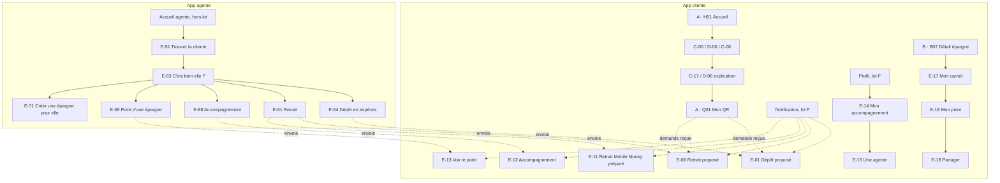

## Parcours

### E-P1 — Déposer des espèces sur mon solde, avec mon téléphone (critique)

Entrée cliente : A · H01 « Déposer » → C-00 « Auprès d'une agente » → C-17 → A · Q01 (lots C et A), ou directement A · Q01. Entrée agente : accueil agente (hors lot) → E-51.

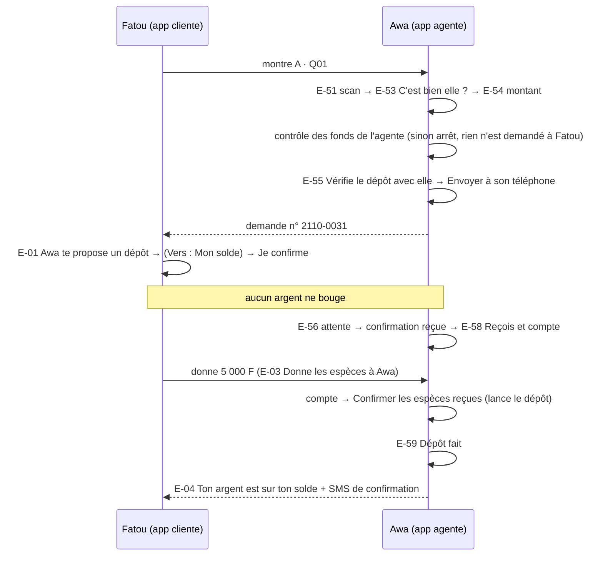

Chemin principal : **cliente 4 écrans** (A · Q01, E-01, E-03, E-04) ; **agente 7 écrans** (E-51, E-53, E-54, E-55, E-56, E-58, E-59). Sortie : A · H01 actualisé (cliente), E-51 ou accueil agente (agente).

### E-P2 — Déposer des espèces dans une épargne (deux mouvements liés)

Même chemin que E-P1 ; sur E-01, Fatou touche « Vers : Mon solde · Changer » et choisit une épargne dans la feuille E-02. Un seul geste, deux mouvements liés : dépôt sur le solde puis mise de côté liée (RM-FUND-02, PRD 16a, 16b).

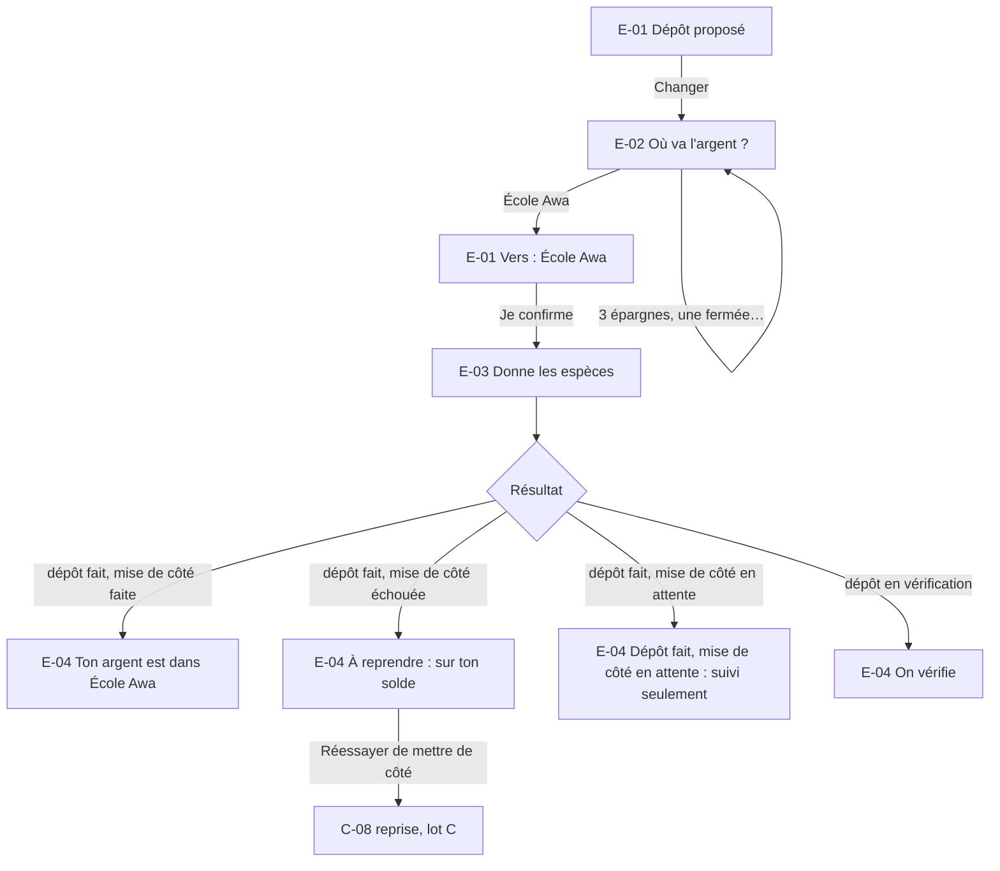

- Changer la destination **après** la confirmation n'est pas possible sur E-03 : c'est un nouveau récapitulatif (l'agente annule et refait la demande, ou corrige le montant, ce qui redemande la confirmation, PRD 16a).
- La reprise d'une mise de côté échouée réutilise le parcours C-P4 du lot C (C-08, nouvelle confirmation, montant inférieur ou autre épargne si besoin, PRD 16h à 16j) : aucun nouveau dépôt, aucune espèce demandée.
- Côté agente : E-59 affiche « Dépôt fait » ; l'agente ne voit **pas** le résultat de la mise de côté ni le nom de l'épargne quand c'est Fatou qui l'a choisie (H7, H8).

Chemin principal : identique à E-P1 + la feuille E-02 : **cliente 5 écrans**, **agente 7 écrans**.

### E-P3 — Déposer des espèces sans smartphone (code du dépôt)

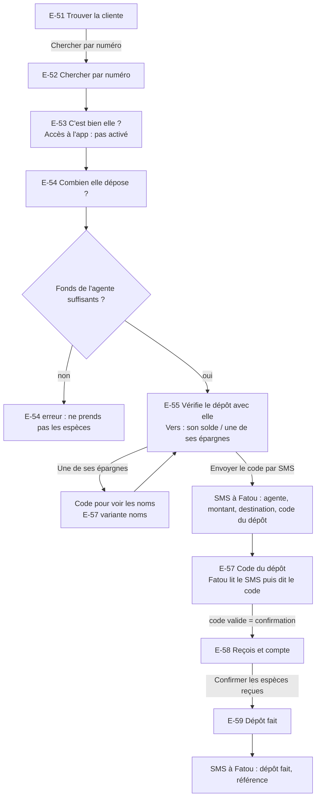

- Le code du dépôt est saisi par l'agente dans le champ « Code du dépôt » de **cette** demande, jamais dans un champ PIN (PRD 17c). Il confirme les conditions (montant, agente, destination) ; il ne lance rien et ne prouve pas la remise.
- Sans accord pour voir les noms, la destination reste « Son solde » : le dépôt n'est jamais bloqué faute d'épargne choisie (PRD 16c).
- Le résultat, y compris un résultat partiel (mise de côté échouée), est envoyé par SMS ; la reprise assistée sans smartphone suit la règle G05-2 (**Décision PO du 21 octobre 2026** : disponible envoyé par SMS à la cliente seule), dont les écrans restent à spécifier.

Chemin principal : **agente 8 écrans** (E-51, E-52, E-53, E-54, E-55, E-57, E-58, E-59) ; **cliente : 2 SMS** (code, confirmation).

### E-P4 — Dépôt en espèces : les imprévus

| Situation                                      | Où                      | Ce qui se passe                                                                                                                                             | Règle                    |
| ---------------------------------------------- | ----------------------- | ----------------------------------------------------------------------------------------------------------------------------------------------------------- | ------------------------ |
| Fonds de l'agente insuffisants                 | E-54                    | Arrêt **avant** toute demande à Fatou ; « Ne prends pas les espèces. » ; aucun montant des fonds affiché                                                    | PRD 17a, RM-FUND-01      |
| Fatou refuse (« Ce n'est pas le bon montant ») | E-01 → E-56             | Demande refusée, rien ne bouge ; l'agente peut corriger et renvoyer une **nouvelle** demande                                                                | PRD 18                   |
| Montant compté différent                       | E-58 → E-54 → E-56      | L'agente corrige ; nouvelle confirmation obligatoire ; E-01 dit « Le montant a changé » ; l'ancienne confirmation ne compte plus                            | PRD 16, RM-FUND-01       |
| Confirmation expirée avant le lancement        | E-58, E-03              | Lancement bloqué ; « Redemander sa confirmation » ; aucun mouvement ; demande et remise éventuelle conservées ; durée **à confirmer (G02)**                 | PRD 17b, RM-FUND-07      |
| Code du dépôt incorrect, expiré, SMS non reçu  | E-57                    | Message sur place ; « Renvoyer le SMS » (règles G02) ; sans code, aucun lancement                                                                           | PRD 17c                  |
| L'agente annule avant le lancement             | E-60 → E-04, SMS        | Demande conservée, « Annulée » ; Fatou voit « Tu as donné les espèces ? » → E-05 → signalement « J'ai remis les espèces » ; SMS d'annulation                | PRD 20a, 20b, RM-FUND-04 |
| Fonds insuffisants au lancement (recontrôle)   | E-59, E-04              | Échec confirmé, rien n'est entré ; l'agente doit rendre les espèces ; Fatou peut signaler qu'elle ne les a pas récupérées                                   | PRD 17a, 18              |
| Résultat inconnu après le lancement            | E-59, E-04              | « Dépôt en cours de vérification », référence, aide ; **ni annulation ni nouveau dépôt** ; aucun remboursement automatique tant qu'un crédit reste possible | PRD 20, 21, RM-FUND-09   |
| L'agente est partie avant la fin               | C-12 → C-14             | « Signaler un problème » depuis l'opération ; l'assistance coordonne, Fatou n'a pas à retrouver l'agente                                                    | PRD 22                   |
| Pas de connexion (agente ou cliente)           | E-54 à E-58, E-01, E-03 | Rien n'est envoyé ; « Ne prends pas les espèces tant que ce n'est pas confirmé. » ; reprise de la **même** demande au retour du réseau                      | H9                       |

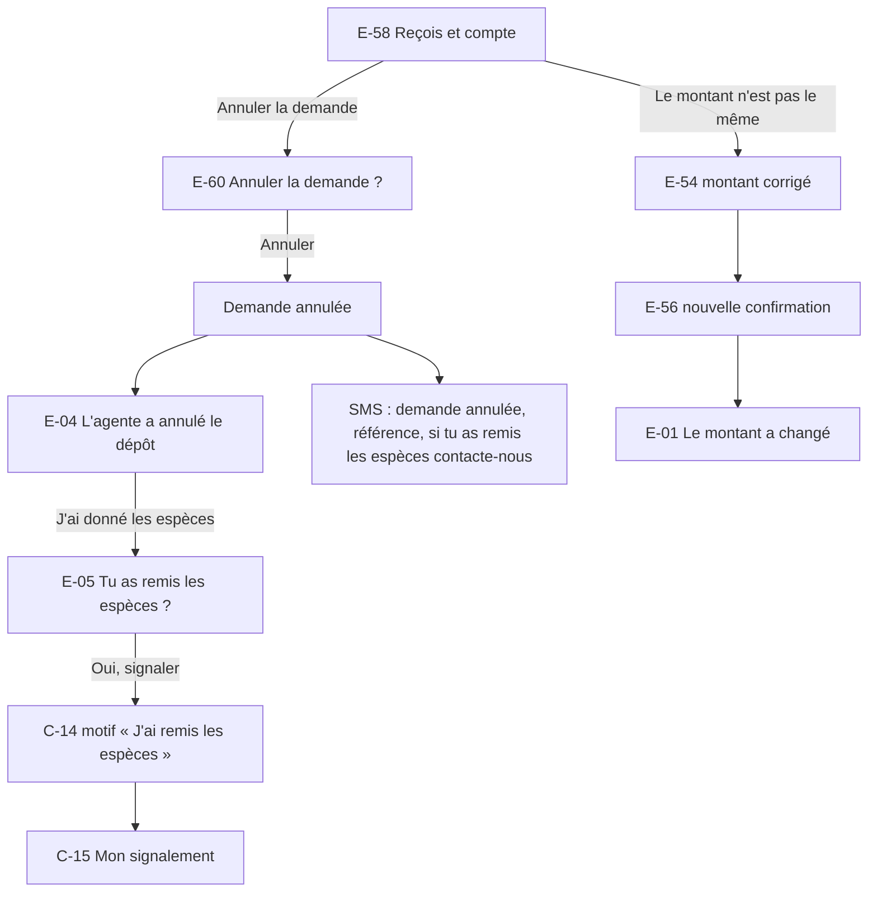

Chemin principal (annulation) : **cliente 4 écrans** (E-04, E-05, C-14, C-15).

### E-P5 — Retirer des espèces, avec mon téléphone (critique)

Entrée cliente : A · H01 « Retirer » → D-00 « Auprès d'une agente » → D-06 → A · Q01 (lots D et A).

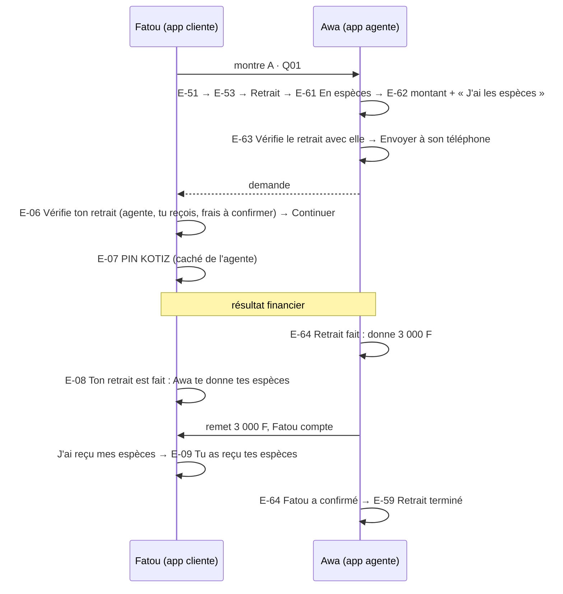

Chemin principal : **cliente 5 écrans** (A · Q01, E-06, E-07, E-08, E-09) ; **agente 8 écrans** (E-51, E-53, E-61, E-62, E-63, E-56, E-64, E-59).

### E-P6 — Retirer des espèces sans smartphone (deux codes)

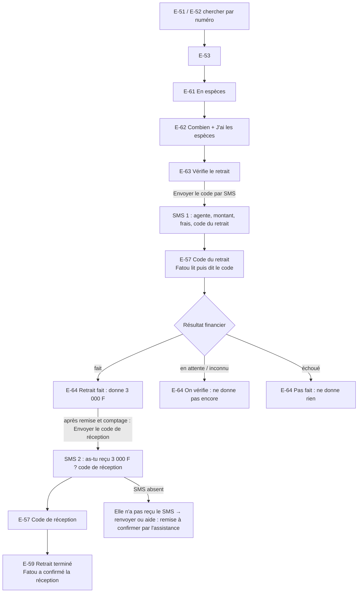

- Le code de réception est **distinct** du code du retrait et ne débite rien (PRD 30a). La déclaration de l'agente et le silence ne prouvent jamais la réception.
- Expiration du code du retrait avant exécution : aucun débit, nouvelle autorisation (nouveau SMS).

Chemin principal : **agente 10 écrans** (E-51, E-52, E-53, E-61, E-62, E-63, E-57, E-64, E-57, E-59) ; **cliente : 3 SMS** (code du retrait, code de réception, confirmation).

### E-P7 — Retrait en espèces : les imprévus

| Situation                                           | Où                             | Ce qui se passe                                                                                                                                                  | Règle                |
| --------------------------------------------------- | ------------------------------ | ---------------------------------------------------------------------------------------------------------------------------------------------------------------- | -------------------- |
| L'agente n'a pas les espèces                        | E-62                           | Elle ne coche pas « J'ai 3 000 F en espèces sur moi » : Continuer reste désactivé avec sa raison                                                                 | PRD 30a, RM-FUND-05  |
| Solde insuffisant, niveau d'accès, règle partenaire | E-06 (cliente) ; E-63 (agente) | Refus **avant le PIN**, raison dite à Fatou seule ; l'agente lit « Ce retrait n'est pas possible pour cette cliente. » ; sans smartphone, la raison part par SMS | H7, lot D (D-P3)     |
| Frais inconnus                                      | E-06, E-63                     | Autorisation bloquée avec sa raison (production) ; « à confirmer » au prototype                                                                                  | PRD § 7 règle 5, G01 |
| Fatou refuse                                        | E-06 → E-56                    | Demande refusée ; rien ne sort                                                                                                                                   | PRD 28               |
| L'agente change le montant après l'envoi            | E-56 → E-62                    | Nouvelle demande, nouvelle autorisation ; jamais de conditions appliquées en silence                                                                             | PRD 28, 30           |
| L'agente annule avant le PIN ou le code             | E-60                           | Demande annulée, rien n'est sorti ; E-06 affiche « Awa a annulé la demande. »                                                                                    | PRD 20a              |
| PIN incorrect ou bloqué                             | E-07                           | Comme D-04 (lot D, D-P6) ; nombre d'essais G02                                                                                                                   | RM-SEC-01            |
| Résultat financier inconnu                          | E-08, E-64                     | « On vérifie » ; **pas de remise sur supposition** ; pas de nouvelle demande pour la même opération                                                              | PRD 30a, RM-FUND-09  |
| Retrait fait, espèces non remises                   | E-08 → E-10 → C-14             | « Je n'ai pas reçu mes espèces » → signalement « Espèces non reçues » ; remise « Contestée » ; l'agente le voit sur E-64                                         | PRD 30a, RM-FUND-10  |
| Fatou ne confirme pas la réception                  | E-64, C-12                     | Remise « En attente » ; l'opération n'est pas terminée ; l'agente peut seulement contacter l'aide                                                                | PRD 29               |
| SMS de réception absent (sans smartphone)           | E-57 réception                 | Renvoyer (G02) ou « Contacter l'aide » : l'assistance recueille la confirmation de la cliente (G03)                                                              | PRD 30a              |
| Pas de connexion                                    | E-62 à E-64, E-06 à E-08       | Rien n'est envoyé ; « Ne donne pas les espèces tant que le retrait n'est pas fait. »                                                                             | H9                   |

Chemin principal (espèces non reçues) : **cliente 4 écrans** (E-08, E-10, C-14, C-15).

### E-P8 — Retrait sur mon Mobile Money préparé par une agente

PRD 30b, décision PO Q6 du lot D. L'agente prépare ; la cliente autorise ; « Fait » seulement quand l'opérateur confirme ; **aucune confirmation de remise** dans cette branche.

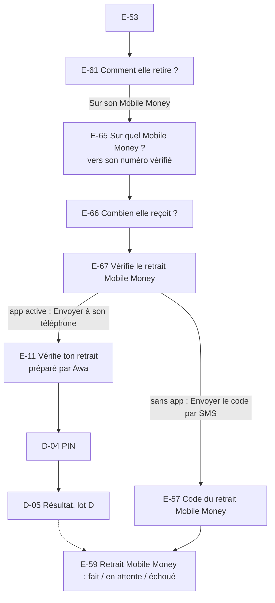

Chemin principal : **cliente 3 écrans** (E-11, D-04, D-05, puis A · H01) ; **agente 8 écrans** (E-51, E-53, E-61, E-65, E-66, E-67, E-56 ou E-57, E-59).

### E-P9 — Accepter, refuser ou retirer l'accompagnement d'une agente

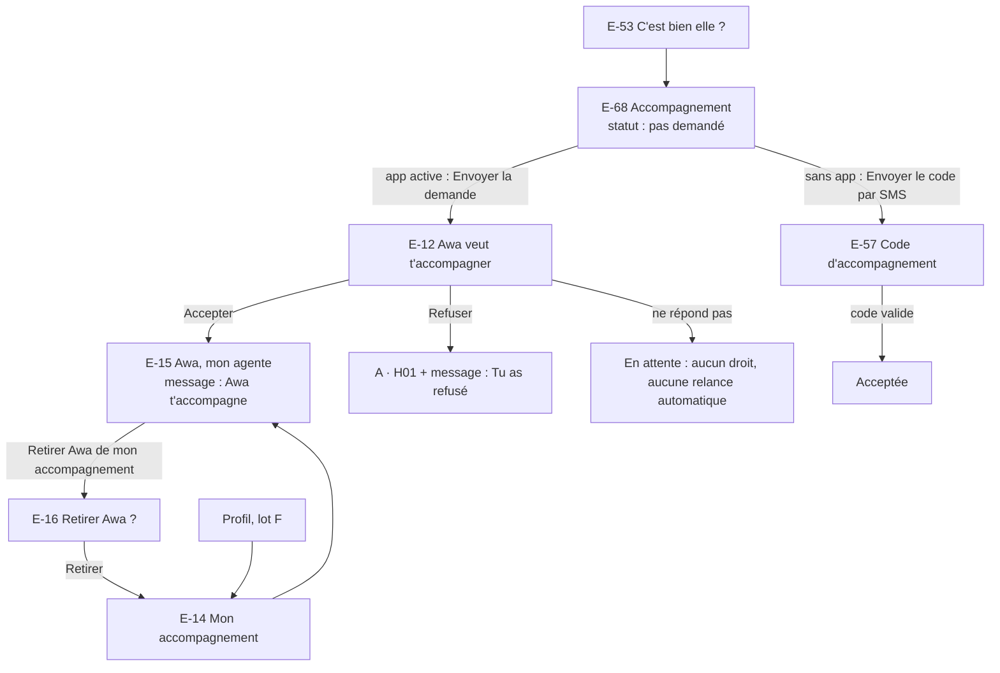

- Le refus, le silence et le retrait n'accordent aucun droit et ne bloquent ni dépôt ni retrait chez cette agente ou une autre (RM-PERM-05, 06).
- Le retrait de l'accompagnement retire aussi les permissions de point liées à cette agente et annule une création d'épargne assistée encore en attente de confirmation (RM-PERM-07, PRD 16g). Sans smartphone, le retrait passe par l'assistance (lot F, G03).

Chemin principal (accepter) : **cliente 2 écrans** (E-12, E-15) ; (retirer) **4 écrans** (Profil, E-14, E-15, E-16) ; **agente 3 écrans** (E-53, E-68, E-56).

### E-P10 — Laisser une agente voir le point d'une épargne

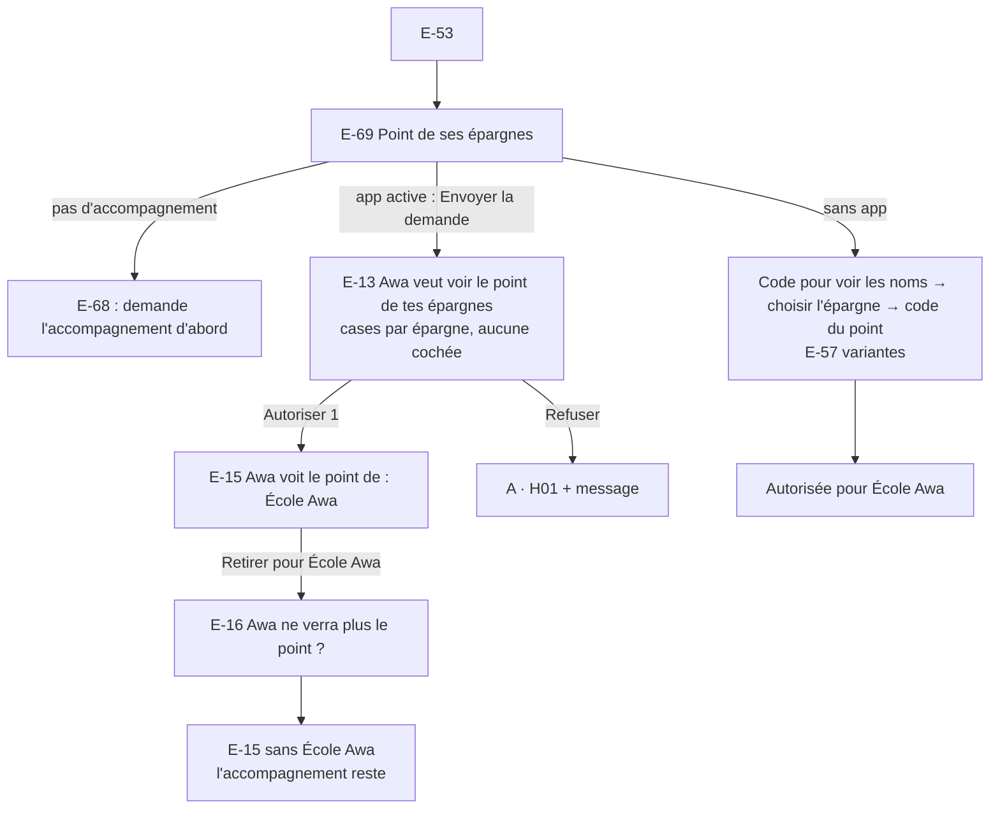

- La permission vaut pour **une** épargne ; une épargne créée ensuite n'est jamais ajoutée seule (PRD 12.1). Elle est contrôlée à chaque consultation et à chaque envoi (E-70).
- Retirer une permission garde l'accompagnement ; les relevés déjà envoyés ne sont pas rappelés (RM-PERM-07).

Chemin principal (autoriser) : **cliente 2 écrans** (E-13, E-15) ; **agente 3 écrans** (E-53, E-69, E-56).

### E-P11 — Mon carnet : voir, garder et partager le point d'une épargne

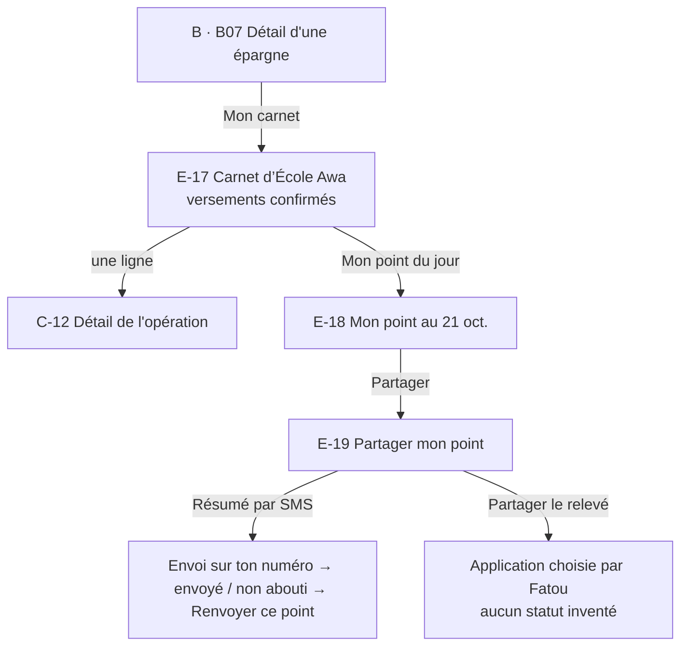

Chemin principal : **cliente 4 écrans** (B · B07, E-17, E-18, E-19).

### E-P12 — Avec une cliente sans smartphone : point d'une épargne et création d'épargne

Deux opérations assistées qui n'existent que dans l'app agente, pour une cliente sans accès à l'app :

1. **Montrer et envoyer le point** d'une épargne autorisée (PRD § 4 : « le carnet peut être présenté à la cliente dans l'espace agente sous permission distincte ») : E-53 → E-69 → E-70 → « Envoyer le point à Fatou par SMS » (vers son numéro vérifié, jamais un autre).
2. **Créer une épargne pour elle** (PRD 16d, 16e) : accompagnement accepté requis ; E-53 → E-71 (compositions B · B02 à B · B05 dans l'app agente) → E-72 récapitulatif → code de création (E-57) → E-59. Aucun argent ne bouge ; l'alimentation est un dépôt distinct (E-P3).

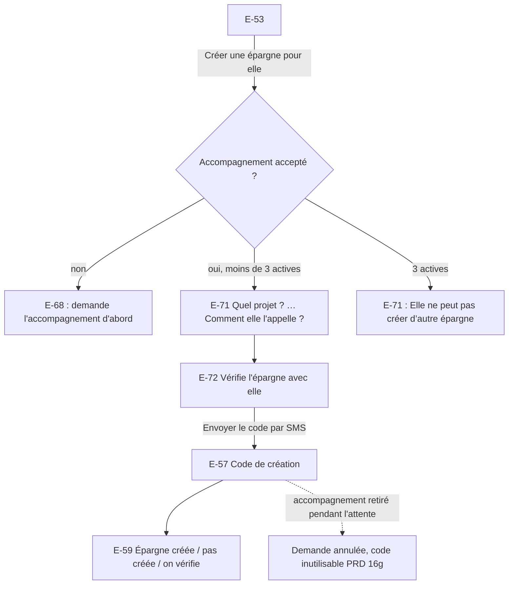

Le retour au solde assisté (FIN-02) et la reprise assistée d'une mise de côté (PRD 16h) demandent de montrer à la cliente, en privé, l'argent disponible : exception **G05-2**, tranchée selon la recommandation (**Décision PO du 21 octobre 2026** : le disponible n'est envoyé que par SMS à la cliente, l'agente saisit le montant que la cliente lui dit, refus « Montant pas possible. Elle a reçu la raison par SMS. »). Ces deux opérations n'ont **pas** d'écran dans la carte de ce lot : à spécifier dans un incrément (E-20 à E-50 libres).

Chemin principal (point) : **agente 3 écrans** (E-53, E-69, E-70) ; (création) **agente 9 écrans** (E-53, E-71 en 4 étapes, E-72, E-57, E-59).

### E-P13 — Retrouver une opération en espèces (Opérations, détail, reçu)

Aucun écran nouveau : C-11, C-12 et C-13 (lot C) reçoivent le contenu des opérations en espèces (voir « Écrans des lots précédents réutilisés »). Une ligne par opération ; montant tel qu'il bouge sur le solde ; une demande annulée reste visible.

Chemin principal : **cliente 3 écrans** (C-11, C-12, C-13).

### Nombre d'écrans par parcours (chemin principal)

| Parcours                                    | App cliente                         | App agente                                                 |
| ------------------------------------------- | ----------------------------------- | ---------------------------------------------------------- |
| E-P1 Dépôt en espèces sur le solde          | **4** — A · Q01 E-01 E-03 E-04      | **7** — E-51 E-53 E-54 E-55 E-56 E-58 E-59                 |
| E-P2 Dépôt en espèces dans une épargne      | **5** — + E-02                      | **7** — comme E-P1                                         |
| E-P3 Dépôt sans smartphone                  | 2 SMS                               | **8** — E-51 E-52 E-53 E-54 E-55 E-57 E-58 E-59            |
| E-P4 Annulation, « J'ai remis les espèces » | **4** — E-04 E-05 C-14 C-15         | **2** — E-58 E-60                                          |
| E-P5 Retrait en espèces                     | **5** — A · Q01 E-06 E-07 E-08 E-09 | **8** — E-51 E-53 E-61 E-62 E-63 E-56 E-64 E-59            |
| E-P6 Retrait sans smartphone                | 3 SMS                               | **10** — E-51 E-52 E-53 E-61 E-62 E-63 E-57 E-64 E-57 E-59 |
| E-P7 Espèces non reçues                     | **4** — E-08 E-10 C-14 C-15         | **1** — E-64 (contestation visible)                        |
| E-P8 Retrait Mobile Money préparé           | **3** — E-11 D-04 D-05              | **8** — E-51 E-53 E-61 E-65 E-66 E-67 E-56 E-59            |
| E-P9 Accepter l'accompagnement              | **2** — E-12 E-15                   | **3** — E-53 E-68 E-56                                     |
| E-P9′ Retirer l'accompagnement              | **4** — Profil E-14 E-15 E-16       | —                                                          |
| E-P10 Autoriser le point d'une épargne      | **2** — E-13 E-15                   | **3** — E-53 E-69 E-56                                     |
| E-P11 Mon carnet et mon point               | **4** — B · B07 E-17 E-18 E-19      | —                                                          |
| E-P12 Point / création sans smartphone      | SMS                                 | **3** (point) ; **9** (création)                           |
| E-P13 Retrouver une opération en espèces    | **3** — C-11 C-12 C-13              | —                                                          |

Cibles : **côté cliente, aucun chemin principal au-delà de 5 écrans**, dont un seul écran de décision par opération (E-01 ou E-06) ; le dépôt en espèces se fait en **une décision** (« Je confirme »), le retrait en **deux** (« Continuer », PIN) puis un constat (« J'ai reçu mes espèces »). Côté agente, les chemins sont plus longs parce que l'agente porte les contrôles (identité, fonds, comptage, codes) ; la cible est **8 écrans** avec smartphone, 10 sans smartphone pour le retrait (deux codes).

## Carte des écrans

### App cliente (variant `client`)

| ID   | Écran                                         | Parcours       | Objectif                                                               |
| ---- | --------------------------------------------- | -------------- | ---------------------------------------------------------------------- |
| E-01 | Awa te propose un dépôt                       | E-P1 E-P2 E-P4 | Vérifier agente, montant, destination, puis confirmer (sans PIN)       |
| E-02 | Où va l'argent ? (bottom sheet)               | E-P2           | Choisir Mon solde ou une épargne active                                |
| E-03 | Donne les espèces à Awa                       | E-P1 E-P2 E-P4 | Savoir que rien n'est encore fait et quand donner les espèces          |
| E-04 | Résultat du dépôt en espèces                  | E-P1 E-P2 E-P4 | Savoir si c'est fait, en attente, à reprendre, échoué ou annulé        |
| E-05 | Tu as remis les espèces ? (bottom sheet)      | E-P4           | Signaler une remise après annulation ou échec                          |
| E-06 | Vérifie ton retrait (proposé par une agente)  | E-P5 E-P7      | Vérifier agente, montant reçu, frais, puis continuer vers le PIN       |
| E-07 | Entre ton PIN (retrait en espèces)            | E-P5           | Autoriser le retrait, PIN caché de l'agente                            |
| E-08 | Résultat du retrait et remise                 | E-P5 E-P7      | Savoir si l'argent est sorti et quand prendre les espèces              |
| E-09 | Tu as reçu tes espèces                        | E-P5           | Clore le retrait après la remise                                       |
| E-10 | Tu n'as pas reçu tes espèces ? (bottom sheet) | E-P7           | Ne pas refaire le retrait, signaler                                    |
| E-11 | Vérifie ton retrait Mobile Money (préparé)    | E-P8           | Autoriser un retrait Mobile Money préparé par une agente               |
| E-12 | Awa veut t'accompagner                        | E-P9           | Accepter ou refuser l'accompagnement                                   |
| E-13 | Awa veut voir le point de tes épargnes        | E-P10          | Choisir épargne par épargne ou refuser                                 |
| E-14 | Mon accompagnement                            | E-P9           | Voir les agentes qui m'accompagnent et les demandes en attente         |
| E-15 | Awa, mon agente                               | E-P9 E-P10     | Voir ce qu'elle peut faire, retirer une permission ou l'accompagnement |
| E-16 | Retirer … ? (dialogue, 2 variantes)           | E-P9 E-P10     | Confirmer un retrait de droit                                          |
| E-17 | Carnet de {épargne}                           | E-P11          | Voir les versements confirmés et leurs accords                         |
| E-18 | Mon point au {date}                           | E-P11          | Voir le relevé daté avant de le partager                               |
| E-19 | Partager mon point (bottom sheet)             | E-P11          | Recevoir un résumé par SMS ou partager le relevé                       |

### App agente (variant `agent`)

| ID   | Écran                                       | Parcours                     | Objectif                                                               |
| ---- | ------------------------------------------- | ---------------------------- | ---------------------------------------------------------------------- |
| E-51 | Trouver la cliente (scan)                   | tous                         | Identifier la cliente par son QR                                       |
| E-52 | Chercher par numéro                         | E-P3 E-P6 E-P12              | Identifier la cliente sans QR                                          |
| E-53 | C'est bien elle ?                           | tous                         | Vérifier l'identité, puis choisir l'opération                          |
| E-54 | Combien elle dépose ?                       | E-P1 à E-P4                  | Saisir le montant ; contrôle des fonds de l'agente                     |
| E-55 | Vérifie le dépôt avec elle                  | E-P1 à E-P3                  | Relire avec la cliente, choisir le canal (et la destination sans app)  |
| E-56 | Attends sa réponse (générique)              | E-P1 E-P5 E-P8 E-P9 E-P10    | Attendre la décision de la cliente sur son téléphone                   |
| E-57 | Code de la cliente (générique, 8 variantes) | E-P3 E-P6 E-P8 à E-P10 E-P12 | Saisir le code ponctuel lu par la cliente dans son SMS                 |
| E-58 | Reçois et compte les espèces                | E-P1 à E-P4                  | Compter, puis lancer le dépôt                                          |
| E-59 | Résultat (app agente)                       | tous                         | Savoir ce qui est fait, et ce qu'il faut faire des espèces             |
| E-60 | Annuler la demande ? (dialogue)             | E-P4 E-P7                    | Annuler avant le lancement, sans effacer la demande                    |
| E-61 | Comment elle retire ? (bottom sheet)        | E-P5 à E-P8                  | Choisir espèces ou Mobile Money                                        |
| E-62 | Combien elle retire en espèces ?            | E-P5 à E-P7                  | Saisir le montant et déclarer avoir les espèces                        |
| E-63 | Vérifie le retrait avec elle                | E-P5 à E-P7                  | Relire avec la cliente, envoyer la demande ou le code                  |
| E-64 | Retrait : donne les espèces                 | E-P5 à E-P7                  | Remettre seulement après le résultat, suivre la confirmation de remise |
| E-65 | Sur quel Mobile Money ? (app agente)        | E-P8                         | Choisir l'opérateur du numéro vérifié                                  |
| E-66 | Combien elle reçoit ? (app agente)          | E-P8                         | Saisir le montant reçu sur le Mobile Money                             |
| E-67 | Vérifie le retrait Mobile Money avec elle   | E-P8                         | Relire, envoyer la demande ou le code                                  |
| E-68 | Accompagnement                              | E-P9                         | Demander l'accompagnement et suivre son statut                         |
| E-69 | Point de ses épargnes                       | E-P10 E-P12                  | Demander une permission, ouvrir un point autorisé                      |
| E-70 | Point de {épargne} (app agente)             | E-P12                        | Montrer le point et l'envoyer à la cliente par SMS                     |
| E-71 | Créer une épargne pour elle (4 étapes)      | E-P12                        | Saisir type, cible, date, nom avec la cliente                          |
| E-72 | Vérifie l'épargne avec elle                 | E-P12                        | Relire, envoyer le code de création                                    |

## Règles communes aux écrans du lot E

- **Orientation** : le titre dit ce que fait la personne qui tient le téléphone (« Combien elle dépose ? » chez l'agente, « Vérifie ton retrait » chez Fatou). Chaque écran cliente lié à une agente montre **qui** est l'agente (`AgentIdentity`, nouveau) ; chaque écran agente montre **pour qui** (« Pour Fatou Koné »).
- **Montant dominant** : `AmountField` à la saisie (app agente) ; montant dominant de `SummaryFlow` aux récapitulatifs ; rappel du montant sur l'attente, le PIN et le résultat.
- **Statut réel** : `StatusPill` « Fait » / « En attente » / « Échoué » (mot + pictogramme) pour le statut financier ; `StatusRows` quand deux statuts coexistent (dépôt + mise de côté ; retrait + espèces reçues). « Fait » seulement après confirmation. En attente : ambre + horloge + `StepTracker` (« Envoyée », « Confirmée »), jamais de reçu de succès, jamais de célébration (aucune illustration de résultat au lot E).
- **Une décision par écran**, un seul bouton principal dans l'`ActionZone`. Accepter / Refuser (E-12, E-13) sont les deux réponses d'une même décision : « Accepter » principal, « Refuser » secondaire.
- **Les espèces ne changent de main qu'au bon moment** : chaque écran agente avant ce moment porte la consigne « Ne prends pas encore les espèces. » (dépôt) ou « Ne donne pas encore les espèces. » (retrait) ; chaque écran cliente correspondant dit « Ne donne pas encore les espèces. » / « Attends : rien n'est encore sorti. ».
- **Secrets** : aucun écran agente n'a de champ PIN ; le PIN de Fatou n'existe que sur E-07 et D-04, avec « Cache ton écran. Ne montre ton PIN à personne, même à l'agente. ». Un code ponctuel est saisi par l'agente dans un champ nommé par sa finalité, chiffres visibles, jamais en cases de PIN.
- **Ce que l'agente ne voit pas** (H7) : aucun solde, aucun montant d'épargne hors point autorisé, aucune opération. Les refus liés à l'argent de la cliente sont dits à la cliente seule.
- **Frais** : ligne « Frais · à confirmer » sur E-01, E-06, E-11, E-55, E-63, E-67 ; jamais de valeur (G01). Les lignes qui en dépendent (« Pris sur ton solde », « Arrive sur ton solde ») disent aussi « à confirmer ». Frais inconnus en production = bouton principal désactivé avec sa raison.
- **Retour** `←` : écran précédent, saisie gardée. Après envoi d'une demande, l'agente ne revient pas modifier en silence : « Modifier » passe par l'annulation ou la correction (nouvelle demande). Depuis un résultat, la croix et le retour Android ramènent au point de départ (A · H01 côté cliente, E-51 côté agente).
- **Attente réseau** (> 1 s) : bouton en « Envoi… », double appui bloqué, une clé d'idempotence par demande et par lancement (#67).
- **Hors ligne** : phrases `Kotiz.OFFLINE` (DESIGN.md) ; « Pas de connexion. Rien n'a été envoyé. » + la consigne espèces de l'écran.
- **Reprise après interruption** : l'app cliente rouvre la demande en cours (E-01, E-03, E-06, E-08) ; l'app agente rouvre la demande en cours sur son étape (E-56, E-57, E-58, E-64). Jamais une nouvelle demande.
- **Aucun paramètre inventé** : frais, minimum, maximum, durée de validité d'une confirmation, longueur, validité, essais et renvoi d'un code, délai d'arrivée, motifs de signalement, contact d'assistance.

## Écrans — app cliente

### E-01 — Awa te propose un dépôt

- Objectif : vérifier qui dépose, combien et vers où, puis confirmer. Rien ne bouge à la confirmation.
- Action primaire : **Je confirme**.
- Actions secondaires : « Changer » sur la ligne Vers (→ E-02) ; bouton texte « Ce n'est pas le bon montant » (refuse la demande, l'agente le voit sur E-56) ; ← / Fermer : la demande reste en attente sur l'app agente, Fatou la retrouve dans Opérations et A · H01 (pas de refus implicite).
- Contenu (par priorité) : `PageHeader` (× Fermer, titre « Dépôt en espèces ») ; `AgentIdentity` « Awa Traoré · Agente KOTIZ · AG-0142 » ; `SummaryFlow` : montant dominant « Tu donnes 5 000 FCFA » ; `FlowPath` Depuis « Tes espèces » (illustration agente) → Vers « Mon solde » (portefeuille) avec « Changer » ; `DetailList` : Frais · à confirmer ; Demande · n° 2110-0031 ; consigne « Ne donne pas encore les espèces. » ; `ActionZone`.
- États : nominal ; **montant changé** (`Message` information au-dessus : « Le montant a changé. Vérifie à nouveau. », la confirmation précédente ne compte plus) ; **nouvelle confirmation demandée** après expiration (« Ta confirmation n'est plus valable. Confirme à nouveau. ») ; **frais inconnus** (production : « Je confirme » désactivé, raison « Les frais ne sont pas encore connus. ») ; **demande annulée par l'agente** pendant la lecture (l'écran passe à E-04 « annulé ») ; envoi en cours (« Envoi… ») ; hors ligne (« Pas de connexion. Rien n'a été envoyé. ») ; épargne choisie fermée entre-temps (« École Awa est fermée. Choisis une autre destination. », retour à « Mon solde » par défaut, nouveau choix explicite).
- Cas limites : deux demandes à la fois (deux agentes) : chacune a son écran et sa référence, jamais fusionnées ; demande d'une agente inconnue de Fatou : l'identité et le code sont toujours visibles, « Ce n'est pas le bon montant » sert aussi à refuser ; nom d'agente long : retour à la ligne ; aucun solde affiché (Fatou peut être regardée par l'agente) ; aucun PIN.

```
┌──────────────────────────────┐
│ ✕  Dépôt en espèces          │
├──────────────────────────────┤
│ [ag] Awa Traoré              │
│      Agente KOTIZ · AG-0142  │
│                              │
│ Tu donnes                    │
│ 5 000 FCFA                   │
│                              │
│ Depuis  [ag] Tes espèces     │
│   ↓                          │
│ Vers    [👛] Mon solde       │
│                     Changer  │
│ ──────────────────────────── │
│ Frais          à confirmer   │
│ Demande        n° 2110-0031  │
│ ──────────────────────────── │
│ Ne donne pas encore les      │
│ espèces.                     │
├──────────────────────────────┤
│ [      Je confirme       ] ★ │
│  Ce n'est pas le bon montant │
└──────────────────────────────┘
```

### E-02 — Où va l'argent ? (bottom sheet)

- Objectif : choisir la destination de **tout** le montant.
- Action primaire : toucher une destination (la feuille se ferme, E-01 affiche le choix).
- Actions secondaires : × Fermer (destination inchangée).
- Contenu : titre « Où va l'argent ? » ; sous-titre « Tout le montant va au même endroit. » ; `OptionRow` « Mon solde » (portefeuille, sélectionné par défaut) ; une `OptionRow` par **épargne active** (illustration du type, nom, sans montant ; `selected` vert doux + coche). Aucun solde ni montant d'épargne (Fatou peut être regardée).
- États : aucune épargne : seule « Mon solde », avec `InfoLine` « Tu pourras créer une épargne après. » (PRD 16c, création facultative, jamais enchaînée) ; épargne fermée : absente ; chargement : `Skeleton` liste sans chiffre.
- Cas limites : 3 épargnes actives (limite) : la feuille n'invite pas à en créer ; noms longs sur deux lignes.

```
┌──────────────────────────────┐
│            ───            ✕  │
│ Où va l'argent ?             │
│ Tout le montant va au même   │
│ endroit.                     │
│ [👛] Mon solde            ✓  │
│ ──────────────────────────── │
│ [🎒] École Awa               │
│ ──────────────────────────── │
│ [🏪] Boutique                │
└──────────────────────────────┘
```

### E-03 — Donne les espèces à Awa

- Objectif : savoir que la confirmation est faite mais que le dépôt ne l'est pas encore ; donner les espèces maintenant.
- Action primaire : aucune pour Fatou (elle donne et regarde compter) ; l'écran avance seul quand l'agente lance le dépôt.
- Actions secondaires : bouton texte « Voir dans Opérations » ; × Fermer (la demande continue ; A · H01 montre « Dépôt en attente »).
- Contenu : `ResultScreen` `status: progress` : pastille horloge ambre ; `StatusPill` « En attente » ; titre « Donne les espèces à Awa. » ; sous-titre « Elle les compte devant toi. » ; montant 5 000 FCFA ; `StepTracker` : « Tu as confirmé » (`sent`) · « Awa compte les espèces » (en attente) · « Arrive sur ton solde » (pas encore) — avec une épargne : quatrième étape « Passe dans École Awa » ; `DetailList` : Avec · Awa Traoré ; Vers · Mon solde ; Demande · n° 2110-0031.
- États : **confirmation expirée** (« Ta confirmation n'est plus valable. » + bouton principal « Confirmer à nouveau » → E-01 actualisé) ; **montant corrigé par l'agente** (→ E-01 « Le montant a changé ») ; **annulée** (→ E-04 annulé) ; hors ligne (« Mis à jour à 10:42 · hors connexion » ; la demande continue côté agente).
- Cas limites : Fatou ferme l'app : la notification de résultat (lot F) et Opérations ramènent à E-04 ; aucune durée affichée (G02).

```
┌──────────────────────────────┐
│ ✕                            │
├──────────────────────────────┤
│ (⏱)  ⏱ En attente            │
│ Donne les espèces à Awa.     │
│ Elle les compte devant toi.  │
│ 5 000 FCFA                   │
│                              │
│ (✓) Tu as confirmé           │
│ (⏱) Awa compte les espèces   │
│ ( ) Arrive sur ton solde     │
│ ──────────────────────────── │
│ Avec      Awa Traoré         │
│ Vers      Mon solde          │
│ Demande   n° 2110-0031       │
├──────────────────────────────┤
│     Voir dans Opérations     │
└──────────────────────────────┘
```

### E-04 — Résultat du dépôt en espèces

- Objectif : savoir sans aide si le dépôt est fait, en attente, à reprendre, échoué ou annulé.
- Action primaire : **Terminé** (→ A · H01), sauf variantes ci-dessous.
- Actions secondaires : boutons texte selon l'état ; × Fermer = Terminé.
- Contenu : `ResultScreen` (composition C-05). Variantes :

| Variante                            | Pastille / pill                                   | Titre                          | Sous-titre / contenu                                                                                                | Actions                                                                            |
| ----------------------------------- | ------------------------------------------------- | ------------------------------ | ------------------------------------------------------------------------------------------------------------------- | ---------------------------------------------------------------------------------- |
| Fait, sur le solde                  | coche · Fait                                      | Ton argent est sur ton solde.  | Avec Awa Traoré ; Référence KTZ-2110-0103 ; « Tu reçois aussi un SMS. »                                             | Terminé ; texte « Voir le reçu »                                                   |
| Fait, dans une épargne              | coche · Fait                                      | Ton argent est dans École Awa. | `StatusRows` : Dépôt · Fait ; Dans École Awa · Fait                                                                 | Terminé ; « Voir mon épargne » ; « Voir le reçu »                                  |
| Dépôt fait, mise de côté échouée    | action · À reprendre (`failed`)                   | Ton argent est sur ton solde.  | « Il n'est pas allé dans École Awa. » ; `StatusRows` : Dépôt · Fait ; Dans École Awa · Échoué                       | **Réessayer de mettre de côté** (→ C-08 reprise) ; texte « Laisser sur mon solde » |
| Dépôt fait, mise de côté en attente | horloge · En attente                              | Ton argent est sur ton solde.  | `StatusRows` : Dépôt · Fait ; Dans École Awa · En attente ; « Ne refais rien. »                                     | Terminé ; « Voir dans Opérations »                                                 |
| En cours de vérification            | horloge · En attente                              | On vérifie ton dépôt.          | « Ne refais pas le dépôt. » ; Demande n° ; « Awa a reçu tes espèces. Ce n'est pas encore sur ton compte. » (PRD 21) | Terminé ; texte « Signaler un problème »                                           |
| Échoué après lancement              | croix · Échoué                                    | Ton dépôt n'est pas fait.      | « Rien n'est entré sur ton compte. » ; « Awa doit te rendre tes espèces. »                                          | Terminé ; texte « Tu n'as pas récupéré tes espèces ? » (→ E-05)                    |
| Annulé par l'agente                 | croix · Échoué, mot « Annulé »                    | Awa a annulé le dépôt.         | « Rien n'est entré sur ton compte. » ; Demande n° 2110-0031                                                         | Terminé ; **bouton secondaire** « J'ai donné les espèces » (→ E-05)                |
| Refusé par toi                      | neutre (**Décision PO du 30 octobre 2026**, PO 2) | Tu as refusé ce dépôt.         | « Rien n'a bougé. »                                                                                                 | Terminé                                                                            |

- États communs : annonce `polite` (fait, attente) ou `assertive` (échec, annulé) ; hors ligne : dernier état connu, daté.
- Cas limites : retour Android → A · H01, jamais E-01 ni E-03 ; « Voir le reçu » seulement en Fait ; aucun « Réessayer le dépôt » (un nouveau dépôt part de l'agente) ; « Remboursé » n'apparaît jamais.

```
┌──────────────────────────────┐
│ ✕                            │
├──────────────────────────────┤
│ (✓)  ✓ Fait                  │
│ Ton argent est sur ton       │
│ solde.                       │
│ 5 000 FCFA                   │
│ ──────────────────────────── │
│ Avec       Awa Traoré        │
│ Référence  KTZ-2110-0103     │
│ Tu reçois aussi un SMS.      │
├──────────────────────────────┤
│ [        Terminé         ] ★ │
│         Voir le reçu         │
└──────────────────────────────┘
```

### E-05 — Tu as remis les espèces ? (bottom sheet)

- Objectif : dire qu'on a donné des espèces alors que le dépôt n'est pas fait (annulé ou échoué).
- Action primaire : **Signaler un problème** (→ C-14, motif « J'ai remis les espèces » présélectionné, demande, agente et montant repris sans ressaisie ; si un signalement existe déjà → C-15).
- Actions secondaires : « Revenir » (ferme la feuille) ; × Fermer.
- Contenu : titre « Tu as donné les espèces ? » ; phrases : « Dis-le-nous. On vérifie avec l'agente. » ; « Ce n'est pas encore un remboursement. » (texte validé de C-15) ; rappel « Demande n° 2110-0031 · 5 000 F · Awa Traoré » ; « Contacter l'aide › » (G03).
- États : hors ligne (C-14 garde la saisie) ; signalement déjà envoyé (primaire « Voir mon signalement »).
- Cas limites : aucun délai ni promesse de restitution ; le suivi de restitution (« Restitution à organiser > Rendez-vous confirmé > Espèces rendues ») est au lot F.

```
┌──────────────────────────────┐
│            ───            ✕  │
│ Tu as donné les espèces ?    │
│ Dis-le-nous. On vérifie avec │
│ l'agente.                    │
│ Ce n'est pas encore un       │
│ remboursement.               │
│ Demande n° 2110-0031         │
│ 5 000 F · Awa Traoré         │
│ Contacter l'aide           › │
│ [ Signaler un problème   ] ★ │
│ [        Revenir         ]   │
└──────────────────────────────┘
```

### E-06 — Vérifie ton retrait (proposé par une agente)

- Objectif : vérifier qui donne les espèces, combien Fatou reçoit et ce que coûte le retrait, avant le PIN.
- Action primaire : **Continuer** (→ E-07).
- Actions secondaires : bouton texte « Ce n'est pas le bon montant » (refuse) ; × Fermer (la demande reste en attente, rien ne sort).
- Contenu : `PageHeader` (× , « Retrait en espèces ») ; `AgentIdentity` ; `SummaryFlow` : « Tu reçois en espèces » 3 000 FCFA ; `FlowPath` Depuis « Mon solde » → Vers « En espèces · Awa » ; `DetailList` : Frais · à confirmer ; Pris sur ton solde · à confirmer ; Demande n° ; consigne « Prends les espèces seulement quand c'est fait. ».
- États : **refusé avant le PIN** (solde insuffisant : « Ton solde ne suffit pas pour ce retrait. » ; niveau d'accès : « Ce retrait dépasse ce que ton compte permet. » + « Vérifier mon identité › » (lot A2) ; argent dans une épargne : « Ton argent est dans tes épargnes. » + « Remettre sur mon solde › » → B · B01) : Continuer désactivé, primaire « Terminé » ; **frais inconnus** (Continuer désactivé, raison) ; **annulée par l'agente** (« Awa a annulé la demande. Rien n'est sorti. ») ; **montant changé** (nouvelle demande, `Message` « Le montant a changé. ») ; hors ligne.
- Cas limites : le récapitulatif ne montre pas le solde complet à l'écran (Fatou peut être regardée) ; une seule ligne « Pris sur ton solde » ; aucun délai.

```
┌──────────────────────────────┐
│ ✕  Retrait en espèces        │
├──────────────────────────────┤
│ [ag] Awa Traoré              │
│      Agente KOTIZ · AG-0142  │
│ Tu reçois en espèces         │
│ 3 000 FCFA                   │
│ Depuis  [👛] Mon solde       │
│   ↓                          │
│ Vers    [ag] En espèces      │
│ ──────────────────────────── │
│ Frais          à confirmer   │
│ Pris sur ton   à confirmer   │
│ solde                        │
│ Demande        n° 2110-0032  │
│ ──────────────────────────── │
│ Prends les espèces seulement │
│ quand c'est fait.            │
├──────────────────────────────┤
│ [       Continuer        ] ★ │
│  Ce n'est pas le bon montant │
└──────────────────────────────┘
```

### E-07 — Entre ton PIN (retrait en espèces)

- Objectif : autoriser le retrait, seule, l'écran caché de l'agente.
- Action primaire : saisir le PIN (envoi automatique au dernier chiffre, comme D-04).
- Actions secondaires : ← (retour E-06, rien n'est envoyé) ; « PIN oublié ? » (lot F).
- Contenu : `PinScreen` (composition D-04) : titre « Entre ton PIN » ; `recap` : « Retrait en espèces · 3 000 F · avec Awa Traoré » ; avertissement à sa place fixe : « Cache ton écran. Ne montre ton PIN à personne, même à l'agente. ».
- États : `idle`, `wrong`, `sending`, `blocked`, `offline` (`PinScreen`) ; nombre d'essais et longueur **G02**.
- Cas limites : capture d'écran bloquée (à confirmer, G02) ; appel entrant : retour sur E-06, PIN effacé.

```
┌──────────────────────────────┐
│ ←  Entre ton PIN             │
├──────────────────────────────┤
│ Retrait en espèces           │
│ 3 000 F · avec Awa Traoré    │
│                              │
│      [ ] [ ] [ ] [ ]         │
│                              │
│ Cache ton écran. Ne montre   │
│ ton PIN à personne, même à   │
│ l'agente.                    │
│        PIN oublié ?          │
│  [1] [2] [3]                 │
│  [4] [5] [6]                 │
│  [7] [8] [9]                 │
│      [0] [⌫]                 │
└──────────────────────────────┘
```

### E-08 — Résultat du retrait et remise des espèces

- Objectif : savoir si l'argent est sorti, et prendre les espèces seulement si c'est fait.
- Action primaire : en **Fait** : **J'ai reçu mes espèces** (→ E-09) ; ailleurs : **Terminé**.
- Actions secondaires : en Fait : bouton texte « Je n'ai pas reçu mes espèces » (→ E-10) ; × Fermer (la remise reste « En attente » ; C-12 garde le bouton).
- Contenu : `ResultScreen`. Variantes :

| Variante             | Pastille / pill      | Titre                       | Contenu                                                                                                                                                                         | Actions                                                            |
| -------------------- | -------------------- | --------------------------- | ------------------------------------------------------------------------------------------------------------------------------------------------------------------------------- | ------------------------------------------------------------------ |
| Fait                 | coche · Fait         | Ton retrait est fait.       | « Awa te donne tes espèces. Compte-les. » ; 3 000 FCFA ; `StatusRows` : Retrait · Fait ; Espèces reçues · En attente (« Tu confirmes quand tu as compté. ») ; Avec · Awa Traoré | **J'ai reçu mes espèces** ; texte « Je n'ai pas reçu mes espèces » |
| En attente / inconnu | horloge · En attente | On vérifie ton retrait.     | « Ne prends pas encore les espèces. » ; « Ne refais pas le retrait. » ; Demande n°                                                                                              | Terminé ; texte « Signaler un problème »                           |
| Échoué               | croix · Échoué       | Ton retrait n'est pas fait. | « Rien n'a été pris sur ton solde. » (si G01 ne le garantit pas : « On vérifie ton solde. » et variante En attente) ; « Awa ne te donne rien. »                                 | Terminé                                                            |

- États : la page passe seule de « En attente » à « Fait » quand le résultat arrive (annonce `polite`) ; hors ligne : dernier état, daté ; **« J'ai reçu mes espèces »** en envoi (« Envoi… ») puis E-09.
- Cas limites : le bouton « J'ai reçu mes espèces » porte l'aide lue par TalkBack « Appuie quand tu as compté tes espèces. » ; il n'existe **jamais** avant « Fait » ; aucun « Espèces remises » côté agente (PRD 29).

```
┌──────────────────────────────┐
│ ✕                            │
├──────────────────────────────┤
│ (✓)  ✓ Fait                  │
│ Ton retrait est fait.        │
│ Awa te donne tes espèces.    │
│ Compte-les.                  │
│ 3 000 FCFA                   │
│ ──────────────────────────── │
│ Retrait         ✓ Fait       │
│ Espèces reçues  ⏱ En attente │
│ ──────────────────────────── │
│ Demande   n° 2110-0032       │
├──────────────────────────────┤
│ [ J'ai reçu mes espèces  ] ★ │
│ Je n'ai pas reçu mes espèces │
└──────────────────────────────┘
```

### E-09 — Tu as reçu tes espèces

- Objectif : clore le retrait ; garder la preuve.
- Action primaire : **Terminé** (→ A · H01).
- Actions secondaires : « Voir le reçu » (C-13).
- Contenu : `ResultScreen` `done` : pill Fait ; titre « Tu as reçu tes espèces. » ; 3 000 FCFA ; `StatusRows` : Retrait · Fait ; Espèces reçues · Fait (« Confirmé par toi ») ; `DetailList` : Avec · Awa Traoré ; Référence ; Pris sur ton solde · à confirmer (valeur réelle quand G01 tranché).
- États : envoi de la confirmation échoué (reste sur E-08 avec `Message` erreur « Pas envoyé. Réessaie. », la remise reste « En attente ») ; hors ligne idem.
- Cas limites : confirmer deux fois ne crée rien (idempotent) ; aucune illustration (mouvement courant, comme D-05, Q8 du lot D).

```
┌──────────────────────────────┐
│ ✕                            │
├──────────────────────────────┤
│ (✓)  ✓ Fait                  │
│ Tu as reçu tes espèces.      │
│ 3 000 FCFA                   │
│ ──────────────────────────── │
│ Retrait         ✓ Fait       │
│ Espèces reçues  ✓ Fait       │
│ ──────────────────────────── │
│ Avec       Awa Traoré        │
│ Référence  KTZ-2110-0107     │
├──────────────────────────────┤
│ [        Terminé         ] ★ │
│         Voir le reçu         │
└──────────────────────────────┘
```

### E-10 — Tu n'as pas reçu tes espèces ? (bottom sheet)

Même famille que D-07 et E-05.

- Objectif : ne pas refaire le retrait ; signaler.
- Action primaire : **Signaler un problème** (→ C-14, motif « Espèces non reçues », retrait repris ; dossier existant → C-15).
- Actions secondaires : « Revenir » ; × Fermer.
- Contenu : titre « Tu n'as pas reçu tes espèces ? » ; « Ne refais pas le retrait. » (Semi Bold) ; « L'assistance vérifie avec l'agente. » ; rappel « Retrait de 3 000 F · Awa Traoré · KTZ-2110-0107 » ; « Contacter l'aide › » (G03).
- États : signalement envoyé → la remise passe à « Contestée » sur C-12 ; l'agente le voit sur E-64.
- Cas limites : aucun délai, aucune promesse ; aucune nouvelle transaction.

```
┌──────────────────────────────┐
│            ───            ✕  │
│ Tu n'as pas reçu tes         │
│ espèces ?                    │
│ Ne refais pas le retrait.    │
│ L'assistance vérifie avec    │
│ l'agente.                    │
│ Retrait de 3 000 F           │
│ Awa Traoré · KTZ-2110-0107   │
│ Contacter l'aide           › │
│ [ Signaler un problème   ] ★ │
│ [        Revenir         ]   │
└──────────────────────────────┘
```

### E-11 — Vérifie ton retrait Mobile Money (préparé par une agente)

Composition de D-03 (lot D), avec l'agente qui a préparé.

- Objectif : autoriser un retrait Mobile Money préparé par une agente, vers son propre numéro.
- Action primaire : **Continuer** (→ D-04 PIN, puis D-05).
- Actions secondaires : bouton texte « Je ne veux pas ce retrait » (refuse) ; × Fermer.
- Contenu : `PageHeader` (× , « Retrait Mobile Money ») ; ligne `AgentIdentity` compacte « Préparé avec Awa Traoré · agente » ; `SummaryFlow` comme D-03 : Tu reçois 5 000 FCFA ; Depuis Mon solde → Vers ton numéro 07 08 12 34 56 · Wave (logo) ; Frais · à confirmer ; Pris sur ton solde · à confirmer ; Ton solde après · à confirmer.
- États : ceux de D-03 (refus avant le PIN, frais inconnus, opérateur devenu indisponible) + annulée par l'agente + montant changé (nouvelle demande).
- Cas limites : numéro **non modifiable** et toujours le numéro vérifié (RM-FUND-06) ; aucun « J'ai reçu » (la remise n'existe pas ici) ; D-05 inchangé.

```
┌──────────────────────────────┐
│ ✕  Retrait Mobile Money      │
├──────────────────────────────┤
│ Préparé avec Awa · agente    │
│ Tu reçois                    │
│ 5 000 FCFA                   │
│ Depuis  [👛] Mon solde       │
│   ↓                          │
│ Vers    [W] Ton numéro       │
│         07 08 12 34 56 · Wave│
│ ──────────────────────────── │
│ Frais          à confirmer   │
│ Pris sur ton   à confirmer   │
│ solde                        │
├──────────────────────────────┤
│ [       Continuer        ] ★ │
│   Je ne veux pas ce retrait  │
└──────────────────────────────┘
```

### E-12 — Awa veut t'accompagner

- Objectif : décider si cette agente peut accompagner Fatou, en sachant ce que ça permet et ne permet pas.
- Action primaire : **Accepter** (→ E-15 avec `Message` information « Awa t'accompagne. »).
- Actions secondaires : bouton secondaire **Refuser** (→ A · H01, `Message` « Tu as refusé. Awa ne peut pas t'accompagner. ») ; × Fermer (demande en attente, aucun droit).
- Contenu : `PageHeader` (× , « Accompagnement ») ; `IconPastille` agente ; titre « Awa veut t'accompagner » ; `AgentIdentity` ; « Avec ton accord, elle peut : » — « t'aider à créer une épargne » ; « te demander de voir le point d'une épargne » ; « Elle ne peut pas : » — « voir ton solde ni tes opérations » ; « voir un point sans ton accord » ; « connaître ton PIN » ; phrase « Tu peux arrêter quand tu veux, dans Profil. ».
- États : envoi ; hors ligne ; demande retirée par l'agente entre-temps (« Cette demande n'existe plus. ») ; déjà accompagnée par cette agente (n'arrive pas : la demande n'est pas proposée).
- Cas limites : accepter ne vaut ni autorisation d'opération, ni permission de point, ni rattachement exclusif (RM-PERM-01 à 06) ; plusieurs agentes possibles ; aucune relance automatique après refus.

```
┌──────────────────────────────┐
│ ✕  Accompagnement            │
├──────────────────────────────┤
│        [ pastille ]          │
│ Awa veut t'accompagner       │
│ Awa Traoré · AG-0142         │
│                              │
│ Avec ton accord, elle peut : │
│ • t'aider à créer une        │
│   épargne                    │
│ • te demander de voir le     │
│   point d'une épargne        │
│ Elle ne peut pas :           │
│ • voir ton solde ni tes      │
│   opérations                 │
│ • connaître ton PIN          │
│ Tu peux arrêter quand tu     │
│ veux, dans Profil.           │
├──────────────────────────────┤
│ [        Accepter        ] ★ │
│ [        Refuser         ]   │
└──────────────────────────────┘
```

### E-13 — Awa veut voir le point de tes épargnes

- Objectif : choisir, épargne par épargne, celles dont Awa peut voir et envoyer le point.
- Action primaire : **Autoriser** (libellé « Autoriser pour 1 épargne », désactivé tant que rien n'est coché, raison « Coche au moins une épargne. »).
- Actions secondaires : bouton secondaire **Refuser** ; × Fermer (en attente, aucun droit).
- Contenu : `PageHeader` ; titre « Awa veut voir le point de tes épargnes » ; « Elle verra les versements, le total et la cible. Jamais ton solde ni tes autres opérations. » ; une `CheckOption` par épargne active (nom, type, **sans montant**), **aucune cochée** ; `InfoLine` « Une nouvelle épargne ne sera pas ajoutée seule. ».
- États : aucune épargne active (« Tu n'as pas d'épargne. » + Fermer ; la demande reste sans réponse) ; épargne déjà autorisée (cochée, désactivée, « Déjà autorisée ») ; accompagnement retiré entre-temps (« Cette demande n'existe plus. ») ; envoi ; hors ligne.
- Cas limites : épargne fermée : absente ; les autorisations s'ajoutent, elles ne retirent rien.

```
┌──────────────────────────────┐
│ ✕  Point d'une épargne       │
├──────────────────────────────┤
│ Awa veut voir le point de    │
│ tes épargnes                 │
│ Elle verra les versements,   │
│ le total et la cible. Jamais │
│ ton solde.                   │
│ [ ] [🎒] École Awa           │
│ [ ] [🏪] Boutique            │
│ ──────────────────────────── │
│ ⓘ Une nouvelle épargne ne    │
│   sera pas ajoutée seule.    │
├──────────────────────────────┤
│ [ Autoriser pour 1 épargne]★ │
│ [        Refuser         ]   │
└──────────────────────────────┘
```

### E-14 — Mon accompagnement

- Objectif : voir qui accompagne Fatou et répondre aux demandes en attente.
- Action primaire : toucher une ligne (→ E-15 ou la demande E-12 / E-13).
- Actions secondaires : ← (Profil, lot F).
- Contenu : `PageHeader` (←, « Mon accompagnement ») ; `SectionHeader` « À répondre » (si besoin) : `OptionRow` « Awa Traoré veut t'accompagner » sub « En attente de ta réponse » ; `SectionHeader` « T'accompagnent » : `OptionRow` « Awa Traoré » sub « Voit le point de 1 épargne » ; texte bas : « Une agente ne voit jamais ton solde. ».
- États : vide (« Aucune agente ne t'accompagne. Une agente peut te le proposer. », aucun bouton d'ajout) ; chargement (`Skeleton`) ; hors ligne (liste datée, actions désactivées).
- Cas limites : plusieurs agentes ; agente désactivée par KOTIZ (ligne « N'est plus agente KOTIZ », droits retirés : à confirmer avec Agents #70).

```
┌──────────────────────────────┐
│ ←  Mon accompagnement        │
├──────────────────────────────┤
│ À répondre                   │
│ [ag] Binta Koffi veut      › │
│      t'accompagner           │
│      En attente de ta réponse│
│ T'accompagnent               │
│ [ag] Awa Traoré            › │
│      Voit le point de 1      │
│      épargne                 │
│ ──────────────────────────── │
│ Une agente ne voit jamais    │
│ ton solde.                   │
└──────────────────────────────┘
```

### E-15 — Awa, mon agente

- Objectif : voir ce qu'Awa peut faire et retirer une permission ou l'accompagnement.
- Action primaire : aucune obligatoire ; actions de retrait par ligne.
- Actions secondaires : « Retirer » sur chaque épargne autorisée (→ E-16 variante point) ; bouton texte bas, destructif : « Retirer Awa de mon accompagnement » (→ E-16 variante accompagnement) ; ←.
- Contenu : `AgentIdentity` ; « T'accompagne depuis le 21 oct. 2026 » ; `SectionHeader` « Elle peut voir le point de » : `OptionRow` « École Awa » trailing « Retirer » ; si aucune : « Aucune épargne. » ; rappel « Elle ne voit pas ton solde ni tes opérations. ».
- États : nominal ; message après acceptation (« Awa t'accompagne. ») ; retrait en cours ; échec du retrait (`Message` erreur « Pas retiré. Réessaie. », droits inchangés) ; hors ligne (retraits désactivés, raison).
- Cas limites : retirer la dernière permission garde l'accompagnement ; une création assistée n'existe que pour une cliente sans app (PO-7, **Décision PO du 21 octobre 2026**) : si elle active son app pendant qu'une création attend, la ligne « Création de {nom} en attente » apparaît ici, et une création confirmée au résultat incertain (exception G05-1, **Décision PO du 21 octobre 2026** : la création suit son résultat réel, aucune annulation automatique, l'ancienne agente perd tout droit dès le retrait) s'affiche « On vérifie la création de {nom}. » sans action.

```
┌──────────────────────────────┐
│ ←  Awa Traoré                │
├──────────────────────────────┤
│ [ag] Awa Traoré · AG-0142    │
│ T'accompagne depuis le       │
│ 21 oct. 2026                 │
│ Elle peut voir le point de   │
│ [🎒] École Awa      Retirer  │
│ ──────────────────────────── │
│ Elle ne voit pas ton solde   │
│ ni tes opérations.           │
├──────────────────────────────┤
│ Retirer Awa de mon           │
│ accompagnement               │
└──────────────────────────────┘
```

### E-16 — Retirer … ? (dialogue, 2 variantes)

- Objectif : confirmer un retrait de droit, en sachant ce qui change et ce qui ne change pas.
- Action primaire : **Retirer Awa** / **Retirer pour École Awa**.
- Actions secondaires : « Garder ».
- Contenu : `ConfirmDialog`. Variante accompagnement : titre « Retirer Awa de ton accompagnement ? » ; « Elle ne pourra plus t'aider ni voir tes points. » ; « Ton argent et tes opérations ne changent pas. » ; « Les relevés déjà envoyés restent envoyés. » ; si une création assistée attend sa confirmation (cas limite de E-15) : « Sa demande de création sera annulée. » (PRD 16g). Variante point : « Awa ne verra plus le point de École Awa ? » ; « Elle t'accompagne toujours. ».
- États : envoi ; échec (E-15 erreur) ; hors ligne (dialogue non ouvert).
- Cas limites : aucune opération financière annulée (PRD 16f) ; aucune promesse d'effacement des traces.

```
┌──────────────────────────────┐
│ ░░░░░░░░░░░░░░░░░░░░░░░░░░░░ │
│ ┌──────────────────────────┐ │
│ │ Retirer Awa de ton       │ │
│ │ accompagnement ?         │ │
│ │ Elle ne pourra plus      │ │
│ │ t'aider ni voir tes      │ │
│ │ points.                  │ │
│ │ Ton argent et tes        │ │
│ │ opérations ne changent   │ │
│ │ pas.                     │ │
│ │ [    Retirer Awa     ] ★ │ │
│ │ [       Garder       ]   │ │
│ └──────────────────────────┘ │
└──────────────────────────────┘
```

### E-17 — Carnet de {épargne}

- Objectif : voir, comme sur un carnet, chaque versement confirmé de cette épargne et les accords qui le portent.
- Action primaire : **Mon point du jour** (→ E-18).
- Actions secondaires : une ligne (→ C-12) ; ← (B · B07) ; œil (masquage, comme B · B07).
- Contenu : `PageHeader` (←, « Carnet d’École Awa », œil) ; accroche « Ton signé-signé, sur ton téléphone. » (PNV-2, **Décision PO du 21 octobre 2026** ; le titre garde le mot « carnet ») ; `GoalProgress` compact (45 000 F sur 100 000 F, barre) ; liste par mois de `TransactionRow` **confirmées seulement**, avec `note` portant les accords réels :
  - dépôt en espèces : « Dépôt en espèces · avec Awa » +5 000 F, note « Confirmé par toi · Espèces reçues par Awa » ;
  - dépôt Mobile Money : « Dépôt Wave » +2 000 F, note « Validé sur ton Wave » ;
  - mise de côté depuis le solde : « Depuis ton solde » +3 000 F, note « Confirmé par toi » ;
  - retour au solde : « Vers ton solde » −1 000 F, note « Avec ton PIN » (PNV-1, **Décision PO du 21 octobre 2026** : le total se lit avec les retours) ;
  - `InfoLine` si un mouvement est en attente : « 1 dépôt en attente n'est pas encore dans ton carnet. » (→ C-12).
- États : vide (« Pas encore de versement. ») ; chargement (`Skeleton`) ; masqué (montants « ••• ») ; hors ligne (« Mis à jour à {HH:MM} · hors connexion ») ; épargne fermée (carnet consultable, en lecture).
- Cas limites : aucune « signature » dessinée ; aucune validation agente inventée pour un versement autonome ; dépôt en espèces vers l'épargne : une seule ligne, deux références au détail (dépôt, mise de côté) ; horodatages et identités affichés seulement s'ils sont disponibles (PRD 12.1).

```
┌──────────────────────────────┐
│ ←  Carnet d’École Awa     👁 │
├──────────────────────────────┤
│ Ton signé-signé, sur ton     │
│ téléphone.                   │
│ 45 000 F sur 100 000 F       │
│ [██████████──────────]       │
│ Octobre 2026                 │
│ [ag] Dépôt en espèces        │
│      avec Awa     +5 000 F   │
│      Confirmé par toi ·      │
│      Espèces reçues par Awa  │
│ [W]  Dépôt Wave   +2 000 F   │
│      Validé sur ton Wave     │
│ ⓘ 1 dépôt en attente n'est   │
│   pas encore ici.          › │
├──────────────────────────────┤
│ [   Mon point du jour    ] ★ │
└──────────────────────────────┘
```

### E-18 — Mon point au {date}

- Objectif : voir le relevé daté, tel qu'il sera partagé.
- Action primaire : **Partager** (→ E-19).
- Actions secondaires : ← (E-17).
- Contenu : `Statement` (nouveau, famille de `Receipt`) : « Mon point · École Awa » ; « Au 21 oct. 2026 à 10:45 » ; Total épargné 45 000 F ; Cible 100 000 F ; Versements confirmés (date, montant, référence, accords), retours au solde compris en lignes « Vers ton solde » (−) (PNV-1, **Décision PO du 21 octobre 2026**) ; mention « Ce relevé montre tes versements confirmés à cette date. » ; « Fatou Koné · 07 •• •• •• 56 ». Le relevé est **toujours** visible en clair (c'est l'objet partagé ; le réglage de masquage ne s'y applique pas ; PO-6, **Décision PO du 21 octobre 2026**).
- États : génération (`Skeleton` détail) ; échec de génération (« Ton point ne s'affiche pas. Réessaie. ») ; hors ligne (« Cet écran a besoin d'internet. ») ; envoi par SMS en cours / envoyé / **Envoi non abouti** (`Message` erreur + primaire « Renvoyer ce point », même relevé daté, sans nouveau mouvement, PRD 12.1).
- Cas limites : le relevé ne devient jamais un solde en direct ; un renvoi renvoie **le même** point ; « Mon point du jour » plus tard crée un nouveau point daté.

```
┌──────────────────────────────┐
│ ←  Mon point                 │
├──────────────────────────────┤
│ Mon point · École Awa        │
│ Au 21 oct. 2026 à 10:45      │
│ ──────────────────────────── │
│ Total épargné    45 000 F    │
│ Cible           100 000 F    │
│ ──────────────────────────── │
│ 21 oct. Espèces  +5 000 F    │
│   avec Awa · KTZ-2110-0103   │
│ 18 oct. Wave     +2 000 F    │
│ …                            │
│ Ce relevé montre tes         │
│ versements confirmés à cette │
│ date.                        │
├──────────────────────────────┤
│ [        Partager        ] ★ │
└──────────────────────────────┘
```

### E-19 — Partager mon point (bottom sheet)

- Objectif : recevoir un résumé par SMS ou partager le relevé à la personne de son choix.
- Action primaire : toucher une option.
- Actions secondaires : × Fermer.
- Contenu : titre « Partager mon point » ; `OptionRow` « Recevoir un résumé par SMS » sub « Sur ton numéro 07 08 12 34 56 » ; `OptionRow` « Partager le relevé » sub « Tu choisis l'application et la personne. » (feuille de partage Android : WhatsApp, e-mail…, e-mail facultatif) ; phrase « KOTIZ ne sait pas si la personne l'a reçu. ».
- États : SMS envoyé (E-18 `Message` information « Résumé envoyé sur ton numéro. ») ; envoi non abouti (E-18 `Message` erreur + « Renvoyer ce point ») ; partage ouvert : **aucun statut** (ni « envoyé », ni « reçu ») ; hors ligne (SMS désactivé avec raison ; partage d'un relevé déjà généré possible si le fichier est sur le téléphone, à confirmer G04).
- Cas limites : aucun destinataire saisi dans KOTIZ ; aucun envoi automatique WhatsApp (ultérieur) ; le contenu exact du résumé SMS est **G04**.

```
┌──────────────────────────────┐
│            ───            ✕  │
│ Partager mon point           │
│ [✉] Recevoir un résumé par › │
│     SMS                      │
│     Sur ton numéro           │
│     07 08 12 34 56           │
│ ──────────────────────────── │
│ [↗] Partager le relevé     › │
│     Tu choisis l'application │
│     et la personne.          │
│ KOTIZ ne sait pas si la      │
│ personne l'a reçu.           │
└──────────────────────────────┘
```

## Écrans — app agente

Toutes les pages de l'app agente utilisent les mêmes composants que l'app cliente (`@kotiz/design-tokens`, ADR-010). L'accueil agente, Mes clientes, les avoirs de l'agente (#70) et son tableau de bord sont **hors lot** (brief).

### E-51 — Trouver la cliente (app agente)

- Objectif : identifier la cliente par son QR KOTIZ (A · Q01).
- Action primaire : viser le QR (lecture automatique).
- Actions secondaires : bouton texte « Chercher par numéro » (→ E-52) ; ← (accueil agente).
- Contenu : `PageHeader` (←, « Trouver la cliente ») ; viseur caméra plein cadre ; consigne « Scanne le QR de la cliente. » ; rappel « Le QR sert à la trouver. Il ne paie rien. ».
- États : caméra refusée (« Autorise la caméra ou cherche par numéro. ») ; QR non KOTIZ (« Ce n'est pas un QR KOTIZ. ») ; QR d'un compte fermé ou suspendu (« Ce compte ne peut pas être servi. Contacte l'aide. », sans détail) ; lecture en cours ; hors ligne (« Cet écran a besoin d'internet. »).
- Cas limites : lumière forte (Q01 passe en luminosité maximale, lot A) ; QR photographié d'un autre téléphone : l'identité est vérifiée sur E-53.

```
[app agente]
┌──────────────────────────────┐
│ ←  Trouver la cliente        │
├──────────────────────────────┤
│  ┌────────────────────────┐  │
│  │                        │  │
│  │      [ viseur QR ]     │  │
│  │                        │  │
│  └────────────────────────┘  │
│ Scanne le QR de la cliente.  │
│ Le QR sert à la trouver.     │
│ Il ne paie rien.             │
├──────────────────────────────┤
│     Chercher par numéro      │
└──────────────────────────────┘
```

### E-52 — Chercher par numéro (app agente)

- Objectif : trouver la cliente sans QR (cliente sans smartphone ou scan impossible).
- Action primaire : **Chercher**.
- Actions secondaires : ←.
- Contenu : `TextField` +225 (« Son numéro KOTIZ ») ; « Tu vérifies son nom à l'étape suivante. ».
- États : vide (Chercher désactivé) ; incomplet (erreur sur place) ; recherche en cours ; **introuvable** (« Aucune cliente à ce numéro. » + bouton texte « Créer sa fiche » → A · A02) ; hors ligne.
- Cas limites : la recherche n'exécute aucune opération (PRD 17) ; aucun indice sur un compte existant au-delà du nom affiché à E-53 (protection, G02).

```
[app agente]
┌──────────────────────────────┐
│ ←  Chercher par numéro       │
├──────────────────────────────┤
│ Son numéro KOTIZ             │
│ +225 [ 07 08 12 34 56     ]  │
│ Tu vérifies son nom à        │
│ l'étape suivante.            │
├──────────────────────────────┤
│ [        Chercher        ] ★ │
└──────────────────────────────┘
```

### E-53 — C'est bien elle ? (app agente)

- Objectif : vérifier que la personne présente est la cliente trouvée, puis choisir l'opération.
- Action primaire : toucher une opération (liste de choix).
- Actions secondaires : bouton texte « Ce n'est pas elle » (→ E-51, rien n'est enregistré) ; ←.
- Contenu : `PageHeader` (←, « C'est bien elle ? ») ; nom « Fatou Koné » (title) ; numéro `07 •• •• •• 56` ; « Accès à l'app : activé » ou « pas activé » (décide le canal, H3) ; consigne « Demande-lui son nom avant de continuer. » ; `OptionRow` : « Dépôt en espèces » (→ E-54) ; « Retrait » (→ E-61) ; « Accompagnement » sub statut (« Pas demandé », « En attente », « Accepté », « Refusé ») (→ E-68) ; « Point de ses épargnes » (→ E-69) ; « Créer une épargne pour elle » (→ E-71, seulement si l'accès à l'app n'est pas activé, PO-7, **Décision PO du 21 octobre 2026**). **Aucun solde, aucune épargne, aucune opération.**
- États : chargement ; hors ligne ; compte restreint (lignes désactivées avec la raison générique « Pas possible pour cette cliente. Contacte l'aide. »).
- Cas limites : homonymes (le numéro partiel aide ; aucune photo au MVP, pièce d'identité : G01/KYC) ; agente qui sert sa propre fiche cliente (interdit, à confirmer G01).

```
[app agente]
┌──────────────────────────────┐
│ ←  C'est bien elle ?         │
├──────────────────────────────┤
│ Fatou Koné                   │
│ 07 •• •• •• 56               │
│ Accès à l'app : activé       │
│ Demande-lui son nom avant de │
│ continuer.                   │
│ ──────────────────────────── │
│ [ag] Dépôt en espèces      › │
│ [ag] Retrait               › │
│ [ag] Accompagnement        › │
│      Pas demandé             │
│ [ag] Point de ses épargnes › │
├──────────────────────────────┤
│       Ce n'est pas elle      │
└──────────────────────────────┘
```

### E-54 — Combien elle dépose ? (app agente)

- Objectif : saisir le montant des espèces ; vérifier que les fonds de l'agente suffisent.
- Action primaire : **Continuer** (contrôle des fonds, puis E-55).
- Actions secondaires : ← (E-53).
- Contenu : `PageHeader` (←, « Dépôt en espèces », « Étape 1 sur 3 ») ; « Pour Fatou Koné » ; `AmountField` (34 Bold, clavier numérique, sans montants rapides) ; consigne « Ne prends pas encore les espèces. ».
- États : vide (Continuer désactivé) ; saisi ; **montant corrigé** (prérempli depuis E-58, `Message` information « Nouveau montant : elle doit confirmer à nouveau. ») ; contrôle en cours (« Vérification… ») ; **fonds insuffisants** (`Message` erreur « Tes fonds ne suffisent pas pour ce dépôt. » + « Ne prends pas les espèces. » ; **aucun montant des fonds** ; lien « Mes fonds › » vers l'app agente hors lot, #70) ; montant hors règles (minimum, maximum, niveau d'accès de la cliente : raison générique, valeurs G01) ; hors ligne.
- Cas limites : le contrôle ne garantit pas les fonds au lancement (recontrôle E-58, PRD 17a).

```
[app agente]
┌──────────────────────────────┐
│ ←  Dépôt en espèces  Étape 1 │
│                       sur 3  │
├──────────────────────────────┤
│ Pour Fatou Koné              │
│ Montant                      │
│ 5 000|              FCFA     │
│ ──────────────────────────── │
│ Ne prends pas encore les     │
│ espèces.                     │
├──────────────────────────────┤
│ [       Continuer        ] ★ │
│  [1] [2] [3] …               │
└──────────────────────────────┘
```

### E-55 — Vérifie le dépôt avec elle (app agente)

- Objectif : relire avec la cliente, puis lui envoyer la demande (app) ou le code (SMS).
- Action primaire : **Envoyer à son téléphone** (accès app activé) ou **Envoyer le code par SMS** (sans app).
- Actions secondaires : « Modifier » sur le montant (→ E-54) ; bouton texte « Annuler » (aucune demande encore envoyée : retour E-53 sans trace).
- Contenu : `PageHeader` (« Étape 2 sur 3 ») ; `SummaryFlow` : « Elle donne 5 000 FCFA » ; `DetailList` : Cliente · Fatou Koné ; Agente · toi (Awa Traoré) ; **Vers** : avec app « Elle choisit sur son téléphone » ; sans app `OptionRow` « Son solde » (sélectionné) / « Une de ses épargnes » ; Frais · à confirmer ; consigne « Elle confirme d'abord. Ensuite seulement, prends les espèces. ».
- États : **sans app, « Une de ses épargnes »** : si les noms ne sont pas encore autorisés, feuille « Voir les noms de ses épargnes ? » → « Envoyer le code par SMS » → E-57 (variante noms) → retour ici avec les noms en `OptionRow` (sans montant) ; noms refusés ou code non donné : « Son solde » reste ; envoi en cours ; échec d'envoi (« Pas envoyé. Réessaie. ») ; hors ligne ; frais inconnus (envoi désactivé, raison).
- Cas limites : changer de destination après l'envoi = annuler puis nouvelle demande (PRD 16a) ; l'accord pour voir les noms ne vaut que pour **ce** dépôt (RM-PERM-10).

```
[app agente]
┌──────────────────────────────┐
│ ←  Vérifie le dépôt  Étape 2 │
│                       sur 3  │
├──────────────────────────────┤
│ Elle donne                   │
│ 5 000 FCFA          Modifier │
│ ──────────────────────────── │
│ Cliente   Fatou Koné         │
│ Agente    Toi                │
│ Vers      Elle choisit sur   │
│           son téléphone      │
│ Frais     à confirmer        │
│ ──────────────────────────── │
│ Elle confirme d'abord.       │
│ Ensuite seulement, prends    │
│ les espèces.                 │
├──────────────────────────────┤
│ [Envoyer à son téléphone ] ★ │
│           Annuler            │
└──────────────────────────────┘
```

### E-56 — Attends sa réponse (app agente, générique)

- Objectif : attendre que la cliente décide sur son téléphone, sans rien faire à sa place.
- Action primaire : aucune (l'écran avance seul) ; en cas d'expiration ou de refus : « Renvoyer la demande » (nouvelle demande).
- Actions secondaires : bouton texte « Annuler la demande » (→ E-60).
- Contenu : `ResultScreen` `progress` : horloge ; titre selon la variante ; `DetailList` (montant, cliente, demande n°) ; consigne espèces.

| Variante             | Titre                             | Consigne                                                   | Suite quand elle accepte |
| -------------------- | --------------------------------- | ---------------------------------------------------------- | ------------------------ |
| Dépôt                | Fatou confirme sur son téléphone. | Ne prends pas encore les espèces.                          | E-58                     |
| Retrait en espèces   | Fatou confirme avec son PIN.      | Ne regarde pas son écran. Ne donne pas encore les espèces. | E-64                     |
| Retrait Mobile Money | Fatou confirme avec son PIN.      | Ne regarde pas son écran.                                  | E-59                     |
| Accompagnement       | Fatou répond sur son téléphone.   | —                                                          | E-68 « Accepté »         |
| Point d'une épargne  | Fatou choisit les épargnes.       | —                                                          | E-69 épargnes autorisées |

- États : **refusée** (pill neutre « Refusée », sans croix rouge, **Décision PO du 30 octobre 2026**, PO 2 ; « Fatou n'a pas confirmé. » ; dépôt : « Ne prends pas les espèces. ») ; **sans réponse / expirée** (« Pas de réponse pour l'instant. » ; aucune relance automatique ; durée G02) ; hors ligne (« Mis à jour à {HH:MM} · hors connexion »).
- État **elle n'a pas internet** : bouton texte « Elle n'a pas internet ? Envoyer le code par SMS » (→ E-57 de la finalité) ; **même demande**, sans annulation ; dès l'envoi du code, l'accord dans l'app n'est plus possible (protocole G02 ; PO-4, **Décision PO du 21 octobre 2026**).
- Cas limites : l'agente ne voit jamais l'écran de la cliente dans son app.

```
[app agente]
┌──────────────────────────────┐
│ ✕                            │
├──────────────────────────────┤
│ (⏱)  ⏱ En attente            │
│ Fatou confirme sur son       │
│ téléphone.                   │
│ 5 000 FCFA                   │
│ ──────────────────────────── │
│ Cliente   Fatou Koné         │
│ Demande   n° 2110-0031       │
│ Ne prends pas encore les     │
│ espèces.                     │
├──────────────────────────────┤
│      Annuler la demande      │
└──────────────────────────────┘
```

### E-57 — Code de la cliente (app agente, générique)

- Objectif : saisir le code ponctuel que la cliente lit dans **son** SMS, après qu'elle a vérifié le message.
- Action primaire : **Valider le code**.
- Actions secondaires : bouton texte « Elle n'a pas reçu le SMS » (feuille : « Renvoyer le SMS » selon G02, « Contacter l'aide ») ; « Annuler la demande » (→ E-60, si la variante le permet).
- Contenu : `PageHeader` (titre = nom du code) ; consigne « Fatou lit le SMS. Elle vérifie, puis te dit le code. » ; rappel de la demande (montant, destination) ; champ code **nommé par sa finalité**, chiffres visibles, longueur selon G02 ; phrase fixe « Ce n'est jamais son PIN. ».

| Variante (titre)             | Ce que le SMS dit à la cliente                          | Effet du code valide                            | Ne fait pas                                    |
| ---------------------------- | ------------------------------------------------------- | ----------------------------------------------- | ---------------------------------------------- |
| Code du dépôt                | agente, montant, destination, frais                     | confirme les conditions du dépôt → E-58         | ne lance pas le dépôt, ne prouve pas la remise |
| Code pour voir les noms      | agente veut voir les noms de tes épargnes pour ce dépôt | affiche les noms, sans montant, pour ce dépôt   | ne donne pas le point                          |
| Code du retrait              | agente, montant, frais                                  | autorise le retrait → résultat financier (E-64) | ne prouve pas la remise                        |
| Code de réception            | « As-tu reçu 3 000 F ? »                                | confirme la réception → E-59                    | aucun nouveau débit                            |
| Code du retrait Mobile Money | opérateur, numéro, montant, frais                       | autorise le retrait Mobile Money → E-59         | aucun mouvement d'espèces                      |
| Code d'accompagnement        | agente, ce qu'elle pourra faire                         | accompagnement accepté → E-68                   | aucun accès au solde                           |
| Code du point                | agente, épargne, droit « voir et envoyer le point »     | permission pour cette épargne → E-69            | aucune autre épargne                           |
| Code de création             | type, cible, nom de l'épargne                           | création de l'épargne → E-59                    | aucun argent ne bouge                          |

- États : vide ; saisie ; vérification ; **code incorrect** (« Code incorrect. Demande-lui de relire le SMS. ») ; **code expiré** (« Ce code n'est plus valable. Renvoie un SMS. ») ; **trop d'essais** (« Code bloqué pour cette demande. » ; nombre G02) ; SMS renvoyé (« Nouveau SMS envoyé. L'ancien code ne marche plus. ») ; **demande annulée entre-temps** (création après retrait de l'accompagnement : « Demande annulée : Fatou a retiré ton accompagnement. », PRD 16g) ; hors ligne.
- Cas limites : un code d'une autre finalité ou d'une autre demande est toujours refusé ; aucune longueur, durée ni nombre d'essais affichés ; la cliente garde son téléphone : l'agente ne lit pas le SMS elle-même (consigne de formation, non contrôlable par l'app).

```
[app agente]
┌──────────────────────────────┐
│ ←  Code du dépôt             │
├──────────────────────────────┤
│ Fatou lit le SMS. Elle       │
│ vérifie, puis te dit le      │
│ code.                        │
│ Dépôt · 5 000 F · son solde  │
│ Code du dépôt                │
│ [ code (longueur : G02)   ]  │
│ Ce n'est jamais son PIN.     │
├──────────────────────────────┤
│ [    Valider le code     ] ★ │
│  Elle n'a pas reçu le SMS    │
└──────────────────────────────┘
```

### E-58 — Reçois et compte les espèces (app agente)

- Objectif : recevoir et compter les espèces **après** la confirmation, puis lancer le dépôt.
- Action primaire : **Confirmer les espèces reçues** (libellé PRD 16 ; aide « 5 000 F comptés devant elle »).
- Actions secondaires : bouton secondaire « Le montant n'est pas le même » (→ E-54 prérempli, nouvelle confirmation) ; bouton texte « Annuler la demande » (→ E-60).
- Contenu : `PageHeader` (« Étape 3 sur 3 ») ; `StatusPill` neutre « Confirmé par Fatou » ; titre « Prends les espèces et compte-les. » ; montant 5 000 FCFA ; « Devant elle. » ; `DetailList` : Cliente ; Demande n° ; Vers (si choisi par l'agente).
- États : lancement en cours (« Lancement du dépôt… », double appui bloqué) ; **confirmation expirée** (`Message` information « Sa confirmation n'est plus valable. » + primaire « Redemander sa confirmation » → E-56 / E-57) ; **fonds devenus insuffisants** (→ E-59 échoué, « Rends les espèces. ») ; hors ligne (« Pas de connexion. Rien n'a été lancé. Garde les espèces de côté. »).
- Cas limites : retour Android = rien ne part, l'écran reste ; après le lancement, plus d'annulation (PRD 20a).

```
[app agente]
┌──────────────────────────────┐
│ ←  Dépôt en espèces  Étape 3 │
│                       sur 3  │
├──────────────────────────────┤
│ ✓ Confirmé par Fatou         │
│ Prends les espèces et        │
│ compte-les.                  │
│ 5 000 FCFA                   │
│ Devant elle.                 │
│ ──────────────────────────── │
│ Cliente   Fatou Koné         │
│ Demande   n° 2110-0031       │
├──────────────────────────────┤
│ [Confirmer les espèces   ] ★ │
│ [ reçues                 ]   │
│ [Le montant n'est pas le   ] │
│ [même                      ] │
│      Annuler la demande      │
└──────────────────────────────┘
```

### E-59 — Résultat (app agente)

- Objectif : savoir ce qui est fait côté KOTIZ, et ce qu'il faut faire des espèces.
- Action primaire : **Terminé** (→ E-51).
- Actions secondaires : « Voir le reçu » (fait seulement, reçu agente : montant, date, agente, référence, statut, PRD 19) ; « Contacter l'aide ».
- Contenu : `ResultScreen`. Variantes :

| Variante              | Pill                       | Titre                                     | Contenu                                                                             |
| --------------------- | -------------------------- | ----------------------------------------- | ----------------------------------------------------------------------------------- |
| Dépôt fait            | Fait                       | Dépôt fait.                               | 5 000 FCFA ; « Sur le compte de Fatou Koné » ; Référence ; « Fatou reçoit un SMS. » |
| Dépôt en vérification | En attente                 | Dépôt en cours de vérification.           | « Ne refais pas le dépôt. » ; « Garde le numéro de demande. » ; Demande n°          |
| Dépôt pas fait        | Échoué                     | Dépôt pas fait.                           | « Rien n'est entré sur son compte. » ; **« Rends les 5 000 F à Fatou. »**           |
| Retrait terminé       | Fait                       | Retrait terminé.                          | `StatusRows` : Retrait · Fait ; Espèces reçues · Fait (« Confirmé par Fatou »)      |
| Retrait Mobile Money  | Fait / En attente / Échoué | Retrait fait. / On vérifie. / Pas fait.   | « Fait » seulement quand l'opérateur confirme ; aucune remise d'espèces             |
| Création d'épargne    | Fait / En attente / Échoué | Épargne créée. / On vérifie. / Pas créée. | « Aucun argent n'a bougé. » ; « Pour l'alimenter : un dépôt. »                      |

- États : annonce `polite` / `assertive` ; hors ligne : dernier état connu.
- Cas limites : l'agente ne voit pas le résultat d'une mise de côté choisie par la cliente (H7) ; le statut d'envoi du SMS est distinct (« SMS pas parti » n'est jamais un échec du dépôt et ne justifie jamais de le refaire, PRD 19).

```
[app agente]
┌──────────────────────────────┐
│ ✕                            │
├──────────────────────────────┤
│ (✓)  ✓ Fait                  │
│ Dépôt fait.                  │
│ 5 000 FCFA                   │
│ Sur le compte de Fatou Koné  │
│ ──────────────────────────── │
│ Référence  KTZ-2110-0103     │
│ Fatou reçoit un SMS.         │
├──────────────────────────────┤
│ [        Terminé         ] ★ │
│         Voir le reçu         │
└──────────────────────────────┘
```

### E-60 — Annuler la demande ? (dialogue, app agente)

- Objectif : annuler avant le lancement, en sachant que la demande reste.
- Action primaire : **Annuler la demande**.
- Actions secondaires : « Continuer ».
- Contenu : `ConfirmDialog` : titre « Annuler la demande ? » ; « Elle reste dans l'historique. » ; « Fatou reçoit un SMS. » ; dépôt : « Si elle t'a donné des espèces, rends-les. ».
- États : envoi ; échec (« Pas annulée. Réessaie. ») ; lancement déjà fait entre-temps (« Le dépôt est déjà lancé. Tu ne peux plus l'annuler. » → E-59).
- Cas limites : l'annulation ne prouve jamais que la cliente n'a pas remis d'espèces (RM-FUND-04) ; non proposée après le lancement ou l'autorisation.

```
[app agente]
┌──────────────────────────────┐
│ ┌──────────────────────────┐ │
│ │ Annuler la demande ?     │ │
│ │ Elle reste dans          │ │
│ │ l'historique.            │ │
│ │ Fatou reçoit un SMS.     │ │
│ │ Si elle t'a donné des    │ │
│ │ espèces, rends-les.      │ │
│ │ [Annuler la demande] ★   │ │
│ │ [    Continuer     ]     │ │
│ └──────────────────────────┘ │
└──────────────────────────────┘
```

### E-61 — Comment elle retire ? (bottom sheet, app agente)

- Objectif : choisir le moyen au début du retrait (PRD 30b).
- Action primaire : toucher une option.
- Actions secondaires : × Fermer (→ E-53).
- Contenu : modèle `MoneyMethodSheet` (C-00, D-00) : « En espèces » (→ E-62) ; « Sur son Mobile Money » sub « Vers son numéro vérifié » (→ E-65).
- États : aucun opérateur disponible (ligne 2 désactivée, raison) ; compte restreint (lignes désactivées).

```
[app agente]
┌──────────────────────────────┐
│            ───            ✕  │
│ Comment elle retire ?        │
│ [ag] En espèces            › │
│ ──────────────────────────── │
│ [📱] Sur son Mobile Money  › │
│      Vers son numéro vérifié │
└──────────────────────────────┘
```

### E-62 — Combien elle retire en espèces ? (app agente)

- Objectif : saisir le montant et déclarer avoir ces espèces sur soi.
- Action primaire : **Continuer** (→ E-63).
- Actions secondaires : ←.
- Contenu : `PageHeader` (« Retrait en espèces », « Étape 1 sur 2 ») ; « Pour Fatou Koné » ; `AmountField` (« Elle reçoit ») ; `CheckOption` « J'ai 3 000 F en espèces sur moi. » (requise, se décoche si le montant change) ; consigne « Ne donne pas encore les espèces. ».
- États : vide ; case non cochée (Continuer désactivé, raison « Coche si tu as les espèces. ») ; montant hors règles (raison générique, G01) ; hors ligne.
- Cas limites : aucun « Tout son solde » (l'agente ne connaît pas le solde, H7) ; aucune suggestion de montant.

```
[app agente]
┌──────────────────────────────┐
│ ←  Retrait en espèces Étape 1│
│                        sur 2 │
├──────────────────────────────┤
│ Pour Fatou Koné              │
│ Elle reçoit                  │
│ 3 000|              FCFA     │
│ [x] J'ai 3 000 F en espèces  │
│     sur moi.                 │
│ Ne donne pas encore les      │
│ espèces.                     │
├──────────────────────────────┤
│ [       Continuer        ] ★ │
└──────────────────────────────┘
```

### E-63 — Vérifie le retrait avec elle (app agente)

- Objectif : relire avec la cliente, puis envoyer la demande d'autorisation (app) ou le code (SMS).
- Action primaire : **Envoyer à son téléphone** / **Envoyer le code par SMS**.
- Actions secondaires : « Modifier » (→ E-62) ; « Annuler ».
- Contenu : `PageHeader` (« Étape 2 sur 2 ») ; `SummaryFlow` : « Elle reçoit en espèces 3 000 FCFA » ; `DetailList` : Cliente ; Frais · à confirmer ; consigne app : « Elle confirme avec son PIN. Ne regarde pas son écran. » ; sans app : « Elle reçoit un SMS avec un code. » ; « Ne donne pas encore les espèces. ».
- États : **refus avant l'autorisation** (« Ce retrait n'est pas possible pour cette cliente. » ; app : « Elle voit la raison sur son téléphone. » ; sans app : « Elle reçoit la raison par SMS. ») ; frais inconnus ; envoi ; hors ligne.
- Cas limites : jamais la raison détaillée chez l'agente (H7).

```
[app agente]
┌──────────────────────────────┐
│ ←  Vérifie le retrait Étape 2│
│                        sur 2 │
├──────────────────────────────┤
│ Elle reçoit en espèces       │
│ 3 000 FCFA          Modifier │
│ ──────────────────────────── │
│ Cliente   Fatou Koné         │
│ Frais     à confirmer        │
│ ──────────────────────────── │
│ Elle confirme avec son PIN.  │
│ Ne regarde pas son écran.    │
│ Ne donne pas encore les      │
│ espèces.                     │
├──────────────────────────────┤
│ [Envoyer à son téléphone ] ★ │
│           Annuler            │
└──────────────────────────────┘
```

### E-64 — Retrait : donne les espèces (app agente)

- Objectif : remettre les espèces seulement après le résultat financier confirmé, puis suivre la confirmation de remise par la cliente.
- Action primaire : avec app : aucune (attente de « J'ai reçu mes espèces ») ; sans app : **Envoyer le code de réception** (après remise et comptage, → SMS 2 → E-57 réception).
- Actions secondaires : bouton texte « Elle ne confirme pas ? » (→ « Contacter l'aide ») ; × Fermer (le retrait reste « remise à confirmer » dans l'historique agente).
- Contenu : `ResultScreen`. Variantes :

| Variante financière  | Titre                                    | Consigne                                                                                               | Suite                                                   |
| -------------------- | ---------------------------------------- | ------------------------------------------------------------------------------------------------------ | ------------------------------------------------------- |
| Fait                 | Retrait fait. Donne 3 000 F.             | « Elle les compte devant toi. » ; `StatusRows` : Retrait · Fait ; Espèces reçues · En attente de Fatou | app : passe seule à E-59 ; sans app : code de réception |
| En attente / inconnu | On vérifie le retrait.                   | **« Ne donne pas encore les espèces. »**                                                               | passe à Fait ou Échoué                                  |
| Échoué               | Retrait pas fait.                        | **« Ne donne rien. »**                                                                                 | Terminé                                                 |
| Remise contestée     | Fatou dit ne pas avoir reçu les espèces. | « L'assistance va vérifier. »                                                                          | Terminé ; « Contacter l'aide »                          |

- États : SMS de réception non reçu (sans app, feuille « Renvoyer le SMS » / « Contacter l'aide ») ; hors ligne.
- Cas limites : **aucun bouton « Espèces remises »** (PRD 29) ; la déclaration de l'agente ne clôt jamais le retrait ; l'agente ne refait pas un retrait pour la même remise.

```
[app agente]
┌──────────────────────────────┐
│ ✕                            │
├──────────────────────────────┤
│ (✓)  ✓ Fait                  │
│ Retrait fait.                │
│ Donne 3 000 F.               │
│ Elle les compte devant toi.  │
│ ──────────────────────────── │
│ Retrait         ✓ Fait       │
│ Espèces reçues  ⏱ En attente │
│                 de Fatou     │
├──────────────────────────────┤
│     Elle ne confirme pas ?   │
└──────────────────────────────┘
```

### E-65, E-66, E-67 — Retrait Mobile Money préparé (app agente)

Compositions de D-01, D-02 et D-03 (lot D), adaptées à l'agente.

- **E-65 « Sur quel Mobile Money ? »** : `OptionRow` opérateurs (logo, nom, chevron) disponibles pour le numéro vérifié ; en tête « Vers son numéro 07 •• •• •• 56 » (non modifiable, partiellement masqué chez l'agente). États : opérateur indisponible (désactivé, raison) ; aucun (→ E-61 avec la ligne désactivée).
- **E-66 « Combien elle reçoit ? »** : `AmountField` « Elle reçoit » ; **ni solde ni « Tout son solde »** (H7) ; refus éventuels dits à la cliente (comme E-63).
- **E-67 « Vérifie le retrait Mobile Money »** : `SummaryFlow` : Elle reçoit 5 000 FCFA ; Vers [logo] son numéro · Wave ; Frais · à confirmer ; consigne « Elle confirme avec son PIN. Ne regarde pas son écran. » / « Elle reçoit un SMS avec un code. » ; primaire **Envoyer à son téléphone** (→ E-56 → E-59) / **Envoyer le code par SMS** (→ E-57 → E-59).
- Cas limites : changement d'opérateur, de montant ou de conditions après l'envoi = nouvelle autorisation (PRD 30b) ; aucun code de réception ; aucun mouvement sur les fonds de l'agente.

```
[app agente] E-67
┌──────────────────────────────┐
│ ←  Retrait Mobile Money      │
├──────────────────────────────┤
│ Elle reçoit                  │
│ 5 000 FCFA          Modifier │
│ Vers  [W] Son numéro         │
│       07 •• •• •• 56 · Wave  │
│ Frais        à confirmer     │
│ ──────────────────────────── │
│ Elle confirme avec son PIN.  │
│ Ne regarde pas son écran.    │
├──────────────────────────────┤
│ [Envoyer à son téléphone ] ★ │
└──────────────────────────────┘
```

### E-68 — Accompagnement (app agente)

- Objectif : demander l'accompagnement et voir sa réponse.
- Action primaire : **Envoyer la demande** (app) / **Envoyer le code par SMS** (sans app) ; selon le statut, aucune.
- Actions secondaires : ← (E-53).
- Contenu : `PageHeader` (←, « Accompagnement ») ; « Avec son accord, tu pourras : l'aider à créer une épargne ; demander à voir le point d'une épargne. » ; « Tu ne verras jamais son solde ni son PIN. » ; statut en `StatusPill` : Pas demandé (neutre) · En attente (ambre) · Accepté (Fait) · Refusé (neutre) · Retiré par la cliente (neutre).
- États : En attente (bouton absent : aucune relance automatique) ; Refusé (aucune relance automatique ni bouton principal ; bouton texte « Elle a changé d'avis ? Redemander » pour une **nouvelle** demande que l'agente envoie seulement si la cliente le lui dit ; PO-5, **Décision PO du 21 octobre 2026**) ; Accepté (lignes « Point de ses épargnes › », « Créer une épargne pour elle › ») ; hors ligne.
- Cas limites : ne jamais déduire un accord du silence ; un dépôt ou un retrait ne crée jamais d'accompagnement (PRD 16e).

```
[app agente]
┌──────────────────────────────┐
│ ←  Accompagnement            │
├──────────────────────────────┤
│ ○ Pas demandé                │
│ Avec son accord, tu pourras :│
│ • l'aider à créer une        │
│   épargne                    │
│ • demander à voir le point   │
│   d'une épargne              │
│ Tu ne verras jamais son      │
│ solde ni son PIN.            │
├──────────────────────────────┤
│ [  Envoyer la demande    ] ★ │
└──────────────────────────────┘
```

### E-69 — Point de ses épargnes (app agente)

- Objectif : demander la permission de voir le point d'épargnes, ou ouvrir un point déjà autorisé.
- Action primaire : **Demander à voir un point** (app : la cliente choisit ; sans app : code des noms puis choix de l'épargne puis code du point) ; ou toucher une épargne autorisée (→ E-70).
- Actions secondaires : ←.
- Contenu : `PageHeader` (←, « Point de ses épargnes ») ; si l'accompagnement n'est pas accepté : `Message` information « Elle doit d'abord accepter ton accompagnement. » + « Accompagnement › » (→ E-68) ; `SectionHeader` « Tu peux voir » : `OptionRow` « École Awa » (sans montant) ; `SectionHeader` « Demandes » : « En attente » ; « Elle ne voit… » ; rappel « Tu ne vois que les épargnes qu'elle choisit. ».
- États : aucune autorisée ; en attente ; refusée (aucune relance) ; permission retirée (l'épargne disparaît, « Fatou a retiré ton accès à ce point. ») ; hors ligne.
- Cas limites : le nom d'une épargne non autorisée n'est jamais affiché ici.

```
[app agente]
┌──────────────────────────────┐
│ ←  Point de ses épargnes     │
├──────────────────────────────┤
│ Tu peux voir                 │
│ [🎒] École Awa             › │
│ ──────────────────────────── │
│ Tu ne vois que les épargnes  │
│ qu'elle choisit.             │
├──────────────────────────────┤
│ [Demander à voir un point] ★ │
└──────────────────────────────┘
```

### E-70 — Point de {épargne} (app agente)

- Objectif : montrer à la cliente le point de cette épargne et le lui envoyer par SMS.
- Action primaire : **Envoyer le point à Fatou par SMS** (vers son numéro vérifié, jamais un autre).
- Actions secondaires : ←.
- Contenu : composition de E-18 (`Statement`) : « Point · École Awa » ; « Au 21 oct. 2026 à 10:45 » ; total, cible, versements confirmés avec leurs accords, retours au solde compris (PNV-1, **Décision PO du 21 octobre 2026**) ; « Envoyé à : 07 •• •• •• 56 » ; **aucun champ destinataire, aucun partage vers une autre application** (RM-BOOK-01).
- États : contrôle de la permission à chaque ouverture (retirée : « Fatou a retiré ton accès à ce point. », rien d'affiché) ; envoi ; **envoyé** (`Message` information « Point envoyé par SMS. ») ; **envoi non abouti** (`Message` erreur + « Renvoyer ce point », même point daté, permission revérifiée) ; hors ligne (« Cet écran a besoin d'internet. »).
- Cas limites : pas d'impression au MVP (PO-8, **Décision PO du 21 octobre 2026**) ; aucune donnée gardée hors ligne sur le téléphone de l'agente (à confirmer, sécurité G02).

```
[app agente]
┌──────────────────────────────┐
│ ←  Point d’École Awa         │
├──────────────────────────────┤
│ Au 21 oct. 2026 à 10:45      │
│ Total épargné    45 000 F    │
│ Cible           100 000 F    │
│ ──────────────────────────── │
│ 21 oct. Espèces  +5 000 F    │
│ 18 oct. Wave     +2 000 F    │
│ …                            │
│ Envoyé à : 07 •• •• •• 56    │
├──────────────────────────────┤
│ [Envoyer le point par SMS] ★ │
└──────────────────────────────┘
```

### E-71 — Créer une épargne pour elle (app agente, 4 étapes)

Compositions de B · B02 (Quel projet ?), B · B03 (Combien ?), B · B04 (Pour quand ?) et B · B05 (Comment elle l'appelle ?), au **elle** au lieu du **tu**, « Étape n sur 5 » comme au lot B (la 5ᵉ est E-72).

- Objectif : renseigner avec la cliente type, cible, date facultative, nom et note facultatifs (PRD 16d).
- Action primaire : **Continuer** à chaque étape.
- Contenu : identique au lot B (neuf types, « Ça fait environ X F par semaine. », nom prérempli avec le type) ; rappel en tête « Pour Fatou Koné ».
- États : **accompagnement non accepté** (entrée absente de E-53 ; si l'accord est retiré pendant la saisie : « Fatou a retiré ton accompagnement. » et sortie) ; **limite** (« Elle ne peut pas créer d'autre épargne pour l'instant. », sans nombre, sans noms ni montants ; **Décision PO du 30 octobre 2026**, PO 3 ; aucune fermeture proposée) ; hors ligne (saisie gardée).
- Cas limites : aucune épargne existante affichée ; aucun montant déposé ici.

### E-72 — Vérifie l'épargne avec elle (app agente)

- Objectif : relire l'épargne à créer, puis envoyer le code de création.
- Action primaire : **Envoyer le code par SMS** (→ E-57 variante création → E-59).
- Actions secondaires : « Modifier » par ligne (→ étape de E-71) ; « Annuler ».
- Contenu : `SummaryPreview` (B · B06) : nom, type, objectif, « 0 F pour l'instant », date ou « Pas de date » ; phrases « Aucun argent ne bouge. » ; « Elle confirme avec un code SMS. ».
- États : envoi ; échec ; demande annulée par retrait de l'accompagnement (PRD 16g, E-57) ; hors ligne.
- Cas limites : la création ne vaut pas autorisation d'alimentation ; aucun dépôt enchaîné automatiquement.

```
[app agente]
┌──────────────────────────────┐
│ ←  Vérifie l'épargne Étape 5 │
│                        sur 5 │
├──────────────────────────────┤
│ [🎒] École Awa      Modifier │
│      Objectif 100 000 F      │
│      0 F pour l'instant      │
│      Pas de date             │
│ ──────────────────────────── │
│ Aucun argent ne bouge.       │
│ Elle confirme avec un code   │
│ SMS.                         │
├──────────────────────────────┤
│ [Envoyer le code par SMS ] ★ │
└──────────────────────────────┘
```

## SMS du lot E (brouillons, contenu à confirmer G02 et G04)

Aucun SMS n'est une preuve de remise ni de réception. Le statut d'envoi d'un SMS est toujours distinct du statut financier (PRD 19). Textes au tutoiement (la phrase du PRD 20b est au vouvoiement : adaptée à la marque, voir Décisions de conception). `{code}` sans longueur ; contact d'assistance réel à confirmer (G03).

| SMS                              | Brouillon                                                                                                                                      | Moment                      |
| -------------------------------- | ---------------------------------------------------------------------------------------------------------------------------------------------- | --------------------------- |
| Code du dépôt                    | KOTIZ : Awa Traoré (agente) dépose 5 000 F sur ton solde. Frais : à confirmer. Code du dépôt : {code}. Donne ce code seulement si c'est juste. | E-55 sans app               |
| Code pour voir les noms          | KOTIZ : Awa (agente) veut voir les noms de tes épargnes pour ce dépôt. Pas les montants. Code : {code}.                                        | E-55 sans app               |
| Dépôt fait                       | KOTIZ : dépôt de 5 000 F fait avec Awa. Réf. KTZ-2110-0103.                                                                                    | après E-59 fait             |
| Dépôt fait, mise de côté échouée | KOTIZ : 5 000 F sont sur ton solde. Ils ne sont pas allés dans École Awa. Réf. …                                                               | après E-59                  |
| Demande annulée                  | KOTIZ : demande n° 2110-0031 de 5 000 F annulée. Si tu as remis les espèces, contacte-nous : {contact}.                                        | après E-60                  |
| Code du retrait                  | KOTIZ : Awa (agente) te donne 3 000 F en espèces. Frais : à confirmer. Code du retrait : {code}. Ne le donne que si c'est juste.               | E-63 sans app               |
| Code de réception                | KOTIZ : as-tu reçu 3 000 F d'Awa ? Si oui, donne ce code de réception : {code}. Sinon, ne le donne pas.                                        | E-64 sans app, après remise |
| Retrait refusé                   | KOTIZ : retrait de 3 000 F pas possible : {raison}. Rien n'est sorti.                                                                          | E-63 refus                  |
| Code du retrait Mobile Money     | KOTIZ : retrait de 5 000 F vers ton Wave 07 08 12 34 56, préparé avec Awa. Frais : à confirmer. Code : {code}.                                 | E-67 sans app               |
| Code d'accompagnement            | KOTIZ : Awa (agente) veut t'accompagner. Elle ne verra pas ton solde. Pour accepter, donne ce code : {code}.                                   | E-68 sans app               |
| Code du point                    | KOTIZ : Awa (agente) veut voir le point de École Awa. Pour accepter, donne ce code : {code}.                                                   | E-69 sans app               |
| Code de création                 | KOTIZ : Awa (agente) crée l'épargne École Awa, objectif 100 000 F. Aucun argent ne bouge. Code : {code}.                                       | E-72                        |
| Résumé du point                  | KOTIZ : École Awa au 21 oct. : 45 000 F sur 100 000 F. {n} versements confirmés.                                                               | E-19, E-70                  |

## Écrans des lots précédents réutilisés

| Écran                     | Ce que le lot E y met                                                                                                                                                                                                                                                                                                                                                                                                                      |
| ------------------------- | ------------------------------------------------------------------------------------------------------------------------------------------------------------------------------------------------------------------------------------------------------------------------------------------------------------------------------------------------------------------------------------------------------------------------------------------ |
| A · Q01 Mon QR            | Inchangé. Quand une demande arrive pendant que Q01 est affiché, l'app ouvre E-01, E-06 ou E-11 (raccord A, voir H2) ; la luminosité revient au réglage de Fatou.                                                                                                                                                                                                                                                                           |
| A · H01 Accueil           | Carte solde : « Dépôt en attente » (lot C) pendant E-03 ; « Retrait en attente · − 3 000 F » (`BalanceCard.pendingOut`, lot D) pendant E-08 en attente ; demande en attente de réponse : `InfoLine` « Awa attend ta réponse › » (PNV-3, **Décision PO du 21 octobre 2026**).                                                                                                                                                               |
| C-17, D-06 (explications) | Textes **compatibles** avec ce lot (« Tu vérifies le montant dans KOTIZ. », « Tu donnes les espèces. », « Tu vérifies et tu confirmes dans KOTIZ. », « L'agente te donne tes espèces. », « Ne donne jamais ton PIN à l'agente. ») : aucun changement demandé.                                                                                                                                                                              |
| C-11 Opérations           | Lignes : « Dépôt en espèces » sub « Avec Awa · Sur ton solde » +5 000 F ; « Dépôt vers École Awa » sub « En espèces avec Awa » (une ligne, statut combiné du lot C) ; « Retrait en espèces » sub « Avec Awa » − 3 000 F (signe seulement si fait) + note « Espèces à confirmer » tant que la remise ne l'est pas ; demande annulée : montant sans signe, `failed` + libellé « Annulé ». Filtres : « Dépôts » et « Retraits » les incluent. |
| C-12 Détail               | Rangées : Avec (agente + code), Demande n°, Référence(s) (dépôt et mise de côté distinctes), Confirmé par toi · {heure}, Espèces reçues par Awa · {heure} (dépôt), `StatusRows` Retrait / Espèces reçues (retrait) ; bouton principal « J'ai reçu mes espèces » tant que la remise est à confirmer ; « Signaler un problème » en bouton texte.                                                                                             |
| C-13 Reçu                 | Reçu d'un dépôt ou d'un retrait **fait** : montant, date, agente, référence, statut (PRD 19) ; retrait : ligne « Espèces reçues : confirmé par toi » ou « à confirmer ».                                                                                                                                                                                                                                                                   |
| C-08 Reprise              | Inchangé : « Réessayer de mettre de côté » depuis E-04 partiel.                                                                                                                                                                                                                                                                                                                                                                            |
| C-14, C-15 Signalement    | Motifs nouveaux à ajouter à la liste G03 : « J'ai remis les espèces », « Espèces non reçues » ; rappel de la demande ou de l'opération sans ressaisie.                                                                                                                                                                                                                                                                                     |
| D-04, D-05                | Inchangés, ouverts depuis E-11.                                                                                                                                                                                                                                                                                                                                                                                                            |
| B · B02 à B · B06         | Compositions reprises dans l'app agente (E-71, E-72).                                                                                                                                                                                                                                                                                                                                                                                      |

## Composants

### Réutilisés tels quels (Design System v15)

`ResultScreen` (E-03, E-04, E-08, E-09, E-56, E-59, E-64), `ActionZone` (tous ; `reason` sur les boutons désactivés), `PinScreen` + `PinPad.disabled` (E-07), `OptionRow` + `BottomSheet` (E-02, E-05, E-10, E-19, E-53, E-55, E-61, E-65, E-69), modèle `MoneyMethodSheet` (E-61), `SummaryFlow` v2 + `FlowPath` + `DetailList` (E-01, E-06, E-11, E-55, E-63, E-67), `TransactionRow` v2 (`note`, E-17, C-11), `Amount` (tous les montants, masquage), `StatusRows` (E-04, E-08, E-09, E-59, E-64), `StatusPill`, `StepTracker` (E-03), `NumberedSteps` (non utilisé hors C-17 / D-06), `IconPastille` (E-12), `Message` (dont en attente et `Kotiz.OFFLINE`), `InfoLine`, `SectionHeader` (E-14, E-15, E-69), `CheckOption` (E-13, E-62), `ConfirmDialog` (E-16, E-60), `AmountField` (E-54, E-62, E-66), `TextField` +225 (E-52), `PageHeader` (`step`, `backLabel: 'Fermer'`), `GoalProgress` (E-17), `SummaryPreview` (E-72), `GoalTypeGrid`, `DateChoice` (E-71), `Skeleton`, `NumberChip`, illustration `Actions/agente.svg`, `Actions/mon-solde.svg`, logos opérateurs.

### Nouveaux ou évolutions (à faire valider, puis à promouvoir dans le Design System)

| Composant                                    | Besoin                                                                                                                                                                                                                                 | Écrans                                   |
| -------------------------------------------- | -------------------------------------------------------------------------------------------------------------------------------------------------------------------------------------------------------------------------------------- | ---------------------------------------- |
| **`AgentIdentity`** (nouveau)                | Bloc qui dit **qui** est l'agente : illustration agente 40 (ou initiales), nom 16 Semi Bold, « Agente KOTIZ · {code} » ; variante compacte une ligne (« Préparé avec Awa · agente »)                                                   | E-01, E-06, E-11, E-12, E-14, E-15, C-12 |
| **`OneTimeCodeField`** (nouveau)             | Champ de code ponctuel côté agente : libellé = finalité, chiffres visibles, longueur paramètre (G02), erreur / expiré / bloqué, phrase fixe « Ce n'est jamais son PIN. » ; **ne ressemble pas** à `PinSlots`                           | E-57                                     |
| **`QrScanner`** (nouveau)                    | Viseur caméra plein cadre, consigne, états permission refusée / QR invalide, lien de secours                                                                                                                                           | E-51                                     |
| **`Statement`** (nouveau, famille `Receipt`) | Relevé daté d'une épargne : en-tête daté, total, cible, versements confirmés avec accords, mention fixe ; aperçu partageable (image ou PDF, à confirmer G04)                                                                           | E-18, E-70                               |
| **`TransactionRow`** contenu espèces         | `note` pour les accords (« Confirmé par toi · Espèces reçues par Awa ») ; libellé `failed` « Annulé » ; note « Espèces à confirmer »                                                                                                   | E-17, C-11                               |
| **`StatusRows`** contenu remise              | Ligne « Espèces reçues » avec `pending` « En attente » + horloge (sous-texte « Tu confirmes quand tu as compté. » / « Fatou confirme quand elle a compté. ») et `done` « Confirmé par toi » (**Décision PO du 30 octobre 2026**, PO 1) | E-08, E-09, E-64, C-12                   |
| **`StepTracker`** contenu dépôt espèces      | « Tu as confirmé » · « Awa compte les espèces » · « Arrive sur ton solde » (· « Passe dans {épargne} »)                                                                                                                                | E-03                                     |
| **`ResultScreen`** variante agente           | Même composant ; consignes espèces en tête de `children` (« Rends les 5 000 F à Fatou. »), en Semi Bold                                                                                                                                | E-56, E-59, E-64                         |

Aucune couleur ni token nouveau. Laissés de côté : suivi de restitution (lot F), impression du relevé (PO-8, **Décision PO du 21 octobre 2026**), carte des agentes (hors MVP).

## Raccords vers les autres lots (non spécifiés ici)

| Départ                                                                                                                                                               | Destination                                                                                                                      | Lot    |
| -------------------------------------------------------------------------------------------------------------------------------------------------------------------- | -------------------------------------------------------------------------------------------------------------------------------- | ------ |
| **A · Q01** : ouverture automatique de la demande reçue (H2)                                                                                                         | Comportement à ajouter à Q01 (**Décision PO du 21 octobre 2026**) ; texte de Q01 inchangé                                        | E → A  |
| **A · H01** : `InfoLine` « Awa attend ta réponse › » (PNV-3)                                                                                                         | Accepté (**Décision PO du 21 octobre 2026**) : à ajouter à A · H01 ; gardé après le test seulement si le test le justifie (PO-9) | E → A  |
| **B · B07** : bouton texte « Mon carnet › » (au-dessus de « Derniers mouvements »)                                                                                   | E-17 ; à reporter dans la spec et le canvas du lot B (**Décision PO du 21 octobre 2026**)                                        | E → B  |
| A · A04 « Terminé » ; Mes clientes ; accueil agente                                                                                                                  | E-51 / E-53 ; reste de l'app agente : chantier séparé (brief)                                                                    | A → E  |
| E-52 « Créer sa fiche »                                                                                                                                              | A · A02                                                                                                                          | E → A  |
| E-06 « Vérifier mon identité › »                                                                                                                                     | KYC                                                                                                                              | A2     |
| E-06 « Remettre sur mon solde › »                                                                                                                                    | B · B01                                                                                                                          | E → B  |
| Profil > **Mon accompagnement** (ligne d'entrée de E-14)                                                                                                             | Profil (FIN-01)                                                                                                                  | F      |
| Notifications de demande (dépôt, retrait, accompagnement, point) et de résultat ; SMS de confirmation                                                                | Notifications essentielles (FIN-04, #75)                                                                                         | F      |
| C-15 : suivi de restitution « Restitution à organiser > Rendez-vous confirmé > Espèces rendues » et « J'ai récupéré mes espèces » ; appel du conseiller (PRD 23, 24) | Signalement, restitution, suivi (famille 13)                                                                                     | F      |
| « Contacter l'aide », retrait de l'accompagnement sans smartphone, confirmation de réception par l'assistance                                                        | Aide et assistance (G03)                                                                                                         | F      |
| E-54 « Mes fonds › »                                                                                                                                                 | Avoirs de l'agente (#70), app agente hors lot                                                                                    | Agente |
| E-07 « PIN oublié ? »                                                                                                                                                | Récupération                                                                                                                     | F      |

Tant qu'un lot n'est pas produit, le prototype montre l'écran neutre « Bientôt ici » du lot A.

## Décisions UX

### Décisions validées reprises (PO, PRD, registre, DESIGN.md, glossaire)

| Décision                                                                                                                                                                              | Source                                         |
| ------------------------------------------------------------------------------------------------------------------------------------------------------------------------------------- | ---------------------------------------------- |
| PIN KOTIZ seulement quand l'argent sort : aucun PIN pour le dépôt en espèces ; PIN pour le retrait en espèces et le retrait Mobile Money                                              | Glossaire § 4 règle 6 ; décisions lots B, C, D |
| Aucun PIN ni code de la cliente vu ou saisi par l'agente ; le code ponctuel est **dit** par la cliente après lecture et saisi dans un champ propre à la demande, jamais un champ PIN  | PRD 17c, 30a ; PRODUCT.md principe 4           |
| Ordre du dépôt : fonds agente → confirmation cliente → remise et comptage → « Confirmer les espèces reçues » → lancement ; confirmation seule ou code seul ne déplacent rien          | PRD 16, 17a, 17c ; RM-FUND-01, 08              |
| Montant ou destination modifiés = nouvelle confirmation ; confirmation expirée = nouvelle confirmation, sans mouvement                                                                | PRD 16, 16a, 17b ; RM-FUND-07                  |
| Destination unique : Mon solde par défaut ou une épargne ; deux mouvements liés ; échec de la mise de côté ≠ échec du dépôt ; reprise par C-P4                                        | PRD 16a, 16b, 16h à 16j ; RM-FUND-02, 03       |
| Noms d'épargnes visibles à l'agente seulement sur accord, sans montants, pour ce dépôt                                                                                                | PRD 16a ; RM-PERM-10                           |
| Annulation agente avant lancement seulement ; demande conservée ; « J'ai remis les espèces » ; SMS d'annulation ; aucun remboursement automatique tant qu'un crédit reste possible    | PRD 20a, 20b, 21 ; RM-FUND-04                  |
| Retrait : résultat financier confirmé avant remise ; une seule confirmation de remise, côté cliente ; aucun « Espèces remises » ; silence et déclaration agente insuffisants          | PRD 28, 29 ; RM-FUND-05, 10                    |
| Sans smartphone : code du retrait puis second code « Espèces reçues » distinct, sans nouveau débit ; assistance si le SMS manque                                                      | PRD 30, 30a ; RM-FUND-05                       |
| Retrait Mobile Money assisté : numéro vérifié seulement, autorisation de la cliente, « Fait » à la confirmation de l'opérateur, aucune confirmation de remise                         | PRD 30b ; RM-FUND-06 ; décision Q6 du lot D    |
| Résultat inconnu = suivi, jamais de répétition                                                                                                                                        | RM-FUND-09 ; PRD 20                            |
| Fiche ≠ activation ≠ accompagnement ≠ autorisation ; accompagnement accepté dans l'app ou par code SMS propre ; refus et silence n'accordent rien ; non exclusif                      | RM-PERM-01, 02, 05, 06 ; PRD 12.2              |
| Accompagnement seul ne donne ni solde ni point ; point par épargne, révocable, jamais ajouté seul                                                                                     | RM-PERM-03, 04, 07 ; PRD 12.1                  |
| Retrait : Profil > Mon accompagnement > agente > permissions, avec confirmation ; retirer l'accompagnement retire ses permissions et annule une création en attente                   | RM-PERM-07, 08 ; PRD 12.2, 16f, 16g            |
| Création d'épargne assistée sans smartphone : accompagnement requis, code SMS propre, aucun argent ne bouge                                                                           | PRD 16d, 16e ; RM-PERM-09                      |
| Carnet : versements confirmés avec confirmation cliente et validation agente réelles ; sans signature dessinée ni certification juridique ; relevé daté ; résumé SMS ; partage manuel | PRD 12.1 ; RM-BOOK-01 à 03                     |
| Envoi du point ≠ résultat financier ; échec connu = renvoi du même point ; partage externe sans statut                                                                                | RM-BOOK-03 ; PRD 12.1                          |
| Feuilles courtes puis pages pleines ; résultats plein écran ; statut réel, ambre + horloge en attente, jamais de succès ni de reçu de succès en attente                               | Décisions PO ; DESIGN.md ; handoffs C et D     |
| Une ligne Opérations par opération ; montant tel qu'il bouge sur le solde ; mouvements internes sans frais                                                                            | Décisions PO ; glossaire § 4 règle 7           |
| Frais du cash « à confirmer », jamais de valeur ; aucune longueur, durée ni nombre d'essais de code                                                                                   | G01, G02 (décisions transmises)                |
| Deux apps distinctes ; aucun écran agente dans l'app cliente                                                                                                                          | ADR-010, ADR-019                               |

### Décisions de conception de cette spec

| Décision                                                                                                                                | Raison                                                                                                                  | Alternative rejetée                                                                  |
| --------------------------------------------------------------------------------------------------------------------------------------- | ----------------------------------------------------------------------------------------------------------------------- | ------------------------------------------------------------------------------------ |
| Numéros `E-01`… avec tiret ; plages **E-01 à E-19 cliente** et **E-51 à E-72 agente**                                                   | Éviter la confusion avec A · E01-E10 ; voir l'app d'un écran à son numéro                                               | Préfixes `EC-` / `EA-` (lettres qui ne suivent pas les lots) ; numérotation continue |
| Avec smartphone, **la cliente choisit la destination dans son app** (E-01, E-02) ; l'agente lit « Elle choisit sur son téléphone »      | Aucun accord de noms à demander ; l'agente ne voit rien ; un seul écran de décision                                     | Choix par l'agente avec accord des noms, aussi avec smartphone                       |
| Le dépôt en espèces se confirme par **« Je confirme »**, sans PIN, sur **un seul écran** (E-01)                                         | L'argent entre (règle 6) ; une décision par opération côté cliente                                                      | PIN de confirmation ; récapitulatif + écran de confirmation séparés                  |
| E-03 « Donne les espèces à Awa » après la confirmation, avec `StepTracker`                                                              | Le moment de remise est le plus risqué : Fatou doit savoir que c'est maintenant, et que ce n'est pas encore fait        | Rester sur E-01 avec un message                                                      |
| Le bouton de remise côté cliente s'appelle **« J'ai reçu mes espèces »** (action « Espèces reçues » du PRD) et n'existe qu'en « Fait »  | Première personne, sans ambiguïté pour une lecture partielle ; jamais sollicité avant le résultat                       | « Espèces reçues » seul (sonne comme un statut)                                      |
| L'agente déclare **« J'ai 3 000 F en espèces sur moi »** (case) avant d'envoyer un retrait                                              | PRD 30a demande ce contrôle avant toute sollicitation ; l'app ne peut pas compter les espèces physiques                 | Aucun contrôle ; contrôle du float (sans rapport avec les espèces en main)           |
| Les refus liés à l'argent de la cliente sont dits **à elle seule** ; l'agente lit « Ce retrait n'est pas possible pour cette cliente. » | RM-PERM-03 : aucun indice sur le solde chez l'agente ; c'est aussi la recommandation pour G05 « présentation privée »   | Raison affichée à l'agente                                                           |
| « Fonds insuffisants » côté agente **sans le montant de ses fonds**                                                                     | La cliente regarde souvent l'écran de l'agente ; PRD 17a                                                                | Montant des avoirs sur E-54                                                          |
| Écrans agente **génériques** E-56 (attente) et E-57 (code, 8 variantes)                                                                 | Huit finalités, une seule composition : l'agente apprend un geste ; chaque code garde son nom                           | Un écran par code                                                                    |
| Le champ de code ponctuel **montre les chiffres** et ne ressemble pas au PIN                                                            | L'agente doit relire ce qu'on lui dicte ; personne ne doit confondre code et PIN                                        | Cases masquées comme `PinSlots`                                                      |
| Demande de point : **la cliente coche les épargnes** dans son app (E-13), aucune pré-cochée                                             | L'agente ne connaît pas les noms ; permission par épargne (PRD 12.1)                                                    | L'agente choisit l'épargne                                                           |
| Partage du point par l'agente : **SMS vers le numéro vérifié seulement** ; pas de partage vers une autre app depuis l'app agente        | RM-BOOK-01 : aucun destinataire libre côté agente ; une feuille de partage Android laisserait choisir n'importe qui     | Partage WhatsApp depuis l'app agente                                                 |
| Partage par la cliente : feuille Android, **sans statut**                                                                               | La cliente choisit elle-même ; KOTIZ ne connaît pas le résultat externe (PRD 12.1)                                      | « Envoyé » après ouverture de WhatsApp                                               |
| Le relevé E-18 est **toujours en clair**, même montants masqués                                                                         | C'est l'objet qu'on partage ; masquer le rendrait inutile (PO-6, **Décision PO du 21 octobre 2026**)                    | Relevé masqué                                                                        |
| SMS au **tutoiement** (PRD 20b est au vouvoiement)                                                                                      | Ton « Akwaba Fatou » de PRODUCT.md ; le sens de la phrase validée est gardé                                             | Vouvoiement dans les seuls SMS                                                       |
| Pas d'illustration de résultat au lot E                                                                                                 | Mouvements courants (Q8 des lots C et D) ; `ResultScreen` réserve l'illustration à « Compte créé » et « Épargne créée » | Illustration sur le dépôt en espèces                                                 |
| Pas de « Réessayer » sur les résultats d'espèces                                                                                        | Un nouveau dépôt ou retrait part de l'agente et d'une nouvelle demande ; RM-FUND-09                                     | Réessayer depuis E-04                                                                |

## Propositions acceptées

Les quatre propositions sont acceptées (**Décision PO du 21 octobre 2026**) et appliquées dans les écrans.

1. **PNV-1 — Le carnet montre aussi les retours au solde.** Le PRD parle de « versements confirmés » ; sans les retours au solde, la somme des lignes ne fait pas le total épargné. Proposition : les afficher en lignes « Vers ton solde » (−), note « Avec ton PIN », dans E-17, E-18 et E-70. **Décision PO du 21 octobre 2026** : acceptée ; appliquée à E-17, E-18 et E-70.
2. **PNV-2 — « Signé-signé » en accroche du carnet.** Remplacer « Ton carnet, sur ton téléphone. » par « Ton signé-signé, sur ton téléphone. » sur E-17. Mot local familier (PRODUCT.md : mots locaux en accroche seulement), mais « signé » pourrait laisser croire à une signature juridique. **Décision PO du 21 octobre 2026** : acceptée ; « signé-signé » est l'accroche de E-17 ; le titre et l'entrée gardent « carnet » ; le test E-P11 observe la lecture du mot.
3. **PNV-3 — Demande en attente sur l'accueil.** `InfoLine` « Awa attend ta réponse › » sur A · H01 tant qu'une demande (dépôt, retrait, accompagnement, point) attend. Touche un écran validé du lot A. **Décision PO du 21 octobre 2026** : acceptée ; ajoutée à A · H01 ; conformément à PO-9, elle n'est gardée après le test que si le test le justifie.
4. **PNV-4 — Point d'une épargne côté agente (E-69, E-70) malgré l'exclusion du brief.** Le brief exclut « carnet côté agente ». Or, pour une cliente sans smartphone, le PRD § 4 prévoit que le carnet lui soit présenté dans l'espace agente. Proposition : garder **seulement** E-69 et E-70 (voir, envoyer par SMS), sans liste ni tableau de bord. **Décision PO du 21 octobre 2026** : acceptée ; on garde E-69 et E-70.

## Décisions PO du 21 octobre 2026

Le PO a validé la spec entière le 21 octobre 2026. Chaque décision ci-dessous est retirée des questions ouvertes et appliquée dans les écrans.

| Point | **Décision PO du 21 octobre 2026**                                                                                                                                                                                                                                                                                                                                                             | Où                                 |
| ----- | ---------------------------------------------------------------------------------------------------------------------------------------------------------------------------------------------------------------------------------------------------------------------------------------------------------------------------------------------------------------------------------------------- | ---------------------------------- |
| PNV-1 | Acceptée : le carnet affiche aussi les retours au solde (« Vers ton solde », −, « Avec ton PIN »)                                                                                                                                                                                                                                                                                              | E-17, E-18, E-70                   |
| PNV-2 | Acceptée : « signé-signé » est l'accroche du carnet (« Ton signé-signé, sur ton téléphone. »)                                                                                                                                                                                                                                                                                                  | E-17                               |
| PNV-3 | Acceptée : `InfoLine` « Awa attend ta réponse › » sur A · H01                                                                                                                                                                                                                                                                                                                                  | A · H01 (raccord)                  |
| PNV-4 | Acceptée : on garde E-69 et E-70, le point d'une épargne côté agente                                                                                                                                                                                                                                                                                                                           | E-69, E-70                         |
| PO-1  | Recommandation retenue : « Frais · à confirmer », la cliente peut continuer au prototype, bande hors produit « Frais pas encore connus : en vrai, tu ne pourrais pas confirmer. » ; la variante bloquée « frais inconnus » reste dessinée                                                                                                                                                      | E-01, E-06, E-11, E-55, E-63, E-67 |
| PO-2  | Recommandation retenue (= PNV-1)                                                                                                                                                                                                                                                                                                                                                               | E-17, E-18, E-70                   |
| PO-3  | Tranchée par PNV-2 : « signé-signé » en accroche ; le test E-P11 observe la lecture                                                                                                                                                                                                                                                                                                            | E-17                               |
| PO-4  | Recommandation retenue : si l'app de la cliente n'a pas internet, l'agente passe au SMS pour **la même demande**, sans l'annuler ; l'accord dans l'app n'est plus possible dès l'envoi du code                                                                                                                                                                                                 | E-56 → E-57                        |
| PO-5  | Recommandation retenue, précisée par le PO le 21 octobre 2026 : aucune relance automatique après un refus ; l'agente garde un bouton texte discret « Elle a changé d'avis ? Redemander », à utiliser seulement si la cliente le lui demande ; la cliente reçoit une nouvelle demande et peut encore refuser. Le test observe si l'agente l'utilise sans demande de la cliente (sinon, retrait) | E-68                               |
| PO-6  | Recommandation retenue : E-17 suit le masquage ; le relevé E-18 reste toujours en clair                                                                                                                                                                                                                                                                                                        | E-17, E-18                         |
| PO-7  | Recommandation retenue : l'agente crée une épargne seulement pour une cliente sans accès à l'app                                                                                                                                                                                                                                                                                               | E-53, E-71                         |
| PO-8  | Recommandation retenue : pas d'impression au MVP                                                                                                                                                                                                                                                                                                                                               | E-18, E-70                         |
| PO-9  | Recommandation retenue : PNV-3 gardée après le test seulement si le test le justifie ; PNV-4 oui                                                                                                                                                                                                                                                                                               | A · H01, E-69, E-70                |
| PO-10 | Recommandation retenue : les écrans agente vont dans le même canvas « KOTIZ — App cliente », section « Lot E — app agente », en-tête « App agente » sur chaque planche                                                                                                                                                                                                                         | canvas                             |
| G05-1 | Recommandation retenue : la création suit son résultat réel, aucune annulation automatique, l'ancienne agente perd tout droit dès le retrait, E-15 « On vérifie la création de {nom}. » sans action                                                                                                                                                                                            | E-15                               |
| G05-2 | Recommandation retenue : le disponible n'est envoyé que par SMS à la cliente ; l'agente saisit le montant dit par la cliente ; refus « Montant pas possible. Elle a reçu la raison par SMS. » ; écrans à spécifier dans un incrément                                                                                                                                                           | E-P12 (hors carte)                 |

Restent ouverts : G01 (partenaire), G02 (sécurité et SMS), G03 (assistance), G04 (carnet et partage), le glossaire.

## Décision PO du 30 octobre 2026

Après la [critique des maquettes du lot E](critique-lot-e.md) (revue du 30 octobre 2026), le PO a tranché les quatre points qui contredisaient une décision validée. Les décisions sont appliquées dans le canvas (voir [screens-lot-e.md](screens-lot-e.md)).

| Point | **Décision PO du 30 octobre 2026**                                                                                                                                                                                                                                                                                             | Où                                                               |
| ----- | ------------------------------------------------------------------------------------------------------------------------------------------------------------------------------------------------------------------------------------------------------------------------------------------------------------------------------ | ---------------------------------------------------------------- |
| PO 1  | « Espèces reçues » s'écrit **« En attente » + horloge** dans les deux apps, jamais « À confirmer ». Sous-texte côté cliente : « Tu confirmes quand tu as compté. » ; côté agente : « Fatou confirme quand elle a compté. » (sans app : « Avec le code de réception »). La liste des opérations dit « Espèces en attente ».     | E-08, E-09 (message d'envoi échoué), E-64, C-11, C-12, reçu C-13 |
| PO 2  | Un refus volontaire est **neutre**, sans croix rouge : « Refusé par toi » (E-04) et « Refusée » (E-56) en pill neutre, pastille grise. Variante neutre de `ResultScreen` proposée au Design System ; au canvas, composition locale en attendant. La même pastille neutre sert à E-03 quand la confirmation n'est plus valable. | E-04, E-56, E-03                                                 |
| PO 3  | E-71 limite : « Elle ne peut pas créer d'autre épargne pour l'instant. » L'agente n'apprend pas combien d'épargnes la cliente possède.                                                                                                                                                                                         | E-71                                                             |
| PO 4  | Aucun changement d'écran. « Pris sur ton solde · à confirmer » reste au prototype sur un retrait fait (PO-1). **Note de handoff : en production, une opération faite affiche toujours le montant réel** (des frais inconnus bloquent l'autorisation).                                                                          | E-09, C-13 (handoff)                                             |

### Textes changés par la critique du 30 octobre 2026

Les corrections de la critique (n° 1 à 15) changent ces textes de la spec. Ils remplacent ceux des écrans ci-dessus là où ils diffèrent.

| Écran                                               | Texte ou règle qui fait foi                                                                                                                                                                                                                                                                                |
| --------------------------------------------------- | ---------------------------------------------------------------------------------------------------------------------------------------------------------------------------------------------------------------------------------------------------------------------------------------------------------- |
| E-03 confirmation expirée                           | Étape 1 « Ta confirmation · Plus valable » (texte secondaire, sans coche) ; pas de pill « En attente » ; pastille neutre ; le `Message` « Ta confirmation n'est plus valable. » porte l'état.                                                                                                              |
| E-58 confirmation expirée (agente)                  | Pas de pill « Confirmé par Fatou ». Titre « Redemande sa confirmation. », consigne « Ne prends pas encore les espèces. Si tu les as, garde-les de côté. » ; `Message` « Sa confirmation n'est plus valable. Rien n'est lancé. » ; montant gardé ; principal « Redemander sa confirmation ».                |
| E-64 Fait (agente)                                  | Titre « Retrait fait. Donne 3 000 F. », puis `Amount` 34 « 3 000 FCFA », puis « Elle les compte devant toi. ». Sans app : ligne Espèces reçues sous-texte « Avec le code de réception » et consigne « Quand elle a compté, envoie-lui le code de réception. ».                                             |
| E-56 accompagnement, point (agente)                 | Mêmes sorties que les autres variantes : « Elle n'a pas internet ? Envoyer le code par SMS » (→ E-57 « Code d'accompagnement » ; point : code des noms puis « Code du point ») et « Annuler la demande » (→ E-60).                                                                                         |
| E-57 (agente)                                       | Code expiré : principal « Renvoyer le SMS », erreur du champ « Ce code n'est plus valable. ». Code bloqué : `Message` « Trop d'essais. », « Valider le code » désactivé avec la raison « Code bloqué pour cette demande. », bouton texte « Contacter l'aide ».                                             |
| E-51, E-53 (agente)                                 | « Ce compte ne peut pas être servi. » et « Pas possible pour cette cliente. » sans « Contacte l'aide. » ; bouton texte « Contacter l'aide » dans l'`ActionZone`.                                                                                                                                           |
| E-07                                                | L'avertissement « Cache ton écran. Ne montre ton PIN à personne, même à l'agente. » reste affiché en saisie, PIN incorrect, hors connexion et envoi ; le message d'état est sous les cases.                                                                                                                |
| E-08                                                | Fait : ligne « Avec · Awa Traoré » ; bouton texte « Je n'ai pas reçu mes espèces ». Pas fait : « Rien n'a été pris sur ton solde. » sous le titre (si G01 ne le garantit pas : « On vérifie ton solde. » et variante En attente).                                                                          |
| E-11                                                | Refus avant le PIN : les trois variantes de E-06 (solde ; niveau d'accès + « Vérifier mon identité » ; argent dans les épargnes + « Remettre sur mon solde »).                                                                                                                                             |
| E-55, E-56, E-63, E-67 (agente)                     | « Fatou confirme avec son PIN. » / « Elle confirme avec son PIN. Ne regarde pas son écran. » (même verbe que la cliente). Le compte de la cliente s'appelle **« Son compte KOTIZ »** partout côté agente (dépôt, retrait, destination).                                                                    |
| E-16                                                | « Les points déjà envoyés restent envoyés. » dans les deux dialogues.                                                                                                                                                                                                                                      |
| E-13                                                | Bouton « Autoriser » tant que rien n'est coché, puis « Autoriser pour N épargne(s) » ; pas de raison sous « Fermer ».                                                                                                                                                                                      |
| Chaînes du lot                                      | Élision dans les gabarits « de {épargne} » : « Carnet d'École Awa », « Point d'École Awa », « le point d'École Awa ». Une seule apostrophe (’) dans le catalogue de textes livré au handoff.                                                                                                               |
| Hors connexion (E-54, E-55, E-62, E-63, E-15, E-06) | Le `Message` dit l'état une fois ; la raison du bouton suit les lots C et D (« Continuer demande la connexion. », « Envoyer demande la connexion. ») ; E-15 : une seule raison ; E-06 : principal « Réessayer », comme E-01. E-54 fonds insuffisants : une seule consigne, « Ne prends pas les espèces. ». |
| E-59 dépôt en vérification (agente)                 | « Garde le numéro de demande. »                                                                                                                                                                                                                                                                            |
| E-01 épargne fermée                                 | « École Awa est fermée. Ton argent ira sur Mon solde. », avec « Changer la destination ».                                                                                                                                                                                                                  |

## Questions ouvertes

Groupées par décideur, avec la recommandation pour chacune.

Les questions PO-1 à PO-10 sont tranchées (voir « Décisions PO du 21 octobre 2026 » ci-dessus). Restent ouverts : G01 à G04, le glossaire, les tickets et la technique.

**Partenaire et règles financières (G01)**

- Frais du dépôt et du retrait en espèces, et leur modèle (ajoutés ou retenus) ; minimum, maximum ; plafonds du niveau d'accès limité.
- Moment du débit du float de l'agente et du crédit de la cliente (atomicité #71) ; recontrôle des fonds au lancement ; réservation éventuelle (PRD 17a).
- Moment du débit du solde au retrait en espèces ; crédit du float de l'agente (#72) ; sens d'un « échec confirmé » (« Ton argent n'a pas quitté ton solde » seulement s'il le garantit).
- Durée de validité de la confirmation du dépôt (PRD 17b) ; délai au-delà duquel un résultat devient « On vérifie ».
- Une agente peut-elle servir sa propre fiche de cliente ? Recommandation : non, refus générique sur E-53.

**Sécurité et SMS (G02)**

- Protocole de chaque code (8 finalités) : longueur, validité, essais, renvoi, blocage, preuve d'accord, contenu final des SMS.
- Authentification de l'agente avant d'envoyer une demande ou de lancer un dépôt (H12). Recommandation : PIN agente à la session, pas à chaque opération ; à décider avec le partenaire.
- Temps réel de la demande vers l'app cliente (H2) ; ouverture automatique depuis Q01 ; capture d'écran sur E-07.
- Données du point gardées sur le téléphone de l'agente (recommandation : aucune).

**Assistance (G03)**

- Motifs « J'ai remis les espèces » et « Espèces non reçues » ; contact réel ; recueil de la confirmation de réception sans smartphone ; retrait de l'accompagnement sans smartphone ; vérification de la cliente par l'assistance.

**Carnet et partage (G04)**

- Contenu final du résumé SMS et du relevé ; format partagé (image ou PDF) ; faisabilité d'un partage externe compatible avec « contact confirmé choisi par la cliente » (exception PRD 15.2). Recommandation : partage par la feuille Android **depuis l'app cliente seulement**, sans statut ; l'app agente n'envoie que des SMS vers le numéro vérifié.

**Exceptions du PRD § 15.2 (G05)** — G05-1 et G05-2 tranchées (voir « Décisions PO du 21 octobre 2026 ») ; reste :

- **G05-3 — Faisabilité du partage externe** : voir G04.

**Domaine (à traiter avec `domain-modeling`)**

- Termes absents du glossaire : **demande** de dépôt ou de retrait en espèces (distincte de l'opération), **accompagnement** (rattachement), **permission de point** par épargne, **accord de noms** (contextuel), **code ponctuel** par finalité, **remise** et **réception** des espèces, **avoirs / fonds de l'agente** (float), **restitution**. Le glossaire § 5.3 garde `KYCTier` « Tier 3 biométrie » et « KYC Tier 1 auto < 5 min », contraires au périmètre (biométrie différée, aucun délai) : à corriger.

**Tickets (G06), sans modification distante avant feu vert du PO**

- [kotiz-ci/platform#71](https://github.com/kotiz-ci/platform/issues/71) (cash-in) : critères génériques ; y ajouter après validation : ordre E-P1, contrôle des fonds, destination solde ou épargne, nouvelle confirmation, expiration, code du dépôt, annulation et « J'ai remis les espèces », résultats et SMS.
- [#72](https://github.com/kotiz-ci/platform/issues/72) (cash-out) : E-P5 à E-P7, deux codes, remise après résultat, « J'ai reçu mes espèces », contestation.
- [#68](https://github.com/kotiz-ci/platform/issues/68) : branche assistée E-P8.
- [#70](https://github.com/kotiz-ci/platform/issues/70) : seul le contrôle des fonds (E-54) touche ce lot ; activation et avoirs de l'agente hors lot.
- [#73](https://github.com/kotiz-ci/platform/issues/73) : « signatures numériques » = carnet E-P11 (à retirer de #73, comme proposé au lot B) ; création assistée E-P12.
- [#93](https://github.com/kotiz-ci/platform/issues/93) : aucun changement ; E-52 « Créer sa fiche » y renvoie.
- **Pas d'issue** pour l'accompagnement, les permissions de point et le carnet : proposer une issue par sujet (accompagnement ; permission de point ; carnet et relevé), contexte Agents / IAM / Savings / Notifications à trancher avec `domain-modeling`.
- [#69](https://github.com/kotiz-ci/platform/issues/69), [#75](https://github.com/kotiz-ci/platform/issues/75) : motifs espèces, notifications de demande.

**Technique**

- Permission caméra (E-51) ; luminosité de Q01 (lot A) ; idempotence par demande et par lancement (#67) ; reprise de la demande en cours dans les deux apps ; génération du relevé hors ligne.

## Points les plus incertains

1. **Les codes SMS sans smartphone (G02).** Huit finalités, chacune avec son code : c'est ce qui garantit qu'aucun accord ne vaut pour un autre, mais c'est lourd pour l'agente et la cliente, et rien n'est fixé (longueur, validité, essais, renvoi). Les parcours E-P3, E-P6 et E-P12 ne sont pas livrables en production avant ce protocole.
2. **Le moment de la remise des espèces.** Dépôt : la remise se fait entre la confirmation et le lancement, alors qu'aucun argent n'a bougé ; retrait : elle se fait après le résultat, alors que l'argent est déjà sorti. Les écrans E-03, E-58, E-08 et E-64 portent tout le risque ; le test dira si Fatou et l'agente donnent et prennent les espèces au bon moment.
3. **La vie privée de la cliente face à l'agente.** Destination, refus, point d'une épargne et disponible sans smartphone (G05-2) doivent rester chez la cliente. Les choix de cette spec (destination choisie dans l'app, refus dits à la cliente seule, point par épargne cochée par elle) tiennent avec smartphone ; sans smartphone, ils reposent sur des SMS encore à cadrer.
