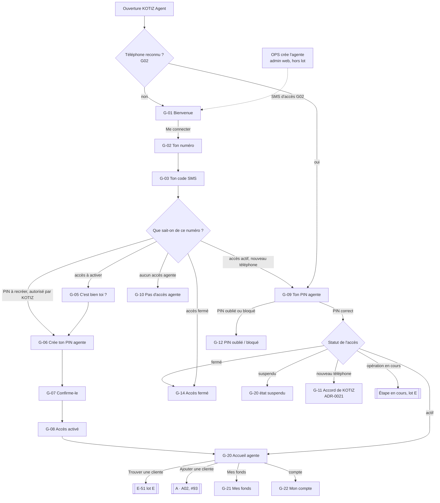
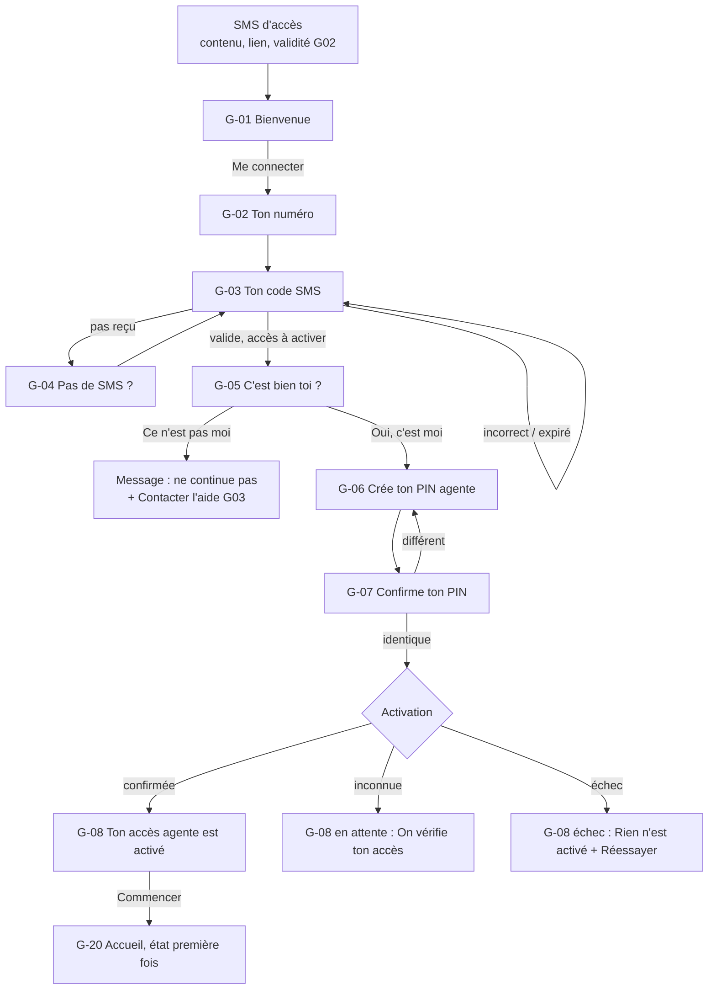
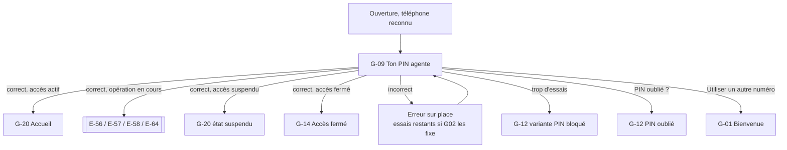
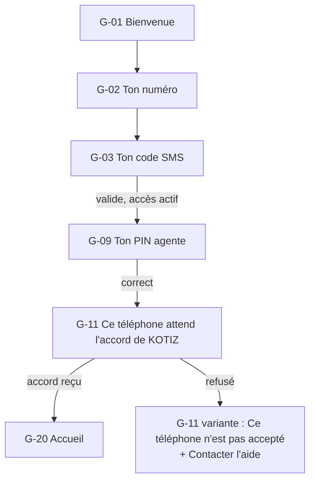
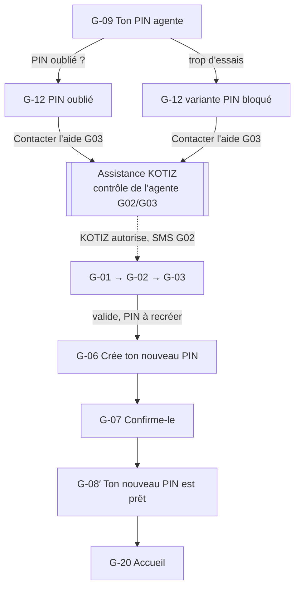
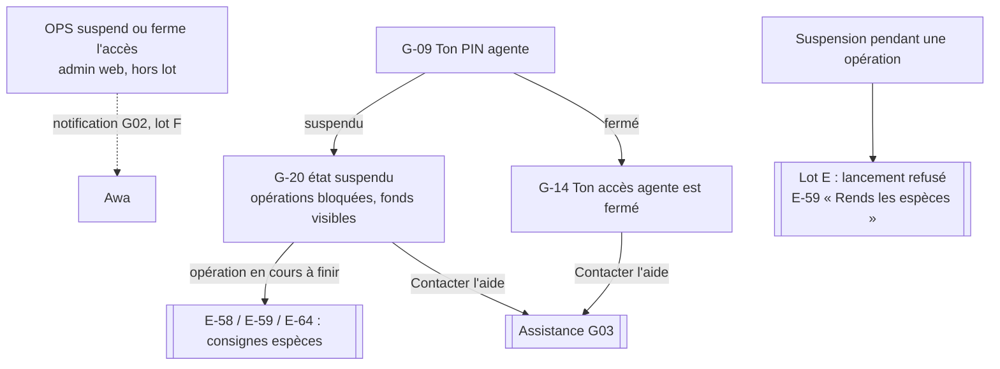
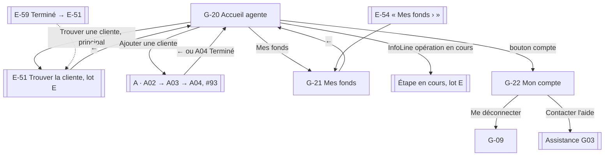
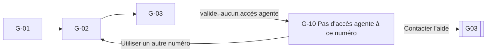

# Spec UX — Refonte des parcours, lot G : app agente, accès et accueil

Date : 30 octobre 2026. Statut : **validée par le PO le 30 octobre 2026** (spec entière ; PNV-G1 à PNV-G3 acceptées ; questions PO-G1 à PO-G12 tranchées selon la recommandation ; voir « Décisions PO du 30 octobre 2026 »). Aucune maquette, aucun code. Les décisions déjà validées (PRD, registre métier, ADR, lots A à E, DESIGN.md v15) sont reprises telles quelles ; les trois propositions qui s'en écartaient sont rangées dans « Propositions acceptées ». PNV-G1 amende ADR-007 par l'[ADR-0021](../../adr/0021-second-facteur-agente-telephone-pin.md). Restent ouverts : G01, G02, G03, G05 et le glossaire.

Sources : [brief refonte](brief.md) (fait foi ; il excluait le reste de l'app agente comme « chantier séparé », le lot G en ouvre la partie accès et accueil), [PRODUCT.md](../../../PRODUCT.md), [DESIGN.md](../../../DESIGN.md) (Design System v15, § Écran de résultat plein écran, § Audit des composants), [spec du lot A](ux-spec-lot-a.md) (A · E01 à A · E10, A · S01, A · C01, A · H01, A · A02 à A · A04), [handoff du lot A](handoff-lot-a.md) (A02 à A04 = issue #93 D20 ; routage après le code SMS ; sécurité), [spec du lot E](ux-spec-lot-e.md) (E-51 à E-72, « accueil agente (hors lot) », H7, H12, E-54 « Mes fonds › »), [PRD design v1.0](../prd-design-mvp.md) § 4, § 4.1, § 12, § 15.2, [PRD MVP](../../product/prd-mvp.md) § 5.2 (brique Agents), § 8.2 (FR-AG-05, FR-AG-06), [epics](../../product/epics.md) (stories 6.1 et 6.7, historique), [re-scope du 1er septembre](../../product/sprint-change-proposal-2026-09-01.md) (Epic 6, stories 6.8 et 6.9), [plan sécurité](../../architecture/plan-securite.md) § connexion et rôles, [glossaire DDD](../../architecture/ddd-context-map-glossaire.md) § 5.3 Agents, [CONTEXT-MAP.md](../../../CONTEXT-MAP.md) (IAM, Agents, Notifications, Admin & Conformité, Assistance), ADR [0007](../../adr/0007-rbac-8-roles.md) (RBAC 8 rôles), [0010](../../adr/0010-mobile-variants.md) et [0019](../../adr/0019-use-expo-mobile-variants.md) (deux binaires, même design system), issues [#70](https://github.com/kotiz-ci/platform/issues/70) D09, [#71](https://github.com/kotiz-ci/platform/issues/71) D10, [#72](https://github.com/kotiz-ci/platform/issues/72) D11, [#93](https://github.com/kotiz-ci/platform/issues/93) D20, [#74](https://github.com/kotiz-ci/platform/issues/74) D13, [#103](https://github.com/kotiz-ci/platform/issues/103) D27.

Script de test associé : [test-lot-g.md](test-lot-g.md).

## Numérotation des écrans (à lire d'abord)

- Les écrans du lot G s'écrivent **`G-01`, `G-02`…, toujours avec un tiret**. Ils sont **tous dans l'app agente** (variant `agent`, ADR-010). Chaque titre porte « (app agente) » et chaque wireframe commence par la ligne `[app agente]`.
- Plages : **`G-01` à `G-14` : accès** (connexion, activation, PIN, accès fermé) ; **`G-20` à `G-22` : accueil** ; numéros libres entre les deux pour des ajouts sans renuméroter.
- Les écrans des autres lots gardent leur identifiant : « A · A02 » (Ajouter une cliente), « A · C01 » (PIN de la cliente), « E-51 » (Trouver la cliente), « E-54 » (Combien elle dépose ?)…
- **Attention : `G-01` n'a rien à voir avec les gates `G01` à `G07`** (sans tiret). Un gate s'écrit toujours sans tiret et avec son sens : « G02 sécurité et SMS ».
- Les parcours s'écrivent `G-P1` à `G-P7`.

## Conventions

- « **à confirmer** » = paramètre non tranché, avec son gate : **G01** partenaire et règles financières, **G02** sécurité et SMS, **G03** assistance, **G05** exceptions, **G06** tickets. **Aucune valeur n'est inventée** : ni longueur, durée de validité, nombre d'essais ou délai de renvoi d'un code ou du PIN (G02), ni seuil de fonds, plafond ou frais (G01), ni contact d'assistance (G03).
- « **Proposition** » (PNV-G1 à PNV-G3) = idée qui contredisait ou étendait une décision validée. Les trois sont acceptées (**Décision PO du 30 octobre 2026**) et appliquées dans les écrans ; elles restent décrites à part dans « Propositions acceptées ».
- **Tutoiement côté agente** : déjà validé au lot E (« tutoiement côté cliente **et** côté agente », spec validée le 21 octobre 2026). Le lot G le garde. Ce n'est pas une question ouverte.
- Personnages fictifs : agente « **Awa Traoré** », code `AG-0142`, numéro `07 11 22 33 44` (affiché masqué `07 •• •• •• 44`), zone « Adjamé » ; cliente « Fatou Koné ». Montants fictifs. Un code SMS s'écrit `{code}` : aucune longueur n'est dessinée.
- Formats : `125 000 FCFA` en montant dominant, `125 000 F` en ligne ; heure « 14:32 ».
- Hors connexion : les **trois phrases validées** seulement (`Kotiz.OFFLINE`, DESIGN.md décision 5) :
  - « Mis à jour à {HH:MM} · hors connexion » ;
  - « Pas de connexion. Rien n'a été envoyé. » ;
  - « Cet écran a besoin d'internet. Réessaie plus tard. ».
- Résultats, attentes après envoi et échecs : **page pleine `ResultScreen`**, croix « × » en haut à gauche (retour au point de départ, jamais au PIN). « **Contacter l'aide** » est toujours un **bouton texte de l'`ActionZone`** (DESIGN.md décision 4). « En attente » = **ambre + horloge**, jamais un succès. **Un seul bouton principal par écran.**

## Vocabulaire

| Interface               | Sens                                                                                                          | Glossaire / sources                                 |
| ----------------------- | ------------------------------------------------------------------------------------------------------------- | --------------------------------------------------- |
| **Ton accès agente**    | Le droit de se connecter à l'app agente, ouvert par KOTIZ                                                     | `Agent` (§ 5.3), rôle `AGENT` (ADR-007)             |
| **Activer ton accès**   | Première connexion : prouver son numéro, se reconnaître, créer son PIN                                        | PRD § 5.2 « activation » ; #70                      |
| **Ton PIN agente**      | Le code secret de l'agente, à elle, distinct de tout PIN de cliente                                           | absent du glossaire (`Credential` côté IAM)         |
| **Code SMS**            | Code reçu par SMS qui prouve la possession du numéro ; **jamais un PIN**                                      | comme A · E03                                       |
| **Mes fonds**           | Les fonds KOTIZ de l'agente qui servent aux dépôts en espèces (le dépôt les diminue, le retrait les augmente) | « float » (#70, #71, #72) ; **absent du glossaire** |
| **Accès suspendu**      | KOTIZ a mis l'accès en pause : aucune nouvelle opération                                                      | FR-AG-06, story 6.7                                 |
| **Accès fermé**         | KOTIZ a mis fin à l'accès agente                                                                              | PRD § 5.2 « désactivation »                         |
| **Trouver une cliente** | Entrée de toutes les opérations pour une cliente existante (→ E-51)                                           | lot E                                               |
| **Ajouter une cliente** | Créer la fiche d'une nouvelle cliente (→ A · A02)                                                             | #93 D20                                             |

Jamais à l'écran : « float », « wallet », « login », « mot de passe », « TOTP », « dashboard », « collecteur », « tontine », « commission » (hors lot). « Agent » au masculin seulement dans le nom du binaire (« KOTIZ Agent », ADR-010).

## Hypothèses

- **H1 — L'accès agente est créé par KOTIZ, jamais par l'agente.** Un administrateur Ops (Ibrahima, rôle `OPS`, ADR-007) crée l'agente dans l'outil d'administration après la formation, le test final et le contrat (PRD § 5.2 : « sans test passé, l'agent ne peut pas être activé »). Cet outil est **hors lot G** (admin web, #70 et #74). L'app agente ne propose aucune inscription.
- **H2 — Comment elle reçoit l'accès.** L'app agente est distribuée par lien, en distribution restreinte (ADR-010 § 3.2). À la création, l'agente reçoit un **SMS d'accès** sur son numéro (lien d'installation et consigne). Contenu, lien, validité et renvoi : **à confirmer G02**. Le SMS seul n'active rien : l'activation se fait dans l'app (code SMS + reconnaissance + PIN), comme pour la cliente (lot A, P4).
- **H3 — Identifiant = numéro de téléphone** (PNV-G3, **Décision PO du 30 octobre 2026**, PO-G1). L'agente se connecte avec son numéro et un code SMS sur un téléphone nouveau, avec son PIN agente sur son téléphone habituel. Son code agente (`AG-0142`) est **affiché** (reconnaissance, en-tête de l'accueil), jamais demandé.
- **H4 — Deux facteurs = téléphone enregistré + PIN agente** (PNV-G1, **Décision PO du 30 octobre 2026**, PO-G2 ; ADR-0021 amende ADR-007). La possession du téléphone est prouvée par le code SMS à l'activation et sur un nouveau téléphone, qui n'est utilisable qu'après l'accord de KOTIZ (PO-G3) ; le PIN est demandé à chaque ouverture. Reconnaissance du téléphone, délai de verrouillage, essais et blocage : **à confirmer G02**.
- **H5 — Une seule porte d'entrée**, comme au lot A (H1). L'agente touche « Me connecter » ; après le code SMS, le système sait si son accès est à activer, actif, à réinitialiser, suspendu, fermé, ou inexistant. Elle n'a aucun choix technique à faire. **Rien n'est révélé avant un code SMS valide** (protection contre l'énumération, G02).
- **H6 — PIN oublié ou bloqué : réinitialisation par KOTIZ seulement** (**Décision PO du 30 octobre 2026**, PO-G4). Le PRD § 4.1 dit que le SMS seul ne suffit pas pour réinitialiser un PIN. Pour l'agente, le contrôle de récupération est fait par KOTIZ (qui la connaît, l'a formée et a signé son contrat) : elle contacte l'aide, KOTIZ autorise, elle recrée son PIN par le même chemin que l'activation. Contrôle exact : **à confirmer G02 et G03**.
- **H7 — Une agente qui est aussi cliente garde deux comptes séparés** : app KOTIZ et PIN de cliente d'un côté, app KOTIZ Agent et PIN agente de l'autre. Aucun écran ne mélange les deux. Interdire un PIN agente identique au PIN cliente : **à confirmer G02** (le dessin demande seulement de choisir un PIN différent).
- **H8 — Accès suspendu : connexion possible, opérations bloquées.** FR-AG-06 dit « pas de nouvelle transaction possible » ; il ne dit pas que l'agente est déconnectée. Elle doit pouvoir **finir ce qui protège une cliente** (remettre les espèces d'un retrait déjà fait, rendre les espèces d'un dépôt pas fait) et voir ses fonds. **Le motif n'est jamais affiché** (une alerte anti-blanchiment ne doit pas être révélée, CENTIF-CI). « Ajouter une cliente » est bloqué aussi (**Décision PO du 30 octobre 2026**, PO-G5).
- **H9 — Accès fermé : plus d'accueil.** Écran plein « Ton accès agente est fermé », sans motif, avec « Contacter l'aide ». Sort des fonds restants : **à confirmer G01** (#70).
- **H10 — Pas de file d'attente hors ligne** (lots A à E). Connexion, activation et PIN demandent le réseau ; l'accueil garde les derniers montants connus ; rien n'est envoyé en silence.
- **H11 — Fonds : seul l'épuisement est un fait.** Aucun seuil « fonds bas » n'est validé (G01). L'accueil distingue « fonds épuisés » (0 F, confirmé par le serveur) ; l'insuffisance pour **un** dépôt reste décidée sur E-54 (lot E).
- **H12 — Reprise.** Si une opération du lot E est en cours (E-56, E-57, E-58, E-64), l'app rouvre son étape après le PIN, comme le lot E l'a validé. L'accueil la rappelle aussi par une `InfoLine`.

## Vue d'ensemble



## Parcours

### G-P1 — Activer mon accès agente (critique)

Awa a fini sa formation. KOTIZ a créé son accès. Elle a reçu le SMS d'accès et installé l'app.
Chemin principal : **8 écrans** (G-01 → G-02 → G-03 → G-05 → G-06 → G-07 → G-08 → G-20), soit 4 étapes numérotées.



Sorties d'échec : pas de réseau (saisie gardée, « Pas de connexion. Rien n'a été envoyé. ») ; code bloqué après trop d'essais (G02) ; SMS d'accès expiré ou accès pas encore prêt (le numéro est alors traité comme « aucun accès agente » : G-10) ; activation au résultat inconnu (jamais « activé » supposé).

### G-P2 — Me connecter sur mon téléphone habituel

Chemin principal : **2 écrans** (G-09 → G-20), ou G-09 → étape en cours du lot E (H12).



### G-P3 — Me connecter sur un nouveau téléphone

Téléphone remplacé, réinstallation, ou téléphone fourni par KOTIZ changé.
Chemin principal : **6 écrans** (G-01 → G-02 → G-03 → G-09 → G-11 → G-20). Le code SMS prouve le numéro ; il n'ouvre jamais l'accès seul : le PIN agente reste demandé, puis l'accord de KOTIZ pour ce téléphone (**Décision PO du 30 octobre 2026**, PO-G3 ; ADR-0021).



Ancien téléphone : ses sessions sont fermées ou non selon le protocole (**à confirmer G02**). Aucun écran n'affirme qu'elles sont fermées. G-11 est toujours sur ce chemin ; si KOTIZ a déjà accepté le téléphone (par exemple un téléphone remis par KOTIZ et enregistré d'avance), G-11 passe sans arrêt à G-20. Délai et forme de l'accord : **à confirmer G02**.

### G-P4 — PIN oublié ou bloqué

Chemin principal : **2 écrans** pour savoir quoi faire (G-09 → G-12), puis, une fois l'accès réinitialisé par KOTIZ, **7 écrans** (G-01 → G-02 → G-03 → G-06 → G-07 → G-08′ → G-20).



Aucun nouveau PIN sans autorisation de KOTIZ (PRD § 4.1). Le parcours de récupération de la cliente (lot F) ne s'applique pas à l'agente.

### G-P5 — Accès suspendu ou fermé

Chemin principal : **2 écrans** (G-09 → G-20 état suspendu ; ou G-09 → G-14).



La suspension ne bloque jamais ce qui rend son argent à une cliente : remise des espèces d'un retrait déjà fait (E-64), consigne « Rends les espèces » d'un dépôt pas fait (E-59). Raccord à reporter au lot E (voir Raccords).

### G-P6 — Accueil : trois entrées

Racine unique de l'app agente au lot G. **1 écran** et ses états, puis la sortie choisie.



### G-P7 — Ce numéro n'a pas d'accès agente (mauvaise app)

Une cliente installe l'app agente par erreur, ou une agente dont l'accès n'est pas encore créé essaie.
Chemin principal : **4 écrans** (G-01 → G-02 → G-03 → G-10).



C'est l'écran « Mauvaise app installée » d'ADR-010 § 3.1, côté agente, dit avec les mots de l'agente. Il ne révèle rien du compte cliente éventuel.

### Nombre d'écrans par parcours (chemin principal)

| Parcours                          | Écrans | Séquence                                                      |
| --------------------------------- | ------ | ------------------------------------------------------------- |
| G-P1 Activer mon accès            | 8      | G-01 G-02 G-03 G-05 G-06 G-07 G-08 G-20                       |
| G-P2 Téléphone habituel           | 2      | G-09 G-20                                                     |
| G-P3 Nouveau téléphone            | 6      | G-01 G-02 G-03 G-09 G-11 G-20                                 |
| G-P4 PIN oublié ou bloqué         | 2 + 7  | G-09 G-12 ; puis G-01 G-02 G-03 G-06 G-07 G-08′ G-20          |
| G-P5 Accès suspendu ou fermé      | 2      | G-09 G-20 (suspendu) ; G-09 G-14 (fermé)                      |
| G-P6 Accueil et ses trois entrées | 1 + n  | G-20 → E-51 (lot E) ; G-20 → A02 A03 A04 → G-20 ; G-20 → G-21 |
| G-P7 Pas d'accès agente           | 4      | G-01 G-02 G-03 G-10                                           |

Lecture : le geste quotidien de l'agente (G-P2) coûte **2 écrans** avant E-51 ; un dépôt en espèces complet coûte donc 1 écran de plus que le chemin agente du lot E (G-09, puis G-20 → E-51…).

## Carte des écrans

Toutes les pages sont des pages poussées sans barre basse. **G-20 est la seule racine** de l'app agente au lot G ; la barre basse agente viendra avec Mes clientes (hors lot).

| ID   | Écran (app agente)                            | Parcours    | Objectif                                                    |
| ---- | --------------------------------------------- | ----------- | ----------------------------------------------------------- |
| G-01 | Bienvenue                                     | P1 P3 P4 P7 | Savoir qu'on est dans l'app agente et commencer             |
| G-02 | Ton numéro                                    | P1 P3 P4 P7 | Saisir le numéro de son accès agente                        |
| G-03 | Ton code SMS                                  | P1 P3 P4 P7 | Prouver qu'on possède ce numéro                             |
| G-04 | Pas de SMS ? (bottom sheet)                   | P1 P3 P4 P7 | Savoir quoi faire quand le SMS n'arrive pas                 |
| G-05 | C'est bien toi ?                              | P1          | Se reconnaître dans l'accès créé par KOTIZ                  |
| G-06 | Crée ton PIN agente                           | P1 P4       | Choisir son code secret d'agente                            |
| G-07 | Confirme ton PIN agente                       | P1 P4       | Vérifier qu'on s'en souvient ; activer                      |
| G-08 | Accès activé (+ attente, échec, variante PIN) | P1 P4       | Savoir que c'est fait (ou pas) et commencer                 |
| G-09 | Ton PIN agente                                | P2 P3 P4 P5 | Ouvrir l'app agente                                         |
| G-10 | Pas d'accès agente à ce numéro                | P7          | Comprendre qu'on n'est pas au bon endroit                   |
| G-11 | Ce téléphone attend l'accord de KOTIZ         | P3          | Attendre l'accord pour un nouveau téléphone                 |
| G-12 | PIN oublié / PIN bloqué                       | P4          | Savoir qui peut rouvrir l'accès                             |
| G-14 | Ton accès agente est fermé                    | P5          | Savoir que l'accès est fini et qui contacter                |
| G-20 | Accueil agente                                | P1 à P6     | Voir son état et lancer une action                          |
| G-21 | Mes fonds                                     | P6          | Voir ses fonds pour les dépôts et savoir à quoi ils servent |
| G-22 | Mon compte (bottom sheet)                     | P6          | Contacter l'aide ou se déconnecter                          |

(G-13 est volontairement libre : l'état suspendu est un état de G-20, pas un écran.)

## Règles communes aux écrans du lot G

- **Orientation** : chaque écran d'accès dit qu'on est dans l'app agente (G-01 nomme « KOTIZ Agent » ; les écrans à secret disent « PIN agente »). Activation : « Étape n sur 4 » (Numéro, Code, C'est toi, PIN). Nouveau téléphone : pas d'indicateur.
- **Secrets** : le PIN agente n'est jamais affiché, stocké en clair ni journalisé ; capture d'écran sur G-06, G-07, G-09 : **à confirmer (technique, G02)**. Mention fixe sur les écrans à secret : « Ne le montre à personne. » Aucun écran du lot G ne touche à un code, un PIN ou un accord de cliente.
- **Retour** `←` : écran précédent, saisie gardée sauf les secrets.
- **Bouton principal** en bas, dans l'`ActionZone`, visible clavier ouvert ; désactivé avec sa raison (`reason`).
- **Attente réseau** (> 1 s) : bouton en « Vérification… », double appui bloqué, aucun écran suivant avant la réponse.
- **Hors ligne** : « Pas de connexion. Rien n'a été envoyé. » sur un envoi ; « Cet écran a besoin d'internet. Réessaie plus tard. » quand rien n'est affichable ; « Mis à jour à {HH:MM} · hors connexion » sous des données gardées.
- **Erreur** : sous le champ, une phrase qui dit quoi faire ; statut par mot + pictogramme, jamais par la couleur seule.
- **Aide** : « Contacter l'aide » en bouton texte de l'`ActionZone` (G-04, G-05 refus, G-10, G-11, G-12, G-14, G-20 suspendu, G-22). Contact réel : **G03**.
- **Aucun paramètre inventé** : longueur du code et du PIN (prototype : PIN de 4, composant capable de 6, comme A · E06, **décision PO du 19 octobre 2026** reprise), validité, essais, renvoi, blocage, délai de verrouillage, seuil de fonds.

## Écrans

### G-01 — Bienvenue (app agente)

- Objectif : savoir qu'on est dans l'app des agentes KOTIZ, puis commencer.
- Action primaire : **Me connecter** (→ G-02).
- Actions secondaires : aucune.
- Contenu : logo KOTIZ + mot « Agent » (nom du binaire, ADR-010) ; illustration `Actions/agente.svg` dans une `IconPastille` 80 ; phrase « L'app des agentes KOTIZ. » ; ligne discrète « Ton accès est créé par KOTIZ après ta formation. ».
- États : nominal ; hors ligne (le bouton reste actif ; l'erreur vient à G-02).
- Cas limites : ouverture depuis le SMS d'accès (même écran) ; grands textes (bouton toujours visible).

```
[app agente]
┌──────────────────────────────┐
│         KOTIZ Agent          │
│                              │
│       [ illus. agente ]      │
│                              │
│ L'app des agentes KOTIZ.     │
│                              │
│ Ton accès est créé par KOTIZ │
│ après ta formation.          │
├──────────────────────────────┤
│ [     Me connecter       ] ★ │
└──────────────────────────────┘
```

### G-02 — Ton numéro (app agente)

- Objectif : saisir le numéro de son accès agente.
- Action primaire : **Recevoir le code**.
- Actions secondaires : ←.
- Contenu : `PageHeader` (←, « Étape 1 sur 4 » si l'activation est connue, sinon rien : on ne la connaît qu'après le code, voir décision) ; titre « Ton numéro » ; `TextField` +225 ; « On t'envoie un code par SMS. ».
- États : vide (bouton désactivé, raison « Il faut 10 chiffres. ») ; saisi ; envoi (« Vérification… ») ; échec d'envoi (« Le SMS n'est pas parti. Réessaie. ») ; hors ligne (« Pas de connexion. Rien n'a été envoyé. ») ; limite d'envois (**G02**).
- Cas limites : numéro collé avec +225 ou espaces (normalisé) ; **même réponse quel que soit le numéro** avant le code (H5).

```
[app agente]
┌──────────────────────────────┐
│ ←                            │
├──────────────────────────────┤
│ Ton numéro                   │
│                              │
│ +225 [ 07 11 22 33 44     ]  │
│ On t'envoie un code par SMS. │
├──────────────────────────────┤
│ [    Recevoir le code    ] ★ │
├──────────────────────────────┤
│   clavier numérique système  │
└──────────────────────────────┘
```

Indicateur d'étape : comme au lot A (P4), l'app ne sait qu'il s'agit d'une activation qu'après le code. G-02 et G-03 n'affichent donc pas d'étape ; G-05 affiche « Étape 3 sur 4 », G-06 et G-07 « Étape 4 sur 4 ».

### G-03 — Ton code SMS (app agente)

- Objectif : prouver qu'on possède ce numéro.
- Action primaire : **Valider** (pas de validation automatique au dernier chiffre, comme A · E03).
- Actions secondaires : Modifier (le numéro), Renvoyer le code (après un délai **G02**), « Je n'ai pas reçu le code » (→ G-04).
- Contenu : même composition que A · E03 : numéro en entier + Modifier ; `TextField` « Code reçu par SMS » (`oneTimeCode`) ; `Message` information « Ne le montre à personne. » ; renvoi.
- États : attente ; saisi ; vérification ; incorrect (« Ce code ne marche pas. Vérifie le SMS. ») ; expiré (« Ce code n'est plus valable. Demande un nouveau code. ») ; renvoi indisponible puis disponible ; trop d'essais (**G02**) ; hors ligne.
- Routage après un code valide (H5) : accès à activer → G-05 ; PIN à recréer (autorisé par KOTIZ) → G-06 ; accès actif → G-09 ; aucun accès agente → G-10 ; accès fermé → G-14 ; accès suspendu → G-09 (l'état est montré après le PIN, sur G-20).
- Cas limites : lecture automatique du SMS (**G02**) ; seul le dernier code vaut (**G02**).

```
[app agente]
┌──────────────────────────────┐
│ ←                            │
├──────────────────────────────┤
│ Ton code SMS                 │
│ Envoyé au 07 11 22 33 44     │
│                  Modifier    │
│ [ code reçu par SMS       ]  │
│ ⓘ Ne le montre à personne.   │
│ Renvoyer le code dans …      │
│ Je n'ai pas reçu le code     │
├──────────────────────────────┤
│ [        Valider         ] ★ │
└──────────────────────────────┘
```

### G-04 — Pas de SMS ? (bottom sheet, app agente)

- Objectif : savoir quoi faire sans quitter l'étape.
- Action primaire : **Renvoyer le code** (active après le délai **G02**).
- Actions secondaires : Modifier mon numéro ; bouton texte « Contacter l'aide » (G03) ; ×.
- Contenu et états : composition de A · S01 (trois vérifications courtes), même textes au tutoiement.

```
[app agente]
┌──────────────────────────────┐
│ Pas de SMS ?            ✕    │
│ • Ton numéro est bon ?       │
│   07 11 22 33 44   Modifier  │
│ • Ton téléphone capte ?      │
│ • Le SMS peut prendre        │
│   un peu de temps.           │
├──────────────────────────────┤
│ [   Renvoyer le code     ] ★ │
│      Contacter l'aide        │
└──────────────────────────────┘
```

### G-05 — C'est bien toi ? (app agente)

- Objectif : se reconnaître dans l'accès créé par KOTIZ, avant de choisir son PIN.
- Action primaire : **Oui, c'est moi**.
- Actions secondaires : bouton texte « Ce n'est pas moi » ; ←.
- Contenu : `PageHeader` (←, « Étape 3 sur 4 ») ; titre « C'est bien toi ? » ; `AgentIdentity` (nouveau au lot E) : illustration agente 40, « Awa Traoré », « Agente KOTIZ · AG-0142 » ; ligne « Zone : Adjamé » seulement si la zone existe (`AgentZone`) ; `Message` information « KOTIZ a créé ton accès agente. ».
- États : nominal ; envoi ; hors ligne.
- **Ce n'est pas moi** : le même écran passe en `Message` erreur « Ne continue pas. Rien n'est activé. » + bouton texte « Contacter l'aide » ; le bouton principal disparaît. L'accès n'est pas activé.
- Cas limites : nom long (retour à la ligne) ; accès créé avec une faute de nom (« Ce n'est pas moi » → aide ; aucune modification du nom dans l'app).
- Engagements de l'agente (charte, conditions) dans l'app : **non dessinés** (contrat signé à l'enrôlement, PRD § 5.2) (**Décision PO du 30 octobre 2026**, PO-G10 : pas d'engagements à accepter dans l'app au MVP ; si le partenaire l'exige plus tard, un écran d'accords comme A · E05 s'insère entre G-05 et G-06).

```
[app agente]
┌──────────────────────────────┐
│ ←              Étape 3 sur 4 │
├──────────────────────────────┤
│ C'est bien toi ?             │
│                              │
│ [ag] Awa Traoré              │
│      Agente KOTIZ · AG-0142  │
│      Zone : Adjamé           │
│                              │
│ ⓘ KOTIZ a créé ton accès     │
│   agente.                    │
├──────────────────────────────┤
│ [    Oui, c'est moi      ] ★ │
│       Ce n'est pas moi       │
└──────────────────────────────┘
```

### G-06 — Crée ton PIN agente (app agente)

- Objectif : choisir son code secret d'agente.
- Action primaire : saisie complète → G-07 (même règle que A · E06).
- Actions secondaires : ← ; effacer.
- Contenu : `PinScreen` (`title` « Crée ton PIN agente ») ; phrases « Il protège tes opérations. » / « Ne le montre à personne. » / « Choisis un PIN différent de celui de ton compte cliente. » (H7) ; `PinSlots` (4 au prototype, jusqu'à 6) ; `PinPad`.
- États : vide ; en cours ; refusé par une règle (règles de PIN interdits **G02**) ; hors ligne n'empêche pas la saisie (l'envoi se fait à G-07).
- Variante PIN à recréer (G-P4) : titre « Crée ton nouveau PIN agente », pas d'indicateur d'étape.
- Cas limites : interruption → on recommence G-06 ; retour depuis G-07 efface les deux saisies.

```
[app agente]
┌──────────────────────────────┐
│ ←              Étape 4 sur 4 │
├──────────────────────────────┤
│ Crée ton PIN agente          │
│ Il protège tes opérations.   │
│ Ne le montre à personne.     │
│ Choisis un PIN différent de  │
│ celui de ton compte cliente. │
│        ○  ○  ○  ○            │
├──────────────────────────────┤
│   1     2     3              │
│   4     5     6              │
│   7     8     9              │
│         0     ⌫              │
└──────────────────────────────┘
```

### G-07 — Confirme ton PIN agente (app agente)

- Objectif : vérifier qu'on s'en souvient ; la saisie complète active l'accès.
- Action primaire : saisie complète = activation (→ G-08).
- Actions secondaires : ← (G-06, tout effacé).
- Contenu : `PinScreen` (`title` « Écris-le encore une fois »), `PinPad.disabled` pendant l'envoi.
- États : en cours ; différent (« Les deux PIN ne sont pas pareils. Recommence. » → G-06 vide) ; envoi (« Activation de ton accès… », `state: sending`) ; hors ligne (« Pas de connexion. Rien n'a été envoyé. », `state: offline`).
- Cas limites : réseau coupé pendant l'envoi → G-08 en attente, jamais « activé » supposé ; même clé d'idempotence à chaque nouvelle tentative.

```
[app agente]
┌──────────────────────────────┐
│ ←              Étape 4 sur 4 │
├──────────────────────────────┤
│ Écris-le encore une fois     │
│        ●  ●  ○  ○            │
├──────────────────────────────┤
│   1     2     3              │
│   4     5     6              │
│   7     8     9              │
│         0     ⌫              │
└──────────────────────────────┘
```

### G-08 — Ton accès agente est activé (app agente)

- Objectif : savoir que c'est fait (ou pas encore) et commencer.
- Action primaire : **Commencer** (→ G-20, état première fois).
- Actions secondaires : × en haut à gauche (→ G-20 aussi).
- Contenu : `ResultScreen` `status: done`, **pastille 64 coche** (pas d'illustration : `ResultScreen` la réserve à « Compte créé » et « Épargne créée ») ; `StatusPill` « Fait » ; titre « Ton accès agente est activé. » ; sous-titre « Garde ton PIN pour toi. ».
- Variantes :

| Variante                 | `status` | Pill                        | Titre                        | Contenu                                               | Actions                                           |
| ------------------------ | -------- | --------------------------- | ---------------------------- | ----------------------------------------------------- | ------------------------------------------------- |
| Activé                   | done     | Fait                        | Ton accès agente est activé. | « Garde ton PIN pour toi. »                           | Commencer                                         |
| Nouveau PIN (G-P4) G-08′ | done     | Fait                        | Ton nouveau PIN est prêt.    | « Garde-le pour toi. »                                | Commencer                                         |
| On vérifie               | pending  | En attente (ambre, horloge) | On vérifie ton accès.        | « Ne recommence pas. » ; « Réessaie dans un moment. » | Vérifier à nouveau ; texte « Contacter l'aide »   |
| Pas activé               | failed   | Échoué                      | Ton accès n'est pas activé.  | « Rien n'est activé. Tu peux réessayer. »             | Réessayer (même clé) ; texte « Contacter l'aide » |

- États : annonce `polite` (fait, attente), `assertive` (échec).
- Cas limites : retour Android sur la variante faite = G-20 (jamais le PIN).

```
[app agente]
┌──────────────────────────────┐
│ ✕                            │
├──────────────────────────────┤
│ (✓)                          │
│ ✓ Fait                       │
│ Ton accès agente est activé. │
│ Garde ton PIN pour toi.      │
│                              │
├──────────────────────────────┤
│ [       Commencer        ] ★ │
└──────────────────────────────┘
```

### G-09 — Ton PIN agente (app agente)

- Objectif : ouvrir l'app agente.
- Action primaire : saisie complète du PIN = vérification.
- Actions secondaires : « PIN oublié ? » (→ G-12) ; bouton texte « Utiliser un autre numéro » (→ G-01, téléphone habituel seulement).
- Contenu : `PinScreen` ; téléphone habituel : titre « Akwaba, Awa » (prénom affiché car le téléphone est reconnu, **G02**), « Agente KOTIZ · AG-0142 », numéro masqué `07 •• •• •• 44`, « Entre ton PIN agente » ; nouveau téléphone : `PageHeader` (←), titre « Ton PIN agente ».
- États : saisie ; vérification ; incorrect (« PIN incorrect. Réessaie. » ; essais restants **seulement si G02 les fixe**) ; bloqué (→ G-12 variante) ; hors ligne (« Pas de connexion. Rien n'a été envoyé. »).
- Après un PIN correct : accès actif → étape en cours du lot E (H12) sinon G-20 ; suspendu → G-20 état suspendu ; fermé → G-14 ; nouveau téléphone → G-11 (accord de KOTIZ).
- Cas limites : retour d'arrière-plan → G-09 après le délai de verrouillage (**G02**) ; téléphone prêté → « Utiliser un autre numéro ».

```
[app agente]
┌──────────────────────────────┐
│ Akwaba, Awa                  │
│ Agente KOTIZ · AG-0142       │
│ 07 •• •• •• 44               │
│ Entre ton PIN agente         │
│        ●  ●  ○  ○            │
│ PIN oublié ?                 │
├──────────────────────────────┤
│   1     2     3              │
│   4     5     6              │
│   7     8     9              │
│         0     ⌫              │
├──────────────────────────────┤
│  Utiliser un autre numéro    │
└──────────────────────────────┘
```

### G-10 — Pas d'accès agente à ce numéro (app agente)

- Objectif : comprendre qu'on n'est pas au bon endroit, sans rien apprendre d'autre.
- Action primaire : **Utiliser un autre numéro** (→ G-02).
- Actions secondaires : bouton texte « Contacter l'aide » (G03).
- Contenu : titre « Pas d'accès agente à ce numéro » ; numéro ; « Tu es cliente ? Utilise l'app KOTIZ. » ; « Tu es agente ? KOTIZ crée ton accès après ta formation. ».
- États : nominal.
- Cas limites : agente dont l'accès est en préparation (même écran : aucun statut interne révélé) ; cliente KOTIZ (même écran : rien sur son compte cliente) ; numéro changé (« Contacter l'aide »).

```
[app agente]
┌──────────────────────────────┐
│ ←                            │
├──────────────────────────────┤
│ Pas d'accès agente à ce      │
│ numéro                       │
│ 07 11 22 33 44               │
│                              │
│ Tu es cliente ? Utilise      │
│ l'app KOTIZ.                 │
│ Tu es agente ? KOTIZ crée    │
│ ton accès après ta formation.│
├──────────────────────────────┤
│ [Utiliser un autre numéro]★  │
│       Contacter l'aide       │
└──────────────────────────────┘
```

### G-11 — Ce téléphone attend l'accord de KOTIZ (app agente)

- Objectif : savoir que le nouveau téléphone n'est pas encore accepté, et ne rien tenter d'autre.
- Action primaire : **Vérifier à nouveau**.
- Actions secondaires : bouton texte « Contacter l'aide » ; × (→ G-01, rien n'est perdu : la demande reste).
- Contenu : `ResultScreen` `status: pending` (ambre + horloge) ; `StatusPill` « En attente » ; titre « Ce téléphone attend l'accord de KOTIZ. » ; « Tu ne peux pas encore faire d'opération ici. » ; aucun délai annoncé.
- Variantes : accord reçu → G-20 (ou étape en cours) ; refusé (`failed`) « Ce téléphone n'est pas accepté. » + « Contacter l'aide ».
- Toujours présent sur un nouveau téléphone (**Décision PO du 30 octobre 2026**, PO-G3 ; mesure compensatoire de l'ADR-0021). Délai et forme de l'accord : **G02**.

```
[app agente]
┌──────────────────────────────┐
│ ✕                            │
├──────────────────────────────┤
│ (◷)                          │
│ ◷ En attente                 │
│ Ce téléphone attend l'accord │
│ de KOTIZ.                    │
│ Tu ne peux pas encore faire  │
│ d'opération ici.             │
├──────────────────────────────┤
│ [   Vérifier à nouveau   ] ★ │
│       Contacter l'aide       │
└──────────────────────────────┘
```

### G-12 — PIN oublié / PIN bloqué (app agente)

- Objectif : savoir que seule KOTIZ peut rouvrir l'accès, et comment la joindre.
- Action primaire : **Compris** (→ G-09 ; sur la variante bloquée → G-01).
- Actions secondaires : bouton texte « Contacter l'aide » (G03) ; ←.
- Contenu : page pleine ; titre « PIN oublié ? » ; `NumberedSteps` : « 1 Contacte KOTIZ. » « 2 KOTIZ vérifie que c'est toi. » « 3 Tu reçois un SMS, puis tu crées un nouveau PIN. » ; `Message` information « Personne chez KOTIZ ne te demandera ton PIN. ».
- Variante bloquée (`ResultScreen` `failed`, croix) : « PIN bloqué. » ; « Trop d'essais. » ; mêmes trois étapes ; durée du blocage ou déblocage automatique : **G02** (aucune durée affichée).
- Cas limites : pendant une opération en cours (E-58, E-64) : la consigne espèces de l'opération reste la règle ; l'aide la reprend (G03).

```
[app agente]
┌──────────────────────────────┐
│ ←                            │
├──────────────────────────────┤
│ PIN oublié ?                 │
│                              │
│ 1  Contacte KOTIZ.           │
│ 2  KOTIZ vérifie que c'est   │
│    toi.                      │
│ 3  Tu reçois un SMS, puis tu │
│    crées un nouveau PIN.     │
│                              │
│ ⓘ Personne chez KOTIZ ne te  │
│   demandera ton PIN.         │
├──────────────────────────────┤
│ [        Compris         ] ★ │
│       Contacter l'aide       │
└──────────────────────────────┘
```

### G-14 — Ton accès agente est fermé (app agente)

- Objectif : savoir que l'accès est fini, sans motif, et qui contacter.
- Action primaire : **Compris** (→ G-01 ; la session est fermée).
- Actions secondaires : bouton texte « Contacter l'aide ».
- Contenu : `ResultScreen` `status: failed`, pastille croix ; `StatusPill` neutre « Fermé » (ce n'est pas l'échec d'une opération) ; titre « Ton accès agente est fermé. » ; « Tu ne peux plus faire d'opération. » ; « Pour tes fonds, contacte KOTIZ. » (sort des fonds : **G01**, #70). **Aucun motif.**
- Cas limites : opération en cours au moment de la fermeture → la page dit en plus « Une opération était en cours. Contacte KOTIZ. » (traitement **G05**) ; ouverture sur un nouveau téléphone (même écran après le code SMS).

```
[app agente]
┌──────────────────────────────┐
│ ✕                            │
├──────────────────────────────┤
│ (✕)                          │
│ ● Fermé                      │
│ Ton accès agente est fermé.  │
│ Tu ne peux plus faire        │
│ d'opération.                 │
│ Pour tes fonds, contacte     │
│ KOTIZ.                       │
├──────────────────────────────┤
│ [        Compris         ] ★ │
│       Contacter l'aide       │
└──────────────────────────────┘
```

### G-20 — Accueil agente (app agente)

- Objectif : voir son état en un coup d'œil et lancer une action.
- Action primaire : **Trouver une cliente** (→ E-51).
- Actions secondaires : ligne « Ajouter une cliente » (→ A · A02) ; bloc « Mes fonds » (→ G-21) ; œil (masquer / afficher le montant des fonds) ; bouton compte (→ G-22) ; `InfoLine` d'opération en cours (→ étape du lot E).
- Contenu (par priorité) :
  1. En-tête : « Akwaba, Awa » + « Agente KOTIZ · AG-0142 » ; bouton compte 48 à droite (pas de cloche au lot G).
  2. Ligne d'état, **une seule** à la fois, par ordre de priorité : accès suspendu (`Message` erreur) > opération en cours (`InfoLine`) > fonds épuisés (`Message` information) > hors connexion (sous les fonds, voir états).
  3. **Mes fonds** : libellé « Mes fonds », `Amount` (masqué par défaut, **Décision PO du 30 octobre 2026**, PO-G6), œil, phrase « Pour les dépôts en espèces. », chevron.
  4. `OptionRow` « Ajouter une cliente » sub « Nouvelle fiche ».
  5. `ActionZone` : `Button` « Trouver une cliente » ; sous le bouton, aide en 14 « Pour un dépôt, un retrait, un accompagnement. ».
- Aucune liste de clientes, aucune opération du jour, aucune commission, aucun tableau de bord (hors lot).
- États :
  - **Première fois** (aucune opération encore faite) : sous l'en-tête, `NumberedSteps` « 1 Scanne le QR de la cliente. » « 2 Elle confirme sur son téléphone. » « 3 Les espèces changent de main quand l'app le dit. » Le bloc disparaît après la première opération terminée. Fonds : valeur réelle ; si 0 F, état « fonds épuisés » en plus.
  - **Normal** : wireframe ci-dessous.
  - **Fonds épuisés** (0 F confirmé par le serveur, H11) : `Message` information « Tes fonds sont épuisés. » / « Pas de dépôt pour l'instant. Les retraits restent possibles. » ; « Trouver une cliente » reste actif (retrait, accompagnement, point) ; le refus d'un dépôt reste sur E-54. Aucun seuil « fonds bas » (G01, PO-G7).
  - **Hors connexion** : fonds avec « Mis à jour à {HH:MM} · hors connexion » ; jamais chargés : « Cet écran a besoin d'internet. Réessaie plus tard. » à la place du montant ; les entrées restent actives et leurs écrans gèrent le réseau (E-51 : « Cet écran a besoin d'internet. » ; A · A02 garde la saisie).
  - **Accès suspendu** (H8) : `Message` erreur « Ton accès est suspendu. » / « Tu ne peux pas faire d'opération. » ; « Trouver une cliente » **désactivé** avec la raison « Accès suspendu. Contacte KOTIZ. » ; « Ajouter une cliente » désactivé avec la même raison ; « Mes fonds » visible ; bouton texte « Contacter l'aide » dans l'`ActionZone`. Si une opération est en cours, l'`InfoLine` reste active **sous** le message (finir la remise ou rendre les espèces). **Aucun motif.**
  - **Opération en cours** (H12) : `InfoLine` « Opération en cours avec Fatou Koné › » → étape du lot E (E-56, E-57, E-58 ou E-64). Aucun montant de la cliente.
  - **Chargement** : squelette, jamais « 0 F » supposé.
- Cas limites : nom long (retour à la ligne) ; montant des fonds à 7 chiffres (`1 250 000 FCFA` sur une ligne) ; retour Android sur G-20 = quitter l'app (jamais retour au PIN) ; agente qui est aussi cliente : rien de son compte cliente ici (H7).

```
[app agente]
┌──────────────────────────────┐
│ Akwaba, Awa              [≡] │
│ Agente KOTIZ · AG-0142       │
├──────────────────────────────┤
│ Mes fonds               👁̸   │
│ ••• ••• FCFA                 │
│ Pour les dépôts en espèces.› │
├──────────────────────────────┤
│ [ag] Ajouter une cliente   › │
│      Nouvelle fiche          │
├──────────────────────────────┤
│                              │
│                              │
├──────────────────────────────┤
│ [ Trouver une cliente    ] ★ │
│ Pour un dépôt, un retrait,   │
│ un accompagnement.           │
└──────────────────────────────┘
```

État première fois (extrait) :

```
[app agente]
┌──────────────────────────────┐
│ Akwaba, Awa              [≡] │
│ Agente KOTIZ · AG-0142       │
├──────────────────────────────┤
│ 1  Scanne le QR de la        │
│    cliente.                  │
│ 2  Elle confirme sur son     │
│    téléphone.                │
│ 3  Les espèces changent de   │
│    main quand l'app le dit.  │
├──────────────────────────────┤
│ Mes fonds  ••• ••• FCFA  👁̸ ›│
│ …                            │
```

État accès suspendu (extrait) :

```
[app agente]
┌──────────────────────────────┐
│ Akwaba, Awa              [≡] │
├──────────────────────────────┤
│ ⊗ Ton accès est suspendu.    │
│   Tu ne peux pas faire       │
│   d'opération.               │
│ ⓘ Opération en cours avec    │
│   Fatou Koné               › │
├──────────────────────────────┤
│ Mes fonds  ••• ••• FCFA  👁̸ ›│
│ [ag] Ajouter une cliente     │
│      (désactivé)             │
├──────────────────────────────┤
│ [ Trouver une cliente    ]   │
│   (désactivé)                │
│ Accès suspendu. Contacte     │
│ KOTIZ.                       │
│       Contacter l'aide       │
└──────────────────────────────┘
```

État fonds épuisés (extrait) :

```
[app agente]
├──────────────────────────────┤
│ ⓘ Tes fonds sont épuisés.    │
│   Pas de dépôt pour          │
│   l'instant. Les retraits    │
│   restent possibles.         │
├──────────────────────────────┤
│ Mes fonds                👁  │
│ 0 FCFA                       │
│ Pour les dépôts en espèces.› │
```

### G-21 — Mes fonds (app agente, minimum)

- Objectif : voir ses fonds pour les dépôts en espèces et comprendre à quoi ils servent. **Rien de plus** : la gestion des avoirs (#70 : réserves, commissions, caution, rechargement) n'est pas cadrée.
- Action primaire : aucune (l'écran se lit).
- Actions secondaires : ← ; œil ; bouton texte « Contacter l'aide ».
- Contenu : `PageHeader` (←, « Mes fonds ») + `MaskToggle` ; `Amount` taille `amount` ; « Mis à jour à {HH:MM} » ; `DetailList` (`layout: column`) de trois phrases : « Un dépôt en espèces les diminue. » / « Un retrait en espèces les augmente. » / « Pour en recevoir plus, contacte KOTIZ. » (procédure **#70, G01**).
- États : chargement ; masqué (suit le réglage de G-20) ; épuisés (0 FCFA + `Message` information de G-20) ; hors connexion (stale) ; jamais chargés (« Cet écran a besoin d'internet. Réessaie plus tard. ») ; accès suspendu (même contenu, lecture seule).
- Absent volontairement : historique des mouvements de fonds, commissions, caution, plafond journalier, rechargement en ligne (hors lot, #70).
- Cas limites : fonds qui changent pendant une opération (le montant se met à jour au retour, pas en direct) ; montant de 7 chiffres.

```
[app agente]
┌──────────────────────────────┐
│ ←  Mes fonds             👁  │
├──────────────────────────────┤
│ 125 000 FCFA                 │
│ Mis à jour à 14:32           │
├──────────────────────────────┤
│ Un dépôt en espèces les      │
│ diminue.                     │
│ Un retrait en espèces les    │
│ augmente.                    │
│ Pour en recevoir plus,       │
│ contacte KOTIZ.              │
├──────────────────────────────┤
│       Contacter l'aide       │
└──────────────────────────────┘
```

### G-22 — Mon compte (bottom sheet, app agente)

- Objectif : joindre l'aide ou se déconnecter, sans écran de profil complet.
- Action primaire : aucune ; deux `OptionRow`.
- Actions : `OptionRow` « Contacter l'aide » (G03) ; `OptionRow` « Me déconnecter » (→ G-09 téléphone habituel, ou G-01) ; ×.
- Contenu : en tête « Awa Traoré · AG-0142 », numéro masqué.
- États : opération en cours → « Me déconnecter » reste possible, avec la ligne « Une opération est en cours. Tu la retrouves après ton PIN. » (aucun `ConfirmDialog` : rien n'est perdu).
- Absent volontairement : changer de PIN (le dessin du lot F pour la cliente pourra être repris ; hors lot G), langue, mode vocal.

```
[app agente]
┌──────────────────────────────┐
│ ░░░░░░░ fond voilé ░░░░░░░░░ │
├──────────────────────────────┤
│ Awa Traoré · AG-0142    ✕    │
│ 07 •• •• •• 44               │
│ ──────────────────────────── │
│ Contacter l'aide           › │
│ Me déconnecter             › │
└──────────────────────────────┘
```

## Raccords avec E-51 et avec #93

### Avec le lot E (E-51 et suivants)

| Départ                                    | Arrivée                                                                                                                                                                                                                                   | Ce qui change dans le lot E                                                                                            |
| ----------------------------------------- | ----------------------------------------------------------------------------------------------------------------------------------------------------------------------------------------------------------------------------------------- | ---------------------------------------------------------------------------------------------------------------------- |
| G-20 « Trouver une cliente »              | E-51 Trouver la cliente                                                                                                                                                                                                                   | E-51 `←` revient à G-20 (« accueil agente » de la spec E = G-20). Aucun texte de E-51 ne change.                       |
| E-59 « Terminé »                          | E-51 (inchangé)                                                                                                                                                                                                                           | Depuis E-51, `←` ramène à G-20.                                                                                        |
| E-54 « Mes fonds › » (fonds insuffisants) | G-21 Mes fonds                                                                                                                                                                                                                            | Le lien du lot E pointe sur G-21 ; G-21 ne montre que le minimum (le montant y est masqué par défaut, comme sur G-20). |
| G-09 après PIN, opération en cours        | E-56 / E-57 / E-58 / E-64 sur leur étape                                                                                                                                                                                                  | Règle de reprise du lot E, appliquée après la connexion (H12).                                                         |
| G-20 `InfoLine` « Opération en cours »    | même étape                                                                                                                                                                                                                                | Nouveau point d'entrée, même règle.                                                                                    |
| Accès suspendu                            | E-53 : lignes d'opération désactivées, raison « Accès suspendu. Contacte KOTIZ. » ; E-58 lancement refusé → E-59 « Dépôt pas fait » + « Rends les … F à Fatou. » ; E-64 reste accessible pour remettre les espèces d'un retrait déjà fait | **À reporter dans la spec du lot E après validation** (nouvel état, aucun texte validé modifié).                       |
| Accès fermé pendant une opération         | G-14 + « Une opération était en cours. Contacte KOTIZ. »                                                                                                                                                                                  | Traitement de la cliente : **G05** (comme une annulation avec espèces possiblement remises, RM-FUND-04).               |

### Avec #93 (Ajouter une cliente, A · A02 à A · A04)

| Départ                       | Arrivée              | Ce qui change                                                                                                                                                                                                        |
| ---------------------------- | -------------------- | -------------------------------------------------------------------------------------------------------------------------------------------------------------------------------------------------------------------- |
| G-20 « Ajouter une cliente » | A · A02              | **PNV-G2** : le PRD place l'entrée dans « Mes clientes > Ajouter une cliente » ; Mes clientes est hors lot G. L'accueil devient une entrée **en plus**, l'entrée Mes clientes reste due quand Mes clientes existera. |
| A · A02 `←`                  | G-20                 | Le handoff A nomme le retour « Retour à Mes clientes » ; tant que Mes clientes n'existe pas, le retour mène à l'écran d'origine (G-20 ou E-52) et s'appelle `←` sans nom (PNV-G2).                                   |
| A · A04 « Terminé »          | G-20                 | Toujours G-20, quelle que soit l'entrée (PNV-G2).                                                                                                                                                                    |
| E-52 « Créer sa fiche »      | A · A02              | Inchangé (lot E). `←` de A02 revient à E-52 ; A04 « Terminé » ramène à G-20 (pas à E-52), pour ne pas enchaîner une opération sur une fiche dont l'accès n'est pas activé sans le vouloir.                           |
| Accès suspendu               | A · A02 inaccessible | G-20 désactive l'entrée (raison écrite) ; si A02 est ouvert au moment de la suspension, « Créer la fiche » échoue avec « La fiche n'est pas créée. » + « Contacter l'aide ».                                         |

A02 à A04 ne changent pas de contenu. Aucun champ PIN, code ou pièce d'identité n'apparaît (handoff A).

## Composants

### Réutilisés tels quels (Design System v15)

`PageHeader` (`step`, `backLabel`), `TextField` +225 (G-02) et code (G-03, `oneTimeCode`), `Message` (information, erreur, en attente, trois phrases hors connexion), `BottomSheet` (G-04, G-22), `PinScreen` + `PinSlots` + `PinPad` (`disabled`) (G-06, G-07, G-09), `ResultScreen` (G-08, G-11, G-12 bloqué, G-14), `StatusPill`, `ActionZone` (`reason`, boutons texte), `Button`, `IconPastille` (G-01), `OptionRow` (G-20, G-22), `InfoLine` (G-20), `NumberedSteps` (G-12, G-20 première fois), `Amount` (`masked`), `MaskToggle` (G-20, G-21), `DetailList` (G-21), `Skeleton`, illustration `Actions/agente.svg`.

### Nouveaux ou évolutions (à faire valider, puis à promouvoir)

| Composant                                                          | Besoin                                                                                                                                                           | Écrans           |
| ------------------------------------------------------------------ | ---------------------------------------------------------------------------------------------------------------------------------------------------------------- | ---------------- |
| **`AgentIdentity`** (nouveau du lot E, pas encore dans le DS v15)  | Reconnaissance de l'agente par elle-même : illustration 40, nom, « Agente KOTIZ · {code} », zone en option                                                       | G-05, G-22       |
| **`HomeHeader`** variante agente (évolution)                       | « Akwaba, {prénom} » + ligne « Agente KOTIZ · {code} » ; à droite, bouton compte 48 au lieu de la cloche                                                         | G-20             |
| **`FundsCard`** (évolution de `BalanceCard`, `kind: 'agentFunds'`) | Libellé « Mes fonds », `Amount` masquable, phrase d'usage, ligne stale, chevron ; **sans QR, sans dernier dépôt, sans vert** (ce n'est pas l'argent de l'agente) | G-20             |
| **`PinScreen`** contenu agente                                     | Titres et phrases « PIN agente » ; ligne identité sous le titre (code agente) ; aucun changement de props                                                        | G-06, G-07, G-09 |
| **`StatusPill`** mot « Fermé »                                     | Pill neutre pour un accès fermé (pas un échec d'opération)                                                                                                       | G-14             |

Aucune couleur ni token nouveau. Distinction visuelle entre les deux apps : nom « KOTIZ Agent » et icône (ADR-010) ; à l'intérieur, mêmes composants.

## Décisions UX

### Décisions validées reprises

| Décision                                                                                            | Source                                          |
| --------------------------------------------------------------------------------------------------- | ----------------------------------------------- |
| Deux binaires, un code, même design system ; garde-fou « mauvaise app »                             | ADR-010, ADR-019                                |
| L'accès agente est créé par KOTIZ ; activation après formation et test                              | PRD § 5.2, story 6.7 (suspension par OPS)       |
| Suspension : plus de nouvelle opération ; notification à l'agente                                   | FR-AG-06                                        |
| Code SMS = possession du numéro, jamais l'accès seul ; PIN toujours demandé                         | PRD design § 5 (connexion) ; lot A P6           |
| Rien de révélé avant un code valide (énumération)                                                   | PRD design § 4 ; handoff A § Routage            |
| SMS seul insuffisant pour réinitialiser un PIN                                                      | PRD design § 4.1                                |
| PIN : 4 au prototype, composant jusqu'à 6, valeur finale G02                                        | Décision PO du 19 octobre 2026 (lot A)          |
| Tutoiement côté agente                                                                              | Spec du lot E (validée le 21 octobre 2026)      |
| « Fonds insuffisants » sur E-54 sans le montant des fonds                                           | Lot E, décisions de conception                  |
| Reprise de l'opération en cours sur son étape                                                       | Lot E, règles communes                          |
| Résultats plein écran, × à gauche, « Contacter l'aide » en bouton texte, ambre + horloge en attente | DESIGN.md (décision du 20 octobre, audit du 21) |
| Trois phrases hors connexion                                                                        | DESIGN.md décision 5                            |

### Décisions de conception de cette spec

| Décision                                                                                       | Raison                                                                                                                | Alternative rejetée                                                       |
| ---------------------------------------------------------------------------------------------- | --------------------------------------------------------------------------------------------------------------------- | ------------------------------------------------------------------------- |
| Une seule porte « Me connecter » ; activation, connexion et PIN à recréer routés après le code | Moins de choix ; même logique que le lot A (H1)                                                                       | Boutons « Activer mon accès » / « Me connecter »                          |
| G-05 « C'est bien toi ? » avant le PIN                                                         | L'agente voit son code agente une première fois et peut refuser un accès qui n'est pas le sien                        | Activer sans reconnaissance                                               |
| Bouton principal de l'accueil « **Trouver une cliente** »                                      | Le bouton dit ce que fait l'écran suivant (E-51 « Trouver la cliente ») ; une seule entrée pour toutes les opérations | « Opération pour une cliente » (long, abstrait) ; un bouton par opération |
| Accueil sans barre basse au lot G                                                              | Une seule racine tant que Mes clientes n'existe pas ; une barre à un onglet n'oriente pas                             | Barre « Accueil / Mes clientes / Profil » avec onglets « Bientôt ici »    |
| Montant des fonds **masqué par défaut** sur G-20 et G-21, œil pour l'afficher, réglage gardé   | La cliente regarde souvent l'écran de l'agente (même raison que E-54) ; l'agente sait lire son œil comme Fatou        | Montant toujours visible ; aucun montant (statut seul)                    |
| Seul « fonds épuisés » (0 F) est un état de l'accueil                                          | Aucun seuil validé (G01) ; l'insuffisance pour un dépôt reste décidée sur E-54                                        | État « fonds bas » avec un seuil inventé                                  |
| Fonds épuisés : « Trouver une cliente » reste actif                                            | Retraits, accompagnement et point restent possibles ; un retrait remonte les fonds                                    | Bloquer toute l'entrée                                                    |
| Suspendue : connexion possible, opérations bloquées, fonds visibles, motif jamais affiché      | Finir ce qui protège une cliente ; ne rien révéler d'une alerte (CENTIF-CI)                                           | Déconnexion forcée ; motif affiché                                        |
| PIN oublié ou bloqué : réinitialisation par KOTIZ, puis même chemin que l'activation           | Contrôle fort sans questions de sécurité inventées ; l'agente apprend un seul chemin                                  | Récupération self-service de la cliente (lot F)                           |
| Pas de `ConfirmDialog` pour se déconnecter                                                     | Rien n'est perdu (DS : dialogue seulement quand une perte réelle est possible)                                        | « Te déconnecter ? »                                                      |
| Pas d'illustration sur G-08                                                                    | `ResultScreen` réserve l'illustration à « Compte créé » et « Épargne créée »                                          | Illustration agente en succès                                             |
| « Fermé » en pill neutre sur G-14                                                              | Un accès fermé n'est pas l'échec d'une opération ; « Échoué » ferait croire à une erreur réparable                    | Pill « Échoué »                                                           |

## Propositions acceptées

Les trois propositions sont acceptées (**Décision PO du 30 octobre 2026**) et appliquées dans les écrans.

1. **PNV-G1 — Deuxième facteur = téléphone enregistré + PIN agente, pas de TOTP.** ADR-007 (acceptée) impose « MFA obligatoire ✅ TOTP » au rôle `AGENT`, et le plan sécurité écrit « numéro + mot de passe + TOTP ». La consigne du lot G (« le PIN de l'agente est le sien ») et le PRD § 5.2 (« login par code + PIN ») vont dans l'autre sens. Proposition : la possession du téléphone, prouvée par code SMS à l'activation et à chaque nouveau téléphone (et, si G02 le retient, par l'accord de KOTIZ, G-11), sert de second facteur ; le PIN agente est demandé à chaque ouverture. Raisons : Moussa (28-45 ans, ancien collecteur) n'a pas d'application d'authentification ; un TOTP ajoute une seconde app et un code de plus à chaque connexion, au marché, en plein soleil ; le téléphone est fourni par KOTIZ. **Décision PO du 30 octobre 2026** : acceptée ; ADR-007 est amendée pour le rôle AGENT par l'[ADR-0021](../../adr/0021-second-facteur-agente-telephone-pin.md), avec deux mesures compensatoires : accord de KOTIZ pour tout nouveau téléphone (G-11) et réinitialisation du PIN par KOTIZ seulement (G-12).
2. **PNV-G2 — « Ajouter une cliente » depuis l'accueil, retours vers l'écran d'origine.** Le PRD (§ 4) et #93 placent l'entrée dans « Mes clientes > Ajouter une cliente ». Mes clientes est hors lot G. Proposition : G-20 ouvre A · A02 ; `←` de A02 revient à l'écran d'origine (G-20 ou E-52) ; « Terminé » de A04 revient à G-20. L'entrée Mes clientes reste due. **Décision PO du 30 octobre 2026** : acceptée (PO-G8).
3. **PNV-G3 — Identifiant = numéro de téléphone, pas le code agente.** Le PRD § 5.2 et la story 6.1 disent « code + PIN » ; le plan sécurité dit « numéro ». Proposition : numéro + code SMS (activation, nouveau téléphone), PIN seul sur le téléphone habituel ; le code agente est affiché (G-05, G-09, G-20), jamais demandé. Raisons : le SMS d'accès arrive sur ce numéro ; même geste que l'app cliente ; un code à recopier est une erreur de plus. **Décision PO du 30 octobre 2026** : acceptée (PO-G1).

## Tickets à créer

Aucune issue n'est créée ni modifiée par cette spec. **Numérotation : « D27 » est déjà pris** par [kotiz-ci/platform#103](https://github.com/kotiz-ci/platform/issues/103) (« D27 — Monter l'app mobile vers Expo SDK 58 », fermée). Les deux tickets sont donc **D28** et **D29** (**Décision PO du 30 octobre 2026**, PO-G12).

### D28 (demandé comme D27) — Connecter l'agente à son app (activation, PIN, nouveau téléphone, accès fermé)

**What to build** — Dans l'app agente (variant `agent`, ADR-010), l'agente active elle-même l'accès créé par KOTIZ, puis s'y connecte : parcours G-P1 à G-P5 et G-P7 du lot G (écrans G-01 à G-14). Numéro → code SMS → routage après le code (à activer, actif, PIN à recréer, aucun accès agente, fermé) → reconnaissance (G-05) → PIN agente créé et confirmé → résultat. Connexion habituelle par PIN agente ; nouveau téléphone par numéro, code SMS et PIN ; PIN oublié ou bloqué : écran d'explication, réinitialisation par KOTIZ puis nouveau PIN ; accès suspendu (routé vers l'accueil en état suspendu, D29) ; accès fermé (G-14). Garde-fou « mauvaise app » côté agente (G-10).

**Critères d'acceptation (à transformer en Gherkin après validation)**

- [ ] Aucune information sur le numéro (accès agente ou non, compte cliente) n'est donnée avant un code SMS valide.
- [ ] Le code SMS seul n'ouvre jamais l'app : le PIN agente est toujours demandé (activation : créé ; connexion : saisi).
- [ ] L'activation n'est « Fait » qu'une fois confirmée ; résultat inconnu = « On vérifie ton accès. » ; Réessayer ne crée jamais deux activations (clé d'idempotence).
- [ ] Le PIN agente est distinct de tout PIN cliente : jamais affiché, stocké en clair ni journalisé ; aucune réutilisation d'un PIN ou d'une session de l'app cliente.
- [ ] PIN oublié ou bloqué : aucun nouveau PIN sans autorisation de KOTIZ ; le SMS seul ne suffit pas.
- [ ] Accès fermé : G-14 sans motif ; accès suspendu : connexion possible, aucune nouvelle opération (D29) ; le motif n'est jamais affiché.
- [ ] Un numéro sans accès agente voit G-10, sans rien sur un éventuel compte cliente.
- [ ] Après le PIN, une opération du lot E en cours est rouverte sur son étape.
- [ ] Hors ligne : « Pas de connexion. Rien n'a été envoyé. » ; aucun écran suivant sans réponse.
- [ ] Aucune longueur, durée, nombre d'essais ou délai n'est codé en dur : tout vient de la configuration (G02).

**À confirmer** — G02 : SMS d'accès (contenu, lien d'installation, validité, renvoi), longueur du code et du PIN, essais, blocage, verrouillage, reconnaissance du téléphone, sessions de l'ancien téléphone, contrôle de réinitialisation, délai et forme de l'accord d'un nouveau téléphone ; G03 : contact d'aide. Second facteur : ADR-0021 (téléphone enregistré + PIN agente, pas de TOTP).

**Blocked by** — #58 (frontières Modulith et FSD), #59 (socle UI accessible ; lui-même après #103 et #96), #70 (création de l'agente par OPS, statuts actif / suspendu / fermé, réinitialisation du PIN côté KOTIZ). **Lié** — #64 (mêmes briques IAM code SMS + PIN, sans partage de session ni de PIN), #74 (rôle OPS qui suspend et ferme), #75 (SMS d'accès et notification de suspension).

### D29 (demandé comme D28) — Afficher l'accueil de l'agente et ses trois entrées

**What to build** — Racine de l'app agente (G-20) : en-tête agente, Mes fonds (masqué par défaut, œil), « Ajouter une cliente » (→ A · A02, #93), « Trouver une cliente » (→ E-51, #71 et #72), feuille Mon compte (aide, déconnexion), et Mes fonds minimal (G-21 : montant, mise à jour, à quoi servent les fonds). États : première fois, normal, fonds épuisés, hors connexion, accès suspendu, opération en cours, chargement.

**Critères d'acceptation (à transformer en Gherkin après validation)**

- [ ] Un seul bouton principal, « Trouver une cliente », qui ouvre E-51 ; `←` de E-51 revient à l'accueil.
- [ ] « Ajouter une cliente » ouvre A · A02 ; `←` de A02 revient à l'écran d'origine ; « Terminé » de A04 revient à l'accueil (PNV-G2).
- [ ] Le montant des fonds est masqué par défaut ; l'œil l'affiche ; le choix est gardé entre deux ouvertures ; TalkBack lit « Montant masqué ».
- [ ] Fonds à 0 F confirmé : message « Tes fonds sont épuisés. » ; « Trouver une cliente » reste actif ; aucun seuil « fonds bas ».
- [ ] Accès suspendu : « Trouver une cliente » et « Ajouter une cliente » désactivés avec leur raison ; Mes fonds visible ; aucune raison de suspension affichée ; une opération en cours reste accessible pour finir la remise ou rendre les espèces.
- [ ] Hors ligne : « Mis à jour à {HH:MM} · hors connexion » sous les derniers fonds connus ; jamais « 0 F » pendant un chargement.
- [ ] Aucun solde, montant, liste ou opération de cliente sur l'accueil ; aucun tableau de bord, liste de clientes ni commission.
- [ ] Mes fonds (G-21) ne propose ni rechargement, ni historique, ni commission.

**À confirmer** — G01 / #70 : définition des « fonds » affichés (float disponible, réserve exclue ?), procédure pour en recevoir, sort des fonds à la fermeture ; G03 : contact d'aide.

**Blocked by** — D28, #59, #70 (lecture des fonds de l'agente et statut de l'accès). **Débloque** — l'entrée de #71, #72 et #93 dans l'app agente.

### Commentaire à ajouter sur #70 (pour éviter le doublon)

> **Raccord du lot G (app agente : accès et accueil), validé par le PO le 30 octobre 2026.**
>
> Le lot G spécifie l'**expérience agente** de connexion et d'accueil. Elle est proposée dans deux nouvelles issues : **D28** (connexion de l'agente : activation, PIN agente, nouveau téléphone, PIN oublié ou bloqué, accès fermé) et **D29** (accueil de l'agente : trois entrées, état suspendu, entrée Mes fonds minimale). Spec : `docs/design/refonte-parcours/ux-spec-lot-g.md`.
>
> **#70 garde** : la création de l'agente par OPS dans l'administration, après formation, test et contrat ; ses statuts (accès à activer, actif, suspendu, fermé) et leurs transitions ; l'autorisation de réinitialiser un PIN agente ; l'accord d'un nouveau téléphone par KOTIZ (ADR-0021) ; la séparation des fonds (float), réserves, commissions et caution ; l'API de lecture des fonds disponibles et du statut, utilisée par D29.
>
> **#70 ne contient plus** aucun écran de connexion ni d'accueil de l'app agente : ils sont dans D28 et D29. La gestion des avoirs côté agente (rechargement, historique, commissions) n'est pas encore cadrée en design ; l'accueil n'en montre que le minimum (montant masqué par défaut, à quoi servent les fonds, « contacte KOTIZ »).
>
> Second facteur de l'agente : téléphone enregistré + PIN agente, sans TOTP (ADR-0021, qui amende ADR-007 pour le rôle AGENT). Seul KOTIZ réinitialise un PIN agente et accepte un nouveau téléphone.

## Hors lot G

- **Mes clientes** (liste des clientes rattachées, recherche, statut d'accès de chaque fiche) et la barre basse agente qui viendra avec.
- **Tableau de bord** de l'agente (opérations du jour, plafond journalier utilisé, alertes anti-churn ; FR-AG-05, story 6.1).
- **Commissions** détaillées, caution, réserves, rechargement et historique des fonds (#70, story 6.8).
- Outil d'administration : création, suspension, fermeture d'une agente, réinitialisation du PIN, accord d'un nouveau téléphone (admin web, #70, #74).
- Changer son PIN agente depuis l'app, notifications de l'agente (lot F, à adapter), mode vocal, langue.
- Manuel opérationnel et procédures d'incident (story 6.9, non-dev).

## Décisions PO du 30 octobre 2026

Le PO a validé la spec entière le 30 octobre 2026. Chaque question ci-dessous est tranchée selon la recommandation, retirée des questions ouvertes et appliquée dans les écrans. Les gates restent ouverts pour les valeurs.

| #      | Question                                                                                                                                          | Décision PO du 30 octobre 2026                                                                                                           | Gates                      |
| ------ | ------------------------------------------------------------------------------------------------------------------------------------------------- | ---------------------------------------------------------------------------------------------------------------------------------------- | -------------------------- |
| PO-G1  | Identifiant de connexion : numéro de téléphone ou code agente (PRD « code + PIN ») ?                                                              | **Numéro** (PNV-G3) ; code agente affiché, jamais demandé.                                                                               | G02                        |
| PO-G2  | Second facteur : TOTP (ADR-007, plan sécurité) ou téléphone enregistré + PIN agente ?                                                             | **Téléphone enregistré + PIN agente** (PNV-G1) ; ADR-007 amendée par l'ADR-0021.                                                         | G02 ; ADR-0021 ; #63 (H04) |
| PO-G3  | Un nouveau téléphone exige-t-il l'accord de KOTIZ (G-11) en plus du code SMS et du PIN ?                                                          | **Oui** : téléphone fourni par KOTIZ, changement rare, l'agente manipule des fonds. G-11 toujours sur le chemin (ADR-0021).              | G02                        |
| PO-G4  | PIN oublié ou bloqué : réinitialisation par KOTIZ seulement, ou récupération self-service comme la cliente ?                                      | **Par KOTIZ seulement** (G-12), puis le chemin d'activation.                                                                             | G02, G03                   |
| PO-G5  | Accès suspendu : l'agente peut-elle se connecter (accueil en lecture, fonds, opérations en cours) ? « Ajouter une cliente » est-il bloqué aussi ? | **Oui à la connexion**, pour finir ce qui protège une cliente ; **oui au blocage** d'« Ajouter une cliente » ; motif jamais affiché.     | G01, G05                   |
| PO-G6  | Montant des fonds sur l'accueil : masqué par défaut, toujours visible, ou absent ?                                                                | **Masqué par défaut**, œil pour l'afficher, réglage gardé.                                                                               | G01 (#70)                  |
| PO-G7  | Un état « fonds bas » avant l'épuisement ?                                                                                                        | **Non** tant que G01 ne fixe pas de seuil ; seul « fonds épuisés » (0 F).                                                                | G01                        |
| PO-G8  | « Ajouter une cliente » depuis l'accueil (PNV-G2), retours vers l'écran d'origine ?                                                               | **Oui**, entrée en plus ; l'entrée Mes clientes reste due.                                                                               | G06 (#93)                  |
| PO-G9  | Libellé du bouton principal : « Trouver une cliente » ?                                                                                           | **Oui** ; le test l'observe (G-P6-1) ; repli : « Servir une cliente ».                                                                   | —                          |
| PO-G10 | Engagements de l'agente (charte, conditions) à accepter dans l'app à l'activation ?                                                               | **Non au MVP** : contrat signé à l'enrôlement. Si le partenaire l'exige, un écran d'accords (comme A · E05) s'insère entre G-05 et G-06. | G01                        |
| PO-G11 | Où vont les maquettes ?                                                                                                                           | Même canvas « KOTIZ — App cliente », section « Lot G — app agente », en-tête « App agente » sur chaque planche (comme PO-10 du lot E).   | G07                        |
| PO-G12 | Numéros des tickets : D27 est pris par #103.                                                                                                      | **D28** (connexion) et **D29** (accueil).                                                                                                | G06                        |

## Questions ouvertes

Aucune question PO ouverte. Restent ouverts : G02 (tous les paramètres de code et de PIN, verrouillage, sessions de l'ancien téléphone, capture d'écran), G03 (contact d'aide), G05 (accès fermé pendant une opération), glossaire (« fonds de l'agente », « accès agente », statuts de l'accès : à traiter avec `domain-modeling`).

## Points les plus incertains

1. **Les paramètres du second facteur (G02).** L'ADR-0021 remplace le TOTP par téléphone enregistré + PIN agente ; sa solidité tient aux mesures compensatoires (accord de KOTIZ pour un nouveau téléphone, réinitialisation par KOTIZ) et aux valeurs encore ouvertes : essais, blocage, verrouillage, délai de l'accord. Le partenaire peut encore exiger plus (G02).
2. **L'accès suspendu (H8, PO-G5, décidé).** Laisser l'agente se connecter pour finir une remise est juste pour la cliente, mais dépend de ce que KOTIZ et le partenaire acceptent pendant une alerte. Le lot E doit recevoir les nouveaux états (E-53, E-58, E-64).
3. **Ce que sont « mes fonds » (#70).** Float disponible, réserve, caution : rien n'est cadré. L'accueil n'affiche qu'un montant et une phrase ; si #70 sépare plusieurs soldes, G-20 et G-21 devront dire lequel.
